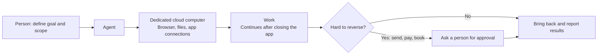

# How Do Chatbots and AI Agents Differ?

[한국어](agent-vs-chatbot.md)

## In One Sentence

A chatbot produces answers, while an agent can receive permissions and tools and take real actions. However, action methods, approval boundaries, and data access differ across services, so we check each individually rather than treating them as equivalent based on their names.

> “It doesn't just answer questions, it actually does the work.” — Meta, Muse announcement
>
> “A Bot = a single persistent, named agent or one AI teammate.” — xAI, Grok Bot documentation

## Services Being Compared

| | Chatbot (e.g., ordinary Grok or ChatGPT chat) | Agent comparison targets in this topic |
|---|---|---|
| What it does | Answers questions; generates text and code | Uses browsers and apps directly to complete work |
| When it works | Usually responds to requests | Some tasks continue between conversations; check by product |
| Where it works | Chat window | Varies by product: web, apps, cloud environments, etc. |
| Memory | May be limited to a conversation | History and memory scope depend on each product's settings and policies |
| Risk management | Answer accuracy | **Approval boundaries** — what it may do independently |

## Common Misunderstandings

- **Calling something an “agent” does not make it one.** Judge whether it actually operates browsers and apps and works while you are away.
- **A company's free chatbot and its agent are different products.** Grok (free) and Grok Bot (paid) are examples.
- **Agents can receive permission for external actions, making approval boundaries important.** A person must decide what to delegate and what to check — a principle also encountered while building CoMC and Catch.
