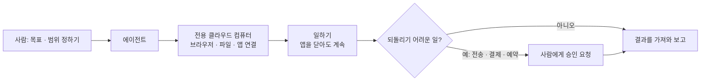

# 챗봇과 AI 에이전트는 무엇이 다른가

## 한 문장으로

챗봇은 답을 만들고, 에이전트는 권한과 도구를 받아 실제 행동까지 할 수 있다. 다만 서비스마다 행동 방식·승인 경계·데이터 접근 범위가 달라서 이름만으로 같다고 보지 않고 각각 확인한다.

> 「It doesn't just answer questions, it actually does the work.」 — Meta, Muse 발표
>
> 「A Bot = a single persistent, named agent or one AI teammate.」 — xAI, Grok Bot 문서

## 비교 대상 서비스

| | 챗봇 (예: 일반 Grok · ChatGPT 대화) | 이 Topic의 에이전트 비교 대상 |
|---|---|---|
| 하는 일 | 질문에 답, 글 · 코드 생성 | 브라우저 · 앱을 직접 써서 일을 끝까지 |
| 언제 일하나 | 보통 요청에 응답 | 일부 작업은 대화 사이에도 이어짐; 제품별 확인 필요 |
| 일하는 곳 | 대화창 | 웹·앱·클라우드 환경 등 제품별로 다름 |
| 기억 | 대화 단위일 수 있음 | 기록·기억 범위는 제품별 설정과 정책에 따름 |
| 위험 관리 | 답의 정확성 | **승인 경계** — 무엇을 혼자 해도 되나 |

## 오해하기 쉬운 점

- **이름에 「에이전트」가 붙었다고 에이전트는 아니다.** 실제로 브라우저 · 앱을 조작하고, 내가 없을 때도 일하는지로 판단한다
- **같은 회사의 무료 챗봇과 에이전트는 다른 제품이다.** Grok(무료)과 Grok Bot(유료)이 그 예다
- **에이전트는 외부 행동 권한을 받을 수 있어 승인 경계가 중요하다.** 무엇을 맡기고 무엇을 확인할지 사람이 정해야 한다 — CoMC · 캐치를 만들며 겪은 원칙과 연결된다
