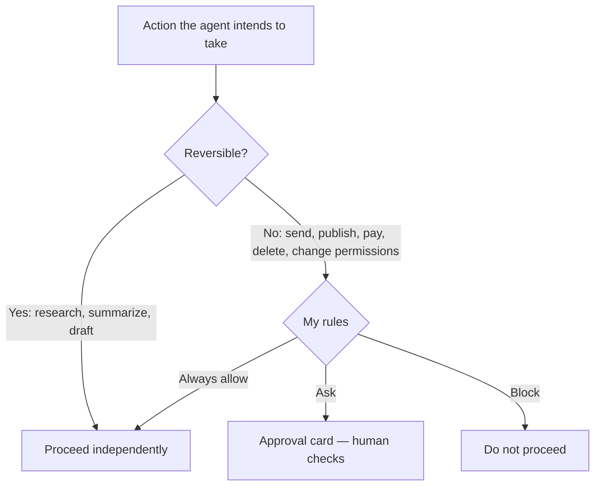

# What Can You Delegate to an Agent? — Approval Boundaries and Privacy

[한국어](approval-and-privacy.md)

## Why This Matters Most

If a chatbot gives a wrong answer, you can simply choose not to use it. An agent **sends email, makes payments, and deletes things.** That is why all three companies let users define what it may do independently and what requires asking first.

## Approval and Delegation Across the Four Services

| | Grok Bot | Muse | Dots | Instinct |
|---|---|---|---|---|
| Approval/delegation | Approval cards: allow once, always allow, deny | User approval before sensitive actions | Details of Custom Rules require official-original verification | Terms delegate authority to make agreements and transactions with third-party services on the user's behalf |
| Automatic review/responsibility | Auto-review rules; execution follows my settings | Audit trail provided | Official original needs verification | Terms place responsibility for action errors and irreversible outcomes on the user |
| Training use | Follows Cursor account settings | Users can opt out of training use | Official original needs verification | Opt-out available; safety-review materials excepted; existing trained models are not rolled back |
| Disconnect/delete | Needs verification | Users can change/disconnect connections | Needs verification | Already indexed material may remain after disconnection; separate deletion request needed |

> “Do not approve an action whose target or effect you cannot identify.” — xAI, Grok Bot documentation
>
> “Avoid broad rules such as 'allow everything in the browser.'” — xAI, Grok Bot documentation

## Privacy — Three Questions to Check

| Question | Grok Bot | Muse | Dots | Instinct |
|---|---|---|---|---|
| Is data used for model training? | Follows Cursor account settings | Users can opt out of training on interaction data | Official original needs verification | Opt-out in settings, with safety-review exceptions; applies prospectively |
| Managing connected materials | Needs verification | Users choose connections/disconnections | Official original needs verification | Deletion of already indexed material requires a separate request even after disconnecting external accounts |
| Processing/action scope | Cloud agent; execution on my PC depends on settings | Dedicated secure VM; actions depend on connected services | Official original needs verification | Accesses permitted connected apps/materials and acts on your behalf; may pass information to third parties |

## Rules for M3 Practice

- Check model-training use of interactions in **Data controls**. Do not copy the account's current settings into public records.
- Use public materials for the first task. If a separate connected-app exercise is needed, first review read/write/delete permissions per action; exclude email, schedules, and account-specific values from results.
- Allow/Ask selections can differ by action, so do not assume “important actions always prompt.” Directly check the scope of changes, deletion, and sending before execution.
- Mask email addresses, account names, notifications, and personal materials in screenshots (public repository).
- Do not connect accounts to Instinct while awaiting approval. Even after invitation, read current terms and privacy policy; do not connect accounts or conduct real transactions before checking delegation scope and data deletion methods.

> Instinct information was checked against the [official privacy policy](https://instinct.com/privacy-policy) and [official terms](https://instinct.com/terms) on 2026-10-09. In particular, the comparison reflects agency authority, exceptions to training opt-out, and separate deletion procedures after disconnection.

## Connections to What We Already Know

We used the same principle when building CoMC (AI co-host for livestreams) and Catch (counseling assistant AI): **AI proposes, and only what a person approves goes out.** The three companies' agents ultimately turn this structure into products.
