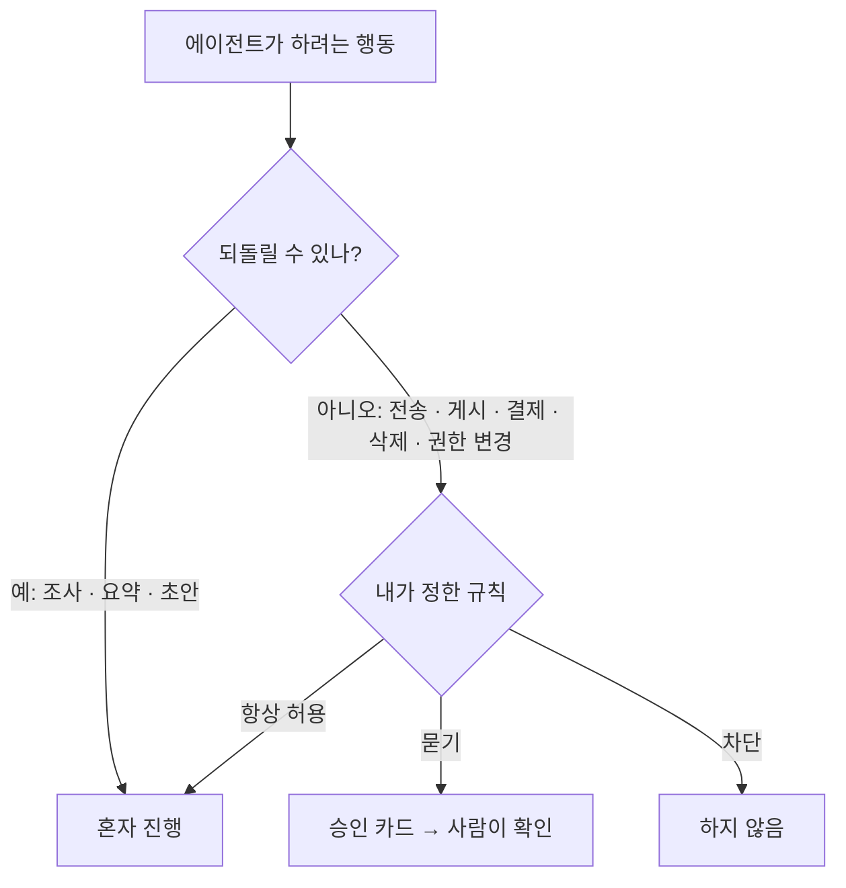

# 에이전트에게 무엇을 맡겨도 되나 — 승인 경계와 개인정보

## 왜 이것이 가장 중요한가

챗봇은 틀린 답을 줘도 내가 안 쓰면 그만이다. 에이전트는 **메일을 보내고, 결제하고, 지운다.** 그래서 세 회사 모두 「무엇을 혼자 해도 되고 무엇은 물어야 하는가」를 사용자가 정하게 해 두었다.

## 네 서비스의 승인·위임 방식

| | Grok Bot | Muse | Dots | Instinct |
|---|---|---|---|---|
| 승인·위임 | 승인 카드: 한 번 허용 · 항상 허용 · 거부 | 민감한 행동 전 사용자 승인 | Custom Rules 세부 동작은 공식 원문 확인 필요 | 약관상 사용자를 대리해 제3자 서비스와 약정·거래를 할 권한을 위임 |
| 자동 검토·책임 | Auto-review 규칙; 내 설정에 따라 실행 | 감사 기록 제공 | 공식 원문 확인 필요 | 약관은 행동 오류·되돌릴 수 없는 결과의 책임을 사용자에게 둠 |
| 학습 사용 | Cursor 계정 설정에 따름 | 사용자가 학습 사용 제외 선택 가능 | 공식 원문 확인 필요 | 거부 설정 가능; 안전 검토 자료는 예외, 기존 학습 모델은 되돌리지 않음 |
| 연결 해제·삭제 | 확인 필요 | 사용자가 연결 변경·해제 가능 | 확인 필요 | 연결 해제해도 이미 색인된 자료는 남을 수 있음; 별도 삭제 요청 필요 |

> 「Do not approve an action whose target or effect you cannot identify.」 — xAI, Grok Bot 문서
>
> 「Avoid broad rules such as 'allow everything in the browser.'」 — xAI, Grok Bot 문서

## 개인정보 — 확인할 세 가지

| 질문 | Grok Bot | Muse | Dots | Instinct |
|---|---|---|---|---|
| 데이터가 모델 학습에 쓰이나 | Cursor 계정 설정을 따름 | 사용자가 상호작용 데이터의 학습 사용을 거부할 수 있음 | 공식 원문 확인 필요 | 사용 설정에서 거부할 수 있으나 안전 검토 예외가 있고, 거부는 이후부터 적용 |
| 연결된 자료 관리 | 확인 필요 | 사용자가 연결·해제 선택 | 공식 원문 확인 필요 | 외부 계정 연결 해제 후에도 이미 색인된 자료 삭제는 별도 요청 필요 |
| 처리·행동 범위 | 클라우드 에이전트, 내 PC 실행은 설정에 따름 | 전용 보안 VM; 연결 서비스에 따라 행동 | 공식 원문 확인 필요 | 허용한 연결 앱·자료에 접근해 대신 행동; 제3자에 정보를 전달할 수 있음 |

## M3 실습에서 지킬 것

- **Data controls**에서 상호작용의 모델 학습 사용 설정을 확인한다. 계정별 현재 상태는 공개 기록에 옮기지 않는다.
- 첫 과제는 공개 자료로 한다. 연결 앱을 쓰는 별도 실습이 필요하면 먼저 읽기·쓰기·삭제 권한을 작업별로 검토하고, 결과 기록에는 메일·일정·계정별 설정값을 넣지 않는다.
- Allow/Ask 선택은 작업마다 다를 수 있으므로 「중요 작업은 항상 묻는다」고 가정하지 않는다. 변경·삭제·전송 범위를 실행 전에 직접 확인한다.
- 화면 캡처에서 이메일 · 계정명 · 알림 및 개인 자료를 가린다 (공개 레포)
- Instinct는 승인 대기 중인 계정에 연결하지 않는다. 초대 후에도 최신 약관·개인정보 정책을 읽고, 위임 범위와 데이터 삭제 방법을 확인하기 전에는 계정 연결·실제 거래를 하지 않는다.

> Instinct 정보는 [공식 개인정보 정책](https://instinct.com/privacy-policy) 및 [공식 약관](https://instinct.com/terms)을 2026-10-09 확인했다. 특히 약관상 대리 권한, 학습 거부의 예외, 연결 해제 뒤 별도 삭제 절차를 읽고 비교표에 반영했다.

## 이미 아는 것과의 연결

CoMC(라이브 방송 공동 진행 AI)와 캐치(상담 보조 AI)를 만들 때도 같은 원칙을 썼다 — **AI 가 제안하고 사람이 승인한 것만 밖으로 나간다.** 세 회사의 에이전트도 결국 이 구조를 제품으로 만든 것이다.
