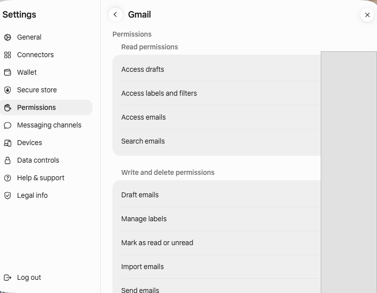
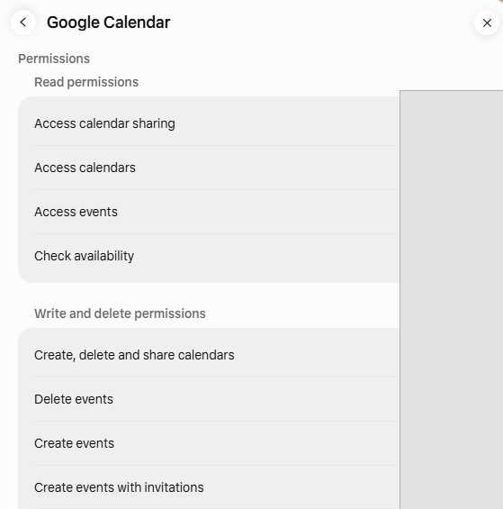
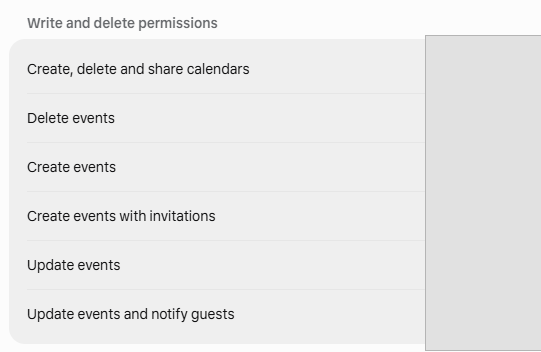
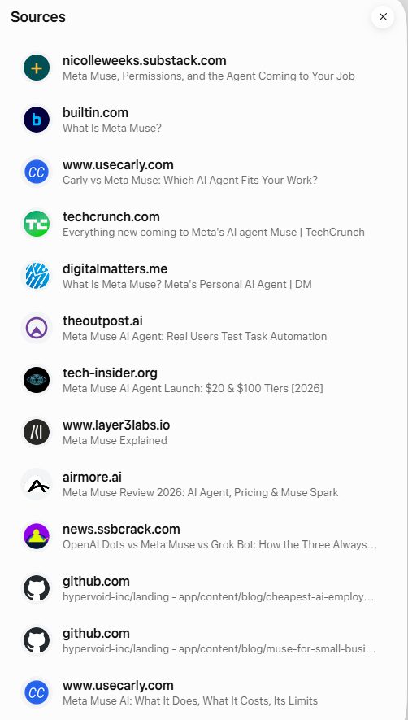

# Muse 첫 사용 및 공개 자료 검증 결과

[English](first-task-results.en.md)

## 범위

2026-10-11 Muse 웹 첫 화면에 도달한 뒤 읽기 중심의 첫 과제, 설정 화면, 공식 자료 조사를 확인했다. 연결 앱 권한 화면도 살펴봤지만, 실제 메일·일정·계정별 설정값과 화면 캡처는 이 공개 기록에 포함하지 않는다.

## 첫 과제: 읽기 중심 일정 요약

Muse에 일정 제목·참석자·설명·링크 없이 집계만 요약하고 아무것도 변경하지 말라고 요청했다. 첫 응답은 하루 전체와 현재 이후의 시간을 혼동해 지난 구간을 빈 시간으로 포함했다. 현재 시각 이후로 다시 계산해 달라고 하자 진행 중인 일정의 남은 시간과 이후 일정을 나눠 표시하고, 요청한 시애틀·한국 시간 병기 형식도 따랐다.

**평가**: 첫 답변만으로 시간 정확성을 가정하면 안 된다. 날짜 경계, 시간대, 이미 지난 구간을 지목해 재질문하면 계산이 개선될 수 있음을 확인했다. 이 기록에는 개인 일정의 값은 남기지 않는다.

## 설정 화면에서 확인한 개념

Data controls에는 상호작용의 모델 개선 사용과 데이터 관리 항목이 별도로 있었다. Permissions는 커넥터·웹 접근의 기본 동의 방식과 작업별 읽기·쓰기·삭제 권한을 나눠 보여 주었다. 따라서 “민감한 작업은 항상 승인받는다”는 일반 문구 대신 실제 작업별 권한 화면을 확인해야 한다.

아래 이미지는 Gmail·Google Calendar 권한 화면에서 작업 이름만 보이도록 정리했다. 계정별 Allow/Ask 선택값은 공개 기록에서 가렸다.

## 공개 자료 조사와 출처 검증

Muse의 첫 조사 답변은 Sources 패널을 제공했지만, 처음 보이는 항목은 주로 언론·요약 사이트 등 제3자 출처였다. 공식 자료를 주장별로 요청한 뒤 Meta 발표문과 Meta 도움말 URL을 제시했다.

### 확인한 주장

| 주장 | 공식 출처에서 확인한 내용 |
|---|---|
| Secure VM · Sentinel | Meta 발표문은 전용 클라우드 VM과 별도 Sentinel을 설명한다. Sentinel이 인터넷 접근을 승인하고 필요할 때 사용자 허가를 요청한다고 안내한다. |
| 백그라운드 작업 | 앱을 닫아도 장기 작업을 이어가며, 이메일 전송이나 구매처럼 승인이 필요한 경우 돌아와 요청한다고 설명한다. |
| 기억 기반 제안 | 한 번만 언급한 정보도 기억해 먼저 제안하거나 행동할 수 있고, 특정 기억을 잊도록 요청할 수 있다고 설명한다. |
| 무료·구독 범위 | 무료 사용량에 한도가 있고, 한도 도달 후 기다리거나 구독할 수 있다. Power는 월 $20·주 500M 토큰, Maximum은 월 $100·주 3B 토큰이며 구독은 매월 자동 갱신된다. |
| 무료 단계 한도 | 공식 구독 도움말은 무료 사용량 제한은 밝히지만 정확한 주간 토큰 수는 제공하지 않는다. 주 1억 토큰 수치는 공식 확인 자료로 취급하지 않는다. |

> “Muse is available for free with a usage limit.”

**출처 품질 평가**: 첫 Sources 패널의 제3자 자료는 탐색 단서로는 쓸 수 있지만, Meta의 정책·가격 주장을 뒷받침하는 공식 근거로 대체할 수 없다. 공식 URL과 제목을 명시해 다시 요청했을 때 근거가 개선됐다.

### Sources 패널 참고

첫 조회에서 표시된 출처 목록은 제3자 자료 위주였다. 아래 화면은 출처 패널이 개별 페이지 제목과 도메인을 노출하는 방식을 보여 준다. 공식 주장을 인용할 때에는 Meta 공식 페이지를 별도로 찾아 확인했다.

## 확인된 공식 출처

- [Introducing Muse: The World's First Personal AI Agent Built for Everyone](https://about.fb.com/news/2026/09/introducing-muse-personal-ai-agent/) — Meta 공식 발표문. 기능·보안·개인정보·무료 제공 설명. 2026-10-11 확인.
- [About Muse subscriptions](https://www.meta.com/help/subscriptions/1021145227643680/) — Meta Help Center. 사용량 한도, Power·Maximum 요금과 토큰, 자동 갱신. 혜택과 제공 여부는 지역·계정마다 다를 수 있다. 2026-10-11 확인.

## 다음 실습에 적용할 점

- 동일한 공개 자료 과제에서 주장·인용 URL·출처 도메인을 각각 확인한다.
- 시간 계산 과제는 시간대와 기준 시각을 명시하고 결과를 검산한다.
- 연결 앱 권한은 기본 설정 문구가 아니라 작업별 Allow/Ask 값을 확인한다.
- 공개 산출물에는 개인 계정의 상태나 실제 일정·메일 내용을 옮기지 않는다.
