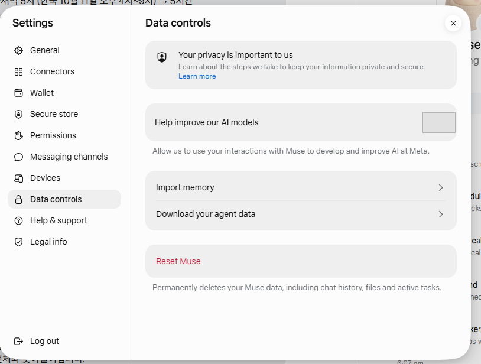
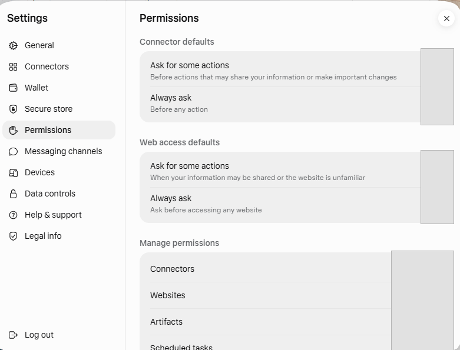
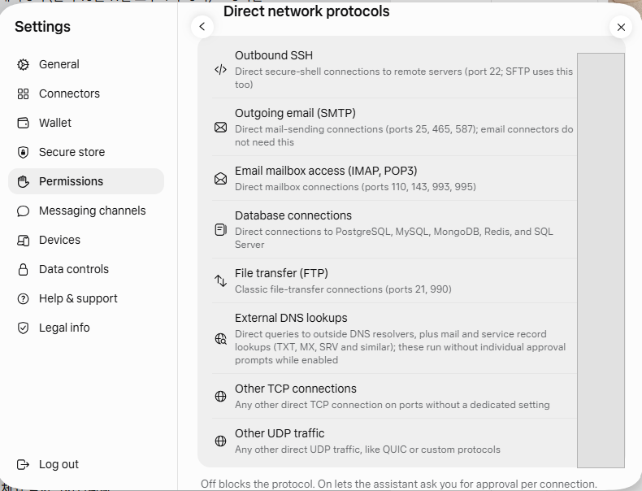

# First Use of Muse on the Web and Permission Checks

[한국어](setup-muse.md)

## Purpose and Scope

This guide describes accessing Muse in a Windows browser and locating the initial screen and settings. The user personally handles account actions such as signup, login, and connection approvals. The basic demonstration uses only public materials; actual email, schedules, and account-specific settings are excluded from this public material.

## Getting Started

1. Open [muse.ai](https://muse.ai) in a browser. If account creation or login appears, the user completes it personally.
2. On reaching the initial screen, check the name, web access, and basic usage display. Even if usage limits or an upgrade prompt appear, do not subscribe to a new paid plan for this topic.
3. Under **Settings — Data controls**, find model-improvement usage options. Meta says users can choose not to have interactions used for model training. Do not copy the account's selected settings into the public repository.
4. Under **Settings — Permissions**, check Connector defaults and Web access defaults. Do not interpret “Ask for some actions” as asking before every action.
5. If necessary, inspect per-connector permissions by reading, writing, deletion, and external notifications. The user decides whether to connect real accounts; define the necessary scope before granting write/delete access.
6. After running a public-material task, open the Sources panel in Muse's answer. Check whether each key claim links to material on the company's official domain.

## First Public-Material Task

```text
Find and summarize three Muse features and its free usage scope using Meta's official public materials. Attach an official source link to each fact, and mark anything not verified in official materials as unverified. Do not open Gmail or Google Calendar, and do not create, change, or delete calendar events. Do not send email either.
```

If the first answer cites third-party material, ask a follow-up requesting official materials. Do not judge source authority solely from the answer saying “I used only official materials”; inspect domains and page titles directly in the Sources panel.

## Screen References: Privacy Settings and Default Permissions

The following are edited versions of screens captured during practice. Account-specific selections, connection counts, and network protocol states are masked.







## Permission-Checking Principles

- App connections are unnecessary for the first public-material task.
- If you choose to connect an app, read both its consent screen and Muse's per-action permissions.
- Read and write permissions differ. Email/event creation, changes, deletion, invitations, and notifications may be separate items.
- Do not generalize defaults or approval behavior that you have not checked on the actual screen.
- Keep account names, email addresses, and personal data out of broadcasts and screen sharing.

## Verified Official Materials

- [Meta — Introducing Muse](https://about.fb.com/news/2026/09/introducing-muse-personal-ai-agent/): Secure VM, Sentinel, background work, memory-based suggestions, privacy controls.
- [Meta Help Center — About Muse subscriptions](https://www.meta.com/help/subscriptions/1021145227643680/): Free usage limits and subscription plans. Availability conditions may vary by region/account.
