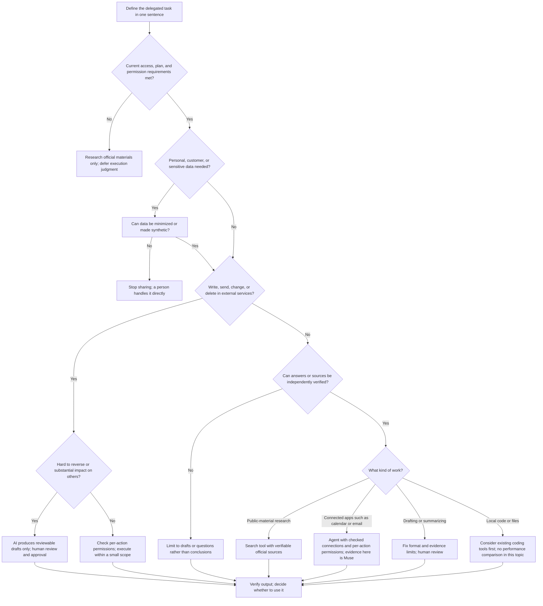

# Which Agent Should I Use, and When?

[한국어](which-agent-when.md)

## Decision Flowchart

## Initial Expectations and Practice Results

| Task/assumption | Prior expectation | Actual observation | Updated judgment | Evidence |
|---|---|---|---|---|
| Muse's read-focused schedule summary | Could calculate requested aggregates from a connected calendar | M3's first response mixed in elapsed time. It corrected the result after the reference time and scope were specified. In M4's separate fictional timetable, it correctly distinguished a five-minute conflict, 90-minute elapsed span, and 95-minute item total. | Specify scope/reference time and independently check calculations. Do not generalize synthetic-test accuracy to real connected-data performance. | [M3 results](../../03-Hands-On/guides/first-task-results.en.md#first-task-read-focused-schedule-summary), [M4 task A](../../04-Real-Task-Trial/guides/trial-results.en.md#task-a--fictional-event-timetable) |
| Muse's description draft in a fixed format | Could draft from provided notes and output format | Title, length, bullets, and hashtags were correct, but unsupported promotional wording remained. Some human editing was needed even after one revision request. | Assess format compliance and factual grounding separately; a person performs final editing before publication. | [M4 task B](../../04-Real-Task-Trial/guides/trial-results.en.md#task-b--fictional-broadcast-description) |
| All four services could be directly compared | Testing the four products on the same tasks would simplify selection | Only Muse actually ran both tasks. Dots, Grok Bot, and Instinct were not directly run in this topic because of access/cost conditions. | Defer direct performance comparison; label official-material evidence and access limitations for the rest. | [M2 practice decisions](../../02-Comparison-Table/guides/comparison-table.en.md#practice-decisions-for-this-topic), [M4 evaluation](../../04-Real-Task-Trial/guides/trial-results.en.md#results-table) |

> Muse identified a five-minute overlap between the short talk and tool demonstration at 09:35–09:40. It also distinguished the 90-minute elapsed time from first start to final end from the 95-minute sum of individual durations.
>
> — Observation recorded in the M4 results document. This answer is an observation for that input, not a measure of performance on all scheduling tasks. [Task A section in M4 results](../../04-Real-Task-Trial/guides/trial-results.en.md#task-a--fictional-event-timetable)

## Evidence Level by Service

| Service | Evidence in this topic | What can be said now |
|---|---|---|
| Muse | M3 settings/source checks; direct execution of two M4 synthetic tasks | M4's fictional timetable analysis was accurate; the formatted draft left unsupported wording requiring review. |
| Dots | Public-material research | Features/access conditions were compared, but direct usability/output quality was not judged. |
| Grok Bot | Public-material research | Public features/access conditions were organized, but no practice was performed in this topic. |
| Instinct | Official-material research; access conditions unconfirmed | Introduction/terms were organized; no actual access/execution results. |

The practice sample is limited to one service and two artificial tasks. This flowchart is a starting point; recheck current official materials, permissions, pricing, and regional availability immediately before a task.
