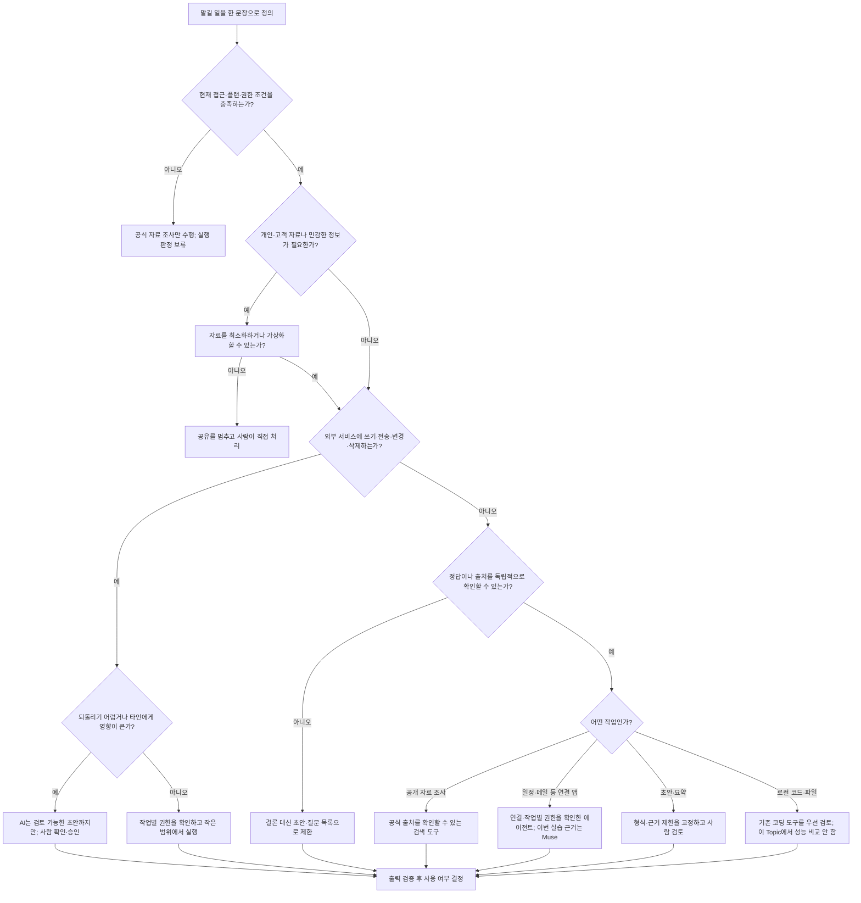

# 언제 어떤 에이전트를 쓸까

## 판단 흐름도

## 처음 예상과 실습 결과

| 과제·가정 | 사전 기대 | 실제 관찰 | 판단 업데이트 | 근거 |
|---|---|---|---|---|
| Muse의 읽기 중심 일정 요약 | 연결된 일정에서 요청한 집계 정보를 계산할 수 있을 것 | M3 첫 응답은 지난 시간 범위를 섞어 계산했다. 기준 시각과 범위를 명확히 지정한 뒤 정정했다. M4의 별도 가상 시간표에서는 5분 충돌, 90분 경과 범위, 95분 항목 합계를 맞게 구분했다. | 정확한 시간 계산은 범위·기준 시각을 명시하고 독립 검산한다. 가상 시험의 정확성을 실제 연결 데이터 성능으로 일반화하지 않는다. | [M3 결과](../../03-Hands-On/guides/first-task-results.md#첫-과제-읽기-중심-일정-요약), [M4 과제 A](../../04-Real-Task-Trial/guides/trial-results.md#과제-a--가상-행사-시간표) |
| Muse의 정해진 형식의 설명문 초안 | 주어진 메모와 출력 형식을 따라 초안을 만들 수 있을 것 | 제목·분량·글머리표·해시태그는 맞췄지만 근거에 없는 홍보 문구가 남았다. 한 번 수정을 요청한 뒤에도 일부를 사람이 손봐야 했다. | 형식 준수와 사실 근거를 별도 평가하고, 게시 전 사람이 최종 편집한다. | [M4 과제 B](../../04-Real-Task-Trial/guides/trial-results.md#과제-b--가상-방송-설명문) |
| 네 서비스 모두 직접 비교 가능 | 네 제품을 같은 과제로 시험하면 선택하기 쉬울 것 | Muse만 두 과제를 실제 실행했다. Dots·Grok Bot·Instinct는 접근·비용 조건 때문에 이번 Topic에서는 직접 실행하지 않았다. | 직접 성능 비교는 보류하고, 나머지는 공식 자료와 접근 한계를 표시한다. | [M2 실습 판정](../../02-Comparison-Table/guides/comparison-table.md#이-topic-의-실습-판정), [M4 평가](../../04-Real-Task-Trial/guides/trial-results.md#결과-기록표) |

> Muse는 짧은 강연과 도구 시연이 09:35–09:40에 5분 겹친다고 찾았다. 첫 시작부터 마지막 종료까지의 경과 시간 90분과 항목별 시간 합계 95분도 구분했다.
>
> — M4 결과 문서의 관찰 기록. 이 답은 해당 입력에서의 관찰이며, 모든 일정 작업의 성능을 뜻하지 않는다. [M4 결과의 과제 A 절](../../04-Real-Task-Trial/guides/trial-results.md#과제-a--가상-행사-시간표)

## 서비스별 근거 수준

| 서비스 | 이번 Topic의 근거 | 지금 말할 수 있는 것 |
|---|---|---|
| Muse | M3 설정·출처 확인, M4 가상 과제 2개 직접 실행 | M4 가상 시간표 분석은 정확했으며, 형식 초안은 근거 밖 문구가 남아 검토가 필요했다. |
| Dots | 공개 자료 조사 | 기능·접근 조건은 비교했지만, 직접 사용성·결과 품질은 판단하지 않았다. |
| Grok Bot | 공개 자료 조사 | 공개된 기능과 접근 조건을 정리했지만, 이 Topic에서는 실습하지 않았다. |
| Instinct | 공식 자료 조사, 접근 조건 미확정 | 소개·약관의 내용을 정리했으며 실제 접근·실행 결과는 없다. |

실습한 표본이 하나의 서비스와 두 가지 인위적 과제에 한정된다. 이 흐름도는 시작점이며, 현재 공식 자료·권한·가격·지역 제공 조건을 작업 직전에 다시 확인한다.
