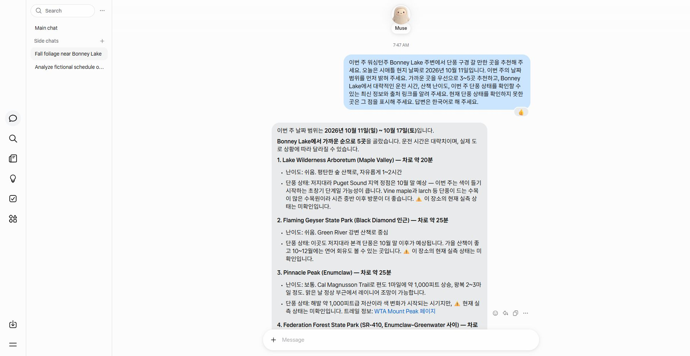

## 관찰한 흐름

사용자는 VS Code의 Codex에서 Muse에 Bonney Lake 주변 이번 주 단풍 장소를 물어보고 한국어로 답하게 해 달라고 요청했다. Codex는 열린 Chrome의 Muse 탭을 찾아 새 대화를 만들고 요청을 입력·전송했다. Muse가 한국어로 다섯 후보를 반환한 것을 화면에서 확인하고 스크린샷으로 남겼다.

사용자 → Codex → 브라우저의 Muse → 한국어 조사 답변 → Codex가 화면 확인·파일 기록이라는 흐름을 실제로 관찰했다. 별도 API 연동을 구현한 사례가 아니라 브라우저 UI를 조작한 사례이며, 사용자는 Muse 화면에 직접 입력하지 않았다. 실행 중 브라우저 연결이 끊겨 같은 대화를 새 탭에서 다시 열었고, 로딩 후 답변을 확인했다.

## 요청과 결과

요청에는 시애틀 현지 날짜 2026년 10월 11일, 가까운 장소 3~5개, 이동 시간·산책 난이도·최신 단풍 출처, 미확인 상태 표시, 한국어 답변을 넣었다. Muse는 이번 주를 10월 11~17일로 해석하고 장소 다섯 개와 설명을 답했다. 각 장소의 현장 단풍 상태는 미확인으로 표시했고 일부 정보만 직접 링크로 뒷받침했다.

결과는 한국어 질문·답변과 브라우저 업무 위임이 가능함을 보여 준다. 현재 단풍·날씨·폐쇄 정보의 정확성, 시니어 사용성, 시간 절약은 별도 검증하지 않았다. 메일·일정 변경이나 예약은 수행하지 않았다.

## 사용자 경험 원문과 영상 요청

> 이 경험도 아주 좋은 경험입니다. VS Code 의 Codex 에서 작업을 지시했더니 Codex 가 브라우저로 가서 Muse 에게 일을 시키는 장면이 인상적입니다.

출처: [[Journal/2026-10-11#Codex에서 Muse로 업무 위임 — 단풍 추천과 교육 활용 (구술 원문)|Journal 구술 원문]]. 사용자는 이 장면을 영상에 포함하고 Senior-AI-Enablement에서 활용할 수 있게 연결하며 단풍 답변을 저장해 달라고 요청했다. 영상에는 지시 입력 → Muse 브라우저 → 한국어 결과 → 파일 기록 순서로 보여 주고, 확인되지 않은 장소 정보는 확정된 여행 안내로 소개하지 않는다.

## 시니어 교육에서 활용할 방법

생활에 익숙한 “주변 단풍 장소를 한국어로 알려 주세요”를 진행자 시연 후보로 사용할 수 있다. 참가자는 설치·계정 설정 없이 진행자의 화면을 보고 원하는 결과를 말하는 역할부터 시작한다. 설치된 VS Code·Codex·Muse 계정은 진행자 환경의 전제이며, 이 사례 자체가 시니어의 설치 장벽을 해소했다고 주장하지 않는다.

로컬에 문서를 저장해 다음 작업에 사용할 수 있다는 점을 보여 주면서, 질문이 Codex와 Muse 서비스로 전달된다는 점도 설명한다. 화면에는 개인 메일·일정·계정 정보가 나오지 않게 준비하고, 조사가 틀릴 수 있어 출처 확인이 필요하다는 장면을 포함한다. 교육 적용안은 [Senior-AI-Enablement 5분 시연](../../Senior-AI-Enablement/02-First-Meeting-Kit/examples/five-minute-demo.md#추가-시연-후보-codex가-muse에-생활-질문-위임)에 연결한다.

## 관련 기록

단풍 후보와 미확인 항목은 [[Research/2026-10-11 Bonney Lake 단풍 나들이 후보 by Codex#후보 비교 — Muse가 제시한 값|단풍 나들이 기록]]에 보존했다. 이는 볼트 내부의 생활 참고 문서이며 공개 Topic 자료와 별도로 관리한다.
