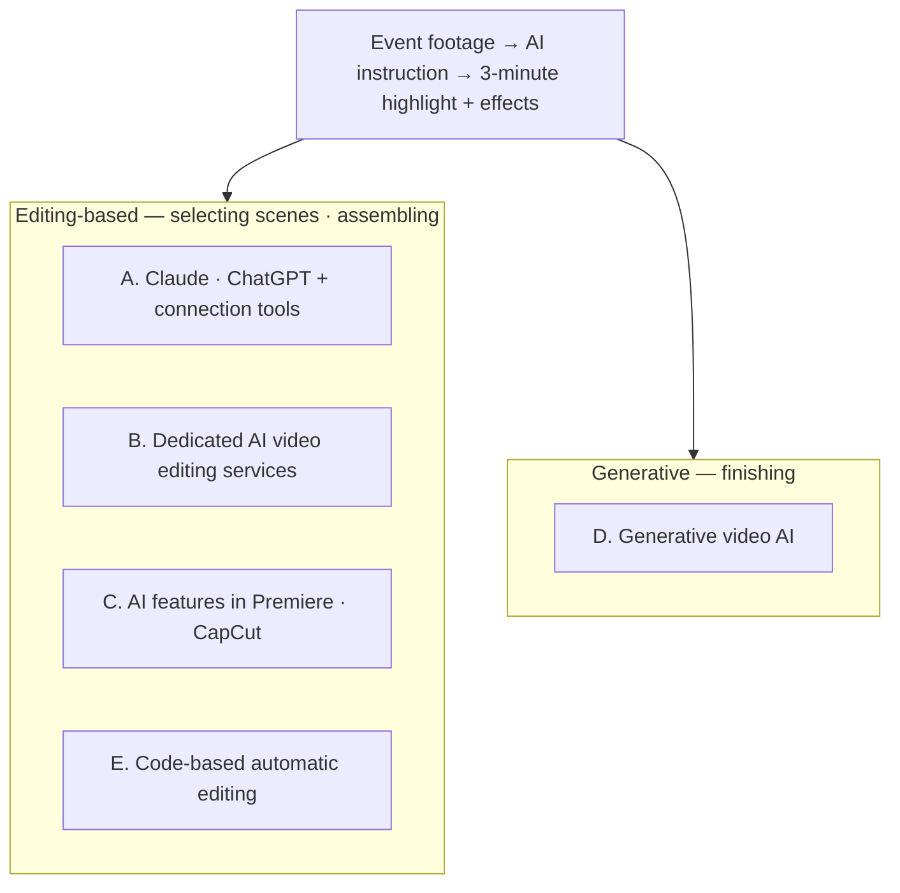

# Methods Map — 5 Categories and Research Candidates
[한국어](methods-map.md)

> This map divides the scope to research in M2. **The candidates were found in a first-round search (2026-10-17), and features · pricing · limits will be checked against official documentation in M2.** Most sources are vendor introduction pages, so they are not yet verified.

**Added after review**: The in-depth research covers 9 cards, and not every M1 candidate was researched. Follow [the status of all candidates and the reasons for holding some](../02-Methods-Research/review-followup.en.md).

**Update 2026-10-24**: The client's answers are left as unverified, and [M2 preliminary research](../02-Methods-Research/README.en.md) has started. Below is the initial candidate map from 10/17. For the latest findings on Premiere's own AI · Vidio.ai · OpusClip, follow the [M2 comparison table](../02-Methods-Research/comparison-table.en.md). In particular, the [public beta of Premiere's official AI Assistant](../02-Methods-Research/cards/premiere-native-ai.en.md) was added to the built-in AI card.

## A Distinction to Know First — Editing-Based and Generative

| Type | What it does | Where it is used in an event highlight |
|---|---|---|
| **Editing-based AI** | Finds, cuts, and joins scenes from **video already shot** | ① Selecting scenes · ② Assembling — **the main body** |
| **Generative AI** | Makes **new video** from text · images | The intro · background scenes within ③ Finishing |

The exact product and version the client meant by "Sidens" (시덴스) is unverified. **Correction 2026-10-24**: Seedance official documentation also includes reference video editing, so we do not conclude that "it is generative, so it cannot edit." We distinguish between picking and assembling real sections from long source footage, and generation · reference editing. → [M2 correction basis](../02-Methods-Research/cards/seedance.en.md)

## The Map

## Candidates by Category

### A. Claude · ChatGPT + Connection Tools (the approach the client mentioned)

| Candidate | What it is (first-round check) | Strong part | To check |
|---|---|---|---|
| **Premiere Pro MCP servers** (community open source, several) | Connection tools that let an AI like Claude **operate Premiere directly**. Some projects say they go from transcription → cut decisions → timeline assembly | ①② · right inside Premiere | **Not official Adobe** · installation difficulty (CEP panel) · stability · supported versions |
| **AutoEdit** (commercial) | Described as Claude-based, automatically cutting silences · filler words · bad takes | ② Trimming | Just launched (2026-06) · whether it fits event video (scenes without speech) |
| **Claude + Seedance skills · MCP** (community) | A path for generation · reference editing through calling tools | ③ Intro, etc. | The actual connected product · cost · support for editing long events need separate checking |
| **ChatGPT** | No official Seedance connection found — some services that bundle several AIs offer Seedance | ③ | What the client meant by "ChatGPT plugin" |

### B. Dedicated AI Video Editing Services (long video → highlight)

| Candidate | What it is (first-round check) | Premiere connection | To check |
|---|---|---|---|
| **VEA (Memories.ai)** | Indexes long video, **makes a highlight script from a prompt and assembles clips** — closest to the request | Final Cut Pro XML (needs checking for Premiere) | Pricing · Korean · how to open in Premiere |
| **Vidio.ai (VibeEdit)** | Exports chosen clips as **XML for Premiere**, with AI descriptions as markers | **Premiere XML** (Premiere 2022 or later) | Scene selection quality · pricing |
| **OpusClip (ClipAnything)** | Cuts scenes from natural-language instructions to make short clips | Premiere XML · SRT (**recheck the screen showing it is included in Pro**, see the M2 review record) | Whether it fits a landscape 3-minute highlight (mainly vertical short-form) |
| **Descript** | An initial research candidate, not researched in depth in M2 · on hold | Unverified | Research further if speech-focused editing is the key |
| **MomentCut** | Automatic highlight detection for weddings · events | Premiere XML | Small project — check reliability |

### C. AI Features in Existing Programs

| Candidate | What it is | To check |
|---|---|---|
| **Adobe Premiere Pro's own AI features** | Text-based editing · scene detection · media search, etc. (check by version) | What the client can use right away **at no extra cost** — check this first |
| **Premiere Assistant (Cutback)** | An extension that finds good sections with prompts **inside** Premiere | Finishes inside Premiere without an XML round trip · pricing |
| **CapCut AI features** | Research card added in M2, check existing tools first | Length · scope of paid AI · Korean · passing to Premiere must be verified in a real account |
| **After Effects** | Not researched in depth in M2, existing intro templates are a comparison target in M5 | Whether existing templates exist · can be used is unverified |

### D. Generative Video AI (intro · finishing)

| Candidate | What it is | To check |
|---|---|---|
| **Seedance** (ByteDance) | Text · image → video generation. Used through services like Higgsfield or an API | Cost of generating a few seconds of intro · terms for commercial use |
| **Runway · Kling · Veo, etc.** | Generative video | For comparison — intro quality · cost |

### E. Code-Based Automatic Editing (for comparison)

| Candidate | What it is | To check |
|---|---|---|
| **Claude Code + FFmpeg + transcription (Whisper)** | Transcribe, have AI pick scenes, and cut and join with FFmpeg | Whether the client can use it without coding — likely not a good fit |
| **Remotion** | A tool for making intros · captions · effects with code (the way Changsoo Park works) | Useful as an intro template reused for every event |

## Whether Changsoo Park Can Try It (confirmed with price tables in M2)

Since Changsoo Park cannot try paid services (including card-required trials — section 7 of [requirements-card.en.md](requirements-card.en.md)), each candidate card in M2 gets one of the three labels below.

| Label | Meaning | In the manual |
|---|---|---|
| ✅ Tried myself | Changsoo Park can use it with a free plan · free trial without a card | Step-by-step manual with captures · where I got stuck · free limits |
| 🤝 Tried together | Paid, but we can look at it together in person (or by screen sharing) when the client uses their own account — options B · C in section 8 of the requirements card | Based on official documentation + results seen together |
| 📄 Documentation only | Paid, and trying it together is also hard — includes work inside Premiere · After Effects | Based on official documentation · tutorial links, marked "not tried myself" |

Category E (Claude Code + FFmpeg · Remotion) uses tools Changsoo Park already uses, so it is ✅. The Premiere MCP servers in category A are free tools themselves, but they need Premiere, so they are 📄 or 🤝.

## Order in M2 (because the client is a Premiere user)

1. **C — Premiere's own AI features**: start with what can be used at no extra cost
2. **B — Highlight services that support Premiere XML** (Vidio.ai · OpusClip · VEA)
3. **A — Premiere MCP · Premiere Assistant**: approaches where AI operates inside Premiere
4. **D — Intro generation** (Seedance, etc.)
5. **E — Code-based** (for comparison)

## First-Round Search Sources (2026-10-17, mostly vendor · community pages)

- [premiere-pro-mcp (GitHub)](https://github.com/leancoderkavy/premiere-pro-mcp) · [Adobe Premiere Pro MCP (Glama)](https://glama.ai/mcp/servers/@hetpatel-11/Adobe_Premiere_Pro_MCP/blob/b9fa9862ecb7be8d717cd63c4b32be594e13bd6c/README.md) · [Adobe Premiere Pro MCP (antipaster)](https://github.com/antipaster/Adobe-Premiere-Pro-MCP) · [AutoEdit (hunted.space)](https://hunted.space/dashboard/autoedit) · [How to use Claude AI in Premiere Pro](https://www.premierecopilot.com/ja/blog/how-to-use-claude-ai-in-premiere-pro)
- [Seedance video skill (Claude)](https://claudemarketplaces.com/skills/freestylefly/canghe-skills/seedance-video) · [Seedance MCP server](https://mcpmarket.com/server/seedance-1) · [Seedance 2.0 prompt tutorial (Claude + Higgsfield)](https://lapis-forge-e7a6.here.now/2026-04-11-seedance-2-prompting-tutorial.md) · [What is Seedance 2.5 (CometAPI)](https://www.cometapi.com/what-is-seedance-2-5/)
- [VEA — Memories.ai](https://api-tools.memories.ai/visual-agents/video-editing-agent) · [Vidio.ai — Export to Premiere Pro (XML)](https://www.vidio.ai/en-ca/support/export-to-premiere-pro-xml) · [OpusClip — Export to XML](https://opus.pro/export-to-xml) · [Cutback — Premiere Assistant](https://cutback.video/blog/how-to-instantly-create-viral-shorts-from-long-videos-using-ai-(inside-premiere-pro)) · [MomentCut](https://contra.com/p/MZANRvO7-moment-cut-ai-video-highlight-tool)
