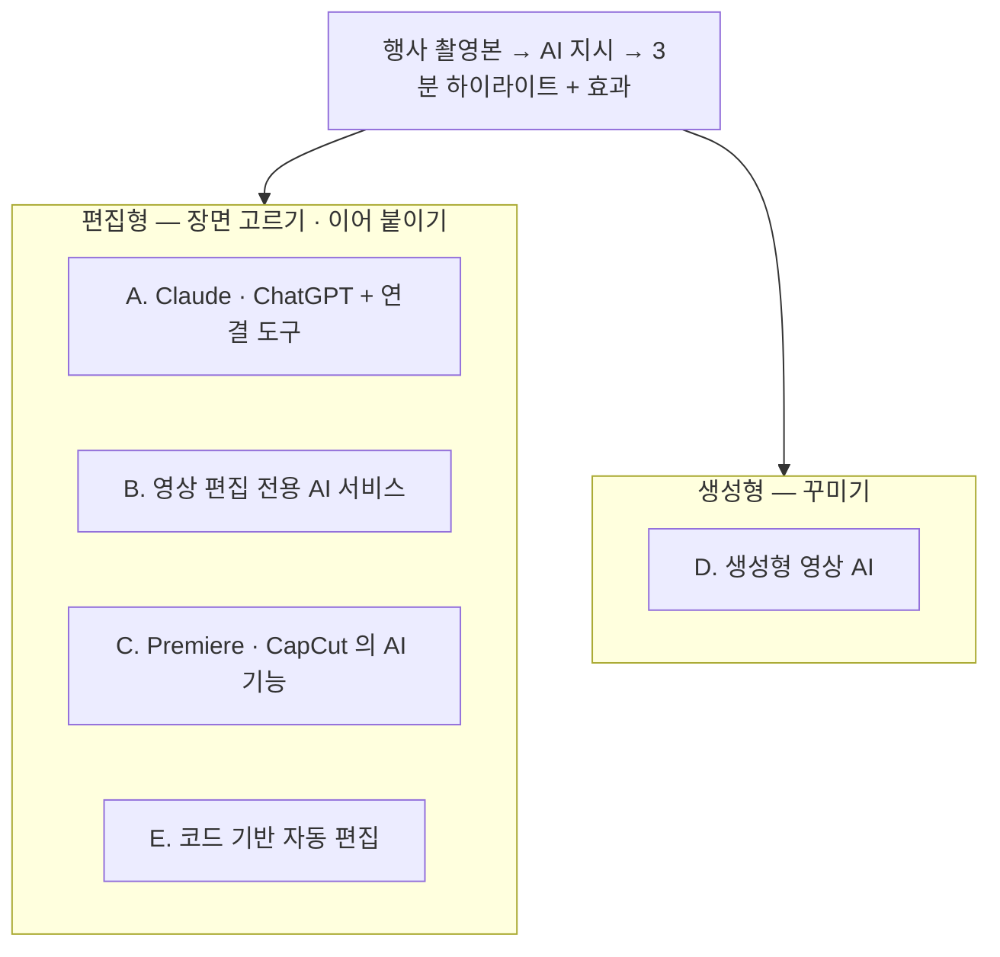

# 방법 지도 — 5개 범주와 조사 후보

> M2 에서 조사할 범위를 나눈 지도다. **후보는 1차 검색(2026-10-17)으로 찾은 것이고, 기능 · 요금 · 한계는 M2 에서 공식 자료로 확인한다.** 대부분 업체 소개 페이지가 출처라 아직 검증되지 않았다.

**리뷰 후 보완**: 심층 조사는 9개 카드이며 M1의 모든 후보를 조사한 것은 아니다. [전체 후보 상태와 보류 이유](../02-Methods-Research/review-followup.md#m1-후보-전체-대조)를 따른다.

**2026-10-24 갱신**: 의뢰인 답변은 미확인으로 두고 [M2 사전 조사](../02-Methods-Research/README.md)를 시작했다. 아래는 10/17의 초기 후보 지도이며, Premiere 자체 AI·Vidio.ai·OpusClip의 최신 확인 내용은 [M2 비교표](../02-Methods-Research/comparison-table.md)를 따른다. 특히 [Premiere 공식 AI Assistant 공개 베타](../02-Methods-Research/cards/premiere-native-ai.md#공식-ai-assistant-공개-베타)를 자체 AI 카드에 추가했다.

## 먼저 알아 둘 구분 — 편집형과 생성형

| 구분 | 무엇을 하나 | 행사 하이라이트에서 쓰는 곳 |
|---|---|---|
| **편집형 AI** | **이미 찍은 영상**에서 장면을 찾아 자르고 이어 붙인다 | ① 장면 고르기 · ② 이어 붙이기 — **몸통** |
| **생성형 AI** | 글 · 이미지로 **새 영상**을 만든다 | ③ 꾸미기 중 인트로 · 배경 장면 |

의뢰인이 말한 「시덴스」의 정확한 제품·버전은 미확인이다. **2026-10-24 정정**: Seedance 공식 자료에는 참조 영상 편집도 있으므로 「생성형이라 편집은 못 한다」고 단정하지 않는다. 긴 원본에서 실제 구간을 골라 조립하는 일과 생성·참조 편집을 구분한다. → [M2 정정 근거](../02-Methods-Research/cards/seedance.md#기능과-기존-설명-정정)

## 지도

## 범주별 후보

### A. Claude · ChatGPT + 연결 도구 (의뢰인이 언급한 방식)

| 후보 | 무엇 (1차 확인) | 강한 부분 | 확인할 것 |
|---|---|---|---|
| **Premiere Pro MCP 서버** (커뮤니티 오픈소스, 여러 개) | Claude 같은 AI 가 **Premiere 를 직접 조작**하게 하는 연결 도구. 전사 → 컷 결정 → 타임라인 조립까지 한다는 프로젝트도 있다 | ①② · Premiere 안에서 바로 | **Adobe 공식이 아님** · 설치 난이도(CEP 패널) · 안정성 · 지원 버전 |
| **AutoEdit** (상용) | Claude 기반으로 침묵 · 군더더기 말 · 잘못된 테이크를 자동으로 잘라 준다고 소개 | ② 다듬기 | 출시 직후(2026-06) · 행사 영상(말 없는 장면)에 맞는지 |
| **Claude + Seedance 스킬 · MCP** (커뮤니티) | 호출 도구를 통한 생성·참조 편집 경로 | ③ 인트로 등 | 실제 연결 제품·비용·긴 행사 편집 지원은 별도 확인 |
| **ChatGPT** | 공식 Seedance 연결은 찾지 못함 — 여러 AI 를 묶은 서비스에서 Seedance 를 쓰는 경우는 있음 | ③ | 의뢰인이 말한 「ChatGPT 플러그인」이 무엇인지 |

### B. 영상 편집 전용 AI 서비스 (긴 영상 → 하이라이트)

| 후보 | 무엇 (1차 확인) | Premiere 연계 | 확인할 것 |
|---|---|---|---|
| **VEA (Memories.ai)** | 긴 영상을 색인해 **프롬프트로 하이라이트 대본을 만들고 클립을 조립** — 요구와 가장 가까움 | Final Cut Pro XML (Premiere 용은 확인 필요) | 요금 · 한국어 · Premiere 로 여는 방법 |
| **Vidio.ai (VibeEdit)** | 고른 클립을 **Premiere 용 XML** 로 내보냄, AI 설명을 마커로 | **Premiere XML** (Premiere 2022 이상) | 장면 고르기 품질 · 요금 |
| **OpusClip (ClipAnything)** | 자연어 지시로 장면을 잘라 짧은 클립 생성 | Premiere XML · SRT (**Pro 포함 화면 재확인**, M2 리뷰 기록 참조) | 가로 3분 하이라이트에 맞는지(주로 세로 숏폼) |
| **Descript** | 초기 조사 후보, M2 심층 미조사·보류 | 미확인 | 발언 중심 편집이 핵심이면 추가 조사 |
| **MomentCut** | 웨딩 · 행사용 하이라이트 자동 감지 | Premiere XML | 작은 프로젝트 — 신뢰성 확인 |

### C. 기존 프로그램의 AI 기능

| 후보 | 무엇 | 확인할 것 |
|---|---|---|
| **Adobe Premiere Pro 자체 AI 기능** | 텍스트 기반 편집 · 장면 감지 · 미디어 검색 등 (버전별 확인) | 의뢰인이 **추가 비용 없이** 바로 쓸 수 있는 것 — 가장 먼저 확인 |
| **Premiere Assistant (Cutback)** | Premiere **안에서** 프롬프트로 좋은 구간을 찾는 확장 | XML 왕복 없이 Premiere 안에서 끝남 · 요금 |
| **CapCut AI 기능** | M2 조사 카드 추가, 기존 도구 우선 확인 | 길이·유료 AI 범위·한국어·Premiere 전달은 실제 계정에서 검증 |
| **After Effects** | M2 심층 미조사, 기존 인트로 틀은 M5 비교 대상 | 기존 템플릿 보유·사용 가능 여부 미확인 |

### D. 생성형 영상 AI (인트로 · 꾸미기)

| 후보 | 무엇 | 확인할 것 |
|---|---|---|
| **Seedance** (ByteDance) | 텍스트 · 이미지 → 영상 생성. Higgsfield 같은 서비스나 API 로 사용 | 인트로 몇 초 생성 비용 · 상업 이용 조건 |
| **Runway · Kling · Veo 등** | 생성형 영상 | 비교용 — 인트로 품질 · 비용 |

### E. 코드 기반 자동 편집 (비교용)

| 후보 | 무엇 | 확인할 것 |
|---|---|---|
| **Claude Code + FFmpeg + 전사(Whisper)** | 전사해서 AI 가 장면을 고르고 FFmpeg 로 자르고 붙이기 | 의뢰인이 코딩 없이 쓸 수 있나 — 맞지 않을 가능성이 큼 |
| **Remotion** | 코드로 인트로 · 자막 · 효과를 만드는 도구 (박창수가 쓰는 방식) | 행사마다 다시 쓰는 인트로 틀로는 유용 |

## 박창수 체험 가능 여부 (M2 에서 요금표로 확정)

유료 서비스는 박창수가 체험할 수 없으므로(카드 등록 체험판 포함 — [requirements-card.md](requirements-card.md) 7절), M2 의 후보 카드마다 아래 셋 중 하나를 붙인다.

| 표시 | 뜻 | 매뉴얼에서 |
|---|---|---|
| ✅ 직접 체험 | 무료 플랜 · 카드 없는 무료 체험으로 박창수가 써 볼 수 있다 | 캡처 · 막힌 곳 · 무료 한계가 들어간 단계별 매뉴얼 |
| 🤝 함께 체험 | 유료이지만 의뢰인이 자기 계정으로 쓸 때 만나서(또는 화면 공유로) 함께 볼 수 있다 — 요구사항 카드 8절 옵션 B · C | 공식 자료 기반 + 함께 본 결과 |
| 📄 자료로만 | 유료이고 함께 체험도 어렵다 — Premiere · After Effects 안에서의 작업 포함 | 공식 문서 · 튜토리얼 링크 기반, 「직접 체험 안 함」 표시 |

E 범주(Claude Code + FFmpeg · Remotion)는 박창수가 이미 쓰는 도구라 ✅ 이다. A 범주 Premiere MCP 서버는 도구 자체는 무료지만 Premiere 가 필요하므로 📄 또는 🤝 가 된다.

## M2 에서의 순서 (의뢰인이 Premiere 사용자이므로)

1. **C — Premiere 자체 AI 기능**: 추가 비용 없이 쓸 수 있는 것부터
2. **B — 하이라이트 서비스 중 Premiere XML 이 되는 것** (Vidio.ai · OpusClip · VEA)
3. **A — Premiere MCP · Premiere Assistant**: Premiere 안에서 AI 가 조작하는 방식
4. **D — 인트로 생성** (Seedance 등)
5. **E — 코드 기반** (비교용)

## 1차 검색 출처 (2026-10-17, 대부분 업체 · 커뮤니티 페이지)

- [premiere-pro-mcp (GitHub)](https://github.com/leancoderkavy/premiere-pro-mcp) · [Adobe Premiere Pro MCP (Glama)](https://glama.ai/mcp/servers/@hetpatel-11/Adobe_Premiere_Pro_MCP/blob/b9fa9862ecb7be8d717cd63c4b32be594e13bd6c/README.md) · [Adobe Premiere Pro MCP (antipaster)](https://github.com/antipaster/Adobe-Premiere-Pro-MCP) · [AutoEdit (hunted.space)](https://hunted.space/dashboard/autoedit) · [How to use Claude AI in Premiere Pro](https://www.premierecopilot.com/ja/blog/how-to-use-claude-ai-in-premiere-pro)
- [Seedance video skill (Claude)](https://claudemarketplaces.com/skills/freestylefly/canghe-skills/seedance-video) · [Seedance MCP server](https://mcpmarket.com/server/seedance-1) · [Seedance 2.0 프롬프트 튜토리얼 (Claude + Higgsfield)](https://lapis-forge-e7a6.here.now/2026-04-11-seedance-2-prompting-tutorial.md) · [What is Seedance 2.5 (CometAPI)](https://www.cometapi.com/what-is-seedance-2-5/)
- [VEA — Memories.ai](https://api-tools.memories.ai/visual-agents/video-editing-agent) · [Vidio.ai — Export to Premiere Pro (XML)](https://www.vidio.ai/en-ca/support/export-to-premiere-pro-xml) · [OpusClip — Export to XML](https://opus.pro/export-to-xml) · [Cutback — Premiere Assistant](https://cutback.video/blog/how-to-instantly-create-viral-shorts-from-long-videos-using-ai-(inside-premiere-pro)) · [MomentCut](https://contra.com/p/MZANRvO7-moment-cut-ai-video-highlight-tool)
