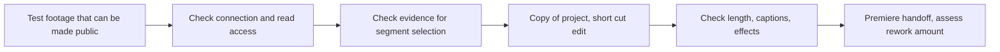

## Summary
[한국어](claude-chatgpt-plugins.md)

**Official documentation and project author material checked on: 2026-10-24. No direct connection, installation or editing practice was done.** The flow "tell the AI and the video gets edited" needs an AI client, an actual editing tool, and an execution path that connects the two. The names plugin, skill or MCP alone do not mean that video understanding, Premiere control and commercial export are all provided.

## Assessment by connection method

| Method | Possibility confirmed from documents | Separate conditions / unverified |
|---|---|---|
| Claude Code + Premiere MCP | Combine Claude's MCP feature with a community Premiere bridge | Installing Premiere, panel and server; supported API; actual Korean task results |
| ChatGPT web + MCP plugin | Official documentation describes connecting read and write tools from a user's MCP server | Server URL or Secure MCP Tunnel, authentication and workspace policy, compatibility with the Premiere bridge |
| Local Codex-type tool + MCP | Official documentation describes setting up local STDIO and Streamable HTTP servers | What the connected tool actually supports must be checked separately |
| AI + a tool that calls Seedance | A path can be designed that wraps the generation / reference editing API as a tool | Whether a specific ready-made connection product or account is offered is unverified. Not assumed to be a highlight feature for hours of footage |
| Coding agent + FFmpeg · Remotion | Write cut lists, code and templates, and run them with video generation / editing tools | Needs a run environment, evidence for segment selection, license, and review of the finished video |

Evidence for Claude: [Anthropic official MCP documentation](https://code.claude.com/docs/en/mcp). The scope of the Premiere bridge follows the [author's repository](https://github.com/leancoderkavy/premiere-pro-mcp) and the [research card](cards/premiere-mcp.en.md#features-and-conditions). Supporting MCP does not mean every feature of a specific Premiere tool has been verified.

Evidence for OpenAI: [official custom MCP connection documentation](https://developers.openai.com/api/docs/guides/custom-mcp-server) · [MCP documentation in ChatGPT Learn](https://learn.chatgpt.com/docs/extend/mcp). The web and local environments connect differently, so I do not assume a local settings file alone also connects on the web. Guidance that a server or tunnel can be used is kept separate from an actual successful Premiere bridge connection.

The specific features and constraints of Seedance, FFmpeg and Remotion are based on the [Seedance features section](cards/seedance.en.md#features-and-correction-of-the-earlier-description), the [FFmpeg roles section](cards/ffmpeg-transcript.en.md#roles-and-limits) and the [Remotion features section](cards/remotion.en.md#features-language-limits). Remotion's [official getting started guide](https://www.remotion.dev/docs) also introduces a ChatGPT desktop plugin path, but actual installation, access and running were not checked in this Topic.

## What works and what has no evidence yet

**What is documented as working**: tool connection, supported timeline operations, code editing of specified segments, and generation / reference editing. **What is not yet verified**: the ability to pick good scenes accurately from the client's source footage, Korean revision instructions, building one finished 3-minute piece, and a Premiere handoff that keeps effects. I do not stretch "can connect" into "fully automatic up to final delivery."

I did not find in official documentation a single "ChatGPT + Seedance" connection product that meets all the needs of this Topic. This is not a conclusion that no such product exists. It is the scope of the evidence gathered this time.

## Verification order

Even after the connection is confirmed, each step has to be recorded separately to know where time was saved. Practice using the client's footage and account will be decided once the conditions are confirmed. This research document is not an instruction to install, log in or upload footage.
