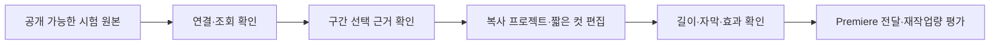

## 요약

**공식 문서·프로젝트 작성자 자료 확인일: 2026-10-24. 직접 연결·설치·편집 실습은 하지 않았다.** 「AI에게 말하면 영상이 편집된다」는 흐름에는 AI 클라이언트, 실제 편집 도구, 둘을 연결하는 실행 경로가 필요하다. 플러그인·스킬·MCP라는 이름만으로 영상 이해·Premiere 조작·상업용 내보내기까지 모두 제공되는 것은 아니다.

## 연결 방식별 판단

| 방식 | 자료로 확인한 가능성 | 별도 조건·미확인 |
|---|---|---|
| Claude Code + Premiere MCP | Claude의 MCP 기능과 커뮤니티 Premiere 브리지를 조합 | Premiere·패널·서버 설치, 지원 API, 실제 한국어 작업 결과 |
| ChatGPT 웹 + MCP 플러그인 | 공식 문서는 사용자 MCP 서버의 읽기·쓰기 도구 연결을 안내 | 서버 URL 또는 Secure MCP Tunnel, 인증·워크스페이스 정책, Premiere 브리지 호환성 |
| 로컬 Codex 계열 + MCP | 공식 문서는 로컬 STDIO·Streamable HTTP 서버 설정을 안내 | 연결된 도구가 실제로 무엇을 지원하는지 별도 확인 |
| AI + Seedance 호출 도구 | 생성·참조 편집 API를 도구로 감싸는 경로를 설계할 수 있음 | 특정 기성 연결 제품·계정 제공 여부는 미확인. 수시간 촬영본 하이라이트 기능으로 가정하지 않음 |
| 코딩 에이전트 + FFmpeg·Remotion | 컷 목록·코드·템플릿을 작성해 영상 생성·편집 도구로 실행 | 실행 환경·구간 선택 근거·라이선스·완성 영상 검수 필요 |

Claude 근거: [Anthropic 공식 MCP 문서](https://code.claude.com/docs/en/mcp). Premiere 브리지의 범위는 [작성자 저장소](https://github.com/leancoderkavy/premiere-pro-mcp)와 [조사 카드](cards/premiere-mcp.md#기능조건)에 따른다. MCP를 지원한다는 사실은 특정 Premiere 도구의 모든 기능이 검증되었다는 뜻이 아니다.

OpenAI 근거: [공식 custom MCP 연결 문서](https://developers.openai.com/api/docs/guides/custom-mcp-server)·[ChatGPT Learn의 MCP 문서](https://learn.chatgpt.com/docs/extend/mcp). 웹과 로컬 실행 환경은 연결 방식이 다르므로 로컬 설정 파일만으로 웹에서도 연결된다고 가정하지 않는다. 서버·터널을 쓸 수 있다는 안내와 실제 Premiere 브리지 연결 성공은 구분한다.

Seedance·FFmpeg·Remotion의 구체적 기능과 제약은 각각 [Seedance 기능 절](cards/seedance.md#기능과-기존-설명-정정), [FFmpeg 역할 절](cards/ffmpeg-transcript.md#역할과-한계), [Remotion 기능 절](cards/remotion.md#기능언어한도)에 근거한다. Remotion은 [공식 시작 안내](https://www.remotion.dev/docs)에서 ChatGPT 데스크톱 플러그인 경로도 소개하지만, 이 Topic에서 실제 설치·접근·실행을 확인하지 않았다.

## 되는 것과 아직 증거가 없는 것

**되는 것으로 문서화된 것**은 도구 연결, 지원되는 타임라인 조작, 지정 구간의 코드 편집, 생성·참조 편집이다. **아직 검증하지 않은 것**은 의뢰인 원본에서 좋은 장면을 정확히 고르는 능력, 한국어 수정 지시, 하나의 3분 완성본 구성, 효과가 유지되는 Premiere 전달이다. 「연결 가능」을 「최종 납품까지 자동 완성」으로 확대하지 않는다.

공식 문서에서 이 Topic의 요구 전체를 충족하는 단일 「ChatGPT + Seedance」 연결 제품을 확인하지 못했다. 이는 그런 제품이 존재하지 않는다는 결론이 아니라, 이번에 확보한 근거의 범위다.

## 검증 순서

연결을 확인한 뒤에도 각 단계를 따로 기록해야 어느 부분에서 시간을 줄였는지 알 수 있다. 의뢰인 영상과 계정을 쓰는 실습은 조건이 확인될 때 정하며, 이번 조사 문서는 설치·로그인·영상 업로드를 수행하라는 지시가 아니다.
