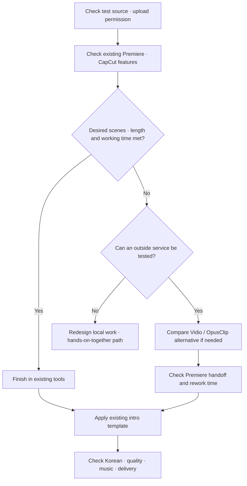

## Decision Criteria and Assumptions
[한국어](recommendation.md)

This review is based on the M1 record that the client uses Premiere · CapCut · After Effects. **Current active subscriptions · supported versions · PC · budget · delivery aspect ratio · consent for outside upload are unverified.** Below is a tentative test order that considers documentation evidence and the cost of switching ways of working. It is not a ranking of actual editing performance. [Requirements card](../01-Requirements-Map/requirements-card.en.md)

## Tentative Judgment Reflecting the Actual M4 Test — 2026-10-25

On one 5-minute English talk sample, the user rated the key content picked by the local summary and by Vidio as similar, and slightly preferred the local summary because it ended cleanly. Vidio's automatic revision did not meet the length · structure requirements, but after manual correction in the Transcript, the user's rating was good. So Vidio stays as a candidate to evaluate together with an automatic draft and manual checking · correction. We do not change it into a recommendation that guarantees automatic completion · deliverable output. → [M4 judgment for practical choice](../04-HandsOn-Highlight/results-comparison.en.md)

For Changsoo Park's follow-up intro · effects demo, the local v1, which passed file verification and the user's comparison, is used as the reference video. This is not evidence that the local method is the easiest for a client who does not work with code, and checking the existing Premiere · CapCut path first remains. The cause of the v3 download problem is not confirmed as a free-plan block, and paid XML · Premiere import · long source footage · Korean audio remain unverified. → [Scope of application and test limits](../04-HandsOn-Highlight/results-comparison.en.md)

## Recommendation 1 — First Check What Can Be Reduced in the Existing Premiere and CapCut

Use speech · scene search in Premiere and compare CapCut's automatic highlights · captions. The judgment is that since these are already familiar tools, we can first avoid the burden of learning a new account · editor. However, existing use does not guarantee access to free AI features, and Premiere's official features must also be distinguished from the trial version of the official Assistant. [Premiere card](../02-Methods-Research/cards/premiere-native-ai.en.md) · [CapCut card](../02-Methods-Research/cards/capcut-ai.en.md)

This path can start while checking how much the editable state needs to be kept. Bringing a single output video made in CapCut into Premiere is different from having cuts · captions · effects come over as separate elements. Decide whether to keep this path after actually comparing whether a landscape 3-minute event structure is possible and how much touch-up is needed.

**Conditions that change it**: If the feature is missing in that version or needs extra paid purchase, review the priority again. If it cannot find awards · performance sections without speech, or most of it must be re-edited, compare with outside candidates.

## Recommendation 2 — Test Scene Selection with Vidio and Finish in Premiere

If outside upload is allowed and the free features are accessible, look at the selection · revision results with source footage of 10 minutes or less. It is a comparison candidate because it supports instructions and a target length and has a path to pass cut information to Premiere. We checked the description of these features, but we do not yet know the actual quality of picking good scenes. [Vidio card](../02-Methods-Research/cards/vidio-vibeedit.en.md)

Cost is calculated from the source length and the credits needed. When passing over by XML, captions · titles · transitions, etc. must be made again, so "time to re-finish" must be subtracted from "time saved on scene selection." We do not recommend paid adoption before checking the real-world cost for long source footage and the total working time. [Recheck record](../02-Methods-Research/review-followup.en.md) · [Handoff limits](../02-Methods-Research/cards/vidio-vibeedit.en.md)

**Conditions that change it**: Put this path on hold if outside upload is not allowed, Korean selection fails, even a 10-minute test requires payment, or the rework is large. If export is blocked in the free preview, record quality observations and paid handoff verification separately.

## Alternative — Compare with OpusClip

If Vidio's access · results do not fit, or making short clips matters more, consider OpusClip as an alternative. We rechecked on screen that export is included in Pro in the public price table, but whether the same feature is provided in the free trial must be checked in a real account. Evaluate separately the amount of work to combine several clips into one event video and the Korean results. [OpusClip card](../02-Methods-Research/cards/opusclip-clipanything.en.md) · [Plan screen evidence](../02-Methods-Research/review-followup.en.md)

MCP · VEA, which need coding, were not included in this priority comparison. They were not excluded because they lack features. The reason is to first check whether existing tools and general editing services can reduce work, before taking on the installation · development burden. [Handling of all candidates](../02-Methods-Research/review-followup.en.md)

## Intro: Start with Existing Templates

If there are After Effects · CapCut templates already in use, first check whether the event name · date · logo can be swapped. When repetitive work needs to be reduced further, Changsoo Park compares them with a Remotion template. Whether the client would need to manage code directly, and whether organization · collaboration licenses fit, must be checked separately. [Remotion card](../02-Methods-Research/cards/remotion.en.md)

Generated video such as Seedance is compared after deciding its purpose, so that new scenes do not get mixed with the real event record. We do not recommend paying for a separate generation service first just because a short intro is needed. [Seedance distinction](../02-Methods-Research/cards/seedance.en.md)

## Workflow

## What to Check Before Finalizing

The AI check of price screens is done, but it was not recorded that the user reviewed them directly. Before actual adoption, check each account's features · payment terms again. Once the test video · account · schedule are decided, fill in the blanks in the [trial plan](test-plan.en.md) and move on to the next practice.
