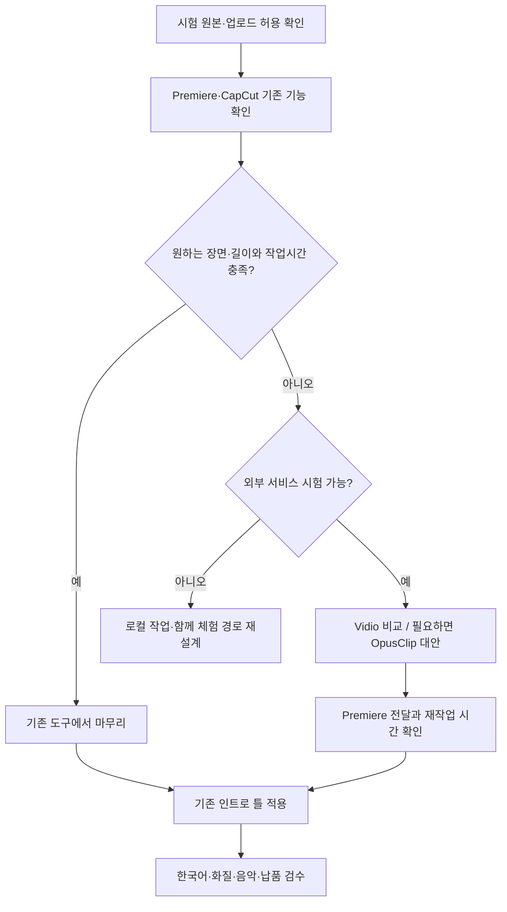

## 판단 기준과 가정

의뢰인이 Premiere·CapCut·After Effects를 사용한다는 M1 기록을 기준으로 검토한다. **현재 유효 구독·지원 버전·PC·예산·납품 화면비·외부 업로드 동의는 미확인**이다. 아래는 문서 근거와 작업 전환 비용을 고려한 잠정 시험 순서이며, 실제 편집 성능 순위가 아니다. [요구사항 카드](../01-Requirements-Map/requirements-card.md#2-6칸-정리)

## M4 실제 시험을 반영한 잠정 판단 — 2026-10-25

한 개의 영어 발표 5분 샘플에서 로컬 요약과 Vidio가 고른 핵심 내용은 사용자에게 비슷하게 평가됐고, 종료가 깔끔한 로컬 요약이 조금 더 선호됐다. Vidio 자동 수정은 길이·구성 요구를 충족하지 못했지만 Transcript 수동 보정 후에는 사용자 평가가 양호했다. 따라서 Vidio는 자동 초안과 수동 확인·보정을 함께 평가할 후보로 유지하고 자동 완성·납품 가능을 보장하는 추천으로 바꾸지 않는다. → [M4 실무 선택 판단](../04-HandsOn-Highlight/results-comparison.md#실무-선택에-반영할-판단)

진행자의 후속 인트로·효과 데모에는 파일 검증과 사용자 비교를 마친 로컬 v1을 기준 영상으로 사용한다. 코드를 다루지 않는 의뢰인에게도 로컬 방식이 가장 쉽다는 근거는 아니며, 기존 Premiere·CapCut 경로의 우선 확인은 유지한다. v3 다운로드 문제의 원인을 무료 플랜 차단으로 확정하지 않고 유료 XML·Premiere 가져오기·장시간 원본·한국어 음성은 미검증으로 남긴다. → [적용 범위와 시험 한계](../04-HandsOn-Highlight/results-comparison.md#시험의-한계와-m4-상태)

## 추천 1 — 기존 Premiere와 CapCut에서 줄일 일부터 확인

Premiere에서 발언·장면 검색을 사용하고 CapCut의 자동 하이라이트·자막을 비교한다. 이미 익숙한 도구라 새 계정·편집기를 배우는 부담을 먼저 피할 수 있다는 판단이다. 다만 기존 사용이 무료 AI 기능 접근을 보장하지 않으며, Premiere 정식 기능과 공식 Assistant 시험 버전도 구분해야 한다. [Premiere 카드](../02-Methods-Research/cards/premiere-native-ai.md#기존-검색전사-기능)·[CapCut 카드](../02-Methods-Research/cards/capcut-ai.md#가격과-무료-범위)

이 경로는 편집 가능한 상태를 얼마나 유지해야 하는지 확인하면서 시작할 수 있다. CapCut에서 만든 하나의 출력 영상을 Premiere로 가져오는 것은 컷·자막·효과가 개별 요소로 넘어오는 것과 다르다. 가로 3분 행사 구성이 가능한지와 손볼 양을 실제로 비교한 뒤 유지 여부를 정한다.

**바뀌는 조건**: 해당 버전에서 기능이 없거나 유료 추가 결제가 필요하면 우선순위를 재검토한다. 말 없는 시상·공연 구간을 찾지 못하거나 대부분 다시 편집해야 하면 외부 후보와 비교한다.

## 추천 2 — Vidio로 장면 선택을 시험하고 Premiere에서 마무리

외부 업로드가 허용되고 무료 기능에 접근할 수 있다면, 10분 이내 원본으로 선택·수정 결과를 본다. 지시와 목표 길이를 지원하고 Premiere로 컷 정보를 전달하는 경로가 있어 비교 후보로 삼는다. 이 기능 안내는 확인했지만 실제 좋은 장면을 고르는 품질은 아직 모른다. [Vidio 카드](../02-Methods-Research/cards/vidio-vibeedit.md#기능과-체험-범위)

비용은 원본 길이와 필요한 크레딧으로 계산한다. XML로 넘기면 자막·타이틀·전환 등은 다시 만들어야 하므로 「장면 선택에서 절약한 시간」에서 「다시 꾸미는 시간」을 빼야 한다. 긴 원본 실무 비용과 전체 작업시간을 확인하기 전에는 유료 도입을 권하지 않는다. [재검증 기록](../02-Methods-Research/review-followup.md#중요-수치-재확인)·[전달 한계](../02-Methods-Research/cards/vidio-vibeedit.md#premiere-연계의-한계)

**바뀌는 조건**: 외부 업로드 불가, 한국어 선택 실패, 10분 시험도 유료 요구, 또는 재작업이 큰 경우 이 경로를 보류한다. 무료 미리보기에서 내보내기가 막히면 품질 관찰과 유료 전달 검증을 나누어 기록한다.

## 대안 — OpusClip으로 비교

Vidio의 접근·결과가 맞지 않거나 짧은 클립 생성이 더 중요하면 OpusClip을 대안으로 본다. 공개 요금표의 Pro 내보내기 포함은 화면으로 재확인했지만 무료 체험에서 같은 기능이 제공되는지는 실제 계정에서 확인해야 한다. 여러 클립을 한 편의 행사 영상으로 묶는 작업량과 한국어 결과를 별도 평가한다. [OpusClip 카드](../02-Methods-Research/cards/opusclip-clipanything.md#후속-검증)·[플랜 화면 근거](../02-Methods-Research/review-followup.md#opusclip-플랜-재검증)

이번 우선 비교에는 코딩이 필요한 MCP·VEA를 넣지 않았다. 기능이 없어서 제외한 것이 아니라 설치·개발 부담보다 기존 도구와 일반 편집 서비스에서 줄일 수 있는 일이 있는지 먼저 확인하기 위해서다. [전체 후보 처리](../02-Methods-Research/review-followup.md#m1-후보-전체-대조)

## 인트로는 기존 틀부터

이미 쓰는 After Effects·CapCut 템플릿이 있으면 행사명·날짜·로고 교체가 가능한지 먼저 확인한다. 반복 작업을 더 줄일 필요가 있을 때 진행자가 Remotion 템플릿과 비교한다. 의뢰인이 직접 코드를 관리할 필요가 생기는지, 조직·협업 라이선스가 맞는지는 별도 확인해야 한다. [Remotion 카드](../02-Methods-Research/cards/remotion.md#비용과-라이선스)

Seedance 등 생성 영상은 새로운 장면이 실제 행사 기록과 섞이지 않게 사용 목적을 정한 뒤 비교한다. 짧은 인트로가 필요하다는 이유만으로 별도 생성 서비스 결제를 먼저 권하지 않는다. [Seedance 구분](../02-Methods-Research/cards/seedance.md#기능과-기존-설명-정정)

## 작업 흐름

## 확정 전 확인할 것

가격 화면의 AI 대조는 완료했지만 사용자가 직접 검토했다고 기록하지 않았다. 실제 도입 전에는 계정별 기능·결제 조건을 다시 확인한다. 시험 영상·계정·일정이 정해지면 [체험 계획](test-plan.md#시험-준비-상태)의 빈칸을 채워 다음 실습으로 진행한다.
