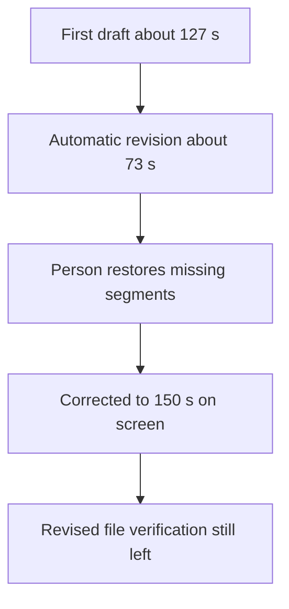

## Conclusion and Scope

[한국어](results-comparison.md)

In this **single 5-minute sample of an English talk**, both local transcript review + FFmpeg and Vidio picked the key parts of the lecture and Q&A. The user slightly preferred the local summary cut because Vidio's first result ended with part of the next Q&A attached. Vidio's natural-language revision did not meet the request, but v3, where clips were restored directly in Transcript, was rated as good by the user. → [[Journal/2026-10-25#AI 행사 영상 편집 비교 평가 (구술 원문)|Original comparison of the two results]], [[Journal/2026-10-25#Vidio 수동 보정본 검토와 다운로드 추정 (구술 원문)|Original assessment of the manual correction]]

So the result of this hands-on is that **automation that makes a draft and the work of checking and correcting the ending must be assessed together**. It is not assumed that the local path that gave a good result on the user's PC is also the easiest method for the client. The client's Premiere environment, the burden of maintaining code, long originals, Korean speech and actual delivery quality are still separate things to verify. → [Local run and limits](method-A.en.md#2026-10-25-talk-b-summary-cut-draft), [Vidio manual correction](method-B.en.md#manual-correction-v3--restoring-12-items-from-transcript)

> Both videos are similar.
>
> I think the video editing came out well.

Each quote is from a different review stage. The first sentence is preserved from the [[Journal/2026-10-25#AI 행사 영상 편집 비교 평가 (구술 원문)|local vs. Vidio v1 comparison]], and the second from the [[Journal/2026-10-25#Vidio 수동 보정본 검토와 다운로드 추정 (구술 원문)|manual v3 review]].

## Comparing the Results

### The Process Actually Followed in Vidio

Below is how this sample went. After the automatic draft and the automatic revision, a person had to restore segments from the original. Even when the length matched on screen, verifying the revised file was still left. The figures and evidence for each step are in the table below.

| Criterion | Local transcript review + FFmpeg | Vidio v1 automatic edit | Vidio v2 automatic revision | Vidio v3 manual correction |
|---|---|---|---|---|
| Length | Measured 147.714 s | Measured 126.912 s | About 73 s in UI | 150 s in UI |
| Target 143–153 s | Met | Short | Short | Met by UI, file measurement unverified |
| Structure | Explanation + related Q&A | Explanation + related Q&A + part of the next question | PR explanation all removed, only Q&A kept | PR explanation and Q&A context restored, next question excluded |
| User assessment | The two are similar, but local slightly preferred | Ending less clean | No user comparison assessment | Rated as well edited |
| File verification | 1280×720, full decode OK | 1280×720, full decode OK | File not received, UI and transcript observation | Project Saved and UI checked, file not received |
| Extra work | Choosing cuts and running the script | Ending cut needs checking and fixing | Automatic revision failure confirmed | Add to video 12 times, selection 12→24 items |
| Result kept | Local MP4, run record | Local MP4, run record | Screens, records | Saved project, screens, selection record |

The sources for the measurements and selections are [Method A](method-A.en.md#generation-and-verification), [Vidio first file verification](method-B.en.md#download-check-and-revision-request-test), [v2 failure observation](method-B.en.md#revision-result--mismatch-between-the-explanation-and-the-actual-timeline), and [v3 manual restoration](method-B.en.md#manual-correction-v3--restoring-12-items-from-transcript). The user's assessment is not turned into the agent's direct listening or an objective score.

## What Was Confirmed About Time and Cost

The render and full decode check of local v1 took 65.542 s, not including segment reading, selection or documentation. The 48.216 s from the first to the last addition in Vidio v3 is **the elapsed time of the agent's browser UI operations**. It is not read as a human editor's manual work time or the total production time. Upload, cloud processing, export waiting and decision time are each not included, so the two figures were not compared directly to calculate a speed ranking or savings rate. → [Scope of time measurement](method-A.en.md#2026-10-25-talk-b-summary-cut-draft), [Scope of correction time](method-B.en.md#manual-correction-v3--restoring-12-items-from-transcript)

On the actual Vidio account, the first request and the revision request used free messages 10→9→8, and the count stayed at 8 during the later manual clip restoration. The free output menu showed 720p and a watermark, and XML showed Paid plan only. Payment, card registration and XML export were not done. The v1 free file was actually received, so **there is no basis for concluding that nothing can be downloaded on the free plan.** The cause of the unverified local save of v3 is left undetermined. → [Actual account record](method-B.en.md#actual-account-access-and-first-run), [Interpreting the download](method-B.en.md#user-review-of-manual-correction-v3-and-interpreting-the-download)

## Judgments to Apply to Practical Choices

**For Changsoo Park's current follow-up demo work, the verified local v1 is used as the baseline video.** The reasons are that it meets the length target, the actual file exists, and the user slightly preferred its ending. Vidio v3 is kept as a separate case showing that manual correction is possible and was rated as good by the user. This choice does not mean a final recommendation of code-based tools to the client. → [User comparison result](method-B.en.md#user-comparison-viewing-results--2026-10-25)

**Vidio is reviewed conditionally as a path of making an automatic edit draft and then checking and correcting it in Transcript.** In this case, the explanation in the natural-language revision reply did not match the timeline, so completion is not judged from the reply text alone. The actual time, content and completeness are checked, together with whether a person can fix it. Premiere handoff is not confirmed as a delivery path because the paid conditions and the actual import quality are unverified. → [Automatic revision mismatch](method-B.en.md#revision-result--mismatch-between-the-explanation-and-the-actual-timeline)

## Test Limits and M4 Status

Both paths were tested with the same original 25:00–30:00 and the same theme and length target, but **the common instruction was fixed after the first local result**. So this is not an independent comparison with identical wording fixed in advance, nor a blind assessment. The Vidio revision request was also a combined request that added length and ending problems to the basic revision wording. There is also a limit on the amount of related Q&A in the original, so one failure is not generalized to the service's overall performance. → [When the common instruction was fixed](method-B.en.md#common-test-input-and-instructions)

| Original M4 criterion | Current status |
|---|---|
| Try highlights with two methods | Both paths run, theme/length target comparison done. Comparison with identical wording fixed in advance not done |
| Step-by-step captures | Screens of the Vidio run, automatic revision and manual correction kept locally. A set of step screenshots for a full user manual is not finished |
| Assessment table | This document is written. Total working time, human correction time and quantitative accuracy not measured |
| Free limits and output conditions | Conditions observed on this account are recorded. Paid quality, XML and the v3 local file unverified |
| README, records and link check | Documents and link verification results are tracked in the WorkLog |

**The hands-on comparison conclusion for M4 is written, but it is not marked as completing the whole original DoD.** The remaining items are kept, and the baseline video and the conditions to check for the next demo are made clear. It is not recorded as having verified the client's answer, Korean speech, full originals several hours long, event scenes without speech, Premiere handoff, or the user's self-assessment.

## Next Step — Input to Pass to M5

The baseline for the follow-up intro and effects hands-on is local v1 (147.714 s, 1280×720, horizontal). This is not extended into permission to put the actual video in a public repository or move it to a new external service; it continues as a local demo. Intro, titles, music and subtitles are assessed separately from M4's scene-selection comparison. → [Roadmap M5](../vl_roadmap/20261017_RoadMap_AI-Event-Video-Editing.md#m5---체험-②--인트로--효과--premiere--capcut-연계)

No arbitrary brand, presenter names or music are inserted before checking existing templates or the terms for using the actual event name, logo and music. The specific production scope and learning plan for M5 will be set in the next session.
