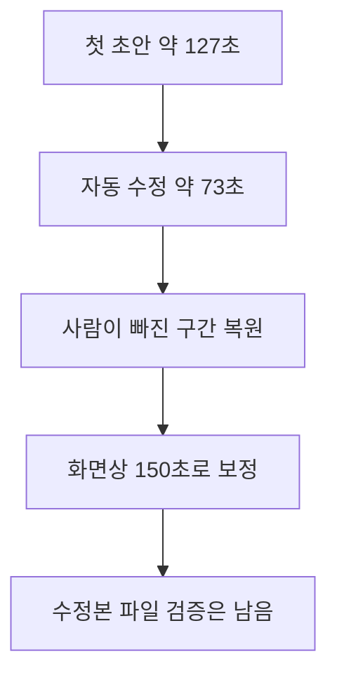

## 결론과 적용 범위

이번 **영어 발표의 5분 샘플 1개**에서는 로컬 전사 판독+FFmpeg와 Vidio 모두 강의·Q&A의 핵심을 골랐다. 사용자는 Vidio 첫 결과의 다음 Q&A 일부가 붙는 마무리 때문에 로컬 요약을 조금 더 선호했다. Vidio의 자연어 수정은 요구를 충족하지 못했으나 Transcript에서 클립을 직접 복원한 v3는 사용자에게 양호한 평가를 받았다. → [[Journal/2026-10-25#AI 행사 영상 편집 비교 평가 (구술 원문)|두 결과 비교 원문]], [[Journal/2026-10-25#Vidio 수동 보정본 검토와 다운로드 추정 (구술 원문)|수동 보정본 평가 원문]]

따라서 이번 실습의 결과는 **초안을 만드는 자동화와 마무리를 확인·보정하는 작업을 함께 평가해야 한다**는 것이다. 사용자의 PC에서 좋은 결과를 만든 로컬 경로가 의뢰인에게도 가장 쉬운 방법이라고 단정하지 않는다. 의뢰인의 Premiere 사용 환경과 코드 유지 부담·장시간 원본·한국어 음성·실제 전달 품질은 아직 별도 검증 대상이다. → [로컬 실행과 한계](method-A.md#2026-10-25-발표-b-요약-초안), [Vidio 수동 보정](method-B.md#수동-보정-v3--transcript에서-12개-복원)

> 두 영상 모두 비슷합니다.
>
> 영상 편집된 것은 잘 된 것 같습니다.

각 인용은 서로 다른 검토 단계의 발언이다. 첫 문장은 [[Journal/2026-10-25#AI 행사 영상 편집 비교 평가 (구술 원문)|로컬·Vidio v1 비교]], 둘째 문장은 [[Journal/2026-10-25#Vidio 수동 보정본 검토와 다운로드 추정 (구술 원문)|수동 v3 검토]]에서 보존했다.

## 결과 대조

### Vidio에서 실제로 거친 과정

아래는 이번 샘플의 진행 결과입니다. 자동 초안과 자동 수정 이후 사람이 원본 구간을 복원해야 했고, 화면상 길이가 맞아도 수정본 파일 검증은 남아 있었습니다. 단계별 수치와 근거는 아래 표에 있습니다.

| 기준 | 로컬 전사 판독 + FFmpeg | Vidio v1 자동 편집 | Vidio v2 자동 수정 | Vidio v3 수동 보정 |
|---|---|---|---|---|
| 길이 | 실측 147.714초 | 실측 126.912초 | UI 약 73초 | UI 150초 |
| 목표 143~153초 | 충족 | 미달 | 미달 | UI 기준 충족, 파일 실측 미확인 |
| 구성 | 설명 + 관련 Q&A | 설명 + 관련 Q&A + 다음 질문 일부 | PR 설명 전부 제외, Q&A만 유지 | PR 설명·Q&A 문맥 복원, 다음 질문 제외 |
| 사용자 평가 | 두 결과는 비슷하나 로컬을 조금 더 선호 | 마무리가 덜 깔끔함 | 사용자 비교 평가 없음 | 잘 편집됐다고 평가 |
| 파일 검증 | 1280×720·전체 디코딩 정상 | 1280×720·전체 디코딩 정상 | 파일 미수령, UI·전사 관찰 | 프로젝트 Saved·UI 확인, 파일 미수령 |
| 추가 작업 | 컷 선정과 스크립트 실행 | 종료 컷 확인·수정 필요 | 자동 수정 실패 확인 | Add to video 12회, 선택 12→24개 |
| 결과 보존 | 로컬 MP4·실행 기록 | 로컬 MP4·실행 기록 | 화면·기록 | 저장된 프로젝트·화면·선택 기록 |

측정값과 선택 내용의 출처는 [방법 A](method-A.md#생성과-검증), [Vidio 첫 파일 검증](method-B.md#다운로드-확인과-수정-요청-시험), [v2 실패 관찰](method-B.md#수정-적용-결과--설명과-실제-타임라인의-불일치), [v3 수동 복원](method-B.md#수동-보정-v3--transcript에서-12개-복원)이다. 사용자 평가를 에이전트의 직접 청취나 객관적 점수로 바꾸지 않는다.

## 시간·비용에서 확인한 것

로컬 v1의 렌더·전체 디코딩 검사는 65.542초였고 구간 판독·선택·문서화는 포함하지 않았다. Vidio v3의 첫 추가부터 마지막 추가까지 48.216초는 **에이전트의 브라우저 UI 조작 경과**이며 인간 편집자의 손작업 시간이나 전체 제작 시간으로 해석하지 않는다. 업로드·클라우드 처리·내보내기 대기·판단 시간이 각각 포함되지 않아 두 수치를 직접 비교해 속도 우열이나 절감률을 계산하지 않았다. → [시간 측정 범위](method-A.md#2026-10-25-발표-b-요약-초안), [보정 시간 범위](method-B.md#수동-보정-v3--transcript에서-12개-복원)

Vidio 실제 계정에서 첫 요청과 수정 요청은 무료 메시지 10→9→8을 사용했고 이후 수동 클립 복원에서는 잔량 8개가 유지됐다. 무료 출력 메뉴는 720p·워터마크, XML은 Paid plan only로 표시됐으며 결제·카드 등록·XML 내보내기는 실행하지 않았다. v1 무료 파일을 실제로 받았으므로 **무료 플랜 전체가 다운로드 불가라는 결론은 근거가 없다.** v3의 로컬 저장 미확인 원인은 미확정으로 남긴다. → [실제 계정 기록](method-B.md#실제-계정-접근과-1차-실행), [다운로드 해석](method-B.md#수동-보정-v3-사용자-검토와-다운로드-해석)

## 실무 선택에 반영할 판단

**현재 진행자의 데모 후속 작업에는 검증된 로컬 v1을 기준 영상으로 사용한다.** 길이 목표에 맞고 실제 파일이 있으며 사용자가 마무리를 조금 더 선호했다는 이유다. Vidio v3는 수동 보정이 가능하고 사용자에게 양호하게 평가됐다는 별도의 사례로 남긴다. 이 선택은 의뢰인에게 코드 기반 도구를 최종 추천한다는 뜻이 아니다. → [사용자 비교 결과](method-B.md#사용자-비교-청취-결과--2026-10-25)

**Vidio는 자동 편집 초안 후 Transcript에서 확인·보정하는 경로로 조건부 검토한다.** 이번 자연어 수정 응답의 설명과 타임라인이 일치하지 않았으므로 응답 문장만으로 완료 판정하지 않는다. 실제 시간·내용·완결성을 확인하고 사람이 수정할 수 있는지를 함께 본다. Premiere 전달은 유료 조건과 실제 가져오기 품질이 미검증이므로 납품 경로로 확정하지 않는다. → [자동 수정 불일치](method-B.md#수정-적용-결과--설명과-실제-타임라인의-불일치)

## 시험의 한계와 M4 상태

같은 원본 25:00~30:00과 같은 주제·길이 목표로 두 경로를 시험했지만 **공통 지시문은 로컬 첫 결과 이후에 고정**했다. 따라서 사전 고정된 동일 문구의 독립 비교나 블라인드 평가가 아니다. Vidio 수정 요청도 기본 수정 문구에 길이·종료 문제를 추가한 복합 요청이었다. 원본 관련 Q&A 분량의 제약도 있으므로 한 번의 실패를 서비스 전체 성능으로 일반화하지 않는다. → [공통 지시문의 확정 시점](method-B.md#공통-시험-입력과-지시문)

| 원래 M4 기준 | 현재 상태 |
|---|---|
| 두 방법 하이라이트 시도 | 두 경로 실행·주제/길이 목표 비교 완료. 사전 동일 문구 비교는 미실시 |
| 단계별 캡처 | Vidio 실행·자동 수정·수동 보정 화면 로컬 보존. 전체 사용 매뉴얼용 단계 화면 묶음은 미완성 |
| 평가표 | 본 문서 작성 완료. 전체 작업 시간·인간 보정 시간·정량 정확도는 미측정 |
| 무료 한계·출력 조건 | 이번 계정에서 관찰한 조건 기록 완료. 유료 품질·XML·v3 로컬 파일은 미검증 |
| README·기록·링크 검사 | 문서와 링크 검증 결과는 WorkLog에서 추적 |

**M4의 실습 비교 결론은 정리했으나 원래 DoD 전체 완료로 표시하지 않는다.** 남은 항목을 유지한 채 다음 데모의 기준 영상과 확인할 조건을 명확히 했다. 의뢰인 답변·한국어 음성·수시간 전체 원본·말 없는 행사 장면·Premiere 전달·사용자 자기평가까지 검증했다고 기록하지 않는다.

## 다음 단계 — M5로 넘길 입력

후속 인트로·효과 실습의 기준은 로컬 v1(147.714초, 1280×720, 가로)이다. 실제 영상을 공개 저장소에 넣거나 새 외부 서비스로 옮기는 허용으로 확대하지 않고 로컬 데모로 이어간다. 인트로·타이틀·음악·자막은 M4의 장면 선택 비교와 분리해 평가한다. → [로드맵 M5](../vl_roadmap/20261017_RoadMap_AI-Event-Video-Editing.md#m5---체험-②--인트로--효과--premiere--capcut-연계)

기존 템플릿이나 실제 행사명·로고·음악 사용 조건을 확인하기 전에는 임의의 브랜드·발표자 이름·음악을 삽입하지 않는다. M5의 구체적 제작 범위와 학습 계획을 다음 세션에서 정한다.
