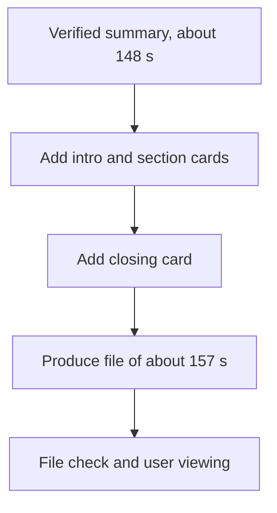

## Input and Goal

[한국어](demo-assembly.md)

The input is local v1, which passed file verification and user comparison: 147.714 seconds, 1280×720. A 5-second intro, a 1.5-second Q&A card, and a 3-second closing card are added to the source excerpt to make a draft under 3 minutes. No repeated scenes or meaningless gaps are added just to fill exactly 180 seconds. → [M4 follow-up input selection](../04-HandsOn-Highlight/results-comparison.en.md)

## Current Run Status

### How the Actual Demo Was Made

This demo was assembled locally with the setup below. It is not a result that combines a generative Seedance video or a CapCut template. It is an assembly of code-made title cards and the verified summary. So please look at the way on-screen text was added separately from the generative intro test.

The local output folder is `AI/VideoEditing/20260908-GitHub/effects/demo-v1/`, and it keeps the actual video, title PNGs, run commands, and measurements together. `talk-B-effects-demo-v1.mp4` was rendered at 157.257 seconds (about 2 minutes 37 seconds), 1280×720 H.264/AAC, and passed a full decode. The source file's size and modified time were kept. 2-second audio samples from six segments were compared by waveform correlation, and all passed: correlation coefficients were 0.99942–0.99995, and the difference from the expected position was 0.005–0.036 seconds. The sample check does not replace listening to all the audio or verifying sync across all segments. Detailed measurements are in `render-manifest.json` and `audio-qa.json` in the output folder.

FFmpeg printed one warning on exit: `100 buffers queued in out_#0:1`. The full video and audio decode and the six audio sample comparisons passed, but the cause of the warning was not determined. In 6 sample frames, I confirmed that the cards and lower titles are readable.

## User Review Items

- Readability of the title text and the lower section titles
- Whether the 1.5-second card between the explanation and Q&A disrupts the flow
- Naturalness of the original voice, the joins, and the last remark
- Telling needed decoration apart from unneeded effects

The user confirmed that the first title and the Q&A transition are in the right places, the text is easy to read, and the last slide is also clearly visible. The user pointed out that the speech in the video is English but the titles are Korean, and suggested that next time the production direction could match the on-screen text language or ask for speech captions. The user said this level of editing is fine if flashy, dynamic special effects for highlights are covered in a later module. → [User's original review](../../../../../Journal/2026-10-25.md#m5-효과-데모-검토-구술-원문)

This version is a code-based draft: title graphics made with Pillow and assembled with FFmpeg. No new music, external images, or speech captions were added. The CapCut template vs. generative intro comparison, CapCut assembly, and Premiere hand-off are not complete yet. The output video and measurement data are kept locally in `AI/VideoEditing/20260908-GitHub/effects/demo-v1/`. Big special effects were not added in this edit and will be reviewed in a later module.
