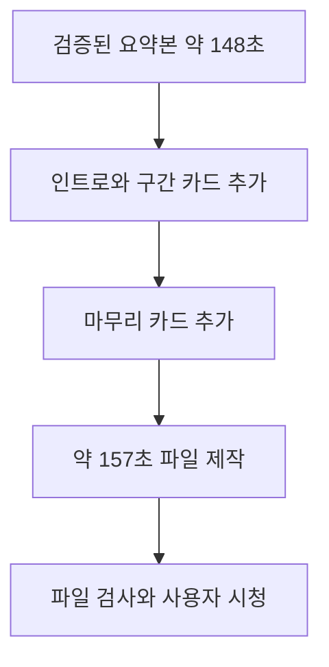

## 입력과 목표

입력은 파일 검증과 사용자 비교를 마친 로컬 v1, 147.714초·1280×720이다. 원본 발췌에 인트로 5초·Q&A 카드 1.5초·마무리 3초를 더해 3분 이내 초안을 만든다. 정확히 180초를 채우기 위한 반복 장면이나 무의미한 공백은 추가하지 않는다. → [M4 후속 입력 선정](../04-HandsOn-Highlight/results-comparison.md#다음-단계--m5로-넘길-입력)

## 현재 실행 상태

### 실제 데모를 만든 과정

이 데모는 아래 구성으로 로컬에서 조립했습니다. 생성형 Seedance 영상이나 CapCut 템플릿을 합친 결과가 아니라, 코드로 만든 제목 카드와 검증된 요약본을 조립한 결과입니다. 따라서 화면 문구를 넣는 방식과 생성형 인트로 시험을 구분해서 보시면 됩니다.

로컬 출력 폴더는 `AI/VideoEditing/20260908-GitHub/effects/demo-v1/`이고 실제 영상·제목 PNG·실행 명령·측정값을 함께 보관한다. `talk-B-effects-demo-v1.mp4`는 157.257초(약 2분 37초), 1280×720 H.264/AAC로 렌더됐고 전체 디코딩에 통과했다. 원본 파일 크기와 수정 시각은 유지됐다. 여섯 구간의 2초 음성 표본을 파형 상관으로 비교한 결과 모두 통과했으며 상관계수는 0.99942~0.99995, 예상 위치와 차이는 0.005~0.036초였다. 표본 점검은 전체 음성 청취나 전 구간 동기 검증을 대신하지 않는다. 자세한 측정은 출력 폴더의 `render-manifest.json`, `audio-qa.json`에 있다.

FFmpeg는 종료 시 `100 buffers queued in out_#0:1` 경고 한 건을 출력했다. 영상·음성 전체 디코딩과 여섯 음성 표본 대조는 통과했지만 경고 원인은 확정하지 않았다. 6개 표본 프레임에서는 카드와 하단 제목이 읽히는 것을 확인했다.

## 사용자 검토 항목

- 제목 글자와 하단 구간 제목의 가독성
- 설명과 Q&A 사이의 1.5초 카드가 흐름을 방해하는지
- 원본 목소리와 접합부·마지막 발언의 자연스러움
- 필요한 꾸미기와 불필요한 효과의 구분

사용자는 첫 제목과 Q&A 전환 위치가 맞고 글자를 읽기 쉬우며 마지막 슬라이드도 잘 보인다고 확인했다. 영상 발화는 영어지만 제목은 한국어인 점을 지적하며, 다음에는 제작 지시에서 화면 문구 언어를 맞추거나 발언 자막을 요청할 수 있다고 제안했다. 하이라이트의 화려하고 역동적인 특수 효과는 후속 단원에서 다룰 내용이라면 이번 편집 수준은 괜찮다고 평가했다. → [사용자 원문 검토](../../../../../Journal/2026-10-25.md#m5-효과-데모-검토-구술-원문)

이번 버전은 Pillow로 타이틀 그래픽을 만들고 FFmpeg로 조립한 코드 기반 초안이다. 새 음악·외부 이미지·발언 자막은 넣지 않았다. CapCut 템플릿·생성형 인트로 비교, CapCut 조립·Premiere 전달은 아직 완료하지 않았다. 출력 영상과 측정 자료는 로컬 `AI/VideoEditing/20260908-GitHub/effects/demo-v1/`에 둔다. 큰 특수 효과는 이번 편집에 추가하지 않고 후속 단원에서 검토한다.
