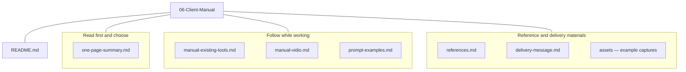
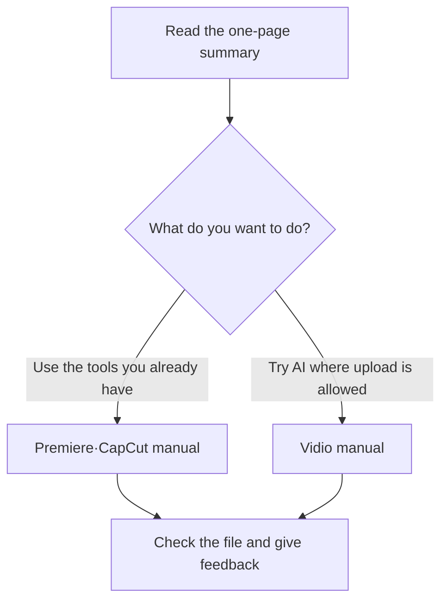
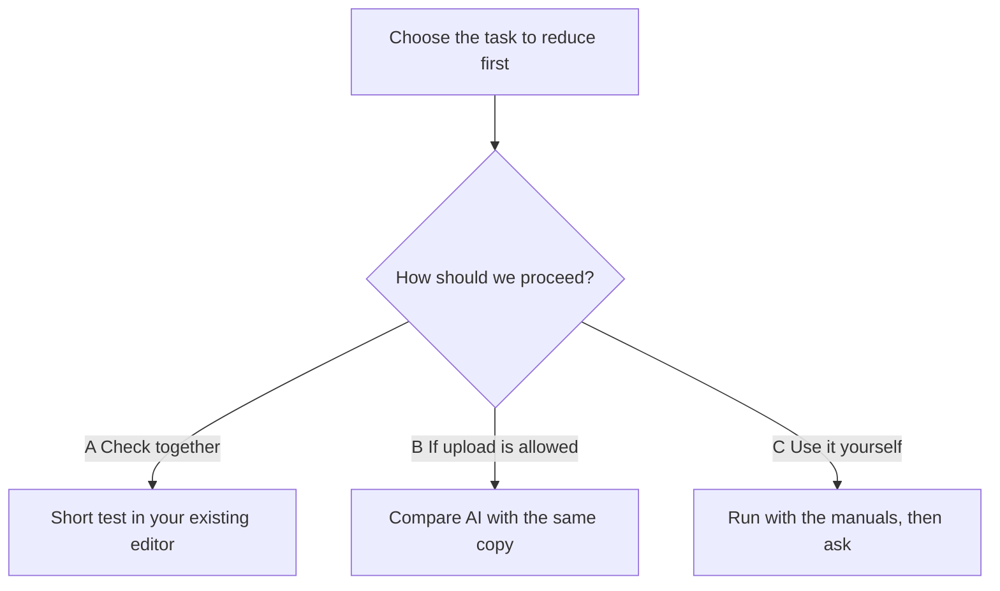

## A note before you begin

[한국어](README.md)

This document is **a guide to the first-round results of the AI event video editing research**. It covers what I researched and tested, what results and limits I actually confirmed, and how we might proceed from here. I grouped the current stage as first-round results so that you can see the comparison materials and manuals gathered so far. Testing in the client's own environment and choosing the final tool to adopt are left for later steps.

The question I set out to answer was this:

> A way to tell AI "use scenes like this" about event footage filmed over several hours, so that it picks only the parts that match, edits them into a short video of about 3 minutes, and adds an intro and effects in between

Many people expect to upload a video, make a request in a sentence or two, and get a finished video right away. In this research and in short sample tests, I confirmed that **AI can help make a draft or reduce repetitive work**. However, I could not confirm that one request can complete the whole process: picking every wanted scene from the full footage, keeping the meaning of what speakers said, and delivering a final video with the right length, captions, and intro. Please read the results below while keeping apart what I actually ran and what I only researched in official documentation. → [Original requirements](../01-Requirements-Map/requirements-card.en.md)

## Manuals in this folder and the order to follow them

### The folder at a glance

The files in this folder are grouped by purpose below. Start from the README, which is the index, and click the link to the document you need. The lines show which group a file belongs to. There are no actual subfolders for these three groups. Only `assets` is a real subfolder, and it holds screen captures of the examples.

### Where should I start?

If the diagrams look like code, open this file in Obsidian's reading view or in GitHub's document preview. The links that open each file are in the table and step-by-step explanations below the diagram.

Follow the order below: read the one-page summary, then pick the manual that fits the work you want to do. Whichever path you choose, play the actual output file at the end, and let me know if you got stuck at any step.

**First read the [one-page summary](one-page-summary.en.md), then choose the one of the two manuals below that fits the work you want to do now.** You do not need to run both manuals in order. Each document is a guide to read. The actual work happens in the Premiere or CapCut app or on the Vidio website linked from the document. Follow the numbered steps one at a time, check the screen and the result, and then move to the next step.

| Document | When to use it | What you can confirm by following it |
|---|---|---|
| [Manual for existing Premiere · CapCut](manual-existing-tools.en.md) | When you want to reduce speech editing, captions, and intro work in the editor you already use. This is the path to look at first. | Preparation → Premiere transcript and speech editing → CapCut captions and intro if needed → export and review. The Premiere and auto-caption steps are based on official documentation and need to be checked in the client's environment. |
| [Vidio VibeEdit hands-on manual](manual-vidio.en.md) | When you want to try typing editing requests in Korean to make a summary draft, and uploading a copy to an outside service is allowed | Check account conditions → upload → instruct → preview → revise and correct the Transcript → check the free output file. It includes the button paths and failure cases from an actual free trial. |
| [5 prompt examples by event type](prompt-examples.en.md) | When deciding what conditions to request for speeches, awards, performances, group photos, and atmosphere scenes | Pick one example that fits the situation and change the language, names, length, and so on. The examples are drafts that have not yet been verified to succeed. |
| [One-page summary](one-page-summary.en.md) | When you want to decide quickly which path to look at first | Get the recommended order, the confirmed results, costs, and unverified conditions first. |
| [Official references](references.en.md) | When your screen looks different or you need to check pricing or support conditions | Check the provider's official help pages and pricing pages linked to that step. |
| [Delivery message draft](delivery-message.en.md) | When Changsoo Park prepares the text to send the guide materials | Text for KakaoTalk and email. It is not a document for the client to follow while editing. |

### Path 1 — Follow the existing Premiere · CapCut manual

First open [step 1, preparation, in the existing-tools manual](manual-existing-tools.en.md) and decide on a short test copy and the target length, aspect ratio, and language. After that, choose only the tasks you need from the list below. You do not have to use both Premiere and CapCut to try this.

1. **To shorten a presentation or speech:** Go to [step 2, Premiere speech editing](manual-existing-tools.en.md). Open the test copy in Premiere and follow **Text-Based Editing → source transcript → sequence transcript editing** in that order. Select and edit transcript sentences, then check the trimmed video and the original audio. This is not a method where you paste a natural-language instruction into the transcript panel and it edits automatically.
2. **If you need captions:** Follow [step 3, CapCut captions](manual-existing-tools.en.md). Open the test video, check the spoken language in **Captions → Auto Captions**, and generate captions. Compare names, numbers, and timing with the original audio and fix them. Menus or what is offered may differ depending on your version and subscription.
3. **If you need a title or intro:** Read [step 4, titles and intros](manual-existing-tools.en.md) and apply the format you already use first. The generative example is there to explain the results and failures I confirmed. The current Seedance result has unintended text, so it is not provided as a finished intro to deliver as is.
4. **Finally, check the file:** Read [step 5, export](manual-existing-tools.en.md) and [step 6, pass criteria](manual-existing-tools.en.md), and play the actual saved file again. Check length, aspect ratio, captions, and sound. Importing a finished MP4 into Premiere and handing over individual cuts and captions as an editable project are two separate things to check.

The Premiere and auto-caption steps on this path are guidance based on official documentation. If the actual menu is different or a feature does not appear, stop at that step and tell me the app version and the menus and messages shown on the screen. For parts that need certain account conditions, we will check them together and I will fix the manual.

### Path 2 — Make a summary draft in Vidio with Korean instructions

Open the [Vidio hands-on manual](manual-vidio.en.md) and follow **steps 1 to 5** to go from the input of a first free trial to checking the file. You will need a copy of about 5 minutes that is allowed to be uploaded outside, a Vidio login account, and the target length, aspect ratio, and language. Please check sign-up, free limits, and payment requirements in your current account first.

1. **Step 1, preparation:** Check the copy's details and the account plan, remaining balance, and free output conditions.
2. **Step 2, upload:** Add the copy through the path used in the hands-on test, **Dashboard → Create's New project → VibeEdit → Media composer → Add files → Choose Files**, and check the input length and file status.
3. **Step 3, instruct:** Pick the manual's common prompt or one of the [prompts by event type](prompt-examples.en.md), and change the values in square brackets to match your actual video. Enter it in Vidio's chat box, check the plan, and run it with **Run task**. View the result in **Preview**.
4. **Step 4, revise:** Check the target length and anything missing, and ask for a revision. After **Apply changes**, check the actual length again. If the automatic correction is wrong, restore the needed original sections with **Transcript → Add to video**. Check the saved status and how the speech flows together.
5. **Step 5, export:** If your account offers a free path, save with **Export → Free preview export**. The first trial is finished only when you find the actual file in your downloads folder and check its length, quality, watermark, and sound. Do not assume the file was saved just because the screen says processing is complete.

**Step 6, paid export and XML, is an optional follow-up item.** I did not verify that procedure myself, and you do not need to start a paid subscription to finish the free trial. If your current screen is different from the manual, write down the step number and the text shown, and I will check it in the next review.

### Using the prompts and what to tell me after your first trial

The [prompt examples](prompt-examples.en.md) are meant to be used one at a time, picking the one that fits the situation. Fill in the names, language, and so on inside the square brackets, and change the target length to what you actually need. You do not paste all five examples at once. Use them in a tool that supports natural-language editing, or as a work order when a person does the editing.

After your first trial, please tell me **which manual and step numbers you used, the app version, which tasks succeeded, the menus or messages where you got stuck, the actual output length, and what needed fixing**. With that, I can adjust the procedure to fit the client's environment. For parts that are hard to do alone, we can meet with a short copy ready, or follow along together over screen sharing.

## How we approached it

First, I split the work into three parts: **picking scenes from the footage → assembling the chosen scenes into a short video → decorating it with an intro, captions, and transitions**. Speech-centered scenes, such as speeches and presentations, and picture-centered scenes, such as awards, performances, and group photos, need different criteria for finding them. So I did not assume one automated feature would solve all of them.

Next, I researched 9 candidates in 5 categories. I compared Claude · ChatGPT and their connected tools, AI services built for video editing, the existing features of Premiere · CapCut, generative video AI such as Seedance, and code-based editing, all by the same criteria. I looked at features, cost, Korean support, video length, and how to hand off to an existing editor, and I recorded separately what came from official documentation and what I saw in actual accounts. → [Methods map](../01-Requirements-Map/methods-map.en.md) · [Candidate comparison table](../02-Methods-Research/comparison-table.en.md)

After that, within what was free to access, I tested summary editing with a short English presentation sample and also checked intros, effects, and captions. I did not judge success only from the AI's description that it was done. I also looked at the actual timeline length, the downloaded file and representative frames, and the user's viewing feedback. The failures I found in this process and how to fix them are included in the manuals. → [Conditional recommendation](../03-Recommendation/recommendation.en.md) · [Actual editing comparison](../04-HandsOn-Highlight/results-comparison.en.md)

## Results and achievements so far

| Task | What was actually confirmed | What it means in practice, and its limits |
|---|---|---|
| Local transcript · AI-assisted section selection · FFmpeg editing | Made a 147.714-second summary and a 157.257-second effects demo; the user watched and reviewed them | AI and code could carry out specific edits. However, I did not judge this to be the easiest path for someone who does not work with code. |
| Vidio Free summary editing | Got a first output file of 126.912 seconds at 720p. The automatic revision came out at about 73 seconds, short of the target length | A Korean request being accepted and the wanted edit succeeding were two different things. A person had to check the result length and scenes. |
| Vidio manual correction | After restoring sections from the Transcript, made a result shown on screen as 2 minutes 30 seconds; the preview was rated good | A flow where a person fixes an automatic draft was possible. Checking the local output file of revision v3 is still left. |
| CapCut generative intro | Made an about 5-second, 720p video with Seedance 2.0 Mini and downloaded the MP4; the full decode was normal | Unrequested `Penhin` text and an `Ai` mark appeared. There is an audio stream, but its content was not listened to. The current result is hard to use as an event intro right away. |
| CapCut template | Checked the template specs and tried to enter the editor | Network errors and endless loading stopped it before rendering. A full comparison of the generative and template results is still left. |
| Local speech transcript · captions | Compared Whisper results by model on a short speech | Misrecognized technical terms remained even with a larger model. Checking against the original audio and correcting were needed, and these were not used in the final demo captions. |

The user who watched both summaries rated their choice of key content as similar, and slightly preferred the local edit, which had a cleaner ending. This is the result for one English presentation, so it cannot be generalized to say the same performance will come out for a whole Korean event, scenes without speech, or footage several hours long. The detailed evidence is in the [M4 comparison conclusion](../04-HandsOn-Highlight/results-comparison.en.md), the [Vidio test record](../04-HandsOn-Highlight/method-B.en.md), the [intro review record](../05-HandsOn-Effects/intro-template-vs-generative.en.md), and the [effects · captions record](../05-HandsOn-Effects/ai-directed-effects.en.md).

In these first-round results, I organized 2 usage guides, 5 prompts by event type, a one-page summary, 11 official references, and 3 shareable captures of a general generative example. I recorded not only the successful results but also the automatic revision failure, the gap found in download checking, and the service loading problem. So these materials can help avoid the same trial and error in later tests.

## What you need to do to actually get help from AI

Within what I confirmed, the right approach is a process where **the editor sets the goal and criteria, AI helps with a draft, and the editor reviews and fixes it**. Just making a request in an ordinary chat window does not operate an editing program automatically. You need a service with editing features or a connecting tool. Making a new intro with a generative model such as Seedance also has to be evaluated separately from picking good scenes out of the footage and summarizing them. → [Research on connecting Claude · ChatGPT with editing tools](../02-Methods-Research/claude-chatgpt-plugins.en.md)

1. **Set the criteria for the finished video.** Write down the length, aspect ratio, caption language, scenes that must be included and scenes to leave out, and how much the speeches may be shortened. If you have one good video you actually delivered before, it is easier to match the criteria.
2. **Start with a short copy you are allowed to use.** First check whether the wanted scenes can be found in one section of about 5 to 10 minutes. Upload to a web service only if uploading that video is allowed.
3. **Use a tool that fits the kind of work.** For presentations and speeches, start with the transcript and speech editing. For awards and performances without speech, start by checking scene selection while watching the picture. In this test, I could not verify how well scenes without speech are picked automatically.
4. **Enter specific requests and check the draft.** For example, give conditions like "30 seconds of the key part of the speech, include the award scene, 150 seconds in total, keep the names and the meaning of what was said." You need to check whether the tool supports natural-language instructions. Premiere transcript editing is a procedure where you select and edit transcript sentences yourself.
5. **Fix the chosen scenes and speech.** Compare with the original audio and picture, and check how questions and answers connect, missing conditions, names and numbers, and whether the start and end feel natural. Manual correction was needed in this Vidio test too.
6. **Add the intro and captions, and review the file again.** If you have an existing template, reuse it first. When you use a newly generated video, check for unintended text and marks. You need to check the downloaded video's length, quality, and sound, and whether it can be edited again in Premiere.

The goal of the next test is to find, through this process, where time can be saved. This time I did not measure upload, generation wait, judgment, and fixing time all by the same standard, so I do not give a time-saving rate such as "several times faster." → [5 prompts by event type](prompt-examples.en.md) · [Existing tools usage guide](manual-existing-tools.en.md) · [Vidio usage guide](manual-vidio.en.md)

## Scope and costs we could not verify directly

**I could not directly pay for, test, or verify paid services and paid features. I also did not do trials that require card registration.** The Premiere transcript and text-based editing steps and the CapCut auto-caption steps are guidance based on official documentation, not results I ran to the end in the apps myself. Paid high-quality export, XML · project handoff, and re-editing individual cuts and captions after importing into Premiere are also still left to actually verify.

The CapCut intro was made within the available credits, and the UI at the time showed 60 credits. This does not mean I tested a paid subscription, nor is it a guarantee that it is free on every account. For Vidio too, I kept the free output result I confirmed separate from the paid output conditions. The pricing and plan information was checked on 2026-10-29, and in later tests the current conditions of the actual account need to be checked again. → [Official references and check dates](references.en.md)

The client's OS, app versions, subscriptions, and delivery specs are currently unverified. So the current manuals are hard to see as a final version fitted to the client's environment, or as a verified version that is done once you follow every step as written. Each document marks which steps I tested directly and which I confirmed only in official documentation.

## Why the first-round results were late

Putting together the first-round results took longer than it should have. I did the research, hands-on tests, and writing alongside other work, so it was hard to find continuous blocks of time. I was also running other work that uses AI, so token usage grew. When I reached an AI service's usage limit, I had to wait until the limit reset before continuing, and this made the schedule even longer. This explains the working conditions of Changsoo Park, who ran this project. It does not describe the processing time or cost of the video editing services themselves.

In the hands-on tests, too, the automatic revision result did not match the requested length, and the CapCut editor would not load, so I repeated checking and recording. Rather than wait for all the follow-up checks, **I am giving you what I have confirmed so far as first-round results first**, and I plan to narrow the scope of later tests to fit the client's needs and environment. I did not describe features I have not yet confirmed as if they were confirmed.

## How to proceed from here

A · B · C in the diagram above are the same as the follow-up options in the table below. The test scope and schedule will be set after checking the client's choice and environment.

**The follow-up step I recommend first is to test one task together in the Premiere · CapCut environment the client already uses.** If we first check what can be reduced with the features you already use, we will have a basis for weighing the sign-up, learning, and cost of a new tool. You can proceed with whichever of the three paths below is easiest for you.

| Path | How it works | What you get next |
|---|---|---|
| A. Test together in your existing tools — suggested first | Meet or share screens to check the version, subscription, and actual menus, and do one task, speech editing or captions, on a short copy | What is possible in your existing environment, the steps where you got stuck, and fixes to the manual |
| B. Compare with an AI-specific service | If outside upload is allowed, test Vidio or others with the same short copy and the same goal. Check up to downloading the revised version | A basis for comparing result quality, the amount of human fixing, total time taken, and cost |
| C. Client-led use | The client works from the 01–06 materials and prompts, and gets guidance and problem-solving help at the steps where it is needed | A repeatable work procedure and questions for further research |

If paid features need testing, it would be good to first set the purpose of the test, the expected cost, and the output conditions, and then check together in an account the client has or chooses. These first-round results alone did not settle on a new subscription or adopting a paid tool. The code-based approach stays as a comparison case that carries out editing instructions in a specific way. Whether to adopt it will be decided after looking at the client's coding burden and whether it can be maintained.

For the next step, please just tell me the items below first. Information that is still unverified can be filled in when it is confirmed, and you do not need to send the actual event footage first.

- One task you want to reduce first: choose from scene selection, speech summary, captions, or intro
- The OS you use now, your Premiere version and plan, and your CapCut platform and version
- The length and aspect ratio of the target finished video, and a delivered example you can share for reference
- Whether the test copy may be uploaded outside, and your preferred way to proceed: paths A · B · C

For the one task you choose, it would be good to agree on the input copy, the success criteria, and where the test ends before starting. The results will be checked through the actual file, the parts that needed fixing, the total work time, and the cost shown in the account, and then reflected in the manuals. The follow-up scope and schedule will be set separately after this choice. I am not assuming a schedule that continues all the unfinished research at once.

## How to find the detailed research and manuals

This document is the entrance that guides you through the whole process. The information from the research and the hands-on records are **organized separately in folders 01–06**, so you can read more about any item that interests you in the materials below. To begin, read the [one-page summary](one-page-summary.en.md) and then go to the usage guide you need.

| Folder · document | What you can find there |
|---|---|
| [01 Requirements and methods map](../01-Requirements-Map/README.en.md) | What problem I tried to solve, how the work was split, and questions to confirm |
| [02 Research by method](../02-Methods-Research/README.en.md) | 5 categories · 9 candidates, comparison of features · cost · Korean · handoff, and sources |
| [03 Conditional recommendation](../03-Recommendation/README.en.md) | The reasons for recommending existing tools first and a Vidio comparison when needed, and trial preparation |
| [04 Highlight hands-on](../04-HandsOn-Highlight/README.en.md) | Local and Vidio tests, revision failure and manual correction, comparison results |
| [05 Intro · effects hands-on](../05-HandsOn-Effects/README.en.md) | Generative intro and template attempts, effects demo, and caption errors |
| [06 Existing Premiere · CapCut guide](manual-existing-tools.en.md) | Procedures to check in your existing tools, the CapCut download I confirmed directly, and example captures |
| [06 Vidio hands-on guide](manual-vidio.en.md) | Actual experience with upload, instructions, revision, manual correction, and export |
| [06 Prompt examples](prompt-examples.en.md) | 5 drafts for speeches, awards, performances, group photos, and atmosphere montage |
| [06 One-page summary](one-page-summary.en.md) · [11 official references](references.en.md) | Quick selection guide and providers' official documentation |

## Record status and later updates

This material is **a document organized as first-round results to give to the client**. It is not a record of actually sending it. Full step-by-step captures, a review in the client's environment, some comparison tests, and the researcher's self-assessment are still left, so the learning roadmap's M6 DoD stays at 5/7 and the Topic as a whole stays in progress. Differences and results confirmed in later reviews will be reflected in the existing documents.

The evidence and unfinished scope are recorded in the [Topic overview](../README.en.md), the [M6 WorkLog](../vl_worklog/20261029_M6_AI-Event-Video-Editing.md), and the [final retrospective draft](../vl_worklog/20261029_AI-Event-Video-Editing_Final_Retrospective.md). The client is not being asked for a separate learning self-assessment. In later use, please just share your views on how useful it is for your actual work and on the steps where you got stuck.
