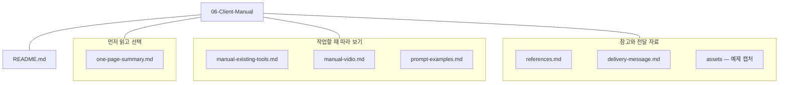
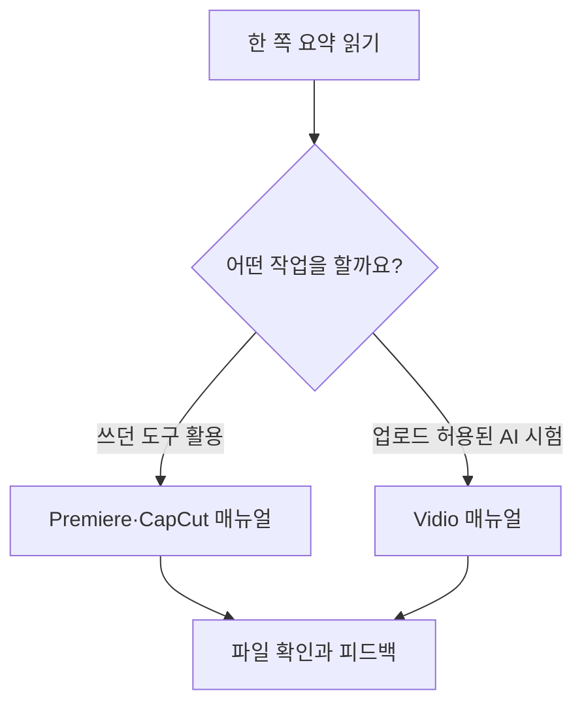
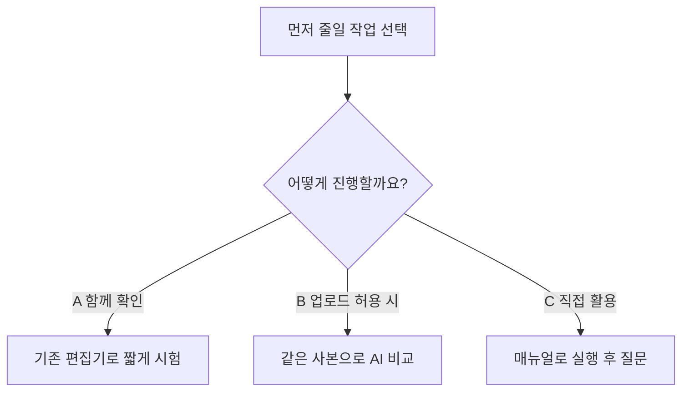

## 먼저 드리는 말씀

이 문서는 **행사 영상 AI 편집 리서치의 1차 결과 안내문**입니다. 그동안 무엇을 조사하고 시험했는지, 실제로 확인한 성과와 한계가 무엇인지, 앞으로 어떤 방식으로 진행하면 좋을지 정리했습니다. 지금까지 확보한 비교 자료와 매뉴얼을 먼저 보실 수 있도록 현재 단계를 1차 결과로 묶었습니다. 의뢰인 환경에서의 사용 검증과 최종 도입 도구 선정은 후속 단계로 남아 있습니다.

처음 확인하려던 질문은 다음과 같습니다.

> 몇 시간 동안 촬영한 행사 영상을 AI 에게 「이런 장면으로」라고 지시하면, 그 지시에 맞는 부분만 골라 3분 안팎의 짧은 영상으로 편집하고, 인트로와 중간 효과까지 넣어 주는 방법

많은 분이 영상을 넣고 한두 문장으로 요청하면 완성본이 바로 나오는 방식을 기대하십니다. 이번 조사와 짧은 샘플 시험에서는 **AI가 초안을 만들거나 반복 작업을 줄이는 데 도움을 줄 수 있다는 점**을 확인했습니다. 다만 촬영본 전체에서 원하는 장면을 빠짐없이 고르고, 발언 의미를 보존하며, 정확한 길이·자막·인트로로 납품까지 끝내는 전 과정을 한 번의 요청으로 완성한다고 확인하지는 못했습니다. 아래 결과는 실제로 실행한 범위와 공식 자료로만 조사한 범위를 구분해 읽어 주시면 좋겠습니다. → [최초 요구사항](../01-Requirements-Map/requirements-card.md)

## 이 폴더에 있는 매뉴얼과 따라 하는 순서

### 폴더 구조 한눈에 보기

이 폴더의 파일을 용도별로 묶으면 아래와 같습니다. 색인인 README에서 시작해 필요한 문서 링크를 누르면 됩니다. 선은 파일의 소속을 뜻하며, 실제 폴더 안에 아래 세 묶음의 하위 폴더가 따로 있는 것은 아닙니다. `assets`만 실제 하위 폴더이며 예제 화면 캡처가 들어 있습니다.

### 어디서 시작하면 되나요?

그림이 코드처럼 보이면 Obsidian의 읽기 보기 또는 GitHub의 문서 미리보기에서 열어 주세요. 파일을 여는 링크는 도식 아래 표와 단계별 설명에 있습니다.

아래 순서대로 한 쪽 요약을 본 뒤 하려는 작업에 맞는 매뉴얼을 고르세요. 어느 경로를 선택하든 마지막에는 실제 출력 파일을 재생하고, 막힌 단계가 있으면 알려 주시면 됩니다.

**처음에는 [한 쪽 요약](one-page-summary.md)을 읽고, 아래 두 사용 매뉴얼 중 지금 하려는 작업에 맞는 문서를 선택해 주세요.** 두 매뉴얼을 모두 순서대로 실행할 필요는 없습니다. 각 문서는 읽는 안내문이며, 실제 작업은 문서에서 연결한 Premiere·CapCut 앱이나 Vidio 웹사이트에서 진행합니다. 문서의 번호를 따라 한 단계씩 실행하고 화면과 결과를 확인한 뒤 다음 단계로 넘어가시면 됩니다.

| 문서 | 어떤 때 사용하는가 | 따라 하면 확인할 수 있는 것 |
|---|---|---|
| [기존 Premiere·CapCut 사용 매뉴얼](manual-existing-tools.md) | 이미 쓰는 편집기에서 발언 편집·자막·인트로 작업을 줄이고 싶을 때. 먼저 볼 경로입니다. | 준비 → Premiere 전사·발언 편집 → 필요한 경우 CapCut 자막·인트로 → 출력과 검수. Premiere·자동 자막은 공식 자료 기반이며 의뢰인 환경에서 확인이 필요합니다. |
| [Vidio VibeEdit 실습 매뉴얼](manual-vidio.md) | 한국어로 편집 요구를 입력해 요약 초안을 만드는 방식을 시험하고 싶고, 사본의 외부 업로드가 허용될 때 | 계정 조건 확인 → 업로드 → 지시 → 미리보기 → 수정·Transcript 보정 → 무료 출력 파일 확인. 실제 무료 시험의 버튼 경로와 실패 사례를 담았습니다. |
| [행사별 지시문 예시 5개](prompt-examples.md) | 축사·시상·공연·단체 사진·분위기 장면을 어떤 조건으로 요청할지 정할 때 | 상황에 맞는 예시 하나를 골라 언어·이름·길이 등을 바꿔 사용합니다. 예시는 아직 성공 검증하지 않은 초안입니다. |
| [한 쪽 요약](one-page-summary.md) | 어떤 경로부터 볼지 빠르게 정할 때 | 추천 순서, 확인한 결과와 비용·미검증 조건을 먼저 파악합니다. |
| [공식 참조 모음](references.md) | 화면이 다르거나 요금·지원 조건을 확인해야 할 때 | 해당 단계에 연결된 공급자 공식 도움말과 요금 페이지를 확인합니다. |
| [전달 메시지 초안](delivery-message.md) | 진행자가 안내 자료를 전달할 문안을 준비할 때 | 카톡·이메일용 문안입니다. 의뢰인이 편집 작업을 따라 할 문서는 아닙니다. |

### 경로 1 — 기존 Premiere·CapCut 매뉴얼 따라 하기

먼저 [기존 도구 매뉴얼의 1번 준비 단계](manual-existing-tools.md#1-시험-준비와-시작-조건)를 열어 짧은 시험 사본과 목표 길이·화면비·언어를 정해 주세요. 이후에는 아래에서 필요한 작업만 선택하면 됩니다. Premiere와 CapCut을 모두 사용해야만 시험할 수 있는 것은 아닙니다.

1. **발표·축사를 줄이려면:** [2번 Premiere 발언 편집](manual-existing-tools.md#2-premiere에서-발언-중심-초안-만들기)으로 이동합니다. Premiere에서 시험 사본을 열고 **Text-Based Editing → 소스 전사 → 시퀀스 전사 편집** 순서로 따라 하세요. 전사 문장을 선택·편집하고 잘린 영상과 원음을 확인합니다. 자연어 지시문을 전사 패널에 붙여 넣어 자동 편집하는 방식은 아닙니다.
2. **자막이 필요하면:** [3번 CapCut 자막](manual-existing-tools.md#3-capcut에서-자막-초안-만들기)을 따라 시험 영상을 열고 **Captions → Auto Captions**에서 발화 언어를 확인해 생성합니다. 이름·숫자·타이밍을 원음과 대조해 수정하세요. 사용 중인 버전·구독에 따라 메뉴나 제공 범위가 다를 수 있습니다.
3. **제목·인트로가 필요하면:** [4번 제목과 인트로](manual-existing-tools.md#4-제목과-인트로-넣기)를 읽고 기존에 사용하는 틀부터 적용합니다. 생성형 예제는 확인한 결과와 실패를 설명하기 위한 자료입니다. 현재 Seedance 결과에는 의도치 않은 글자가 있으므로 그대로 납품할 완성 인트로로 제공하는 것은 아닙니다.
4. **마지막으로 파일을 확인합니다:** [5번 내보내기](manual-existing-tools.md#5-내보내기와-premiere-마무리)와 [6번 통과 기준](manual-existing-tools.md#6-첫-시험의-통과-기준)을 읽고 실제 저장 파일을 다시 재생하세요. 길이·화면비·자막·소리를 확인합니다. 완성 MP4를 Premiere로 가져오는 것과 개별 컷·자막을 편집 가능한 프로젝트로 넘기는 것은 따로 확인해야 합니다.

이 경로의 Premiere와 자동 자막 절차는 공식 자료에 근거한 안내입니다. 실제 메뉴가 다르거나 기능이 보이지 않으면 해당 단계에서 멈추고 앱 버전과 화면에 나온 메뉴·안내 문구를 알려 주세요. 계정 조건이 필요한 부분은 함께 확인해 매뉴얼을 수정하겠습니다.

### 경로 2 — Vidio에서 한국어 지시로 요약 초안 만들기

[Vidio 실습 매뉴얼](manual-vidio.md)을 열고 **1번부터 5번까지** 따라 하면 첫 무료 시험의 입력부터 파일 확인까지 진행할 수 있습니다. 준비물은 외부 업로드가 허용된 5분 안팎의 사본, Vidio 로그인 계정, 목표 길이·화면비·언어입니다. 가입·무료 한도·결제 요구는 현재 계정에서 먼저 확인해 주세요.

1. **1번 준비:** 사본 정보와 계정 플랜·잔량·무료 출력 조건을 확인합니다.
2. **2번 업로드:** 실습에서 사용한 **Dashboard → Create의 New project → VibeEdit → Media composer → Add files → Choose Files** 경로로 사본을 넣고 입력 길이와 파일 상태를 확인합니다.
3. **3번 지시:** 매뉴얼의 공통 지시문 또는 [행사별 지시문](prompt-examples.md) 하나를 골라 대괄호 값을 실제 영상에 맞게 바꿉니다. Vidio의 대화 입력란에 넣고, 계획을 확인한 뒤 **Run task**로 실행합니다. 결과는 **Preview**에서 봅니다.
4. **4번 수정:** 목표 길이와 빠진 내용을 확인해 수정 요청을 합니다. **Apply changes** 후 실제 길이를 다시 보고, 자동 보정이 맞지 않으면 **Transcript → Add to video**로 필요한 원본 구간을 복원합니다. 저장 상태와 발언 연결을 확인하세요.
5. **5번 출력:** 계정에서 무료 경로가 제공되면 **Export → Free preview export**로 저장합니다. 다운로드 폴더의 실제 파일을 찾아 길이·화질·워터마크·소리를 확인해야 첫 시험이 끝납니다. 화면상 처리 완료만으로 파일 저장까지 성공했다고 판단하지 마세요.

**6번 유료 출력·XML은 선택적인 후속 확인 항목**입니다. 직접 검증한 절차가 아니며 무료 시험을 끝내기 위해 유료 구독을 시작할 필요는 없습니다. 현재 화면이 매뉴얼과 다르면 단계 번호와 표시 문구를 기록해 주시면 다음 검토에서 확인하겠습니다.

### 지시문 사용과 첫 시험 후 알려 주실 내용

[지시문 예시](prompt-examples.md)는 상황별로 하나씩 골라 쓰는 자료입니다. 대괄호 안의 이름·언어 등을 채우고 목표 길이는 실제 필요에 맞게 고쳐 주세요. 다섯 예시를 한 번에 붙여 넣는 방식이 아니며, 자연어 편집을 지원하는 도구에서 사용하거나 사람이 편집할 때의 작업 지시서로 활용합니다.

첫 시험 후에는 **사용한 매뉴얼과 단계 번호, 앱 버전, 성공한 작업, 막힌 메뉴·안내 문구, 실제 출력 길이와 수정이 필요했던 점**을 알려 주세요. 그 결과로 의뢰인 환경에 맞게 절차를 보완할 수 있습니다. 혼자 진행하기 어려운 부분은 짧은 사본을 준비해 만나거나 화면 공유로 함께 따라 하는 방식으로 진행하면 됩니다.

## 어떤 방식으로 접근했는가

먼저 작업을 세 부분으로 나누었습니다. **촬영본에서 장면 고르기 → 고른 장면을 짧게 조립하기 → 인트로·자막·전환 효과로 꾸미기**입니다. 축사·발표처럼 말이 중심인 장면과 시상·공연·단체 사진처럼 화면이 중심인 장면은 찾는 기준이 다르므로, 같은 자동화 기능으로 모두 해결된다고 가정하지 않았습니다.

그다음 5개 범주에서 9개 후보를 조사했습니다. Claude·ChatGPT와 연결 도구, 영상 편집 전용 AI 서비스, Premiere·CapCut의 기존 기능, Seedance 같은 생성형 영상 AI, 코드 기반 편집을 같은 기준으로 비교했습니다. 기능·비용·한국어 지원·영상 길이와 기존 편집기로 넘기는 방법을 살폈고, 공식 자료와 실제 계정에서 본 결과를 따로 기록했습니다. → [방법 지도](../01-Requirements-Map/methods-map.md) · [후보 비교표](../02-Methods-Research/comparison-table.md)

이후 무료로 접근할 수 있는 범위에서 짧은 영어 발표 샘플로 요약 편집을 시험하고, 인트로·효과·자막까지 확인했습니다. AI의 완료 설명만으로 성공을 판단하지 않고 실제 타임라인 길이, 내려받은 파일과 대표 프레임, 사용자 시청 의견을 함께 보았습니다. 이 과정에서 발견한 실패와 수정 방법도 매뉴얼에 포함했습니다. → [조건부 추천](../03-Recommendation/recommendation.md) · [실제 편집 비교](../04-HandsOn-Highlight/results-comparison.md)

## 지금까지 얻은 결과와 성과

| 작업 | 실제 확인한 결과 | 실무에 적용할 때의 의미와 한계 |
|---|---|---|
| 로컬 전사·AI 보조 구간 선택·FFmpeg 편집 | 147.714초 요약본과 157.257초 효과 데모 제작, 사용자 시청 검토 | AI와 코드로 구체적인 편집을 실행할 수 있었습니다. 다만 코드를 다루지 않는 분에게 가장 쉬운 경로라고 판단한 것은 아닙니다. |
| Vidio Free 요약 편집 | 첫 출력 126.912초·720p 파일 확보. 자동 수정은 약 73초로 목표 길이 미달 | 한국어 요청이 접수되는 것과 원하는 편집이 성공하는 것은 달랐습니다. 결과 길이와 장면을 사람이 확인해야 했습니다. |
| Vidio 수동 보정 | Transcript에서 구간을 복원한 뒤 화면상 2분 30초 결과를 만들었고 미리보기 평가도 양호 | 자동 초안 뒤 사람이 수정하는 흐름은 가능했습니다. 수정본 v3의 로컬 출력 파일 검증은 남아 있습니다. |
| CapCut 생성형 인트로 | Seedance 2.0 Mini로 약 5초·720p 영상 생성 및 MP4 다운로드, 전체 디코드 정상 | 요청하지 않은 `Penhin` 문구와 `Ai` 표시가 나타났습니다. 오디오 스트림은 있으나 내용은 미청취입니다. 현재 결과를 행사 인트로로 바로 사용하기는 어렵습니다. |
| CapCut 템플릿 | 템플릿 사양 확인과 편집기 진입 시도 | 네트워크 오류와 계속되는 로딩으로 렌더까지 완료하지 못했습니다. 생성형과 템플릿 결과의 완전한 비교는 남았습니다. |
| 로컬 음성 전사·자막 | 짧은 발언에서 Whisper 모델별 결과 비교 | 더 큰 모델에도 전문 용어 오인식이 남았습니다. 원음 대조와 교정이 필요했고 최종 데모 자막에는 반영하지 않았습니다. |

두 요약을 본 사용자는 핵심 내용 선택을 비슷하게 평가했고, 끝맺음이 깔끔한 로컬 편집본을 조금 더 선호했습니다. 한 영어 발표의 결과이므로 한국어 행사 전체, 말 없는 장면, 수시간 촬영본에도 같은 성능이 나온다고 일반화할 수는 없습니다. 세부 근거는 [M4 비교 결론](../04-HandsOn-Highlight/results-comparison.md#실무-선택에-반영할-판단), [Vidio 시험 기록](../04-HandsOn-Highlight/method-B.md), [인트로 검수 기록](../05-HandsOn-Effects/intro-template-vs-generative.md#실제-실행-결과), [효과·자막 기록](../05-HandsOn-Effects/ai-directed-effects.md)에 있습니다.

이번 1차 결과에는 사용 안내 2개, 행사별 지시문 5개, 한 쪽 요약, 공식 참조 11개와 일반 생성형 예제의 공개 가능 캡처 3개를 정리했습니다. 성공한 결과뿐 아니라 자동 수정 실패, 다운로드 검증의 차이, 서비스 로딩 문제를 기록했기 때문에 후속 시험에서 같은 시행착오를 줄이는 자료로 활용할 수 있습니다.

## 실제로 AI의 도움을 받으려면 어떻게 해야 하는가

현재 확인한 범위에서는 **편집자가 목표와 기준을 정하고, AI가 초안을 돕고, 편집자가 검수·수정하는 과정**으로 접근하는 것이 적절합니다. 일반 대화창에 요청하는 것만으로 편집 프로그램이 자동 조작되는 것은 아니며, 편집 기능을 가진 서비스나 연결 도구가 필요합니다. Seedance 같은 생성형 모델로 새 인트로를 만드는 기능도 촬영본에서 좋은 장면을 골라 요약하는 기능과 나누어 평가해야 합니다. → [Claude·ChatGPT와 편집 도구 연결 조사](../02-Methods-Research/claude-chatgpt-plugins.md)

1. **완성본의 기준을 정합니다.** 길이·화면비·자막 언어, 꼭 넣을 장면과 제외할 장면, 발언을 줄여도 되는 범위를 적습니다. 실제로 납품했던 좋은 영상 하나가 있으면 판단 기준을 맞추기 쉽습니다.
2. **허용된 짧은 사본으로 시작합니다.** 먼저 5~10분 정도의 한 구간에서 원하는 장면을 찾을 수 있는지 확인합니다. 웹 서비스에 올리는 작업은 해당 영상의 업로드가 허용된 경우에 진행합니다.
3. **작업 성격에 맞는 도구를 씁니다.** 발표·축사는 전사와 발언 편집부터, 말 없는 시상·공연 장면은 화면을 보며 장면 선택부터 확인합니다. 이번 시험에서는 말 없는 행사 장면의 자동 선정 성능까지 검증하지 못했습니다.
4. **요구를 구체적으로 입력하고 초안을 확인합니다.** 예를 들어 “축사 핵심 30초, 시상 장면 포함, 전체 150초, 이름과 발언 의미 보존”처럼 조건을 줍니다. 대상 도구가 자연어 지시를 지원하는지 확인해야 하며, Premiere 전사 편집은 전사 문장을 직접 선택·편집하는 절차입니다.
5. **선택된 장면과 발언을 고칩니다.** 원음·원화면과 대조해 질문과 답변의 연결, 빠진 조건, 이름·숫자와 시작·끝의 자연스러움을 확인합니다. 이번 Vidio 시험에서도 수동 보정이 필요했습니다.
6. **인트로·자막을 더하고 파일을 다시 검수합니다.** 기존 템플릿이 있으면 우선 재사용하고, 새 생성 영상을 쓸 때는 의도치 않은 글자와 표식을 확인합니다. 내려받은 영상의 길이·화질·소리와 Premiere에서의 재편집 가능 여부까지 보아야 합니다.

이 과정을 통해 시간을 줄일 수 있는 지점을 찾는 것이 다음 시험의 목적입니다. 이번에는 업로드·생성 대기·판단·수정 시간을 모두 같은 기준으로 측정하지 않았으므로 “몇 배 빨라진다”는 절감률은 제시하지 않습니다. → [행사별 지시문 5개](prompt-examples.md) · [기존 도구 사용 안내](manual-existing-tools.md) · [Vidio 사용 안내](manual-vidio.md)

## 직접 검증하지 못한 범위와 비용

**유료 서비스 및 유료 기능은 직접 결제하거나 시험·검증하지 못했습니다. 카드 등록이 필요한 체험판도 진행하지 않았습니다.** Premiere의 전사·텍스트 기반 편집과 CapCut 자동 자막 절차는 공식 자료 기반 안내이며 직접 앱에서 끝까지 실행한 결과가 아닙니다. 유료 고화질 출력, XML·프로젝트 전달, Premiere 가져오기 후 개별 컷·자막을 다시 편집하는 과정도 실제 검증이 남아 있습니다.

CapCut 인트로는 사용 가능한 크레딧 범위에서 생성했고 당시 UI에는 60 credits가 표시됐습니다. 이는 유료 구독을 시험했다는 뜻이나 모든 계정에서 무료라는 보장이 아닙니다. Vidio도 확인한 무료 출력 결과와 유료 출력 조건을 구분했습니다. 요금·플랜 안내의 확인일은 2026-10-29이며, 후속 시험에서는 실제 계정의 현재 조건을 다시 확인해야 합니다. → [공식 참조와 확인일](references.md)

의뢰인의 OS·앱 버전·구독·납품 규격은 현재 미확인입니다. 따라서 지금 매뉴얼을 의뢰인 환경에 맞춘 최종본이나 모든 단계를 그대로 따라 하면 완료되는 검증본으로 보기는 어렵습니다. 각 문서에서 직접 시험한 단계와 공식 문서로만 확인한 단계를 표시했습니다.

## 1차 결과 전달이 늦어진 이유

1차 결과 정리가 늦어졌습니다. 다른 업무와 병행해 조사·실습·문서화를 진행하면서 작업 시간을 연속으로 확보하기 어려웠고, AI를 활용하는 다른 작업도 함께 진행해 토큰 사용량이 많아졌습니다. AI 서비스의 사용량 한도에 도달하면 한도가 재설정될 때까지 기다린 뒤 이어서 작업해야 했기 때문에 일정이 더 길어졌습니다. 이 부분은 진행자의 작업 여건에 대한 설명이며 영상 편집 서비스 자체의 처리 시간이나 비용을 뜻하지 않습니다.

실습에서도 자동 수정 결과가 요구한 길이와 다르거나, CapCut 편집기가 로딩되지 않는 문제가 있어 확인과 기록을 반복했습니다. 모든 후속 검증을 기다리기보다 **지금까지 확인한 내용을 먼저 1차 결과로 드리고**, 이후 시험 범위는 의뢰인의 필요와 사용 환경에 맞춰 좁혀 진행하려고 합니다. 아직 확인하지 못한 기능은 확인된 것처럼 설명하지 않았습니다.

## 앞으로 진행하는 방법

위 도식의 A·B·C는 아래 표의 후속 진행 방식과 같습니다. 시험 범위와 일정은 의뢰인의 선택과 환경을 확인한 뒤 정합니다.

**가장 먼저 권하는 후속 단계는 의뢰인이 이미 쓰는 Premiere·CapCut 환경에서 한 가지 작업을 함께 시험하는 것입니다.** 사용 중인 기능으로 줄일 수 있는 일부터 확인하면 새 도구의 가입·학습·비용을 검토할 기준이 생깁니다. 아래 세 경로 중 편한 방식으로 진행할 수 있습니다.

| 경로 | 진행 방법 | 다음에 얻을 결과 |
|---|---|---|
| A. 기존 도구에서 함께 시험 — 우선 제안 | 만나거나 화면 공유로 버전·구독과 실제 메뉴를 확인하고, 짧은 사본의 발언 편집 또는 자막 한 작업을 수행 | 기존 환경에서 가능한 범위, 막힌 단계, 매뉴얼 수정사항 |
| B. AI 전용 서비스와 비교 | 외부 업로드가 허용되면 같은 짧은 사본과 같은 목표로 Vidio 등을 시험. 수정본 다운로드까지 확인 | 결과 품질·사람의 수정량·전체 소요시간·비용을 비교할 근거 |
| C. 의뢰인 주도 활용 | 01~06 자료와 지시문을 바탕으로 의뢰인이 작업하고, 필요한 단계에서 안내와 문제 해결 지원 | 반복 가능한 작업 절차와 추가 조사할 질문 |

유료 기능 시험이 필요하면 먼저 시험 목적과 예상 비용·출력 조건을 정하고, 의뢰인이 보유하거나 직접 선택한 계정에서 함께 확인하는 방식이 좋겠습니다. 이번 1차 결과만으로 새 구독이나 유료 도구 도입을 확정하지는 않았습니다. 코드 기반 방식은 편집 지시를 구체적으로 실행하는 비교 사례로 두고, 의뢰인의 코딩 부담과 유지관리 가능성을 본 뒤 채택 여부를 판단합니다.

다음 단계에서는 아래 내용만 우선 알려 주시면 됩니다. 기존에 미확인으로 남은 정보는 확인되는 때에 보완하면 되고, 실제 행사 원본을 먼저 보내실 필요는 없습니다.

- 먼저 줄이고 싶은 작업 한 가지: 장면 선택, 발언 요약, 자막, 인트로 중 선택
- 현재 사용하는 OS, Premiere 버전·플랜, CapCut 플랫폼·버전
- 목표 완성본의 길이·화면비와 참고할 수 있는 납품 예시
- 시험용 사본의 외부 업로드 허용 여부와 선호하는 진행 방식 A·B·C

선택한 한 작업에 대해 입력 사본·성공 기준·시험 종료 범위를 합의한 뒤 진행하면 좋겠습니다. 결과는 실제 파일, 수정이 필요했던 부분, 전체 작업 시간과 계정 표시 비용으로 확인하고 매뉴얼에 반영합니다. 후속 범위와 일정은 이 선택 후 별도로 정하며, 모든 미완료 연구를 한 번에 이어가는 일정으로 가정하지 않습니다.

## 자세한 조사 내용과 매뉴얼을 찾는 방법

이 문서는 전체 과정을 안내하는 입구입니다. 리서치에서 얻은 정보와 실습 기록은 **01~06 폴더에 나누어 정리했으므로**, 관심 있는 항목은 아래 자료에서 더 자세히 보실 수 있습니다. 처음에는 [한 쪽 요약](one-page-summary.md)을 읽고 필요한 사용 안내로 이동하시면 됩니다.

| 폴더·문서 | 볼 수 있는 내용 |
|---|---|
| [01 요구사항과 방법 지도](../01-Requirements-Map/README.md) | 어떤 문제를 해결하려 했는지, 작업 구분과 확인 질문 |
| [02 방법별 조사](../02-Methods-Research/README.md) | 5개 범주·9개 후보, 기능·비용·한국어·연계 비교와 출처 |
| [03 조건부 추천](../03-Recommendation/README.md) | 기존 도구 우선·필요시 Vidio 비교라는 추천 이유와 체험 준비 |
| [04 하이라이트 실습](../04-HandsOn-Highlight/README.md) | 로컬·Vidio 시험, 수정 실패와 수동 보정, 비교 결과 |
| [05 인트로·효과 실습](../05-HandsOn-Effects/README.md) | 생성형 인트로·템플릿 시도, 효과 데모와 자막 오류 |
| [06 기존 Premiere·CapCut 안내](manual-existing-tools.md) | 기존 도구에서 확인할 절차, 직접 확인한 CapCut 다운로드와 예제 캡처 |
| [06 Vidio 실습 안내](manual-vidio.md) | 업로드·지시·수정·수동 보정·출력의 실제 경험 |
| [06 지시문 예시](prompt-examples.md) | 축사·시상·공연·단체 사진·분위기 몽타주 5개 초안 |
| [06 한 쪽 요약](one-page-summary.md) · [공식 참조 11개](references.md) | 빠른 선택 안내와 공급자 공식 문서 |

## 기록 상태와 이후 갱신

이 자료는 의뢰인께 드리기 위한 **1차 결과로 정리한 문서**이며 실제 전송을 수행한 기록은 아닙니다. 전체 단계 캡처·의뢰인 환경 검토, 일부 비교 실습과 연구자의 자기평가가 남아 있어 학습 로드맵의 M6 DoD는 5/7, Topic 전체는 진행 중으로 유지합니다. 후속 검토에서 확인된 차이와 결과를 기존 문서에 반영하겠습니다.

[Topic 전체 안내](../README.md), [M6 WorkLog](../vl_worklog/20261029_M6_AI-Event-Video-Editing.md), [최종 회고 초안](../vl_worklog/20261029_AI-Event-Video-Editing_Final_Retrospective.md)에 근거와 미완료 범위를 기록했습니다. 의뢰인께 별도의 학습 자기평가를 요청하는 것은 아니며, 후속 활용에서는 실제 업무의 유용성과 막힌 단계에 대한 의견을 주시면 됩니다.
