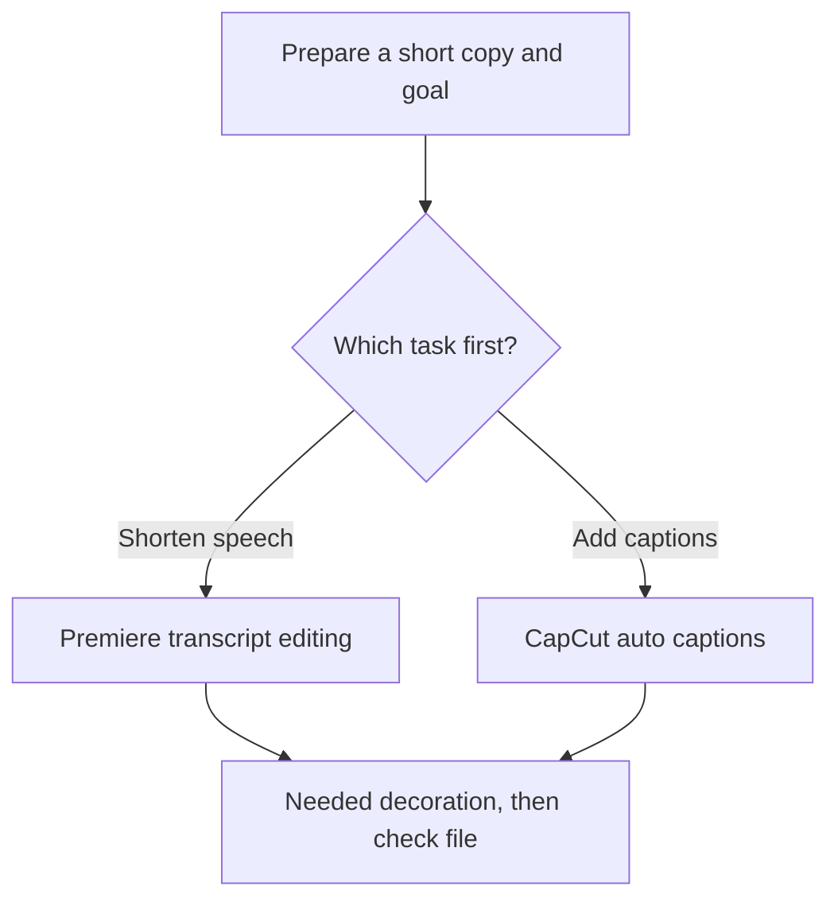
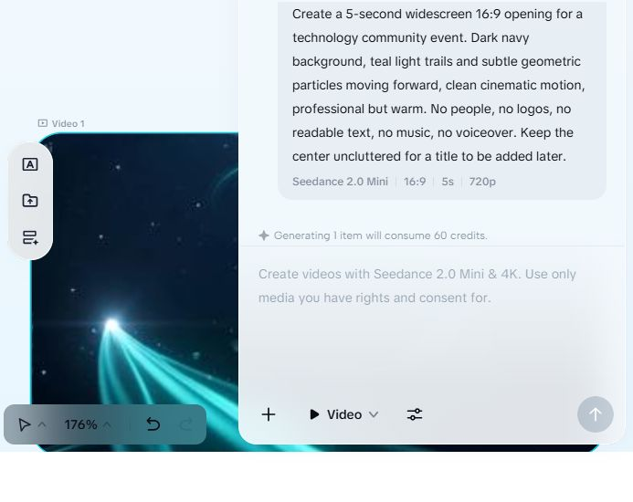
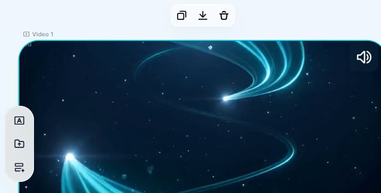
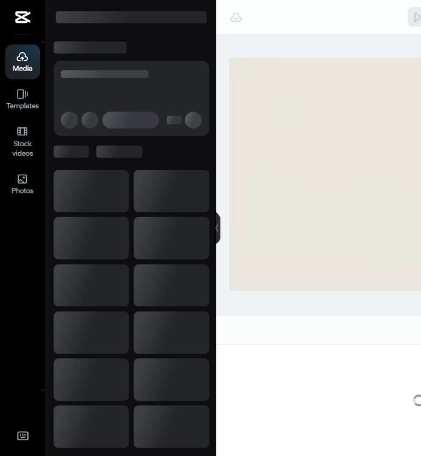

## Read First

[한국어](manual-existing-tools.md)

This guide is a draft for a first test of reducing speech editing and caption work in Premiere and CapCut, which are already in use. **The client's PC, app versions, subscriptions, and delivery specs are unverified**, so check with a short copy that the menus below appear, then apply them to actual event work. The basis for the conditional recommendation is in [M3 Recommendation 1](../03-Recommendation/recommendation.en.md).

| Task | Evidence level | Remaining checks |
|---|---|---|
| Premiere transcription and text-based editing | Official documentation checked 2026-10-29, not hands-on | Client's version, menus, Korean results |
| CapCut auto captions | Official help checked 2026-10-29, not hands-on | Usage per account, paid labels, output conditions |
| CapCut Seedance intro | 5-second generation and MP4 download done; file decodes normally | Full review found unintended `Penhin` text and an `Ai` mark. Need to decide on regeneration or post-editing before use |
| CapCut template | Editor network error in M5 | Edit asset loading, text replacement, render |
| Re-editing CapCut output in Premiere | Not demonstrated | Video import and whether individual cuts and captions carry over |

## 1. Test Preparation and Starting Conditions

### Guide for This Test

After preparing, pick the task you need: speech editing or captions. If you need both, check the result of the first task and then continue to the other. This diagram is the procedure to follow; please check the actual app verification scope in the table above and in each step.

1. Write down the Premiere and CapCut versions, the OS, and the current subscriptions. If installation is needed, use each vendor's official app distribution channel; this Topic did not demonstrate a completed installation.
2. Keep the original and make a short copy where you can check the speech and the picture. When using web features, first check whether that copy is allowed to be uploaded externally.
3. Write down the target length, aspect ratio, speech language, on-screen title language, and caption language. Specify each one, for example "landscape 16:9, 150 seconds, English speech, Korean titles, Korean caption draft."
4. Save the edit project under a separate name. If a feature shows Pro, Upgrade, start trial, or payment, record it as an item to check against the actual account conditions.

The client environment check items are in [M1 confirmation questions](../01-Requirements-Map/client-questions.en.md). Do not read this document as permission to upload the original or start a new subscription.

## 2. Making a Speech-Focused Draft in Premiere

The steps below are based on Adobe's official documentation and were not run on screen. Awards, performances, and group photos without speech must be selected separately by watching the picture.

1. Import the test copy into the project and open the **Text-Based Editing** workspace.
2. In the **Project** panel, double-click the clip to transcribe.
3. Choose **Text → Transcribe** and check the speech language and speaker labeling options. After transcription finishes, compare names, numbers, and technical terms against the original audio.

Source: [Adobe — Transcribe source files](https://helpx.adobe.com/premiere/desktop/edit-projects/edit-video-using-text-based-editing/transcribe-individual-source-files.html), checked 2026-10-29. Screen images from the official documentation can be seen on that page; this Topic does not have hands-on captures yet.

4. Put the clip on the timeline, select the **Timeline** panel, and switch to the sequence transcript.
5. In the sequence transcript, copy and paste sentences to reorder them, or cut them, to build the speech draft. Deletions are reflected as ripple edits on the timeline, so listen again to how sentences connect before and after.
6. Refine cut lengths, audio, and titles with the video editing tools. Check that you did not keep the question and cut only the answer, or remove conditions or negations from what was said.

Source: [Adobe — Edit sequences with text](https://helpx.adobe.com/premiere/desktop/edit-projects/edit-video-using-text-based-editing/edit-sequences-using-text-based-editing.html), checked 2026-10-29. This is not described as a feature that automatically picks the good scenes of a whole event.

## 3. Making a Caption Draft in CapCut

CapCut's official help states the following principle.

> "Availability and functionality vary by platform."

Source: [CapCut auto captions help](https://www.capcut.com/help/how-to-recognise-subtitles), checked 2026-10-29. The steps below are the official guidance; the CapCut caption feature was not run hands-on in this Topic.

1. Open the allowed test video in a new project. The web version involves uploading, so use only an approved copy.
2. On desktop, open **Captions → Auto Captions**. Choose the audio source and the speech language, then click **Generate**. The web help gives the path **Captions → Auto Captions → Recognise**.
3. Edit the text, timing, and style of the generated captions. Check names, numbers, the meaning of what was said, and a readable amount of text per screen yourself.
4. If you need translated captions, correct the original-language transcript first. Do not use the speech language setting in place of the translation language setting.

The range of advanced features and SRT export differs by region and version. The experience that technical-term misrecognitions remained even in the local Whisper practice is recorded in [M5 speech caption test](../05-HandsOn-Effects/ai-directed-effects.en.md). Do not use that result as a measurement of CapCut's caption accuracy.

## 4. Adding Titles and an Intro

If you have an existing intro frame you can use, replace only the event name, date, and allowed logo. Check the exact event name against the provided original, and check that the length is readable and the contrast is good. Also check that the usage terms for music, fonts, and images in the template fit the delivery purpose.

In M5, **Seedance 2.0 Mini, 16:9, 5 seconds, 720p** was selected in the Video mode of CapCut AI Creator. The generation UI showed that one generation costs **60 credits**; this is the value seen with this setup and account. The existing generated video was saved as MP4 by collapsing the chat panel, selecting the video card, and clicking the download arrow on the card. The output is 1280×720, 24fps, 5.062 seconds, and a full decode is normal. However, unrequested `Penhin` text and an `Ai` mark in the top left were found across the frames, so the current file is hard to use as an event intro as is. There is an audio stream, but it was not identified by listening. Title post-editing, Premiere import, and delivery usage terms were not demonstrated. → [M5 intro actual results](../05-HandsOn-Effects/intro-template-vs-generative.en.md#actual-run-results)

The use button for the `INTRODUCTION 16:9` template opened the editor, but after a network error it kept loading. If the same error appears, keep the existing project and the original, and check the connection and service status. Regenerating may cost additional credits, so decide after checking whether it completed.

## 5. Exporting and Finishing in Premiere

### Public Example Captures — Generated Result and Loading State

Below are actual screens captured on 2026-10-29 in the existing CapCut workspace. This is a generative example for a tech community, with no sensitive information or event footage entered, and no new generation request or additional payment was made. The captures were cropped to keep only the video and the toolbar, excluding the project and account information area.

The first screen shows the existing generated video and the download arrow on the card. The 60 credits shown in the earlier settings capture was the generation UI's notice at that time, not credits newly used for this download. Do not judge the text, audio, or quality of the whole video from this one capture alone. The full output review results are in the [M5 practice record](../05-HandsOn-Effects/intro-template-vs-generative.en.md#2026-10-29-download-and-full-frame-check).

The actual MP4 file is kept in a local working folder outside the public Topic. If the chat panel is open and covers the tools, collapse the panel and then select the generated video card. Click the download arrow in the toolbar on the video card to save it, then open the saved file again and review the resolution, length, start, middle, end, and audio. Buttons and file names may differ by account and app version. This procedure is a check of an AI Creator generated video; it did not verify template editor output, caption file output, or reproduction in the client's environment.

The second screen shows the menu frame and the asset area that is still loading. In the earlier run, a network error message appeared, and in this recheck it stayed in the Loading state. Do not use it as a screen showing a finished template or an editor ready for editing. Our own captures of the full steps for Premiere, CapCut captions, and Vidio have not been made yet.

### Checking General Output Conditions

CapCut's [official caption guide](https://www.capcut.com/resource/how-to-add-subtitle-in-capcut) describes downloading with **Export** after editing. The AI Creator video download was checked hands-on, but the output procedure for templates, edit projects, and caption files was not checked all the way through. In the output window, check the resolution, frame rate, watermark, paid asset labels, and additional costs, then save in the delivery spec. Do not assume that exporting a low-resolution source at a larger size restores the original detail.

When you import a finished MP4 into Premiere, first treat it as a single video file and check it. Whether the original cuts, captions, and effects carry over in a separately editable state needs a separate test. For the first adoption, check import, sound, and aspect ratio with a 10-second copy, then expand to the full work. This is a recommended review procedure, not a hand-off demonstration performed in this Topic.

## 6. Pass Criteria for the First Test

- [ ] The output length and aspect ratio match the specified values.
- [ ] The meaning, names, and numbers of the speech match the original, and the question-and-answer connection is natural.
- [ ] A person checked the language and readability of the titles and captions.
- [ ] The generative intro was not used where it could be mistaken for an actual event record.
- [ ] The output file was opened again and its start, middle, end, and audio were checked.
- [ ] The time spent on selection, editing, and export, and the cost shown in the account, were recorded.

This checklist is a set of checks to perform in the future. Read through it once in the client's version, and update it for delivery after adding hands-on captures and an actual output review. The next document to read is [directions by event type](prompt-examples.en.md).
