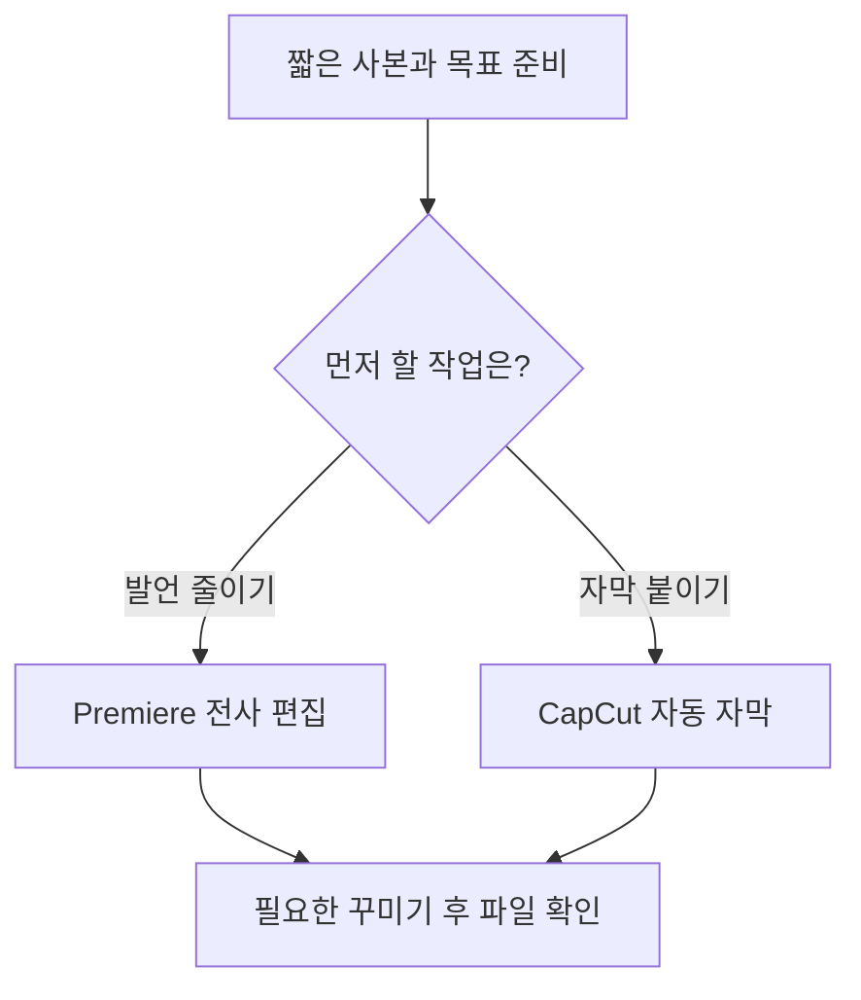
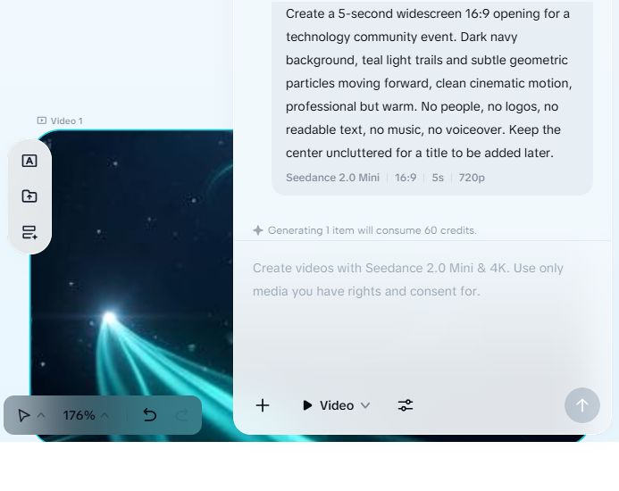
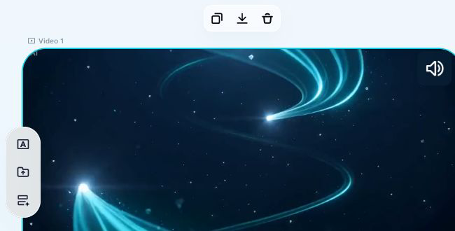
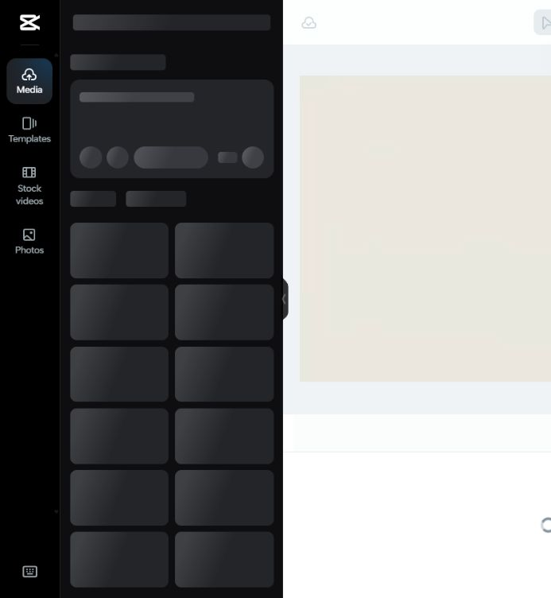

## 먼저 읽기

이 안내는 이미 사용하는 Premiere·CapCut에서 발언 편집과 자막 작업을 줄이는 첫 시험용 초안이다. **의뢰인의 PC·앱 버전·구독과 납품 규격은 미확인**이므로, 아래 메뉴가 보이는지 짧은 사본으로 확인한 뒤 실제 행사 작업에 적용한다. 조건부 추천 근거는 [M3 추천 1](../03-Recommendation/recommendation.md#추천-1--기존-premiere와-capcut에서-줄일-일부터-확인)에 있다.

| 작업 | 근거 수준 | 남은 확인 |
|---|---|---|
| Premiere 전사·텍스트 기반 편집 | 2026-10-29 공식 문서 확인, 직접 체험 안 함 | 의뢰인 버전·메뉴·한국어 결과 |
| CapCut 자동 자막 | 2026-10-29 공식 도움말 확인, 직접 체험 안 함 | 계정별 사용량·유료 표시·출력 조건 |
| CapCut Seedance 인트로 | 5초 생성·MP4 다운로드 완료; 파일 디코드 정상 | 전체 검토에서 의도치 않은 `Penhin` 문구와 `Ai` 표시 확인. 사용 전 재생성·후편집 판단 필요 |
| CapCut 템플릿 | M5에서 편집기 네트워크 오류 | 편집 자산 로딩·문구 교체·렌더 |
| CapCut 출력의 Premiere 재편집 | 미실증 | 영상 가져오기와 개별 컷·자막 전달 여부 |

## 1. 시험 준비와 시작 조건

### 이번 시험의 길잡이

준비를 마친 뒤 발언 편집과 자막 중 필요한 작업을 고르세요. 두 작업이 모두 필요하면 첫 작업의 결과를 확인한 다음 다른 작업으로 이어가면 됩니다. 이 그림은 따라갈 절차이며 실제 앱 검증 범위는 위 표와 각 단계에서 확인해 주세요.

1. Premiere·CapCut의 버전, OS, 현재 구독을 적는다. 설치가 필요하면 각 공급자의 공식 앱 배포 경로를 사용하며, 이 Topic에서는 설치 완료를 실증하지 않았다.
2. 원본은 보존하고 발언·화면을 확인할 수 있는 짧은 사본을 만든다. 웹 기능을 사용할 때는 해당 사본의 외부 업로드 허용 여부를 먼저 확인한다.
3. 목표 길이·화면비·발화 언어·화면 제목 언어·자막 언어를 적는다. 예를 들어 “가로 16:9, 150초, 영어 발화, 한국어 제목, 한국어 자막 초안”처럼 각각 지정한다.
4. 편집 프로젝트를 별도 이름으로 저장한다. 기능에 Pro·Upgrade·체험 시작·결제가 표시되면 실제 계정 조건을 확인할 항목으로 기록한다.

의뢰인 환경 확인 항목은 [M1 확인 질문](../01-Requirements-Map/client-questions.md)에 있다. 이 문서에서 원본 업로드나 새 구독을 허용한 것으로 해석하지 않는다.

## 2. Premiere에서 발언 중심 초안 만들기

아래 순서는 Adobe 공식 문서 기반이며 직접 화면에서 실행하지 않았다. 말 없는 시상·공연·단체 사진은 화면을 보며 별도로 골라야 한다.

1. 프로젝트에 시험 사본을 가져오고 **Text-Based Editing** 작업 영역을 연다.
2. **Project** 패널에서 전사할 클립을 더블클릭한다.
3. **Text → Transcribe**를 선택하고 발화 언어와 화자 구분 옵션을 확인한다. 전사 완료 후 이름·숫자·전문 용어를 원음과 대조한다.

출처: [Adobe — 소스 파일 전사](https://helpx.adobe.com/premiere/desktop/edit-projects/edit-video-using-text-based-editing/transcribe-individual-source-files.html), 2026-10-29 확인. 공식 문서의 화면 그림은 해당 페이지에서 볼 수 있으며, 이 Topic의 체험 캡처는 아직 없다.

4. 클립을 타임라인에 넣고 **Timeline** 패널을 선택해 시퀀스 전사로 전환한다.
5. 시퀀스 전사에서 문장을 복사·붙여넣어 순서를 바꾸거나 잘라내어 발언 초안을 구성한다. 삭제는 타임라인의 리플 편집에 반영되므로 문장 앞뒤 연결을 다시 듣는다.
6. 영상 편집 도구로 컷 길이·음성·타이틀을 다듬는다. 질문을 남기고 답변만 잘라내거나, 발언의 조건·부정을 제거하지 않았는지 확인한다.

출처: [Adobe — 텍스트로 시퀀스 편집](https://helpx.adobe.com/premiere/desktop/edit-projects/edit-video-using-text-based-editing/edit-sequences-using-text-based-editing.html), 2026-10-29 확인. 행사 전체의 좋은 장면을 자동 선정하는 기능으로 설명하지 않는다.

## 3. CapCut에서 자막 초안 만들기

CapCut 공식 도움말은 다음 원칙을 명시한다.

> “Availability and functionality vary by platform.”

출처: [CapCut 자동 자막 도움말](https://www.capcut.com/help/how-to-recognise-subtitles), 2026-10-29 확인. 아래 순서는 공식 안내이며 이 Topic에서 CapCut 자막 기능은 직접 실행하지 않았다.

1. 허용된 시험 영상을 새 프로젝트에서 연다. 웹은 업로드가 포함되므로 승인된 사본만 사용한다.
2. 데스크톱에서는 **Captions → Auto Captions**를 연다. 오디오 소스와 발화 언어를 선택하고 **Generate**를 누른다. 웹 도움말은 **Captions → Auto Captions → Recognise** 경로를 안내한다.
3. 생성된 자막의 문구·타이밍·스타일을 수정한다. 이름·숫자·발언 의미와 한 화면의 읽기 쉬운 분량을 직접 확인한다.
4. 번역 자막이 필요하면 원어 전사를 먼저 교정한다. 발화 언어 선택을 번역 언어 선택으로 대신하지 않는다.

지역·버전에 따라 고급 기능과 SRT 내보내기 제공 범위가 달라진다. 로컬 Whisper 실습에서도 전문 용어 오인식이 남았다는 경험은 [M5 발언 자막 시험](../05-HandsOn-Effects/ai-directed-effects.md)에 기록했다. 이 결과를 CapCut의 자막 정확도 실측으로 사용하지 않는다.

## 4. 제목과 인트로 넣기

기존에 사용 가능한 인트로 틀이 있으면 행사명·날짜·허용된 로고만 교체한다. 정확한 행사명은 제공받은 원문과 대조하고, 읽을 수 있는 길이와 대비를 확인한다. 템플릿 내 음악·글꼴·이미지의 사용 조건도 납품 목적에 맞게 확인한다.

M5에서는 CapCut AI Creator의 Video 모드에서 **Seedance 2.0 Mini·16:9·5초·720p**를 선택했다. 생성 UI는 1건에 **60 credits**가 든다고 표시했으며, 이 설정·계정에서 본 값이다. 기존 생성 영상은 채팅 패널을 접고 영상 카드를 선택한 뒤 카드 위 다운로드 화살표를 눌러 MP4로 저장했다. 출력은 1280×720·24fps·5.062초이며 전체 디코드는 정상이다. 그러나 전체 프레임에 요청하지 않은 `Penhin` 문구와 좌측 상단 `Ai` 표시가 확인되어 현재 파일을 행사 인트로로 바로 사용하기 어렵다. 오디오 스트림이 있지만 청취 판별은 하지 않았다. 제목 후편집·Premiere 가져오기·납품 사용 조건은 실증하지 않았다. → [M5 인트로 실제 결과](../05-HandsOn-Effects/intro-template-vs-generative.md#실제-실행-결과)

`INTRODUCTION 16:9` 템플릿의 사용 버튼은 편집기를 열었지만 네트워크 오류 후 로딩이 계속됐다. 같은 오류가 나면 기존 프로젝트·원본을 보존하고 연결과 서비스 상태를 확인한다. 재생성은 추가 크레딧이 들 수 있으므로 완료 여부를 확인한 뒤 결정한다.

## 5. 내보내기와 Premiere 마무리

### 공개용 예제 캡처 — 생성 결과와 로딩 상태

아래는 2026-10-29 기존 CapCut 작업 공간에서 확보한 실제 화면이다. 민감 정보나 행사 촬영본을 입력하지 않은 기술 커뮤니티용 생성형 예제이며, 새 생성 요청이나 추가 결제를 실행하지 않았다. 캡처는 영상과 도구 막대만 남기도록 잘라 프로젝트·계정 정보 영역을 제외했다.

첫 화면에서는 기존 생성 영상과 카드 위 다운로드 화살표를 확인할 수 있다. 이전 설정 캡처에 표시된 60 credits는 생성 UI의 당시 안내이며 이번 다운로드에서 새로 사용한 크레딧이 아니다. 이 캡처 한 장만으로 영상 전체의 문구·음성·품질을 판단하지 않는다. 전체 출력 검수 결과는 [M5 실습 기록](../05-HandsOn-Effects/intro-template-vs-generative.md#2026-10-29-다운로드와-전체-프레임-확인)에 있다.

실제 MP4 파일은 공개 Topic 밖 로컬 작업 폴더에 보관했다. 채팅 패널이 열려 도구가 가려져 있으면 패널을 접은 다음 생성 영상 카드를 선택한다. 영상 카드 위 도구 막대에서 다운로드 화살표를 눌러 저장하고, 저장된 파일을 다시 열어 해상도·길이·시작·중간·끝·음성을 검수한다. 버튼과 파일명은 계정·앱 버전에 따라 다를 수 있다. 이 절차는 AI Creator 생성 영상에 대한 확인이며 템플릿 편집기 출력·자막 파일 출력·의뢰인 환경에서의 재현을 검증한 것은 아니다.

두 번째 화면은 메뉴 틀과 로딩 중인 자산 영역을 보여 준다. 앞선 실행에서는 네트워크 오류 문구가 나타났고, 이번 재확인에서는 Loading 상태가 남아 있었다. 템플릿이 완성되거나 편집 준비가 끝난 화면으로 사용하지 않는다. Premiere·CapCut 자막·Vidio의 전체 단계 자체 캡처는 아직 확보하지 않았다.

### 일반 출력 조건 확인

CapCut의 [공식 자막 가이드](https://www.capcut.com/resource/how-to-add-subtitle-in-capcut)는 편집 후 **Export**로 다운로드하는 흐름을 안내한다. AI Creator 영상 다운로드는 직접 확인했지만, 템플릿·편집 프로젝트·자막 파일의 출력 절차를 끝까지 확인한 것은 아니다. 출력 창에서 해상도·프레임률·워터마크·유료 소재 표시·추가 비용을 확인한 뒤 납품 규격으로 저장한다. 낮은 해상도의 소스를 크게 출력해도 원본 디테일이 복원된다고 보지 않는다.

Premiere에 완성 MP4를 가져오면 우선 하나의 영상 파일로 취급해 확인한다. 원래 컷·자막·효과가 각각 수정 가능한 상태로 전달되는지는 별도 시험이 필요하다. 첫 도입에서는 10초 사본으로 가져오기·소리·화면비를 확인하고 전체 작업으로 확장한다. 이는 권장 검수 절차이며 이 Topic에서 수행한 전달 실증은 아니다.

## 6. 첫 시험의 통과 기준

- [ ] 출력 길이와 화면비가 지정값에 맞는다.
- [ ] 발언의 의미·이름·숫자가 원본과 맞고 질문·답변 연결이 자연스럽다.
- [ ] 제목·자막의 언어와 가독성을 사람이 확인했다.
- [ ] 생성형 인트로가 실제 행사 기록으로 오해될 위치에 쓰이지 않았다.
- [ ] 출력 파일을 다시 열어 시작·중간·끝과 음성을 확인했다.
- [ ] 선택·수정·내보내기에 걸린 시간과 계정 표시 비용을 기록했다.

이 검수표는 앞으로 수행할 확인 항목이다. 의뢰인 버전에서 한 번 따라 읽고, 체험 캡처와 실제 출력 검수를 보완하면 전달용으로 갱신한다. 다음 읽을 문서는 [행사별 지시문](prompt-examples.md)이다.
