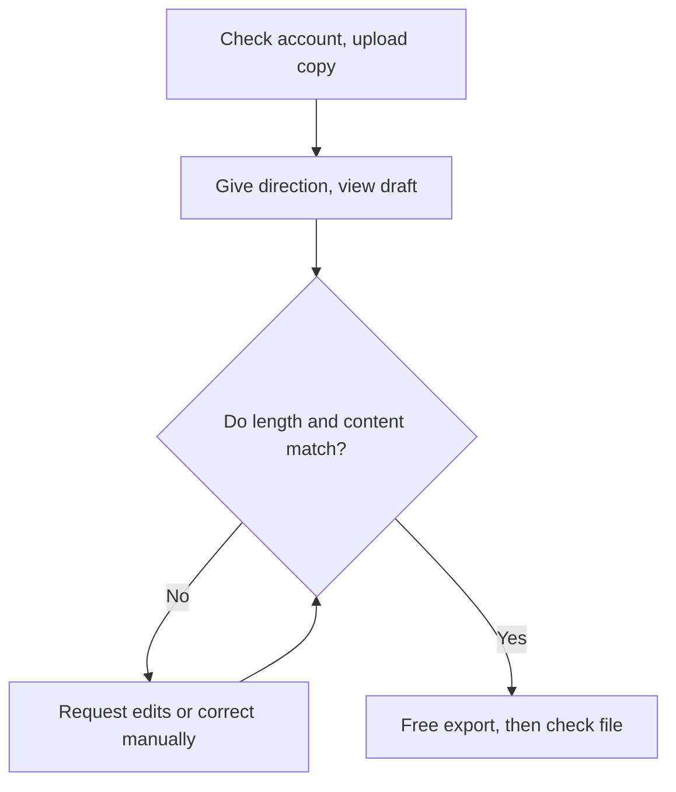

## Starting Conditions and Verification Scope

[한국어](manual-vidio.md)

Use this path when evaluating an automatic edit draft with a short copy that is allowed to be uploaded externally. The click steps in this manual are based on actual Free account observations on 2026-10-25 and may differ on the current screen. The new sign-up procedure, whether a card is required, and the limits of the client's account were not checked. Read this together with the [existing tools manual](manual-existing-tools.en.md), and first decide which tasks can be reduced in the current Premiere environment.

In the practice, I asked in Korean for 148 seconds ±5 seconds from a 5-minute copy of an English talk. The first output was 126.912 seconds, the automatic edit was about 73 seconds in the UI and fell short of the target, and after manual Transcript correction it became 150 seconds in the UI. The user rated the manual correction preview as good, but local file verification of v3 remains. This experience is an example where an automatic draft needs human checking and correction. → [Actual test results](../04-HandsOn-Highlight/method-B.en.md)

## 1. Preparing the Copy and Checking the Account

### Full Walkthrough Flow

The free test follows the flow below. If the result differs from what you asked for, go back to the edit step; if it matches, check all the way to whether the actual file was saved. Paid output and XML are items to review separately after this first test.

1. Prepare a copy of around 5 minutes that is allowed to be uploaded. Keep the original, and record the file name, length, resolution, and speech language.
2. Log in with an account at the [Vidio official site](https://www.vidio.ai/) and check the plan and remaining messages. This practice was done in an account the user logged into.
3. Check the [official pricing table](https://www.vidio.ai/pricing) before working. On 2026-10-29, the public Basic listing showed 10 messages per month, 3 uploads per day, 1GB per file, and watermarked output. Check paid subscription and credit requirements on the actual account screen.

Sending the whole event original externally needs separate permission. Do not extend the upload of the 5-minute copy allowed in the earlier practice into consent for uploading other videos. → [M4 allowed scope](../04-HandsOn-Highlight/method-B.en.md)

## 2. Adding the Video to a VibeEdit Project

1. The path used in the actual practice was **Dashboard → Create's New project → VibeEdit**.
2. In **Media composer → Add files → Choose Files**, select the test copy. Add files was a button that first opens a panel, so the file selection window opened from Choose Files.
3. Check that the video went into **Main visuals** and that its length and file status are right. In the practice, it showed 1 A-roll, 05:00.0, All requirements met.
4. After closing the Media Composer panel, check that the input video is still there. Do not repeat duplicate uploads.

Source: [M4 actual account access and first run](../04-HandsOn-Highlight/method-B.en.md). This document does not yet include our own step-by-step captures, and screens showing real people were not moved into the public Topic.

## 3. Entering the Request and Checking the Run Plan

Below is an example for writing an edit direction; change the values to fit the actual video. For other event situations, pick from the [5 directions](prompt-examples.en.md).

> From this test video, pick the explanation of [key topic] and the related questions and answers, and make a landscape 16:9 summary with a target of [seconds] ±5 seconds. Keep the meaning of what was said and the time order, and do not create scenes or speech that are not in the original. The speech is in [language], the on-screen titles are [language or none], and the captions are [language or none]. Do not add music, an intro, or transitions this time. Tell me about any request you cannot carry out.

1. Send the direction in the chat input and check the target length, number of videos, and aspect ratio in the response.
2. If there is **Show the plan**, open it and review the source and the plan. In the practice, **Run task** was run after checking the plan.
3. After processing finishes, open the result in **Preview**. Do not judge whether the direction was carried out based only on a reply that repeats the request.

In the first practice, the free remaining messages went from 10 to 9, and the length was shorter than the target. Check the message count and how runs work again in the current account. → [First result and file measurement](../04-HandsOn-Highlight/method-B.en.md)

## 4. Edit Requests and Manual Transcript Correction

1. Keep the first result as a separate file or version. Write down what needs to change, such as length, a missing explanation, or an incomplete next question.
2. Send the position, the change, and what to keep together, like "Remove the next question at 00:20–00:30 and keep the total within [seconds]."
3. When **Apply changes** appears, apply it and check the actual length and the selected sentences in Preview.
4. If the automatic edit does not meet the request, restore context with **Add to video** on the needed source segments in **Transcript**. Listen to the question and answer together, and leave out unrelated next questions.
5. Check **Saved** and the timeline, and play it from start to finish. Record the UI length and the output file length separately.

In the practice, the automatic edit shrank to 1:13, unlike its explanation that it "matched the length." After that, 12 segments were added manually to make 2:30 in the UI. This step is a human-selected correction and is not counted as a successful AI automatic edit. → [Manual correction v3](../04-HandsOn-Highlight/method-B.en.md)

## 5. Checking the Free Output File

On the practice screen, **Export → Free preview export** was a 720p watermarked output. For v1, the downloaded file was received, played, and measured; for v3, receipt of the local file after the UI export ended could not be confirmed. Do not judge the download as complete just because the progress finished.

1. First check the currently selected result version and the free output conditions.
2. Export once, and find the actual file in the download list or save folder.
3. Rename the file by version to keep it, and check the length, resolution, and the sound at the start, middle, and end.
4. If you cannot find the file, first check the save status and the download path. Do not conclude that all free output is blocked just from v1 succeeding and v3 being unverified.

Basis: [M4 download results and interpretation](../04-HandsOn-Highlight/method-B.en.md). The official guide also describes free watermarked output. → [Vidio output guide](https://www.vidio.ai/guide), checked 2026-10-29

## 6. When Also Checking Paid Output and XML

The official guide says you can get high-quality output and XML with credits. However, the plan table in the same guide also shows that Free does not support XML, and the practice screen said **Paid plan only**. Until the current account's notices, balance, and billing conditions are checked, do not settle whether free XML is possible. Check the cost based on the input video length and editing method, not just the length of a 3-minute result. → [Official pricing table](https://www.vidio.ai/pricing) · [Official guide](https://www.vidio.ai/guide)

XML delivery was **not hands-on**. Per the official description, it is a timeline that references the source files; cuts and original audio carry over, and captions, titles, transitions, and so on need to be rebuilt. Check together in the client's account the flow of gathering the source files, loading the XML with Premiere's **File → Import**, and reconnecting with **Link Media**. Do not treat this as an import manual that was actually performed.

## Completion Check and Next Steps

In the first test, record the specified length, whether the speech is complete, the question-and-answer connection, output file playback, and usage and editing time. For a delivery decision, also check the watermark, quality, re-editable state, and the amount of correction work. The current recommendation is in the [one-page summary](one-page-summary.en.md), and the list of sources is in the [official reference list](references.en.md).
