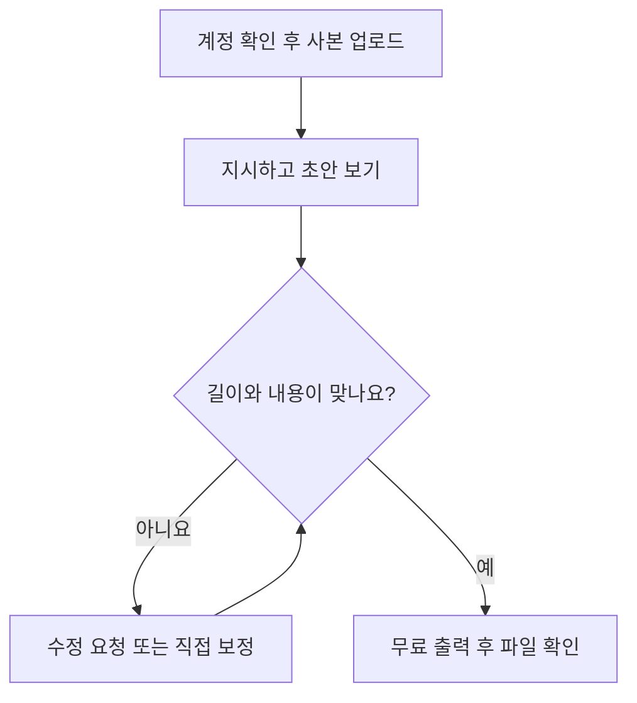

## 시작 조건과 검증 범위

이 경로는 외부 업로드가 허용된 짧은 사본으로 자동 편집 초안을 평가할 때 사용한다. 본 매뉴얼의 클릭 순서는 2026-10-25 실제 Free 계정 관찰에 기반하며 현재 화면에서는 달라질 수 있다. 신규 가입 절차·카드 요구 여부와 의뢰인 계정의 한도는 확인하지 않았다. [기존 도구 매뉴얼](manual-existing-tools.md)과 함께 읽고 현재 Premiere 환경에서 줄일 수 있는 작업부터 판단한다.

실습에서는 영어 발표 5분 사본에 한국어로 148초±5초를 요청했다. 첫 출력은 126.912초, 자동 수정은 UI 약 73초로 목표에 미달했고, Transcript 수동 보정 뒤 UI 150초가 됐다. 사용자는 수동 보정 미리보기를 양호하게 평가했지만 v3 로컬 파일 검증은 남았다. 이 경험은 자동 초안에 사람의 확인·보정이 필요한 사례다. → [실제 시험 결과](../04-HandsOn-Highlight/method-B.md#수정-적용-결과--설명과-실제-타임라인의-불일치)

## 1. 사본 준비와 계정 확인

### 전체 따라 하기 흐름

무료 시험은 아래 흐름으로 진행합니다. 결과가 요구와 다르면 수정 단계로 돌아가고, 맞으면 실제 파일이 저장됐는지까지 확인합니다. 유료 출력·XML은 이 첫 시험 뒤 별도로 검토하는 항목입니다.

1. 업로드 허용된 5분 안팎의 사본을 준비한다. 원본은 보존하고, 파일명·길이·해상도·발화 언어를 기록한다.
2. [Vidio 공식 사이트](https://www.vidio.ai/)에서 계정으로 로그인하고 플랜·메시지 잔량을 확인한다. 이번 실습은 사용자가 로그인한 계정에서 진행했다.
3. 작업 전에 [공식 요금표](https://www.vidio.ai/pricing)를 확인한다. 2026-10-29 공개 Basic 표시는 월 메시지 10개·하루 업로드 3개·파일당 1GB·워터마크 출력을 안내했다. 유료 구독과 크레딧 요구는 실제 계정 화면으로 확인한다.

전체 행사 원본의 외부 전송은 별도 허용이 필요하다. 이전 실습에서 허용된 5분 사본의 업로드를 다른 영상의 업로드 동의로 확대하지 않는다. → [M4 허용 범위](../04-HandsOn-Highlight/method-B.md#현재-결과)

## 2. VibeEdit 프로젝트에 영상 넣기

1. 실제 실습에서 사용한 경로는 **Dashboard → Create의 New project → VibeEdit**였다.
2. **Media composer → Add files → Choose Files**에서 시험 사본을 선택한다. Add files는 먼저 패널을 여는 버튼이었으므로 파일 선택 창은 Choose Files에서 열었다.
3. **Main visuals**에 영상이 들어가고 길이·파일 상태가 맞는지 확인한다. 실습에서는 A-roll 1개·05:00.0·All requirements met로 표시됐다.
4. Media Composer 패널을 닫은 뒤에도 입력 영상이 남았는지 확인한다. 중복 업로드를 반복하지 않는다.

출처: [M4 실제 계정 접근과 1차 실행](../04-HandsOn-Highlight/method-B.md#실제-계정-접근과-1차-실행). 이 문서에는 단계별 자체 캡처를 아직 첨부하지 않았으며, 실제 인물 화면을 공개 Topic으로 옮기지 않았다.

## 3. 요구를 입력하고 실행 계획 확인하기

아래는 편집 지시를 작성할 때의 예시이며 실제 영상에 맞게 값을 바꾼다. 다른 행사 상황은 [지시문 5개](prompt-examples.md)에서 고른다.

> 이 시험 영상에서 [핵심 주제] 설명과 관련 질문·답변을 골라 가로 16:9, 목표 [초]±5초의 요약을 만들어 주세요. 발언 의미와 시간 순서를 유지하고 원본에 없는 장면·발언은 만들지 마세요. 발화는 [언어], 화면 제목은 [언어 또는 없음], 자막은 [언어 또는 없음]입니다. 이번에는 음악·인트로·전환을 추가하지 마세요. 수행할 수 없는 요구는 알려 주세요.

1. 대화 입력란에 지시를 전송하고 응답의 목표 길이·영상 수·화면비를 확인한다.
2. **Show the plan**이 있으면 열어 원본과 계획을 검토한다. 실습에서는 계획 확인 뒤 **Run task**를 실행했다.
3. 처리 완료 후 **Preview**에서 결과를 연다. 요청을 되풀이한 답변만으로 지시 이행을 판정하지 않는다.

첫 실습에서는 무료 메시지 잔량이 10→9로 줄었고 길이가 목표보다 짧았다. 메시지 수와 실행 방식은 현재 계정에서 다시 확인한다. → [첫 결과와 파일 실측](../04-HandsOn-Highlight/method-B.md#첫-결과--길이와-선택-내용)

## 4. 수정 요청과 Transcript 수동 보정

1. 첫 결과를 별도 파일이나 버전으로 보존한다. 길이, 빠진 설명, 불완전한 다음 질문 등 수정 대상을 적는다.
2. “00:20~00:30의 다음 질문을 제외하고 전체 [초] 범위를 유지해 주세요”처럼 위치·변경·유지 조건을 함께 보낸다.
3. **Apply changes**가 나타나면 적용 후 Preview의 실제 길이와 선택된 문장을 확인한다.
4. 자동 수정이 요구를 충족하지 못하면 **Transcript**에서 필요한 원본 구간의 **Add to video**로 문맥을 복원한다. 질문과 답변을 같이 듣고 관련 없는 다음 질문은 제외한다.
5. **Saved**와 타임라인을 확인하고 처음부터 끝까지 재생한다. UI 길이와 출력 파일 길이는 따로 기록한다.

실습의 자동 수정은 “길이를 맞췄다”는 설명과 달리 1:13으로 줄었다. 이후 12개 구간을 수동으로 추가해 UI 2:30을 만들었다. 이 단계는 사람이 선정한 보정이며 AI 자동 수정 성공으로 집계하지 않는다. → [수동 보정 v3](../04-HandsOn-Highlight/method-B.md#수동-보정-v3--transcript에서-12개-복원)

## 5. 무료 출력 파일 확인하기

실습 화면에서는 **Export → Free preview export**가 720p·워터마크 출력이었다. v1은 다운로드 파일을 받아 재생·실측했고, v3는 UI 내보내기 종료 후 로컬 파일 수령을 확인하지 못했다. 진행률 종료만으로 다운로드 완료라고 판단하지 않는다.

1. 먼저 현재 선택된 결과 버전과 무료 출력 조건을 확인한다.
2. 한 번 내보내고 다운로드 목록·저장 폴더에서 실제 파일을 찾는다.
3. 파일명을 버전별로 바꿔 보존하고 길이·해상도·처음/중간/끝의 소리를 확인한다.
4. 파일을 찾지 못하면 저장 상태와 다운로드 경로부터 확인한다. v1 성공과 v3 미확인만으로 모든 무료 출력이 차단됐다고 결론 내리지 않는다.

근거: [M4 다운로드 결과와 해석](../04-HandsOn-Highlight/method-B.md#수동-보정-v3-사용자-검토와-다운로드-해석). 공식 가이드도 무료 워터마크 출력을 안내한다. → [Vidio 출력 안내](https://www.vidio.ai/guide), 2026-10-29 확인

## 6. 유료 출력·XML을 함께 확인할 때

공식 가이드는 크레딧으로 고화질 출력과 XML을 받을 수 있다고 안내한다. 그러나 같은 가이드의 플랜 표에는 Free XML 미지원이라는 표시도 있고, 실습 화면은 **Paid plan only**였다. 현재 계정의 안내·잔액·청구 조건 확인 전에는 무료 XML 가능 여부를 확정하지 않는다. 비용은 입력 영상 길이와 편집 방식에 따라 확인하며, 3분 결과물 길이만으로 계산하지 않는다. → [공식 요금표](https://www.vidio.ai/pricing) · [공식 가이드](https://www.vidio.ai/guide)

XML 전달은 **직접 체험 안 함**이다. 공식 설명상 원본 파일을 참조하는 타임라인이며 컷·원음 등이 넘어가고 자막·타이틀·전환 등은 재구성이 필요하다. 원본을 모아 Premiere의 **File → Import**로 XML을 불러온 뒤 **Link Media**로 재연결하는 흐름을 의뢰인 계정에서 함께 확인한다. 이를 실제 수행한 가져오기 매뉴얼로 보지 않는다.

## 완료 판정과 다음 단계

첫 시험에서 지정 길이, 발언 완결성, 질문·답변 연결, 출력 파일 재생, 사용량과 수정 시간을 기록한다. 납품용 판단에는 워터마크·화질·재편집 가능 상태·수정 작업량까지 확인한다. 현재 추천은 [한 쪽 요약](one-page-summary.md), 근거 목록은 [공식 참조 모음](references.md)에 있다.
