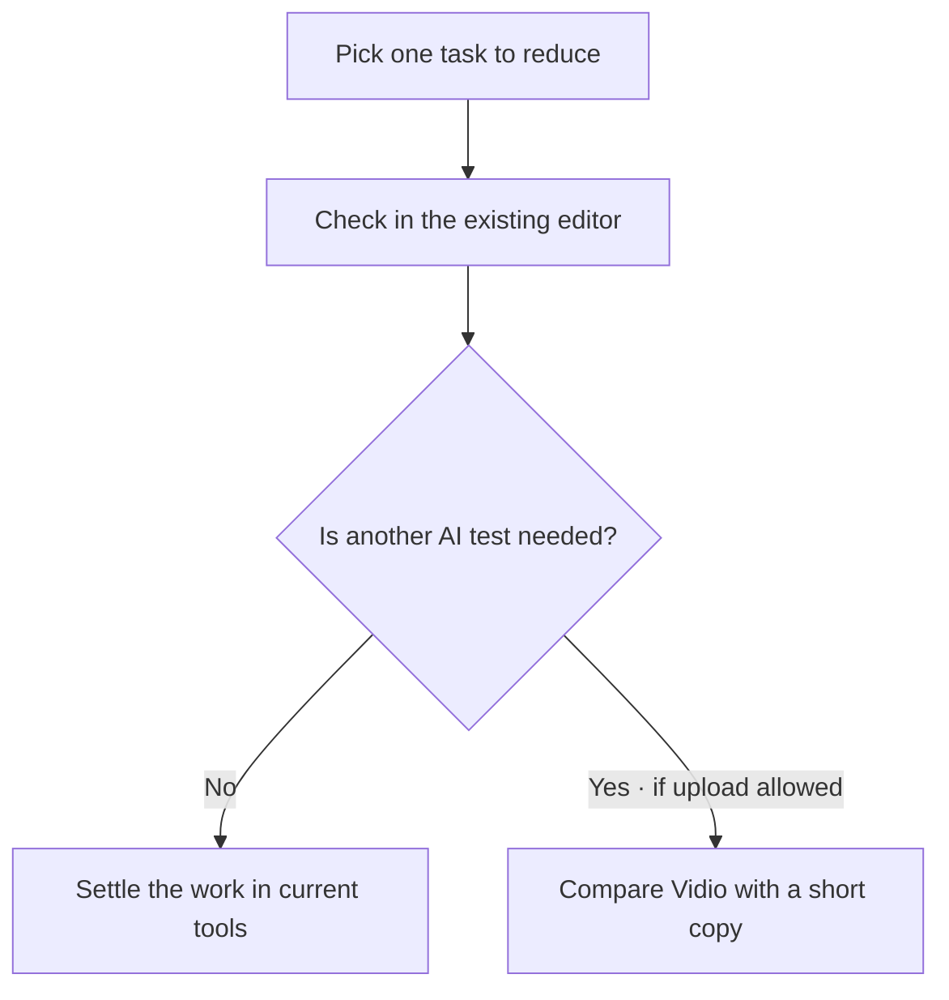

## Order to Test First

[한국어](one-page-summary.md)

The diagram above is the current conditional test order. If it is unverified whether external upload is allowed, the Vidio test is put on hold, and you start by checking what can be done in the existing tools.

**First check which tasks can be reduced in the existing Premiere and CapCut, and if that is not enough, compare Vidio with a short copy that is allowed to be uploaded.** The client's versions, subscriptions, and delivery specs are still unverified, so the final adoption recommendation is conditional. Read the [existing tools guide](manual-existing-tools.en.md) first, and move to the [Vidio practice guide](manual-vidio.en.md) when needed.

| Path | What to expect | Scope actually checked and what remains |
|---|---|---|
| Existing Premiere and CapCut | Transcription, speech selection, captions, using existing intro frames | Premiere and CapCut captions are based on official documentation. Needs hands-on check in the client's version |
| Vidio VibeEdit | Scene selection draft from Korean directions, manual Transcript correction | 5-minute English talk test. First result 126.912 s, automatic edit fell short of the length, manual correction UI 150 s. v3 output verification remains |
| CapCut generative intro | Short background video to put a title on | MP4 download and basic decode checked: 1280×720, 5.062 s. A full review found unintended `Penhin` text and an `Ai` mark, so it is hard to use as is. Template editing not complete |

## Cost and Delivery Conditions

Vidio separates a free 720p watermarked preview from output paths that use credits. High-quality and XML conditions need to be checked in an actual account, and the length of the input source matters for the cost decision. CapCut's 60 credits is a value observed with this setup and does not guarantee the free allowance for each account. Pricing and features were checked on **2026-10-29**. → [Vidio pricing](https://www.vidio.ai/pricing) · [Vidio output guide](https://www.vidio.ai/guide) · [CapCut pricing](https://www.capcut.com/pricing)

Vidio's edit response and the actual length differed, so you need to play the result and check it. Importing an MP4 and delivering a project where individual cuts and captions can be edited are evaluated separately, and Premiere XML import has not been demonstrated yet. → [Actual comparison conclusion](../04-HandsOn-Highlight/results-comparison.en.md)

## Information Needed Before Starting

Check the Premiere and CapCut versions and subscriptions, examples of the desired result, aspect ratio and quality, and whether the test copy may be uploaded externally. Then test scene selection, editing, and output with one short copy, and decide which path to keep, including the time and cost of fixing. You can also use the [5 directions by event type](prompt-examples.en.md) and the [official reference list](references.en.md).
