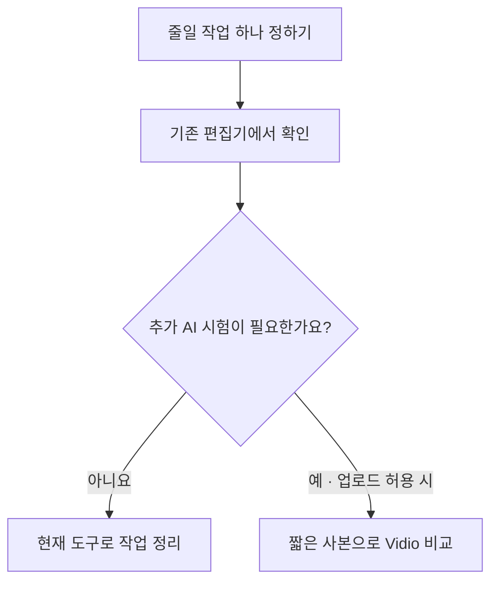

## 먼저 시험할 순서

위 도식은 현재의 조건부 시험 순서입니다. 외부 업로드 허용 여부가 미확인이면 Vidio 시험은 보류하고 기존 도구에서 가능한 작업부터 확인합니다.

**기존 Premiere·CapCut에서 줄일 수 있는 작업부터 확인하고, 부족하면 업로드가 허용된 짧은 사본으로 Vidio를 비교합니다.** 의뢰인의 버전·구독·납품 규격은 아직 미확인이라 최종 도입 추천은 조건부입니다. 먼저 [기존 도구 안내](manual-existing-tools.md)를 읽고 필요할 때 [Vidio 실습 안내](manual-vidio.md)로 넘어갑니다.

| 경로 | 기대할 일 | 실제 확인한 범위·남은 일 |
|---|---|---|
| 기존 Premiere·CapCut | 전사·발언 선택·자막·기존 인트로 틀 활용 | Premiere와 CapCut 자막은 공식 자료 기반. 의뢰인 버전에서 직접 확인 필요 |
| Vidio VibeEdit | 한국어 지시로 장면 선택 초안, Transcript 수동 보정 | 영어 발표 5분 시험. 첫 결과 126.912초, 자동 수정 길이 미달, 수동 보정 UI 150초. v3 출력 검증 남음 |
| CapCut 생성형 인트로 | 제목을 얹을 짧은 배경 영상 | MP4 다운로드·기본 디코드 확인: 1280×720, 5.062초. 전 구간 검수에서 의도치 않은 `Penhin` 문구와 `Ai` 표시가 나와 바로 사용하기 어려움. 템플릿 편집은 미완료 |

## 비용과 전달 조건

Vidio는 무료 720p 워터마크 미리보기와 크레딧을 쓰는 출력 경로를 구분합니다. 고화질·XML 조건은 실제 계정에서 확인해야 하며, 입력 원본 길이가 비용 판단에 중요합니다. CapCut의 60 credits는 이번 설정의 관찰값으로 계정별 무료 제공량을 보장하지 않습니다. 요금과 기능 확인일은 **2026-10-29**입니다. → [Vidio 요금](https://www.vidio.ai/pricing) · [Vidio 출력 가이드](https://www.vidio.ai/guide) · [CapCut 요금](https://www.capcut.com/pricing)

Vidio의 수정 응답과 실제 길이가 달랐으므로 결과를 재생해 확인해야 합니다. MP4 가져오기와 개별 컷·자막을 수정할 수 있는 프로젝트 전달은 따로 평가하며, Premiere XML 가져오기는 아직 실증하지 않았습니다. → [실제 비교 결론](../04-HandsOn-Highlight/results-comparison.md#실무-선택에-반영할-판단)

## 시작 전에 필요한 정보

Premiere·CapCut 버전과 구독, 원하는 결과물 예시·화면비·화질, 시험 사본의 외부 업로드 허용 여부를 확인합니다. 이후 짧은 사본 한 개로 장면 선택·수정·출력을 시험하고, 손보는 시간과 비용을 포함해 유지할 경로를 정합니다. [행사별 지시문 5개](prompt-examples.md)와 [공식 참조 모음](references.md)을 함께 사용할 수 있습니다.
