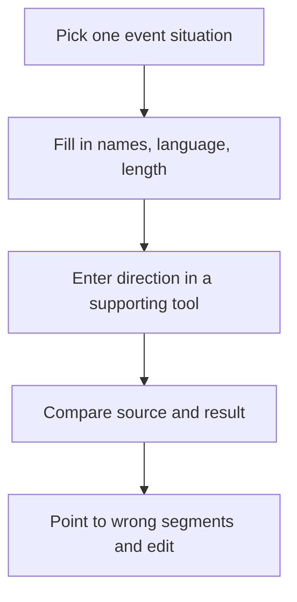

## How to Use

[한국어](prompt-examples.md)

This diagram is the order for using the examples below. If a regular editor does not support natural-language input, use the same sentences as a work instruction for a person to follow.

Below are **unrun drafts** that expand M3's [common summary direction](../03-Recommendation/test-plan.en.md) for each event situation. Fill in the bracketed values and check that the scenes actually exist in the footage. Enter them in a tool that supports natural-language video editing, or in a regular editor, use them as edit instructions for a person to carry out. Do not assume the Premiere transcript panel accepts these sentences and runs them automatically.

Each example has a length for a standalone test; it is not the total length of combining the five results. When making a whole-event highlight, first decide the total length and how it is split across scenes. Ask the tool to report requests it does not support and scenes that are not in the source as unsupported or not available.

## 1. Congratulatory Speech — Speech Summary That Keeps the Meaning

> From the congratulatory speech in this footage, pick the remarks that carry the event's purpose and key message, and make a landscape 16:9, 45-second draft. Cut so each sentence can be heard to the end, and keep conditions and negative expressions. The speech language is [English/Korean], the on-screen titles are in [language], and the captions are [language or none]. Use only [confirmed spelling] for names and titles, and if unknown, leave them as unverified. Do not generate new speech or event scenes. Tell me the selected source file names, start/end times, and the reason for each choice.

What to review: check that the starting context, sentence endings, names and titles, and caption translation match the meaning of the original speech. The actual editing limits for speech summaries are in the [M4 comparison record](../04-HandsOn-Highlight/results-comparison.en.md).

## 2. Awards — Connecting the Announcement to the Presentation

> Using the award announcement, presentation, winner's reaction, and applause that actually exist in the source, make a landscape 16:9, 30-second awards draft. Check that the announced winner matches the winner on screen, and mark any uncertain connections. Write winner and award names only from [confirmed list], and do not generate presentation scenes that do not exist. Make the on-screen titles [language] and the captions [language or none]. Also give me the missing scenes and the timetable of source clips used.

What to review: compare the screen with the name called to make sure another winner's reaction was not wrongly connected. A person makes the final check of the list and of the applause and presentation scenes.

## 3. Performance — Connecting Movement and Sound

> From this performance, make a landscape 16:9, 45-second draft with segments that show the start, signature movements, and the ending. Keep the original performance sound and keep the audio in sync with the movement. Reduce awkward cuts in the middle of key movements and repeats of the same movement. Do not add separate music; make the title [confirmed performance name, language] and the speech captions [language or none]. Do not generate new movements or audience reactions, and tell me the segments used and the points where the sound connections should be checked.

What to review: check the connection of beats and movements and the range of original audio used. Do not approve a performance edit based only on reviewing the scenes without sound.

## 4. Group Photo — Keeping Faces and Composition

> From the actually shot group photos or group photo video, pick scenes where few faces are blocked and the composition is stable, and make a landscape 16:9, 10-second ending. Do not generate or change faces, hands, or the number of people, and avoid zooming in so that people at the edges are cut off. The event name is [confirmed event name], the on-screen titles are in [language], and there are no captions. If no scene meets these conditions, tell me why and give alternatives with a source timetable.

What to review: check people at the edges, faces, blinking and shaking, and the actual number of people. Check whether participant exposure and photo use are allowed separately from the video selection.

## 5. Atmosphere Montage — Built from Actual Footage

> Using actually shot wide views of the venue, preparation, and conversation, participation, and reaction scenes, make a landscape 16:9, 30-second atmosphere montage. Arrange it so the flow of changing places and activities is easy to follow, and reduce repeats of the same scene. Do not generate scenes or text that exaggerate the audience size or the event's results. Keep the original audio only in the segments that need it, and do not add outside music. Make the title [language or none] and the captions [language or none], and tell me the source time and reason for choosing each cut.

What to review: check that reactions from different places and times were not wrongly connected. Instead of asking for scenes that are not in the source, adjust the structure using the scenes you actually have.

## Edit Directions and Records

After seeing the first result, write the position, the change, and what to keep together, like "Replace the 00:20–00:30 segment with the actual presentation scene and keep the total at 30 seconds." Check the length before and after the edit and what is missing, and record the request wording, unsupported features, and work a person corrected. In M4, the automatic edit did not meet the length and structure and manual correction was needed, so these examples also need to be run and reviewed.
