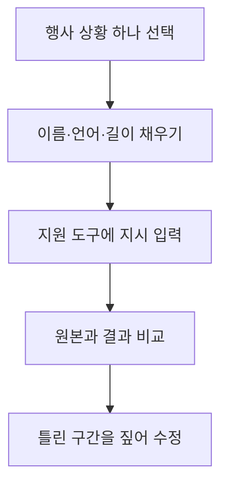

## 사용하는 방법

이 그림은 아래 예시를 사용하는 순서입니다. 일반 편집기에서 자연어 입력을 지원하지 않으면 같은 문장을 사람이 따라 할 작업 지시서로 쓰면 됩니다.

아래는 M3의 [요약용 공통 지시문](../03-Recommendation/test-plan.md#요약용-공통-지시문)을 행사 상황별로 확장한 **미실행 초안**이다. 대괄호 값을 채우고 실제로 찍힌 장면이 있는지 확인한다. 자연어 영상 편집을 지원하는 도구에 입력하거나, 일반 편집기에서는 사람이 수행할 편집 지시서로 사용한다. Premiere 전사 패널이 이 문장을 받아 자동 실행한다고 가정하지 않는다.

각 예시는 독립 시험용 길이이며 다섯 결과를 그대로 합친 전체 길이가 아니다. 전체 행사 하이라이트를 만들 때는 총 길이와 각 장면 배분을 먼저 정한다. 도구가 지원하지 않는 요구와 원본에 없는 장면은 미지원·없음으로 보고하도록 요청한다.

## 1. 축사 — 의미를 보존한 발언 요약

> 이 촬영본의 축사에서 행사 취지와 핵심 메시지를 담은 발언을 골라 가로 16:9, 45초 초안을 만들어 주세요. 문장을 끝까지 들을 수 있게 자르고 조건·부정 표현을 보존해 주세요. 발화 언어는 [영어/한국어], 화면 제목은 [언어], 자막은 [언어 또는 없음]입니다. 이름·직함은 [확인된 표기]만 쓰고 모르면 미확인으로 남겨 주세요. 새 발언이나 행사 장면을 생성하지 마세요. 선택한 원본 파일명·시작/끝 시간·선택 이유를 함께 알려 주세요.

검토할 점: 시작 맥락, 문장 끝, 이름·직함, 자막 번역이 원래 발언의 뜻과 맞는지 확인한다. 발언 요약의 실제 수정 한계는 [M4 비교 기록](../04-HandsOn-Highlight/results-comparison.md)에 있다.

## 2. 시상 — 발표에서 수여까지 연결

> 원본에 실제로 있는 수상 발표, 수여, 수상자 반응과 박수로 가로 16:9, 30초 시상 초안을 만들어 주세요. 발표된 수상자와 화면의 수상자가 일치하는지 확인하고 불확실한 연결은 표시해 주세요. 수상자·상 이름은 [확인된 명단]으로만 표기하며 없는 수여 장면을 생성하지 마세요. 화면 제목은 [언어], 자막은 [언어 또는 없음]으로 해 주세요. 누락된 장면과 사용한 원본 시간표를 함께 제시해 주세요.

검토할 점: 다른 수상자의 반응을 잘못 연결하지 않았는지 화면과 호명을 대조한다. 명단 확인과 박수·수여 장면 판단은 사람이 최종 확인한다.

## 3. 공연 — 동작과 소리의 연결

> 이 공연에서 시작, 대표 동작, 마무리가 드러나는 구간으로 가로 16:9, 45초 초안을 만들어 주세요. 원본 공연 소리를 유지하고 음성과 동작의 동기를 맞춰 주세요. 주요 동작 중간의 어색한 절단과 같은 동작의 반복을 줄여 주세요. 별도 음악은 추가하지 말고, 제목은 [확인된 공연명·언어], 발언 자막은 [언어 또는 없음]으로 해 주세요. 새 동작·관객 반응을 생성하지 말고 사용한 구간과 소리 연결을 확인할 지점을 알려 주세요.

검토할 점: 박자·동작의 연결과 원음 사용 범위를 확인한다. 소리 없이 장면을 검토한 결과만으로 공연 편집을 승인하지 않는다.

## 4. 단체 사진 — 얼굴과 구도 보존

> 실제 촬영된 단체 사진 또는 단체 촬영 영상에서 얼굴 가림이 적고 구도가 안정된 장면을 골라 가로 16:9, 10초 마무리를 만들어 주세요. 얼굴·손·인원을 생성하거나 바꾸지 말고, 가장자리 인물을 자르는 확대도 피해주세요. 행사명은 [확인된 행사명], 화면 제목은 [언어], 자막은 없음으로 해 주세요. 조건에 맞는 장면이 없으면 이유와 대안을 원본 시간표로 알려 주세요.

검토할 점: 가장자리 인물, 얼굴, 깜빡임·흔들림과 실제 인원을 확인한다. 참가자 노출·사진 사용 허용 여부는 영상 선택과 별도로 확인한다.

## 5. 분위기 몽타주 — 실제 기록으로 구성

> 실제 촬영된 행사장 전경, 준비 모습, 대화·참여·반응 장면으로 가로 16:9, 30초 분위기 몽타주를 만들어 주세요. 장소와 활동이 바뀌는 흐름이 이해되게 배열하고 같은 장면 반복은 줄여 주세요. 관객 규모나 행사 성과를 과장하는 장면·문구를 생성하지 마세요. 원음은 필요한 구간만 유지하고 외부 음악은 추가하지 마세요. 제목은 [언어 또는 없음], 자막은 [언어 또는 없음]으로 하며 각 컷의 원본 시간과 선택 이유를 알려 주세요.

검토할 점: 서로 다른 장소·시간의 반응을 잘못 연결하지 않았는지 확인한다. 원본에 없는 장면을 요구하는 대신 실제로 확보한 장면으로 구성을 조정한다.

## 수정 지시와 기록

첫 결과를 본 뒤에는 “00:20~00:30 구간을 실제 수여 장면으로 바꾸고 전체 30초는 유지해 주세요”처럼 위치·변경·유지 조건을 함께 쓴다. 수정 전후 길이와 빠진 내용을 확인하고 요청 문구·지원하지 않은 기능·사람이 보정한 작업을 기록한다. M4에서는 자동 수정이 길이·구성을 충족하지 못해 수동 보정이 필요했으므로 이 예시도 실행과 검토를 거쳐야 한다.
