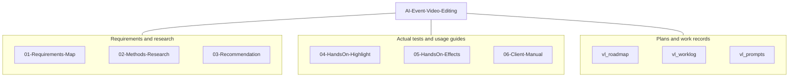
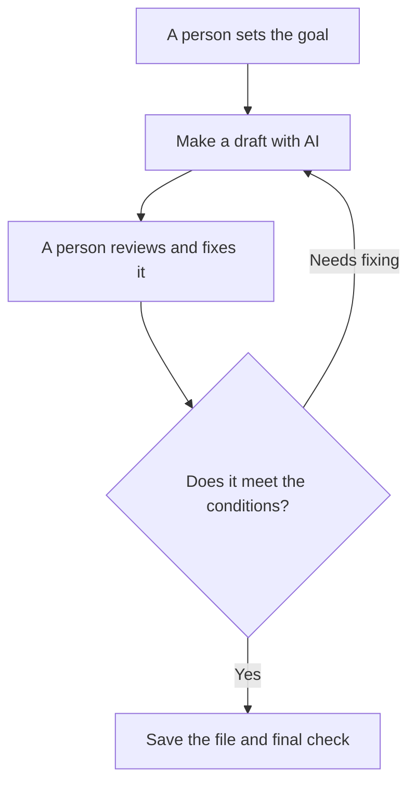

## AI Event Video Editing Research — First-Round Results

[한국어](README.md)

**Client, please start by reading [06 — First-round results and next-step guide](06-Client-Manual/README.en.md).** It puts the research process, the actual results and limits, the reason for the delay, the steps for getting help from AI, and the methods we can test together next into one document. The materials so far were grouped as first-round results so they could be delivered first. Testing in the client's environment and the final adoption decision are later steps.

I researched and tested ways to pick scenes from event footage, assemble them into about 3 minutes, and add an intro and captions. I propose **a conditional path: check the existing Premiere · CapCut environment first, then compare Vidio using a short copy that is allowed to be uploaded**. The client's versions, subscriptions, and conditions for handling the original footage are unverified, so I have not settled on a tool to adopt.

> A way to tell AI "use scenes like this" about event footage filmed over several hours, so that it picks only the parts that match, edits them into a short video of about 3 minutes, and adds an intro and effects in between

This request is organized in the [requirements card](01-Requirements-Map/requirements-card.en.md). The public Topic does not include the client's name, contact details, event organizer information, or actual footage.

## Research method and the process for using AI editing

### Where the materials are, at a glance

The structure diagram below shows where the materials are. Client, please look at **folder 06 first**, and go to 01–05 when you want to see the research evidence or actual test results. A description of each folder and links to its documents are in the module guide table below.

### Editing done by AI and people together

Below is the basic flow to follow in later use. In the review step in the middle, you fix missing scenes, cut-off speech, and wrong text, and at the end you check the actual downloaded file. This does not mean the whole flow has been verified in the client's environment.

I split the problem into scene selection, assembling a short video, and decorating with an intro and captions, and researched 9 candidates in 5 categories. After separating official feature descriptions from actual account tests, I tested local editing and Vidio Free with a short English presentation sample, and also looked at a generative intro, effects, and captions. I checked not only the descriptions of the results but also the timeline length, the output file and representative frames, and the user's viewing evaluation, and recorded both successes and failures. → [Methods map](01-Requirements-Map/methods-map.en.md) · [Candidate comparison table](02-Methods-Research/comparison-table.en.md)

The usage process confirmed in this test is **define the target length and required scenes → prepare a short copy you are allowed to use → make a draft or do transcript editing with a tool that fits the task → manually correct scenes, speech, and captions → add effects → review the actual output**. AI could help with drafts and repetitive work, but I could not verify the full flow of turning several hours of footage into a deliverable finished video with one instruction. Making a generative intro and picking scenes from the footage were also evaluated separately. → [Steps for using AI editing](06-Client-Manual/README.en.md#what-you-need-to-do-to-actually-get-help-from-ai)

## Documents to read first

The overall progress and the direction for next steps are in the [first-round results guide for the client](06-Client-Manual/README.en.md). Below are detailed documents by purpose. The evidence for research, recommendations, hands-on tests, and manuals is organized separately in folders 01–06.

1. [One-page summary for the client](06-Client-Manual/one-page-summary.en.md) — read the recommended order and what was actually confirmed.
2. [Existing Premiere · CapCut guide](06-Client-Manual/manual-existing-tools.en.md) — check the procedures based on official documentation and the range I tried directly.
3. [Vidio hands-on manual](06-Client-Manual/manual-vidio.en.md) — check the experience of upload, requests, revision, manual correction, and export.
4. [5 prompts by event type](06-Client-Manual/prompt-examples.en.md) — write requests for speeches, awards, performances, group photos, and atmosphere scenes.
5. [11 official references](06-Client-Manual/references.en.md) — check providers' documents and guides.
6. [Delivery message draft](06-Client-Manual/delivery-message.en.md) — review the KakaoTalk and email text. It has not been sent outside.

The manuals include 3 captures with no real event participants: a CapCut example result, the download tool, and template loading. I also found unintended text in the full frames of the downloaded generative MP4. Full step-by-step captures and a follow-along review in the client's environment are still left, so these are provided for review.

## Actual test results and limits

| Test | Confirmed result | How far it can be interpreted |
|---|---|---|
| Local transcript review · FFmpeg | Excerpt summary of 147.714 seconds. Later effects demo of 157.257 seconds, user review complete | Result from one English presentation sample. Not evidence that this is the easiest method for a client who does not work with code |
| Vidio Free | First file 126.912 seconds · 1280×720. Automatic revision about 73 seconds shown in the UI, short of the length | A Korean request being accepted and the wanted revision succeeding are separate |
| Vidio Transcript correction | After manual additions, 2:30 · Saved shown in the UI; user preview rating good | v3 local output file and technical verification not done |
| CapCut Seedance 2.0 Mini | Generated 5 seconds · 16:9 · 720p; downloaded the MP4 at 1280×720 and confirmed a full decode | Unintended `Penhin` text and an `Ai` mark found in the full frames. For audio, only the stream was confirmed; the content was not listened to. Hard to use right away |
| CapCut template | Confirmed the detailed specs and the use button; network error in the editor | No template render, so the comparison of the two results with the generative one is not done |
| Local Whisper captions | Compared tiny · medium on a short speech; misrecognitions remain even with medium | Not used in the final demo captions. Not treated as a test of CapCut caption accuracy |

Sources: [M4 comparison conclusion](04-HandsOn-Highlight/results-comparison.en.md), [Vidio actual results](04-HandsOn-Highlight/method-B.en.md), [M5 intro](05-HandsOn-Effects/intro-template-vs-generative.en.md), [effects · captions record](05-HandsOn-Effects/ai-directed-effects.en.md).

The user rated the key choices of the two summaries as similar, and slightly preferred the local one, which ended more cleanly. I do not generalize the evaluation of this one sample into a performance ranking for all events, Korean speech, or scenes without speech.

## Learning order and status by module

| Module | Guide | Current status |
|---|---|---|
| M1 | [Requirements and methods map](01-Requirements-Map/README.en.md) | 6/7 · waiting for the client's answers |
| M2 | [Research by method](02-Methods-Research/README.en.md) | 7/7 · document research on 5 categories · 9 candidates |
| M3 | [Conditional recommendation and trial preparation](03-Recommendation/README.en.md) | 7/7 · preparation complete, the final adoption recommendation is conditional |
| M4 | [Highlight hands-on](04-HandsOn-Highlight/README.en.md) | 5/7 · strict same-wording comparison and full step-by-step captures left |
| M5 | [Intro · effects hands-on](05-HandsOn-Effects/README.en.md) | 6/7 · CapCut template vs. generative comparison left |
| M6 | [First-round results guide and manuals](06-Client-Manual/README.en.md) | 5/7 · first-round results organized; full step-by-step captures, follow-along, and finalizing the final retrospective left |

The [learning roadmap](vl_roadmap/20261017_RoadMap_AI-Event-Video-Editing.md) is the DoD standard, and the current review is recorded in the [latest WorkLog](vl_worklog/20261029_M6_AI-Event-Video-Editing.md). The [Topic retrospective draft](vl_worklog/20261029_AI-Event-Video-Editing_Final_Retrospective.md) includes the goals not met and the follow-up proof still needed, and it is not a declaration that the Topic is complete.

## Costs and handling of the original footage

**I could not directly pay for, test, or verify paid services and paid features, and I did not do trials that require card registration.** Premiere transcript and text-based editing and CapCut auto captions are guidance based on official documentation. For paid features the client uses, I propose a follow-up path of checking them together in the client's account. I kept using CapCut generation credits within the free range separate from verifying a paid subscription. Pricing needs to be read together with the check date and the actual account's features, usage, and output conditions. → [Official references](06-Client-Manual/references.en.md)

Permission for outside upload was limited to the specified 5-minute test copy. The original footage, actual result videos, and captures of people are kept in a local work folder outside the public Topic. Generative scenes are used only in ways that will not be confused with actual recorded footage.

## Schedule and organizing the first-round results

The reasons for the delay that the user explained are these: research and hands-on time had to be found alongside other work, and token usage grew from several AI tasks, so when the usage limit was reached, work had to wait until the reset before resuming. There was also the process of checking the automatic revision failure and the editor loading problem during the hands-on tests. Because of this, the calendar period got longer. This is not converted into actual active work time or into the processing time of the video services themselves. The explanation for the client is in [Why the first-round results were late](06-Client-Manual/README.en.md#why-the-first-round-results-were-late).

So that the current results can be reviewed first, I organized the first-round results guide and the detailed manuals. Preparing documents and sending them outside, and providing first-round results and completing all the learning, are each recorded separately, and no actual sending was done. Unfinished hands-on work was not changed to complete.

## Proposed next steps and remaining checks

First, I propose **choosing one task, speech editing or captions,** in the client's existing Premiere · CapCut environment and testing it briefly in person or over screen sharing. If outside upload is allowed, an AI-specific service can be compared using the same copy and the same goal. Another option is for the client to work directly using the materials and get support only where needed. Paid tests will be checked in an account the client chooses, after setting the purpose, cost, and output conditions. → [Follow-up paths A · B · C and information to prepare](06-Client-Manual/README.en.md#how-to-proceed-from-here)

From the [questions for the client](01-Requirements-Map/client-questions.en.md), I need the PC, Premiere/CapCut versions and subscriptions, a delivery example, and whether outside upload is allowed. Next, I will check an actual follow-along with a short copy, the shareable captures needed, and Premiere XML import and the amount of rework. Vidio's Free XML information differs between sections even within its official guide, so the actual account conditions need to be checked.

After checking the remaining M4 · M5 hands-on work, the M6 manual review, and the user's self-assessment, I will finalize the final retrospective. This Topic uses the [VibeLearn AI](https://github.com/solkit70/CatchUpAI_VL) method to leave work records and reusable outputs.
