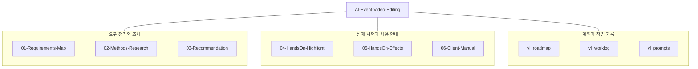
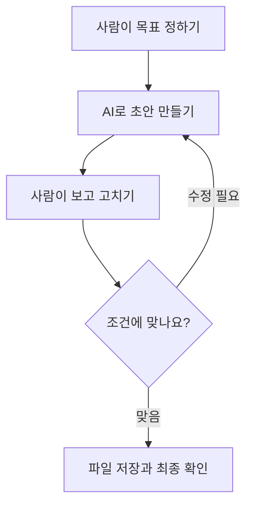

## 행사 영상 AI 편집 리서치 — 1차 결과

[English](README.en.md)

**의뢰인께서는 [06 — 1차 결과와 후속 진행 안내](06-Client-Manual/README.md)부터 읽어 주세요.** 조사 과정, 실제 성과와 한계, 전달이 늦어진 이유, AI의 도움을 받는 절차와 다음에 함께 시험할 방법을 한 문서로 정리했습니다. 현재까지의 자료를 먼저 전달할 수 있는 1차 결과로 묶었으며, 의뢰인 환경에서의 검증과 최종 도입 결정은 후속 단계입니다.

행사 촬영본에서 장면을 고르고 3분 안팎으로 조립한 뒤 인트로·자막을 더하는 방법을 조사하고 시험했다. **기존 Premiere·CapCut 환경을 먼저 확인하고, 업로드가 허용된 짧은 사본으로 Vidio를 비교하는 조건부 경로**를 제안한다. 의뢰인의 버전·구독·원본 처리 조건이 미확인이라 도입 도구를 확정하지 않았다.

> 몇 시간 동안 촬영한 행사 영상을 AI 에게 「이런 장면으로」라고 지시하면, 그 지시에 맞는 부분만 골라 3분 안팎의 짧은 영상으로 편집하고, 인트로와 중간 효과까지 넣어 주는 방법

이 요청은 [요구사항 카드](01-Requirements-Map/requirements-card.md)에 정리했다. 공개 Topic에는 의뢰인 이름·연락처·행사 주최 측 정보와 실제 촬영 영상을 넣지 않는다.

## 조사 방법과 AI 편집을 활용하는 과정

### 자료의 위치를 한눈에 보기

아래 구조도는 자료가 들어 있는 위치를 보여 줍니다. 의뢰인께서는 **06 폴더부터** 보시고, 조사 근거나 실제 시험 결과가 궁금할 때 01~05로 이동하시면 됩니다. 각 폴더의 한국어 설명과 문서 링크는 아래 모듈별 안내 표에 있습니다.

### AI와 사람이 함께 하는 편집

아래는 후속 활용에서 따라갈 기본 흐름입니다. 가운데 검토 단계에서 빠진 장면·잘린 발언·잘못된 글자를 고치고, 마지막에는 실제 내려받은 파일을 확인합니다. 이 흐름 전체가 의뢰인 환경에서 검증 완료됐다는 뜻은 아닙니다.

문제를 장면 선택·짧은 영상 조립·인트로와 자막 꾸미기로 나누고, 5개 범주에서 9개 후보를 조사했다. 공식 기능 설명과 실제 계정 시험을 구분한 뒤 짧은 영어 발표 샘플로 로컬 편집과 Vidio Free를 시험하고 생성형 인트로·효과·자막까지 살폈다. 결과 설명뿐 아니라 타임라인 길이, 출력 파일과 대표 프레임, 사용자 시청 평가를 확인해 성공과 실패를 함께 기록했다. → [방법 지도](01-Requirements-Map/methods-map.md) · [후보 비교표](02-Methods-Research/comparison-table.md)

이번 시험에서 확인한 활용 과정은 **목표 길이·필수 장면 정의 → 허용된 짧은 사본 준비 → 작업에 맞는 도구로 초안 생성 또는 전사 편집 → 장면·발언·자막의 수동 보정 → 효과 추가 → 실제 출력 검수**다. AI가 초안과 반복 작업을 도울 수 있었지만 한 번의 지시로 수시간 촬영본을 납품 가능한 완성본으로 만드는 전체 흐름은 검증하지 못했다. 생성형 인트로 제작과 촬영본에서 장면을 고르는 작업도 따로 평가했다. → [AI 편집 활용 절차](06-Client-Manual/README.md#실제로-ai의-도움을-받으려면-어떻게-해야-하는가)

## 먼저 읽을 문서

전체 경과와 다음 진행 방향은 [의뢰인용 1차 결과 안내](06-Client-Manual/README.md)에 있다. 아래는 목적별 상세 문서이며 01~06 폴더에 조사·추천·실습·매뉴얼의 근거를 나누어 정리했다.

1. [의뢰인용 한 쪽 요약](06-Client-Manual/one-page-summary.md) — 추천 순서와 실제 확인한 범위를 읽는다.
2. [기존 Premiere·CapCut 안내](06-Client-Manual/manual-existing-tools.md) — 공식 자료 기반 절차와 직접 체험 범위를 확인한다.
3. [Vidio 실습 매뉴얼](06-Client-Manual/manual-vidio.md) — 업로드·요청·수정·수동 보정·출력 경험을 확인한다.
4. [행사별 지시문 5개](06-Client-Manual/prompt-examples.md) — 축사·시상·공연·단체 사진·분위기 장면의 요구를 작성한다.
5. [공식 참조 11개](06-Client-Manual/references.md) — 공급자 문서와 가이드를 확인한다.
6. [전달 메시지 초안](06-Client-Manual/delivery-message.md) — 카톡·이메일 문안을 검토한다. 외부 전송은 하지 않았다.

매뉴얼에는 실제 행사 인물이 없는 CapCut 예제 결과·다운로드 도구·템플릿 로딩 캡처 3개를 넣었다. 다운로드한 생성형 MP4 전체 프레임에서 의도치 않은 글자도 확인했다. 전체 단계 캡처와 의뢰인 환경에서 따라 하기 검토가 남아 있어 검토용으로 제공한다.

## 실제 시험 결과와 한계

| 시험 | 확인한 결과 | 해석의 범위 |
|---|---|---|
| 로컬 전사 판독·FFmpeg | 발췌 요약 147.714초. 후속 효과 데모 157.257초, 사용자 리뷰 완료 | 한 영어 발표 샘플의 결과. 코드를 다루지 않는 의뢰인에게 가장 쉬운 방법이라는 근거는 아님 |
| Vidio Free | 첫 파일 126.912초·1280×720. 자동 수정 UI 약 73초로 길이 미달 | 한국어 요청 접수와 원하는 수정 성공은 별도 |
| Vidio Transcript 보정 | 수동 추가 후 UI 2:30·Saved, 사용자 미리보기 평가 양호 | v3 로컬 출력 파일·기술 검증 미완료 |
| CapCut Seedance 2.0 Mini | 5초·16:9·720p 생성; MP4 1280×720 다운로드 및 전체 디코드 확인 | 전체 프레임에서 의도치 않은 `Penhin` 문구와 `Ai` 표시 확인. 오디오는 스트림만 확인했고 내용은 미청취. 바로 사용하기 어려움 |
| CapCut 템플릿 | 상세 사양과 사용 버튼 확인, 편집기 네트워크 오류 | 템플릿 렌더가 없어 생성형과 두 결과 비교 미완료 |
| 로컬 Whisper 자막 | 짧은 발언에서 tiny·medium 비교, medium에도 오인식 남음 | 최종 데모 자막에는 미반영. CapCut 자막 정확도 시험으로 보지 않음 |

출처: [M4 비교 결론](04-HandsOn-Highlight/results-comparison.md#실무-선택에-반영할-판단), [Vidio 실제 결과](04-HandsOn-Highlight/method-B.md#수정-적용-결과--설명과-실제-타임라인의-불일치), [M5 인트로](05-HandsOn-Effects/intro-template-vs-generative.md#실제-실행-결과), [효과·자막 기록](05-HandsOn-Effects/ai-directed-effects.md).

사용자는 두 요약의 핵심 선택을 비슷하게 평가했고 종료가 깔끔한 로컬을 조금 더 선호했다. 이 한 샘플의 평가를 모든 행사·한국어 발화·말 없는 장면의 성능 순위로 일반화하지 않는다.

## 모듈별 학습 순서와 상태

| 모듈 | 안내 | 현재 상태 |
|---|---|---|
| M1 | [요구사항과 방법 지도](01-Requirements-Map/README.md) | 6/7 · 의뢰인 답변 대기 |
| M2 | [방법별 조사](02-Methods-Research/README.md) | 7/7 · 5개 범주·9개 후보 문서 조사 |
| M3 | [조건부 추천과 체험 준비](03-Recommendation/README.md) | 7/7 · 준비 완료, 최종 도입 추천은 조건부 |
| M4 | [하이라이트 체험](04-HandsOn-Highlight/README.md) | 5/7 · 엄밀한 동일 문구 비교·전체 단계 캡처 남음 |
| M5 | [인트로·효과 체험](05-HandsOn-Effects/README.md) | 6/7 · CapCut 템플릿·생성형 비교 남음 |
| M6 | [1차 결과 안내와 매뉴얼](06-Client-Manual/README.md) | 5/7 · 1차 결과 정리, 전체 단계 캡처·따라 하기·최종 회고 확정 남음 |

[학습 로드맵](vl_roadmap/20261017_RoadMap_AI-Event-Video-Editing.md)이 DoD 기준이며 [최신 WorkLog](vl_worklog/20261029_M6_AI-Event-Video-Editing.md)에 현재 검토를 기록한다. [Topic 회고 초안](vl_worklog/20261029_AI-Event-Video-Editing_Final_Retrospective.md)은 목표 미달과 후속 실증을 포함하며 Topic 완료 선언은 아니다.

## 비용과 원본 처리

**유료 서비스·유료 기능의 직접 결제와 시험·검증은 수행하지 못했으며 카드 등록이 필요한 체험도 진행하지 않았다.** Premiere 전사·텍스트 기반 편집과 CapCut 자동 자막은 공식 문서 기반 안내다. 의뢰인이 사용하는 유료 기능은 의뢰인 계정에서 함께 확인하는 후속 경로를 제안한다. 무료 범위의 CapCut 생성 크레딧 사용과 유료 구독 검증을 구분했으며, 요금은 확인 날짜와 실제 계정의 기능·사용량·출력 조건을 함께 보아야 한다. → [공식 참조 모음](06-Client-Manual/references.md)

외부 업로드를 허용받은 범위는 지정된 5분 시험 사본에 한정됐다. 원본과 실제 결과 영상·인물 캡처는 공개 Topic 밖 로컬 작업 폴더에 보관한다. 생성형 장면은 실제 촬영 기록과 혼동되지 않는 용도로 사용한다.

## 진행 일정과 1차 결과 정리

사용자가 설명한 지연 사유는 다른 업무와 병행해 조사·실습 시간을 확보해야 했던 점, 여러 AI 작업으로 토큰 사용량이 늘어 사용 한도에 도달하면 재설정까지 기다린 뒤 재개해야 했던 점이다. 실습 중 자동 수정 실패와 편집기 로딩 문제를 확인하는 과정도 있었다. 이 사정으로 달력상의 진행 기간이 길어졌으며 실제 능동 작업 시간이나 영상 서비스 자체의 처리 시간으로 환산하지 않는다. 의뢰인께 드리는 설명은 [1차 결과 전달이 늦어진 이유](06-Client-Manual/README.md#1차-결과-전달이-늦어진-이유)에 정리했다.

현재 결과를 먼저 검토할 수 있도록 1차 결과 안내와 상세 매뉴얼을 정리했다. 문서 준비와 외부 전송, 1차 결과 제공과 전체 학습 완료는 각각 따로 기록하며 실제 전송은 수행하지 않았다. 미완료 실습을 완료로 변경하지 않았다.

## 후속 진행 제안과 남은 확인

우선 의뢰인의 기존 Premiere·CapCut 환경에서 **발언 편집 또는 자막 중 한 작업을 골라** 만나거나 화면 공유로 짧게 시험하는 방식을 제안한다. 외부 업로드가 허용되면 같은 사본·같은 목표로 AI 전용 서비스를 비교할 수 있고, 의뢰인이 자료를 참고해 직접 진행하며 필요한 부분만 지원받는 방법도 가능하다. 유료 시험은 목적·비용·출력 조건을 정한 뒤 의뢰인이 선택한 계정에서 확인한다. → [후속 진행 경로 A·B·C와 준비 정보](06-Client-Manual/README.md#앞으로-진행하는-방법)

[의뢰인 확인 질문](01-Requirements-Map/client-questions.md) 중 PC·Premiere/CapCut 버전·구독, 납품 예시, 외부 업로드 허용 여부가 필요하다. 이어서 짧은 사본의 실제 따라 하기, 필요한 공개 가능 캡처, Premiere XML 가져오기와 재작업량을 확인한다. Vidio의 Free XML 안내는 공식 가이드 안에서도 절별 차이가 있어 실제 계정 조건을 확인해야 한다.

M4·M5 잔여 실습과 M6 매뉴얼 검토, 사용자 자기평가를 확인한 뒤 최종 회고를 확정한다. 이 Topic은 [VibeLearn AI](https://github.com/solkit70/CatchUpAI_VL) 방식으로 작업 기록과 재사용 가능한 산출물을 남긴다.
