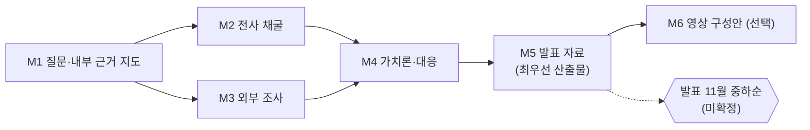

# Builders-Lounge-AI-Market 학습 로드맵

**생성일**: 2026-10-11
**방법론**: VibeLearn AI
**버전**: 1.1 (리뷰 반영 — 사용자 검토 대기)

> **v1.1 변경 (2026-10-11)**: ① 최우선 산출물 M5 시간 증액(4→6h), M3(6→4h)·M4(4→3h) 축소, M1(4→5h) ② M1 에서 **잠정 핵심 메시지**와 **청중 분석**을 먼저 세우고 이후 모듈은 그 메시지를 검증·수정 ③ M5 에 멤버 1~2명 **사전 검증**과 토론 질문 추가 ④ M2·M3 에 **조사 종료 기준** 추가 ⑤ 발표 길이를 운영진에게 확인할 때까지 **5분판 하나**만 만든다 ⑥ 가치론은 발표의 틀로 짧게, 대응 비중을 높인다 ⑦ Self-Assessment 를 이 Topic 고유 문항으로 교체

## 📚 학습 개요

### Topic 소개
AI 로 만들기가 쉬워져 빌더와 제품이 급증하면 제품의 가치와 시장은 어떻게 바뀌는가를 탐구하고, 빌더가 되려는 사람이 어떻게 제품에 가치를 부여해 사업 활동을 할 수 있는지(3년 이내 단기, 5~10년 중장기)와 Builders Lounge 의 역할을 근거와 함께 정리해 다음 모임에서 발표하는 연구형 Topic. 주제는 사용자 말씀대로 **가주제**다.

### 학습 기간 확정 (STEP 1 통과)
- 4주, 주당 5~6시간, 약 22시간 (2026-10-11 사용자 확인).
- 발표는 **11월 중하순이 유력하나 미확정**이다. 길이도 미정이므로 **운영진에게 길이를 확인하는 것을 M1 할 일로 둔다.** 확인 전까지는 5분판 하나를 만들고, 길면 같은 뼈대에서 확장한다. 4주 학습이 11/8 쯤 끝나면 발표까지 1~3주의 여유가 생겨 리허설과 수정에 쓴다.
- 우선순위(사용자 확정): **발표 자료 준비가 가장 앞, 영상 작업은 그다음.** 영상도 진행하므로 선택 모듈 M6 으로 둔다.
- 이번 주는 10/21 특강 준비와 시니어 모임 자료(M2 마감 10/20 전)가 겹친다. 지속 가능한 페이스를 위해 W2 는 가볍게 잡았다.

### 사용자 확정 사항 (Journal/2026-10-11 구술 원문 기준)
- 미팅 상대의 발언은 공개해도 된다. 표기는 **한국 이름을 쓰지 않고 영어 이름이나 성만** 쓴다 (예: Dr. Kim).
- 인용은 원문을 보존하고 출처를 단다. 외부 근거는 조사한 출처로만 쓴다.

### 학습 환경
- OS: Windows 11
- 도구: VS Code, Claude Code, 웹 검색·문서 읽기, 전사 파일 읽기, Markdown 슬라이드
- 사전 지식: VibeLearn AI 흐름, 가치론 글·영상 맥락, Seattle Tech Week 근거 자료

## 🗺️ 전체 로드맵 구조

| 모듈 | 모듈명 | 난이도 | 예상 시간 | 주차 | 산출물 폴더 |
|------|--------|--------|----------|------|------------|
| M1 | 잠정 메시지·청중·내부 근거 지도 | ⭐ | 5h | W1 (10/11~) | 01-Question-and-Source-Map/ |
| M2 | 영상·미팅 전사 채굴 | ⭐⭐ | 4h | W2 (가볍게) | 02-Transcript-Mining/ |
| M3 | 외부 조사 (빈 고리 중심) | ⭐⭐⭐ | 4h | W2~W3 | 03-External-Research/ |
| M4 | 단기·중장기 대응 (가치론은 틀로) | ⭐⭐⭐ | 3h | W3~W4 | 04-Value-Theory-and-Responses/ |
| M5 | 발표 자료 + 사전 검증 | ⭐⭐⭐ | 6h | W4 (~11/8) | 05-Presentation-Kit/ |
| M6 (선택) | 영상 구성안 | ⭐⭐ | 3h | 발표 자료 승인 후 | 06-Video-Outline/ |

**총 예상 시간**: 핵심 22시간(M1~M5) + 선택 3시간 (각 모듈에 버퍼 20% 포함)



**작동 방식 (v1.1)**: M1 에서 잠정 핵심 메시지를 먼저 세운다. M2~M4 는 그 메시지를 지지하거나 반박하는 근거를 찾는 일이며, 근거에 따라 메시지를 고친다. M2 와 M3 는 서로 독립이라 시간이 날 때 병행할 수 있다. Dr. Kim 미팅 전사가 늦게 오면 M2 를 두 번에 나눠 하고, 도착 전에도 나머지는 진행한다.

## 📖 모듈별 상세 계획

### M1 - 잠정 메시지·청중·내부 근거 지도

**난이도**: ⭐
**예상 시간**: 5h
**산출물 폴더**: `01-Question-and-Source-Map/`

#### 학습 목표
- [ ] 사용자 원문의 주장을 고리별 가설 사슬로 풀고 각 고리의 상태(사용자 주장/가설/근거 있음)를 표시할 수 있다
- [ ] 발표의 중심 질문을 한 문장으로 확정할 수 있다 (출발 질문 두 개를 하나로 합칠지 정함)
- [ ] 이미 있는 내부 자료(근거 자료, 가치론 글, 구술, Builders Lounge 기록)를 고리별로 연결한 지도를 만들 수 있다
- [ ] 아직 없는 자료(전사 위치 미확인, Dr. Kim 전사 대기)를 목록으로 남길 수 있다
- [ ] **잠정 핵심 메시지** 한 문장을 세울 수 있다 (이후 모듈에서 검증·수정)
- [ ] Builders Lounge 청중(개발자·비개발자 혼합, 「서로의 첫 번째 사용자」 문화)이 발표에서 무엇을 가져가야 하는지 정리할 수 있다

#### 주요 개념
1. **가설 사슬**: 주장을 고리로 쪼개 어디가 약한지 보이게 하는 방법
2. **출발 질문**: 「빌더는 무엇을 준비하나」와 「Builders Lounge 의 역할」은 한 발표에서 앞뒤로 이어질 수 있다. 하나로 합칠지 사용자가 정한다
3. **근거 수준 표시**: 1차 자료(발언 전사, 데이터) / 전문가 의견 / 언론 / 블로그 / 사용자 주장
4. **재사용 원칙**: Seattle Tech Week 근거 자료는 이미 정리돼 있으므로 다시 채굴하지 않는다
5. **잠정 메시지 우선**: 답을 먼저 세우고 근거로 검증한다. 메시지가 없으면 조사 범위가 끝없이 늘어난다
6. **청중이 가져갈 것**: 생각 하나, 행동 하나, 토론 질문 하나
7. **오해하기 쉬운 점**: 자료가 많다고 근거가 강한 것이 아니다. 같은 말을 반복하는 자료는 하나로 센다

#### 실습 과제

**실습 1: 가설 사슬 확정** ⭐
- **목적**: 발표 논리의 뼈대를 만든다
- **단계**: 1) vl_materials 1장 사슬을 읽는다 2) 사용자와 확인해 고리를 수정/삭제/추가 3) 고리마다 상태 표시
- **예상 시간**: 90분
- **검증**: 모든 고리에 상태가 있고 사용자가 승인했다

**실습 2: 내부 자료 지도 갱신** ⭐⭐
- **목적**: 재사용할 근거를 고리에 연결한다
- **단계**: 1) 근거 자료의 교차 주제 7개와 발표자 인용을 고리에 붙인다 2) 가치론 글에서 고리 ⑥에 쓸 부분을 표시 3) Builders Lounge 기록에서 고리 ⑨ 관련 항목 표시
- **예상 시간**: 90분
- **검증**: 고리마다 자료 위치(파일·절)가 적혀 있다

**실습 3: 잠정 메시지·청중·빈 곳 목록** ⭐⭐
- **목적**: 이후 조사의 방향과 종료 기준을 정한다
- **단계**: 1) 중심 질문 한 문장 2) 잠정 핵심 메시지 후보 2~3개 → 사용자 선택 3) 청중 분석(누가 오나, 무엇을 가져가야 하나) 4) 근거가 없는 고리 목록 = M2·M3 조사 대상 5) 운영진에게 발표 길이 확인 요청
- **예상 시간**: 100분
- **검증**: 사용자가 잠정 메시지를 골랐고, 빈 고리 목록이 M3 종료 기준으로 쓰일 만큼 구체적이다

#### 산출물
```
01-Question-and-Source-Map/
├── README.md
├── concepts/
│   └── hypothesis-chain.md
├── guides/
│   └── source-map.md
└── examples/
    ├── central-question-and-gaps.md
    └── provisional-message-and-audience.md
```

> **README.md 작성 기준**: 모듈 헤더(번호·제목·상태·시간), 학습 순서대로 번호 매긴 문서 목록과 상대 경로 링크·한 줄 설명, 이전/다음 모듈 링크를 둔다.

#### Definition of Done
- [ ] 모든 학습 목표 달성
- [ ] 가설 사슬 문서와 사용자 승인
- [ ] 내부 자료 지도 (고리별 위치 명시)
- [ ] 중심 질문 한 문장 확정
- [ ] 잠정 핵심 메시지와 청중 분석 사용자 승인
- [ ] 빈 고리 목록(M2·M3 조사 대상) 작성
- [ ] 발표 길이 확인 요청 (답이 오면 기록)
- [ ] 산출물 폴더 README 작성
- [ ] 🔴 README 링크가 실제 파일을 가리키는지 확인 (`python scripts/check_links.py`)
- [ ] WorkLog 작성 완료
- [ ] Daily Retrospective 작성

#### Self-Assessment
**개념 이해**:
- [ ] 가설 사슬에서 가장 약한 고리가 어디이고 왜 약한지 말할 수 있다
- [ ] 잠정 메시지를 한 문장으로 말하고, 무엇이 나오면 이 메시지를 버릴지 말할 수 있다

**실무 활용**:
- [ ] 비개발자 멤버가 이 발표에서 가져갈 행동 하나를 말할 수 있다
- [ ] 자료 지도의 위치 표기가 실제 파일과 맞는지 확인했다

#### 예상 시간 배분
- 개념 학습: 40분
- 실습 1: 80분
- 실습 2: 80분
- 실습 3: 100분
- **합계**: 약 5h (버퍼 20% 포함)

#### 참조 자료
- vl_materials/00-자료-지도와-가설-사슬.md — 사슬과 자료 지도 초안
- Topics/Seattle-Tech-Week-2026-Article-Writing/05-Evidence-Bank/ — 정리된 현장 발언
- Journal 2026-10-02 · 10-06 · 10-09 — 사용자 구술 원문

### M2 - 영상·미팅 전사 채굴

**난이도**: ⭐⭐
**예상 시간**: 4h
**산출물 폴더**: `02-Transcript-Mining/`

#### 학습 목표
- [ ] 사용자가 업로드한 영상(본인 제작분, 세미나 녹화분)의 전사 위치를 찾고 후보 목록을 만들 수 있다
- [ ] 후보 중 이 주제를 다룬 발언을 원문·번역·화자·타임스탬프·영상 링크로 정리할 수 있다
- [ ] Dr. Kim 미팅 전사가 도착하면 핵심 발언을 같은 형식으로 정리할 수 있다
- [ ] 이미 근거 자료에 있는 발언과 새 발언을 구분해 중복을 피할 수 있다

#### 주요 개념
1. **인용 6요소**: 원문(영어는 영어 그대로), 한국어 번역, 화자, 소속, 타임스탬프, 영상 링크. 하나라도 빠지면 검증할 수 없다
2. **채굴 원칙**: 요약하지 않고 원문을 보존한다. 요약은 인용 뒤에 쓴다
3. **표기 규칙**: 미팅 상대는 한국 이름 없이 영어 이름이나 성만 쓴다
4. **반론 채굴**: 사용자 가설에 반하는 발언도 같은 형식으로 모은다
5. **오해하기 쉬운 점**: 발표자는 홍보를 위해 말한다. 발표자가 스스로 밝힌 한계를 같이 모은다

#### 실습 과제

**실습 1: 전사 후보 찾기** ⭐
- **목적**: 어디에 무엇이 있는지 먼저 안다
- **단계**: 1) `Ingest/Transcripts/` 등에서 전사 목록 확인 2) 제목·날짜로 주제 관련 후보 선별 3) 후보 목록에 근거 자료와의 중복 표시
- **예상 시간**: 60분
- **검증**: 후보마다 파일 위치와 선별 이유가 있다. **후보가 많으면 M1 의 빈 고리와 관련된 것만 남기고 나머지는 목록에만 둔다** (4시간 안에 끝낼 범위를 이 실습 끝에서 확정)

**실습 2: 후보 정독과 채굴** ⭐⭐
- **목적**: 인용 단위로 근거를 만든다
- **단계**: 1) 후보를 정독해 관련 구간을 찾는다 2) 인용 6요소로 정리 3) 반론도 별도 표시
- **예상 시간**: 120분
- **검증**: 모든 인용에 6요소가 있고 출처 링크가 열린다. **종료 기준**: 빈 고리마다 인용 1~2개가 확보되면 멈춘다

**실습 3: Dr. Kim 미팅 정리** ⭐⭐
- **목적**: 사용자 계기의 대화를 근거로 만든다
- **단계**: 1) 전사 도착 확인 2) 핵심 발언 채굴 3) 사용자 구술(Journal 10/6)과 대조
- **예상 시간**: 60분
- **검증**: 전사에 있는 말과 사용자 기억이 다른 곳이 표시되었다. 전사가 도착하지 않았으면 이 실습만 보류하고 사유를 WorkLog 에 적는다

#### 산출물
```
02-Transcript-Mining/
├── README.md
├── guides/
│   ├── candidate-list.md
│   └── quote-bank.md
└── examples/
    └── dr-kim-meeting-notes.md
```

#### Definition of Done
- [ ] 모든 학습 목표 달성 (실습 3 은 전사 도착 시)
- [ ] 후보 목록과 인용 모음 작성
- [ ] 인용마다 6요소 확인
- [ ] 반론 발언 별도 표시
- [ ] 산출물 폴더 README 작성
- [ ] 🔴 README 링크가 실제 파일을 가리키는지 확인 (`python scripts/check_links.py`)
- [ ] WorkLog 작성 완료
- [ ] Daily Retrospective 작성

#### Self-Assessment
**개념 이해**:
- [ ] 채굴한 인용 중 잠정 메시지를 가장 강하게 지지하는 것과 가장 강하게 반박하는 것을 하나씩 꼽을 수 있다

**실무 활용**:
- [ ] Dr. Kim 전사와 사용자 기억(10/6 구술)이 다른 곳을 짚을 수 있다
- [ ] 인용 3개를 골라 타임스탬프와 영상이 맞는지 직접 확인했다

#### 예상 시간 배분
- 개념 학습: 30분
- 실습 1: 60분
- 실습 2: 120분
- 실습 3: 60분
- **합계**: 약 4h (버퍼 20% 포함)

#### 참조 자료
- Topics/Seattle-Tech-Week-2026-Article-Writing/05-Evidence-Bank/README.md — 채굴 원칙과 인용 6요소 선례
- Eden Cohen 발표: 01-founders-and-builders.md 의 A-04
- 사용자 업로드 영상 목록 (사용자 확인 필요)

### M3 - 외부 조사 (빈 고리 중심)

**난이도**: ⭐⭐⭐
**예상 시간**: 4h
**산출물 폴더**: `03-External-Research/`

#### 학습 목표
- [ ] 웹, YouTube, 학술 자료에서 이 주제의 분석·예측·대응 자료를 찾아 출처 수준을 표시해 정리할 수 있다
- [ ] 사용자 가설을 지지하는 자료와 반하는 자료를 각각 모을 수 있다
- [ ] 단기(≈3년)와 중장기(5~10년) 전망의 차이를 말하는 자료를 구분해 정리할 수 있다
- [ ] 조사 날짜와 출처의 신뢰도 한계를 기록할 수 있다
- [ ] **M1 의 빈 고리가 채워지면 조사를 멈출** 수 있다

#### 주요 개념
0. **종료 기준**: 조사 대상은 M1 의 빈 고리 목록이다. 고리마다 지지 근거와 반론 근거가 하나 이상 확보되면 그 고리는 닫는다. 건수가 아니라 고리가 기준이다
1. **검색 축 여섯 개**: 공급 증가와 가치, 해자(차별점), 새 사업 방식, 가치론, 반론, 시간 축 (vl_materials 3장)
2. **출처 수준**: 학술 / 1차 데이터 / 전문가 의견 / 언론 / 블로그
3. **날짜 표시**: 빠르게 변하는 주제라 오래된 자료는 오래됐다고 표시한다
4. **지지와 반론의 균형**: 가설에 맞는 자료만 모으면 발표가 약해진다
5. **오해하기 쉬운 점**: AI 가 요약한 글을 근거로 쓰면 원문과 다를 수 있다. 가능하면 원문에서 확인한다

#### 실습 과제

**실습 1: 검색과 1차 선별** ⭐⭐
- **목적**: 넓게 찾고 걸러낸다
- **단계**: 1) 빈 고리마다 키워드 세트 (검색 축은 보조) 2) 후보 수집 3) 출처 수준 표시와 1차 선별
- **예상 시간**: 90분
- **검증**: 후보마다 URL·날짜·출처 수준이 있다

**실습 2: 정독과 인용 정리** ⭐⭐⭐
- **목적**: 선별한 자료를 원문에서 확인한다
- **단계**: 1) 고리별 핵심 자료 정독 2) 핵심 주장과 근거 데이터 정리 3) 잠정 메시지와의 관계(지지/반론/무관) 표시 4) 메시지 수정이 필요하면 제안
- **예상 시간**: 90분
- **검증**: 주장마다 원문 위치가 있고 요약이 원문과 맞는지 확인했다

**실습 3: 지도와 한계 기록** ⭐⭐
- **목적**: 무엇을 알고 무엇을 모르는지 남긴다
- **단계**: 1) 고리별 요약표(닫힘/열림) 2) 열린 고리는 발표에서 「아직 모른다」로 말할지 결정 3) 조사 한계(접근 못한 자료, 날짜)
- **예상 시간**: 40분
- **검증**: 한계 목록이 있고 사용자가 읽고 이해한다

#### 산출물
```
03-External-Research/
├── README.md
├── guides/
│   ├── search-log.md
│   └── source-notes.md
└── examples/
    └── support-vs-counter-map.md
```

#### Definition of Done
- [ ] 모든 학습 목표 달성
- [ ] 검색 기록(키워드·날짜)과 출처 노트
- [ ] 지지와 반론 지도
- [ ] 단기·중장기 구분 자료
- [ ] 모든 출처에 URL·날짜·수준
- [ ] 산출물 폴더 README 작성
- [ ] 🔴 README 링크가 실제 파일을 가리키는지 확인 (`python scripts/check_links.py`)
- [ ] WorkLog 작성 완료
- [ ] Daily Retrospective 작성

#### Self-Assessment
**개념 이해**:
- [ ] 조사 뒤 잠정 메시지가 어떻게 바뀌었는지(또는 왜 안 바뀌었는지) 근거로 말할 수 있다
- [ ] 가장 강한 반론 하나를 출처와 함께 말할 수 있다

**실무 활용**:
- [ ] AI 요약 하나를 원문과 대조해 차이를 확인했다

**문제 해결**:
- [ ] 접근이 막힌 자료(유료·차단)를 만났을 때 대안을 정할 수 있다

#### 예상 시간 배분
- 개념 학습: 20분
- 실습 1: 90분
- 실습 2: 90분
- 실습 3: 40분
- **합계**: 약 4h (버퍼 20% 포함)

#### 참조 자료
- vl_materials/00-자료-지도와-가설-사슬.md 3장 외부 조사 계획
- Topics/Seattle-Tech-Week-2026-Article-Writing/05b-External-Coverage/ — 이미 정리된 외부 시각 (중복 확인)

### M4 - 단기·중장기 대응 (가치론은 틀로)

**난이도**: ⭐⭐⭐
**예상 시간**: 3h

> v1.1: 가치론은 사용자의 강점이지만 빌더 청중은 「그래서 나는 무엇을 하나」를 원한다. 가치론은 발표의 **틀(1~2장 분량)** 로 짧게 정리하고 비중은 대응 쪽에 둔다.
**산출물 폴더**: `04-Value-Theory-and-Responses/`

#### 학습 목표
- [ ] 「가치는 결핍에서 나온다」를 발표 1~2장 분량의 틀로 근거와 한계와 함께 정리할 수 있다
- [ ] 줄어든 결핍과 남은 결핍을 구분해 빌더가 힘을 쏟을 곳 후보를 낼 수 있다
- [ ] 단기(3년 이내)와 중장기(5~10년)의 대응을 구분한 표를 만들 수 있다
- [ ] Builders Lounge 의 역할 제안을 근거와 함께 쓸 수 있다

#### 주요 개념
1. **결핍과 가치**: 개인의 결핍, 사회의 결핍, 인간의 유한함. 사용자의 기존 분석 위에 얹는 확장 가설
2. **줄어든 결핍/남은 결핍**: 제작 능력은 줄었으나 무엇이 남았는지는 M2·M3 근거로 채운다
3. **시간 축 대응**: 단기에 할 수 있는 일과 중장기 준비를 구분
4. **모임의 역할**: Builders Lounge 가 개인 빌더의 대응을 어떻게 돕는가 — 현재 방향(서로의 첫 번째 사용자, 기록 기반)과 연결
5. **오해하기 쉬운 점**: 제안은 근거에서 나와야 한다. 근거 없는 처방은 발표에서 가장 먼저 공격받는다

#### 실습 과제

**실습 1: 가치론 정리** ⭐⭐⭐
- **목적**: 사용자 가설을 발표 가능한 수준으로 만든다
- **단계**: 1) 기존 가치론 글에서 재사용할 부분 표시 2) M2·M3 근거로 보강 3) 반론과 한계 쓰기
- **예상 시간**: 50분
- **검증**: 1~2장 분량이고, 모든 주장에 근거 위치와 한계가 있다

**실습 2: 대응 표 작성** ⭐⭐⭐
- **목적**: 빌더가 할 일을 시간 축으로 정리한다
- **단계**: 1) 줄어든/남은 결핍 표 2) 단기·중장기 대응 후보 3) 근거 강도 표시
- **예상 시간**: 90분
- **검증**: 대응마다 근거와 강도가 있다

**실습 3: Builders Lounge 역할 제안** ⭐⭐
- **목적**: 발표 결론부를 만든다
- **단계**: 1) 현재 모임 방향 정리 2) 제안 2~3개 3) 사용자 선택
- **예상 시간**: 40분
- **검증**: 사용자가 제안 중 발표에 쓸 것을 고른다

#### 산출물
```
04-Value-Theory-and-Responses/
├── README.md
├── concepts/
│   └── scarcity-and-value.md
├── guides/
│   └── short-and-long-term-responses.md
└── examples/
    └── builders-lounge-role-proposals.md
```

#### Definition of Done
- [ ] 모든 학습 목표 달성
- [ ] 가치론 문서에 한계 절 포함
- [ ] 대응 표(단기/중장기) 근거 강도 표시
- [ ] 모임 역할 제안 중 사용자 선택 기록
- [ ] 산출물 폴더 README 작성
- [ ] 🔴 README 링크가 실제 파일을 가리키는지 확인 (`python scripts/check_links.py`)
- [ ] WorkLog 작성 완료
- [ ] Daily Retrospective 작성

#### Self-Assessment
**개념 이해**:
- [ ] 줄어든 결핍과 남은 결핍의 차이를 빌더의 실제 예와 함께 설명할 수 있다

**실무 활용**:
- [ ] 단기 대응 중 이번 달 안에 직접 해 볼 수 있는 것 하나를 말할 수 있다
- [ ] 내 가설의 가장 큰 약점을 말하고 발표에서 어떻게 다룰지 정했다

#### 예상 시간 배분
- 개념 학습: 20분
- 실습 1: 50분
- 실습 2: 80분
- 실습 3: 30분
- **합계**: 약 3h (버퍼 20% 포함)

#### 참조 자료
- 볼트 `AI/Research/2026-05-19 모두가 자신의 무가치함과 싸우고 있다 - AI 시대 가치론 (통합 v4) by Claude.md`
- 볼트 `AI/Initiatives/Builders Lounge/` 청사진과 교집합 성장 구상
- M2 인용 모음, M3 지지·반론 지도

### M5 - 발표 자료 + 사전 검증 — 최우선 산출물

**난이도**: ⭐⭐⭐
**예상 시간**: 6h
**산출물 폴더**: `05-Presentation-Kit/`

#### 학습 목표
- [ ] 발표의 핵심 메시지를 한 문장으로 정할 수 있다
- [ ] 확인된 발표 길이에 맞는 구성안을 만들 수 있다 (확인 전에는 5분판 하나, 길면 같은 뼈대에서 확장)
- [ ] Markdown 슬라이드와 발표 스크립트를 만들 수 있다
- [ ] 슬라이드마다 근거 출처를 연결하고, 참석자의 질문과 반론에 답할 준비를 할 수 있다
- [ ] 발표 전에 Dr. Kim 이나 멤버 1~2명에게 핵심 메시지를 들려주고 반응으로 고칠 수 있다
- [ ] 청중이 참여할 토론 질문 하나를 설계할 수 있다 (「서로의 첫 번째 사용자」 문화)

#### 주요 개념
1. **핵심 메시지 한 문장**: 모든 슬라이드가 이 한 문장을 향한다
2. **뼈대 하나**: 5분판은 질문→핵심 근거→한 가지 제안. 길이가 길면 사슬 전체와 시간 축 대응을 덧붙인다. 길이를 모르는 채 두 벌을 만들지 않는다
3. **사전 검증**: AI 가 추측한 예상 질문보다 실제 사람의 첫 반응이 정확하다
3. **출처 연결**: 인용은 화자·소속·타임스탬프를 슬라이드 노트에 둔다
4. **예상 질문**: 가장 센 반론 3개와 답
5. **오해하기 쉬운 점**: 조사한 것을 다 넣으려 하면 메시지가 흐려진다. 넣지 않을 것을 먼저 정한다

#### 실습 과제

**실습 1: 메시지와 구성안** ⭐⭐
- **목적**: 발표의 골격을 만든다
- **단계**: 1) 핵심 메시지 후보 3개 → 사용자 선택 2) 5분판 구성안 3) 확장판 구성안
- **예상 시간**: 90분
- **검증**: 두 구성안이 같은 메시지를 향하고 사용자가 승인했다

**실습 2: 슬라이드와 스크립트** ⭐⭐
- **목적**: 말할 수 있는 형태로 만든다
- **단계**: 1) Markdown 슬라이드 2) 5분판 스크립트(소리 내어 읽어 시간 측정) 3) 슬라이드 노트에 출처
- **예상 시간**: 100분
- **검증**: 5분판이 5분 안에 끝난다 (사용자가 직접 시간 측정)

**실습 3: 사전 검증** ⭐⭐
- **목적**: 실제 사람의 반응으로 메시지를 다듬는다
- **단계**: 1) Dr. Kim 이나 멤버 1~2명에게 핵심 메시지와 5분판을 들려준다(대화나 메시지로) 2) 반응을 원문으로 기록 3) 수정 목록
- **예상 시간**: 60분 (상대 일정에 따라 비동기)
- **검증**: 반응 원문과 수정 목록이 있다

**실습 4: 예상 질문·토론 질문과 리허설** ⭐
- **목적**: 현장 대비
- **단계**: 사전 검증에서 나온 질문을 포함한 반론 3개와 답 → 청중 토론 질문 하나 → 리허설 1회 → 수정 목록
- **예상 시간**: 60분
- **검증**: 리허설 후 수정 목록이 있다

#### 산출물
```
05-Presentation-Kit/
├── README.md
├── guides/
│   ├── outline.md
│   ├── pre-validation.md
│   └── qa-and-discussion.md
└── examples/
    ├── slides.md
    └── script-5min.md
```

#### Definition of Done
- [ ] 모든 학습 목표 달성
- [ ] 핵심 메시지 한 문장 사용자 승인
- [ ] 구성안(확인된 길이 기준), 슬라이드, 스크립트
- [ ] 사전 검증 반응 원문과 반영 기록
- [ ] 토론 질문 하나
- [ ] 슬라이드마다 출처, 사용자가 시간 측정
- [ ] 산출물 폴더 README 작성
- [ ] 🔴 README 링크가 실제 파일을 가리키는지 확인 (`python scripts/check_links.py`)
- [ ] WorkLog 작성 완료
- [ ] 🔴 Topic 최상위 README 는 선택 모듈 M6 까지 마친 뒤(또는 M6 을 하지 않기로 정한 뒤) 작성

#### Self-Assessment
**개념 이해**:
- [ ] 핵심 메시지가 M1 잠정안에서 어떻게 바뀌었는지 근거와 함께 말할 수 있다

**실무 활용**:
- [ ] 사전 검증에서 가장 예상 밖이었던 반응과 그에 따른 수정을 말할 수 있다
- [ ] 가장 센 반론에 근거로 답할 수 있다

#### 예상 시간 배분
- 개념 학습: 20분
- 실습 1: 80분
- 실습 2: 100분
- 실습 3: 60분
- 실습 4: 60분
- **합계**: 약 6h (버퍼 20% 포함)

#### 참조 자료
- Topics/Builders-Lounge-AI-Guide-Presentation/ — 4차 모임 발표 제작 선례 (구조·스크립트 방식)
- M1~M4 산출물

### M6 (선택) - 영상 구성안

**난이도**: ⭐⭐
**예상 시간**: 3h
**산출물 폴더**: `06-Video-Outline/`

발표 자료(M5)가 승인된 뒤에 시작한다. 영상 제작 자체(Remotion 슬라이드 플랜, 오디오, 렌더링)는 별도 작업이며 이 모듈은 구성안까지다.

#### 학습 목표
- [ ] 발표 자료를 영상 메시지(한 문장)와 길이에 맞게 재구성할 수 있다
- [ ] 영상용 인용(출처, 화면에 보일 자막)을 정리할 수 있다
- [ ] 영상 슬라이드 플랜 초안을 만들 수 있다

#### 주요 개념
1. **발표와 영상의 차이**: 발표는 청중과 질문이 있고 영상은 혼자 본다. 설득 순서가 다르다
2. **저작권·출처**: 타인의 발표 영상 인용은 출처 표기와 사용 범위를 확인한다
3. **재사용**: M2·M3 인용과 M4 대응 표를 그대로 쓴다
4. **오해하기 쉬운 점**: 발표 스크립트를 그대로 읽으면 영상이 지루해진다

#### 실습 과제

**실습 1: 영상 메시지와 구성** ⭐⭐
- **목적**: 영상의 뼈대를 만든다
- **단계**: 메시지 → 길이 → 장면 순서
- **예상 시간**: 70분
- **검증**: 사용자가 구성을 승인했다

**실습 2: 인용 정리와 슬라이드 플랜 초안** ⭐⭐
- **목적**: 제작 직전 단계까지 만든다
- **단계**: 인용 자막 정리 → 슬라이드 플랜 초안 (제작은 remotion-video 스킬로 별도 진행)
- **예상 시간**: 80분
- **검증**: 모든 인용에 출처가 있다

#### 산출물
```
06-Video-Outline/
├── README.md
├── guides/
│   └── video-outline.md
└── examples/
    └── quotes-for-video.md
```

#### Definition of Done
- [ ] 영상 메시지와 구성 사용자 승인
- [ ] 인용 출처 확인
- [ ] 슬라이드 플랜 초안
- [ ] 산출물 폴더 README 작성
- [ ] 🔴 README 링크가 실제 파일을 가리키는지 확인 (`python scripts/check_links.py`)
- [ ] WorkLog 작성 완료

#### Self-Assessment
**개념 이해**:
- [ ] 발표와 영상의 설득 순서 차이를 설명할 수 있다

**실무 활용**:
- [ ] AI 에게 발표 스크립트를 영상용으로 재구성하게 하고 근거 누락을 점검할 수 있다

#### 예상 시간 배분
- 개념 학습: 20분
- 실습 1: 70분
- 실습 2: 80분
- **합계**: 약 3h (버퍼 20% 포함)

#### 참조 자료
- M5 산출물, M2 인용 모음
- 영상 제작 방법: remotion-video 스킬 (제작 시점에 호출)

## 📝 WorkLog 작성 가이드

각 학습 세션마다 WorkLog 를 작성한다.

**파일명 규칙**: `vl_worklog/YYYYMMDD_MX_Builders-Lounge-AI-Market.md` (예: `vl_worklog/20261011_M1_Builders-Lounge-AI-Market.md`)

**WorkLog 필수 섹션**:
1. 오늘의 학습 목표 (체크리스트)
2. 진행 내용 (실습별 상세 기록)
3. 문제 해결 로그
4. DoD 체크리스트 (모듈 완료 기준)
5. Daily Retrospective
6. 참조 및 산출물

이 Topic 의 추가 규칙: 사용자 구술은 Journal 에 원문 보존 후 인용하고, 미팅 상대는 한국 이름 없이 영어 이름이나 성만 쓴다.

## 🔍 Retrospective 가이드

### Daily Retrospective (매일, 5~10분)
WorkLog 안에 작성: What went well / What could be improved / Insights / Tomorrow's focus

### Module Retrospective (모듈 완료 시, 15~20분)
`vl_worklog/YYYYMMDD_MX_Retrospective.md`: 계획 대비 실제, 핵심 학습, 문제와 해결, Roadmap 정확도, 다음 모듈 준비

### Topic Retrospective (전체 완료 시, 30~60분)
`vl_worklog/YYYYMMDD_Builders-Lounge-AI-Market_Final_Retrospective.md`: 전체 여정 통계, 방법론 효과성, 산출물 품질, 향후 개선

## 📂 전체 폴더 구조

```
Builders-Lounge-AI-Market/
├── README.md                  # 🔴 마지막 모듈 후 작성
├── topic_starter.md
├── vl_prompts/
├── vl_roadmap/
├── vl_worklog/
├── vl_materials/
│   └── 00-자료-지도와-가설-사슬.md
├── 01-Question-and-Source-Map/
├── 02-Transcript-Mining/
├── 03-External-Research/
├── 04-Value-Theory-and-Responses/
├── 05-Presentation-Kit/
└── 06-Video-Outline/          # 선택
```

## 📊 학습 진행 상황 추적

| 모듈 | 시작일 | 종료일 | 상태 | DoD 달성률 | 비고 |
|------|--------|--------|------|-----------|------|
| M1 | | | ⏳ | 0% | W1 |
| M2 | | | ⏳ | 0% | Dr. Kim 전사 도착 시 실습 3 |
| M3 | | | ⏳ | 0% | M2 와 병행 가능 |
| M4 | | | ⏳ | 0% | |
| M5 | | | ⏳ | 0% | 최우선 산출물(6h), 사전 검증 포함, ~11/8 |
| M6 | | | ⏳ | 0% | 선택, 발표 자료 승인 후 |

**범례**: ⏳ 대기 / 🔄 진행 중 / ✅ 완료

## 🎯 성공 기준

전체 Topic 완료 기준:
- [ ] M1~M5 완료 (DoD 100%), M6 은 시작 여부를 사용자가 정함
- [ ] 발표 자료(구성안, 슬라이드, 스크립트)에 사용자 승인
- [ ] 모든 인용에 출처 6요소
- [ ] 반론을 정리해 발표에 반영
- [ ] Topic Retrospective 작성
- [ ] Self-Assessment 평균 ⭐⭐⭐⭐ 이상

## ⚠️ 가정과 위험 (사용자 확인 필요)

- 발표 날짜(11월 중하순)와 길이가 미정이다. 길이는 M1 에서 운영진에게 묻고, 답 전까지는 5분판 하나만 만든다. 날짜가 앞당겨지면 M3 의 열린 고리를 「아직 모른다」로 두고 진행한다.
- 사전 검증(M5 실습 3)은 상대 일정에 달려 있다. 메시지가 나오면 바로 요청해 비동기로 받는다.
- Dr. Kim 미팅 전사가 늦으면 M2 실습 3 이 밀린다. 다른 모듈은 계속 진행한다.
- 업로드 영상의 전사 위치를 아직 확인하지 못했다. M2 실습 1 에서 확인하고 없으면 사용자에게 알린다.
- 외부 조사는 자료의 질이 고르지 않다. 학술 자료는 접근이 막힐 수 있어 대안을 M3 에 둔다.
- 이번 주(W2)는 10/21 특강과 시니어 모임 자료 때문에 시간이 부족하다. 무리하지 않고 M2 를 두 번에 나눈다.
- 영상(M6)은 발표 자료 다음이다. 일정이 빠듯하면 M6 을 발표 이후로 미룬다.

---

**생성자**: Claude with VibeLearn AI
**Roadmap 버전**: 1.0
**방법론 버전**: VibeLearn AI 2.0
