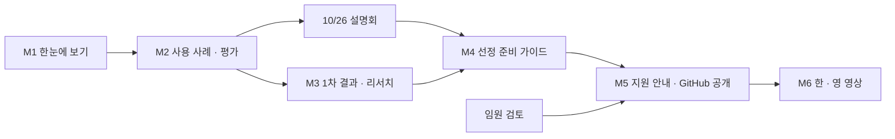

# Civic-Innovation-Challenge-2026 학습 로드맵

**생성일**: 2026-10-24
**수정일**: 2026-10-29
**방법론**: VibeLearn AI
**버전**: 1.1

### 변경 이력

| 버전 | 날짜 | 바뀐 것 | 근거 |
|---|---|---|---|
| 1.0 | 2026-10-24 | 처음 작성 | 공고 4종 · 1차 자료 |
| 1.1 | 2026-10-29 | ① 설명회에서 확인한 것 · 끝내 확인하지 못한 것으로 학습 목표와 M4 를 갱신 ② **상공회의소 지원 안내 확정**(10/28 임원회의: 상공회의소 이름으로 홍보 + 스타트업지원팀 지원, 문의 startup.support@kaccwa.org, 지지 서한은 이번 안내에서 제외) → M5 를 「검토 대기」에서 「작성」으로 ③ M6 영상의 핵심 메시지 · 공개 시점(11/4 온라인 상담 전)을 구체화 | 10/26 설명회 현장 녹음 · 10/28 임원회의 · 공식 사이트 재확인(10/29) |

---

## 📚 학습 개요

### Topic 소개
Exchange Northwest(Bellevue 시 · Bellevue College · King County IT · 워싱턴주 WaTech)의 「제2차 Civic Innovation Challenge」를 누구나 이해할 수 있게 정리해 GitHub 에 공개하고, 그 문서를 근거로 Remotion 한국어 · 영어 영상을 만들어 Catch Up AI 채널에서 알린다. 1차(2025, Bellevue) 결과를 토대로 「선정에 유리하게 준비하는 법」과, 워싱턴주 한인상공회의소 스타트업지원팀이 도울 수 있는 것과 연락 방법을 함께 안내한다. **신청 마감은 2026-11-13(금) 오후 5시(PT).**

### 학습 목표
- [ ] 공식 공고 4종 · 1차 자료를 중심으로 관련 보도 · 기관 발표 · 선정 기업 자료 · 설명회 내용까지 근거로 삼아(출처를 문장마다 표시하고, 공식 자료와 다르면 공식 자료를 따른다), 「무엇인지 · 지원 자격 · 일정 · 사용 사례 8개 · 신청 방법」을 처음 보는 사람이 순서대로 읽고 이해할 수 있는 한국어 · 영어 문서로 GitHub 에 공개한다
- [ ] 1차 선정 4팀 · 평가 기준 9항목 · 신청서 16문항을 근거로 「선정에 유리한 준비 가이드」(준비 체크리스트 · 문항별 작성 요령 · 2분 피치 영상 요령)를 만든다
- [x] 10/26 Tukwila 설명회에서 확인한 내용으로 문서를 갱신한다 — **확인**: 워싱턴주 밖 가능 · 시제품 단계 가능 · 스타트업 = 소기업 · 대학 가능 · 사용 사례 밖은 무게가 낮음 · 1차 후속 결과. **답을 못 들음**: 미국 밖 팀 · 보험 수준 · 지지 서한 반영 → 공고 기준을 따른다고 명시 (2026-10-29)
- [x] 워싱턴주 한인상공회의소 스타트업지원팀의 지원 내용 · 연락 방법 안내를 임원 검토 결과(10/28 임원회의)에 맞춰 넣는다 (2026-10-29)
- [ ] GitHub 문서를 근거로 Remotion 한국어판 · 영어판 영상을 만들어 마감 전에 공개할 수 있게 한다

### 예상 학습 기간
약 1.5주 (2026-10-25 ~ 11/4 목표, 늦어도 11/6) — 2026-10-24 기간 분석 결과 「그대로 진행」. **범위는 유지하고 순서로 조정**: ① GitHub 문서를 먼저 공개(10/29~30) ② 상공회의소 지원 안내는 임원 검토 뒤 반영 ✅ (10/28 확정) ③ 영상은 한국어판 → 영어판.

> **10/29 조정**: 영상이 **11/4(수) 온라인 상담 신청**을 알리려면 한국어판이 **11/3(화)까지** 나오는 것이 가장 좋다. 늦어지면 상담 안내 대신 「마감 11/13」과 「도움 받을 곳」을 앞세운다. 영어판은 늦어도 11/6(마감 1주 전).

### 학습 환경
- OS: Windows 11 (i7-1355U · 16GB RAM · GPU 없음)
- 도구: VS Code + Claude Code, Python 3.13, Remotion(AI/RemotionStudio) + remotion-video 스킬, edge-tts · Qwen3-TTS, GitHub(CatchUpAI_VL), YouTube(Catch Up AI)
- 사전 지식: 영어 공고 읽기(또는 AI 번역 확인), Remotion 제작 흐름 / 권장: 공공기관 파일럿 · 조달 기본 개념, 워싱턴주 한인 커뮤니티 맥락

### 이 Topic 의 「실습」
이 Topic 은 코딩이 아니라 **조사 · 분석 · 문서 · 영상 제작**이 실습이다. 각 모듈의 실습은 「근거를 찾아 확인하고 → 처음 보는 사람이 이해할 문서로 쓰고 → 한 · 영 두 언어로 맞추는」 순서로 반복된다.

### 지킬 원칙
- **근거는 넓게, 출처는 분명하게** — ① 공식 공고 · 기관 페이지 ② 정부 보도자료 ③ 언론 보도 · 선정 기업 발표 · 행사 페이지 ④ 설명회 현장 확인 순으로 무게를 둔다. 출처를 적고, 서로 다르면 공식 자료를 따르며, 추측은 추측이라고 쓴다.
- **한 · 영 짝** — 한국어 문서를 고치면 영어 짝(`.en.md`)도 같은 작업에서 맞춘다.
- **공개 레포 · 영상에 넣지 않는 것** — 상공회의소 임원방 대화 · 회장님 메일 · 임원 이름 · 임원회의 녹취, 임원회의에서 정하지 않은 지원 약속(예: 지지 서한 · 세무 · 보험 전문가 소개). 공개물에는 박창수 이름 대신 Catch Up AI / Builders Lounge 를 쓴다.
- **게시 주체는 Catch Up AI** — 상공회의소 자격으로 올리는 자료가 아니다. 상공회의소 지원 안내는 「안내」로만 넣는다. **10/28 임원회의에서 상공회의소 이름으로 홍보하기로 했으므로** 「워싱턴주 한인상공회의소 스타트업지원팀 · startup.support@kaccwa.org」는 공개물에 쓸 수 있다.
- **설명회 내용은 역할만** — 현장 녹음은 내부 자료다. 공개 문서에는 「Bellevue 시 쪽 답변」처럼 역할로만 쓰고, 참석자 이름 · 발언자 이름은 쓰지 않는다.

---

## 🗺️ 전체 로드맵 구조

| 모듈 | 모듈명 | 난이도 | 예상 시간 | 산출물 폴더 | 목표 날짜 |
|------|--------|--------|----------|------------|----------|
| M1 | 한눈에 보기 — 무엇 · 누가 · 언제 | ⭐ | 2h | 01-Overview/ | 10/25 |
| M2 | 사용 사례 8개와 평가 기준 | ⭐⭐ | 2.5h | 02-Use-Cases-And-Criteria/ | 10/26 (설명회 전) |
| M3 | 1차(2025) 결과와 관련 자료 리서치 | ⭐⭐ | 3h | 03-Round1-And-Research/ | 10/27 |
| M4 | 선정 준비 가이드 (설명회 내용 반영) | ⭐⭐⭐ | 4h | 04-Application-Guide/ | 10/28~29 ✅ |
| M5 | 지원 안내와 GitHub 공개 | ⭐⭐ | 2.5h | 05-Support-And-Publish/ | 10/29~30 |
| M6 | Capstone — Remotion 한 · 영 영상 | ⭐⭐⭐ | 8h | 06-Video/ | 10/30~11/3 (KO) · 늦어도 11/6 (EN) |

**총 예상 시간**: 약 22시간 (버퍼 20% 포함)



---

## 📖 모듈별 상세 계획

### M1 - 한눈에 보기 — 무엇 · 누가 · 언제

**난이도**: ⭐
**예상 시간**: 2h
**산출물 폴더**: `01-Overview/`

#### 학습 목표
- [ ] 이 사업을 세 문장(무엇 · 누가 · 언제까지)으로 설명하는 한국어 · 영어 요약을 쓸 수 있다
- [ ] 공식 자격 3가지와 실제로 필요한 조건(해법 · 피치 영상 · 세금 번호 · 보험)을 구분해 정리할 수 있다
- [ ] 2026-10-14 공모부터 2027-08 디브리프까지 일정을 한 표로 정리할 수 있다
- [ ] 문장마다 출처(공고 파일 · 페이지)를 달 수 있다

#### 주요 개념
1. **Exchange Northwest**: Bellevue 시 · Bellevue College · King County IT · WaTech 의 지역 협력체. 2차 Challenge 의 주최.
2. **Civic design partner**: 파일럿을 함께하는 정부 · 대학 직원. 「고객」이 아니라 「함께 설계하는 사람」이다.
3. **Proof-of-Concept(PoC) 파일럿**: 실제 업무에서 기간을 정해 시험하는 것. 도입이나 후속 계약을 보장하지 않는다(오해하기 쉬운 점).
4. **Stipend(지원금)**: 상금이 아니라 참여 지원금. $15,000~$45,000 이지만 「대부분 하한 쪽」.

#### 실습 과제

**실습 1: 세 문장 요약 (한 · 영)** ⭐
- **목적**: 처음 보는 사람이 10초 안에 알 수 있게
- **단계**:
  1. 준비 자료의 사실표(한 · 영)와 공고 Overview 를 읽는다
  2. 「무엇 · 누가 · 언제까지」 세 문장으로 한국어 요약을 쓴다
  3. 같은 내용을 영어로 쓴다(공고 원문 표현 우선)
- **예상 시간**: 30분
- **검증**: 숫자(지원금 · 마감 · 선정 수)가 공고와 일치, 두 언어 내용이 같다

**실습 2: 자격과 일정 정리** ⭐⭐
- **목적**: 「나도 지원할 수 있나」를 판단할 수 있게
- **단계**:
  1. 공식 자격 3가지 / 사실상 필요한 조건 / 공고에 없는 것(설명회 확인 예정)을 표로 나눈다
  2. 일정 표를 만든다(질문 세션 3회 포함)
  3. 출처 표기를 단다
- **예상 시간**: 50분
- **검증**: 「공고에 없는 것」이 별도 칸으로 분리되어 있다

#### 산출물
```
01-Overview/
├── README.md                  ← 학습 순서 안내 (한국어)
├── README.en.md               ← 영어 짝
├── concepts/
│   ├── what-is-it.md          ← 무엇인가 · 주최 · 혜택
│   └── what-is-it.en.md
└── guides/
    ├── eligibility-and-timeline.md      ← 자격 · 일정
    └── eligibility-and-timeline.en.md
```

#### Definition of Done
- [ ] 세 문장 요약(한 · 영)이 README 맨 위에 있다
- [ ] 자격 · 일정 문서(한 · 영) 완성, 「공고에 없는 것」 분리
- [ ] 모든 숫자에 출처 표기
- [ ] 한국어 · 영어 문서 내용이 일치
- [ ] 🔴 **README 링크가 실제 파일을 가리키는지 확인** (`python Topics/YouTube-Channel-Revival-With-AI/scripts/check_links.py`)
- [ ] WorkLog 작성 · Daily Retrospective

#### Self-Assessment
**개념 이해**:
- [ ] PoC 파일럿이 「도입 보장」이 아닌 이유를 설명할 수 있다
- [ ] 지원금 범위와 「대부분 하한 쪽」을 함께 말할 수 있다

**실무 활용**:
- [ ] AI 에게 공고 PDF 에서 특정 사실을 찾게 하고 원문과 대조할 수 있다
- [ ] 영어 번역에서 공고 원문 표현을 살렸는지 판단할 수 있다

#### 예상 시간 배분
- 개념 학습: 25분
- 실습 1: 30분
- 실습 2: 50분
- 문서화 · 영어 짝: 15분
- **합계**: 2h (버퍼 포함)

#### 참조 자료
- [Exchange Northwest — Programs](https://exchangenw.org/programs): 2차 공고 · 신청서 링크
- 준비 자료 `Materials_For_Topics/Civic-Innovation-Challenge-2026/` — 사실표(한 · 영), 공고 PDF 4종 (공개 레포 제외)

---

### M2 - 사용 사례 8개와 평가 기준

**난이도**: ⭐⭐
**예상 시간**: 2.5h
**산출물 폴더**: `02-Use-Cases-And-Criteria/`

#### 학습 목표
- [ ] 사용 사례 8개를 기관별로 「어떤 문제 · 어떤 해법 · 누가 맞을까」로 정리할 수 있다
- [ ] 평가 기준 9항목을 「심사자가 무엇을 보나」와 「신청서 몇 번 문항과 연결되나」로 매핑할 수 있다
- [ ] 10/26 설명회에서 물을 질문을 사용 사례 · 자격 기준으로 정리할 수 있다

#### 주요 개념
1. **Use case(사용 사례)**: 기관이 풀고 싶은 문제. 이 범위 밖 아이디어는 King County 정책 목표형으로만 열려 있다.
2. **Rubric(평가 기준)**: 9항목. 「지역사회 참여와 포용」 · 「제품 성숙도」 · 「혜택 기관 수」가 점수에 영향.
3. **Vendor 등록**: KCIT 사용 사례는 King County 전자조달 포털 등록이 지원 조건(놓치기 쉬운 점).
4. **AI 설문**: 제품에 AI 가 있으면 추가로 작성.

#### 실습 과제

**실습 1: 사용 사례 카드 8장 (한 · 영)** ⭐⭐
- **목적**: 지원자가 자기 해법이 맞는 사례를 고르게
- **단계**:
  1. Use Cases PDF 를 기관별로 읽는다
  2. 사례마다 「문제 · 기관이 원하는 해법 · 이런 팀에 맞다 · 주의점」 카드를 쓴다
  3. 영어 짝을 만든다
- **예상 시간**: 60분
- **검증**: 8개 모두 있고, 숫자(예: Metro 고객 의견 4만 건)가 원문과 일치

**실습 2: 평가 기준 ↔ 신청서 문항 매핑** ⭐⭐
- **목적**: M4 준비 가이드의 뼈대
- **단계**:
  1. 9개 평가 항목과 16개 신청서 문항을 표로 연결한다
  2. 1차(2025) 평가 기준 4개와 비교해 무엇이 새로 생겼는지 표시한다
- **예상 시간**: 40분
- **검증**: 모든 평가 항목이 최소 1개 문항과 연결

**실습 3: 설명회 질문 목록** ⭐ (10/26 전 필수)
- **목적**: 공고에 없는 것을 현장에서 확인
- **단계**: 자격 · 보험 · 성숙도 · 지지 서한 · 사용 사례별 질문을 영어로 정리
- **예상 시간**: 20분
- **검증**: 설명회에 들고 갈 수 있는 1쪽

#### 산출물
```
02-Use-Cases-And-Criteria/
├── README.md / README.en.md
├── concepts/
│   ├── use-cases.md / use-cases.en.md          ← 사용 사례 카드 8장
│   └── rubric-map.md / rubric-map.en.md        ← 평가 기준 ↔ 문항 매핑, 1차 대비 변화
└── guides/
    └── office-hours-questions.md               ← 10/26 설명회 질문 (영어 중심)
```

#### Definition of Done
- [ ] 사용 사례 카드 8장(한 · 영)
- [ ] 평가 기준 매핑표(한 · 영)와 1차 대비 변화
- [ ] 설명회 질문 목록 완성(10/26 전)
- [ ] 출처 표기
- [ ] 🔴 README 링크 확인 (`check_links.py`)
- [ ] WorkLog · Daily Retrospective

#### Self-Assessment
**개념 이해**:
- [ ] 이 사업이 「기관 문제를 푸는 해법」을 찾는다는 점을 사례로 설명할 수 있다
- [ ] KCIT 사례의 vendor 등록 조건을 설명할 수 있다

**실무 활용**:
- [ ] AI 에게 사용 사례별 「맞는 팀」 추론을 시키고 근거를 검증할 수 있다
- [ ] 평가 기준을 신청서 작성 체크리스트로 바꿀 수 있다

#### 예상 시간 배분
- 개념 학습: 30분
- 실습 1: 60분
- 실습 2: 40분
- 실습 3: 20분
- **합계**: 2.5h (버퍼 포함)

#### 참조 자료
- 공고 `CIC2 Use Cases.pdf` · `CIC2 Submission Process.pdf` (준비 자료 폴더 `official/`)
- [Exchange Northwest — Programs](https://exchangenw.org/programs)

---

### M3 - 1차(2025) 결과와 관련 자료 리서치

**난이도**: ⭐⭐
**예상 시간**: 3h
**산출물 폴더**: `03-Round1-And-Research/`

#### 학습 목표
- [ ] 1차 선정 4팀을 「누가 · 무엇 · 어느 기관과 · 왜 뽑혔을까(추정 표시)」로 분석할 수 있다
- [ ] 1차와 2차의 차이(주최 · 지원금 · 자격 · 주제 · 신청서)를 표로 정리할 수 있다
- [ ] 공고 밖의 관련 자료(보도 · 기관 발표 · 선정 기업 발표 · 포럼 영상 · 비슷한 프로그램)를 5건 이상 찾아 출처 등급과 함께 정리할 수 있다

#### 주요 개념
1. **1차(2025)**: Bellevue 단독, 23팀 지원 · 4팀 선정, 최대 $15,000, 학생 지원 가능, 일정 2~4개월 지연.
2. **선정 4팀**: Certivo · Legislaide · Juganu · FindIt(고등학생). 모두 AI 파일럿.
3. **출처 등급**: 공식 > 정부 보도 > 언론 · 기업 발표 > 현장 확인. 기업 자기 발표는 홍보 성격.
4. **「왜 뽑혔나」는 추정**: 팀별 평가는 공개되지 않았다. 공개 기준과 맞춰 본 해석임을 표시한다.

#### 실습 과제

**실습 1: 선정 4팀 분석 (한 · 영)** ⭐⭐
- **목적**: 「어떤 팀이 뽑히는가」의 실제 사례
- **단계**:
  1. 1차 정리 문서와 Bellevue 시 페이지를 읽는다
  2. 팀별로 사실(출처 표시)과 해석(추정 표시)을 나눠 쓴다
  3. 공통점(AI · 시 업무 직결 · 여러 기관 적용 가능 등)을 뽑는다
- **예상 시간**: 60분
- **검증**: 사실과 해석이 칸으로 분리

**실습 2: 관련 자료 리서치** ⭐⭐
- **목적**: 공고만으로 모르는 맥락 보강
- **단계**:
  1. 1차 선정 기업 후기 · 언론 보도 · Exchange Northwest 포럼(10/14) 자료 · 2026-06 Innovation Exchange · 비슷한 다른 도시 프로그램을 찾는다
  2. 출처 · 날짜 · 등급 · 요점을 표로 정리한다
- **예상 시간**: 60분
- **검증**: 5건 이상, 각 링크 확인

**실습 3: 1차 vs 2차 비교 (한 · 영)** ⭐
- **목적**: 올해 달라진 점을 한눈에
- **단계**: 비교표 작성(학생 → 18세 이상, $15K → $15~45K, 사용 사례 목록 신설 등)
- **예상 시간**: 25분
- **검증**: 모든 항목에 1차 · 2차 출처

#### 산출물
```
03-Round1-And-Research/
├── README.md / README.en.md
├── examples/
│   └── round1-selected-teams.md / .en.md     ← 선정 4팀 분석
├── concepts/
│   └── round1-vs-round2.md / .en.md          ← 1차 vs 2차
└── guides/
    └── related-sources.md                    ← 관련 자료 목록 (출처 등급)
```

#### Definition of Done
- [ ] 선정 4팀 분석(한 · 영), 사실 / 해석 분리
- [ ] 1차 vs 2차 비교표(한 · 영)
- [ ] 관련 자료 5건 이상, 링크 확인
- [ ] 출처 등급 표시
- [ ] 🔴 README 링크 확인 (`check_links.py`)
- [ ] WorkLog · Daily Retrospective

#### Self-Assessment
**개념 이해**:
- [ ] 1차 선정 팀의 공통점을 근거와 함께 말할 수 있다
- [ ] 기업 자기 발표와 공식 자료의 무게 차이를 설명할 수 있다

**실무 활용**:
- [ ] AI 리서치 결과에서 확인 안 된 주장을 골라낼 수 있다
- [ ] 「추정」 표시가 필요한 문장을 구분할 수 있다

#### 예상 시간 배분
- 개념 학습: 30분
- 실습 1: 60분
- 실습 2: 60분
- 실습 3: 25분
- **합계**: 3h (버퍼 포함)

#### 참조 자료
- [Bellevue 시 — 1차 Challenge](https://bellevuewa.gov/city-government/departments/ITD/innovation-programs/civic-innovation-challenge)
- [Bellevue 시 — 1차 선정 4팀](https://bellevuewa.gov/city-government/departments/ITD/innovation-programs/civic-innovation-challenge/civic-challenge-participants)
- [Bellevue 시 — 1차 일정 · 마일스톤](https://bellevuewa.gov/city-government/departments/ITD/innovation-programs/accomplishments)
- [Bellevue 시 보도 — 4팀 선정](https://bellevuewa.gov/city-news/innovation-challenge-partners)
- 준비 자료 `round1-2025/` — 1차 공고 PDF · 1차 정리

---

### M4 - 선정 준비 가이드 (설명회 내용 반영)

**난이도**: ⭐⭐⭐
**예상 시간**: 4h
**산출물 폴더**: `04-Application-Guide/`

#### 학습 목표
- [ ] 10/26 설명회에서 확인한 내용을 「확인된 사실」로 기존 문서에 반영할 수 있다
- [ ] 마감(11/13)에서 거꾸로 계산한 준비 일정 체크리스트를 만들 수 있다
- [ ] 신청서 16문항마다 「심사자가 보는 것 · 쓰는 요령 · 흔한 실수」를 정리할 수 있다
- [ ] 2분 피치 영상 구성안과 촬영 요령을 정리할 수 있다
- [ ] 「지원하기 어려운 경우」(아이디어만 있음 · 미국 세금 번호 없음 등)를 솔직하게 안내할 수 있다

#### 주요 개념
1. **역산 일정**: 마감 → 서류 점검 → 피치 영상 → 초안 → 사용 사례 선택. 11/4 온라인 상담 활용.
2. **문항별 작성 요령**: 175단어 제한. 평가 기준 매핑(M2)을 근거로 쓴다.
3. **유리한 준비 = 평가 기준 + 1차 사례**: 여러 기관 적용 · 지역 단체 협력 · 측정 가능한 지표 · 성숙도 근거.
4. **설명회 확인 사항**: 자격 세부 · 보험 · 지지 서한 반영 — 확인 전 내용은 「확인 중」으로 표시.

#### 실습 과제

**실습 1: 설명회 결과 정리 · 반영** ⭐⭐
- **목적**: 공고에 없던 답을 문서에 넣기
- **단계**:
  1. 설명회 근거를 보존한다 — 구술 대신 **현장 녹음 전사**(내부: `AI/Initiatives/KACCWA/20261026_CivicChallenge/`)를 원문으로 쓴다
  2. 공개 가능한 사실만 골라 정리한다(참석자 · 발언자 이름 제외, 답한 쪽은 역할로)
  3. M1 · M2 문서의 「확인 중」을 갱신한다
- **예상 시간**: 50분
- **검증**: 갱신한 문장에 「10/26 설명회」 출처 표시

**실습 2: 준비 체크리스트와 역산 일정 (한 · 영)** ⭐⭐
- **단계**: 자격 점검 → 사용 사례 선택 → 문항 초안 → 피치 영상 → 서류(W-9 · 보험 · vendor 등록) → 11/13 이전 일찍 제출
- **예상 시간**: 40분
- **검증**: 날짜가 마감 기준으로 맞다

**실습 3: 문항별 작성 요령 · 피치 영상 가이드 (한 · 영)** ⭐⭐⭐
- **단계**:
  1. 16문항 표: 심사자가 보는 것(평가 기준 연결) · 쓰는 요령 · 흔한 실수 · 1차 사례 연결
  2. 2분 피치 영상: 구성(문제 → 해법 → 기관에 주는 가치 → 팀 → 지표) · 촬영 팁
  3. 「지원하기 어려운 경우」와 대안(다음 차수 · 팀 구성) 안내
- **예상 시간**: 90분
- **검증**: 모든 문항에 요령이 있고, 추측은 추측 표시

#### 산출물
```
04-Application-Guide/
├── README.md / README.en.md
├── guides/
│   ├── preparation-checklist.md / .en.md    ← 준비 체크리스트 · 역산 일정
│   ├── application-questions.md / .en.md    ← 16문항 작성 요령
│   └── pitch-video.md / .en.md              ← 2분 피치 영상 가이드
└── concepts/
    └── office-hours-findings.md / .en.md    ← 10/26 설명회에서 확인한 것
```

#### Definition of Done
- [ ] 설명회 결과 반영(현장 녹음 전사 보존, 공개 문서에는 공개 가능한 사실만)
- [ ] 준비 체크리스트 · 역산 일정(한 · 영)
- [ ] 16문항 작성 요령(한 · 영)
- [ ] 피치 영상 가이드(한 · 영)
- [ ] 「지원하기 어려운 경우」 안내 포함
- [ ] 🔴 README 링크 확인 (`check_links.py`)
- [ ] WorkLog · Daily Retrospective

#### Self-Assessment
**개념 이해**:
- [ ] 평가 기준에서 점수를 얻기 쉬운 항목과 그 이유를 말할 수 있다
- [ ] PoC 파일럿에 맞는 「성공 지표」 예를 들 수 있다

**실무 활용**:
- [ ] AI 에게 175단어 답변 초안을 시키고 평가 기준으로 다듬을 수 있다
- [ ] 2분 피치 영상 대본을 AI 와 함께 만들 수 있다

#### 예상 시간 배분
- 개념 학습: 40분
- 실습 1: 50분
- 실습 2: 40분
- 실습 3: 90분
- 문서화 · 영어 짝: 20분
- **합계**: 4h (버퍼 포함)

#### 참조 자료
- 공고 `CIC2 Submission Process.pdf` · `CIC2 FAQ.pdf`
- M2 평가 기준 매핑, M3 선정 4팀 분석
- 10/26 설명회 현장 녹음 전사 · 정리 (내부, 공개 레포 제외)

---

### M5 - 지원 안내와 GitHub 공개

**난이도**: ⭐⭐
**예상 시간**: 2.5h
**산출물 폴더**: `05-Support-And-Publish/`

#### 학습 목표
- [ ] 워싱턴주 한인상공회의소 스타트업지원팀의 지원 안내(도울 수 있는 것 · 연락 방법)를 임원 검토 결과에 맞춰 한 · 영으로 쓸 수 있다
- [ ] Topic 최상위 README(한 · 영) 1차 공개판을 써서 방문자가 순서대로 읽게 할 수 있다
- [ ] 공개 전 점검(링크 · 빈 폴더 · 내부 자료 · 이름 표기)을 통과시킬 수 있다

#### 주요 개념
1. **게시 주체와 안내의 구분**: 자료는 Catch Up AI 가 올리고, 상공회의소 지원은 「이런 곳에서 돕는다」는 안내로만 넣는다.
2. **임원 검토 의존**: 문의 창구 · 지지 서한 명의 · 상공회의소 이름 사용은 검토 결과대로. 검토 전이면 「준비 중」으로 두고 공개한다.
3. **공개 레포 규칙**: 내부 자료(임원방 대화 · 회장님 메일 · 임원 이름) 제외, 박창수 이름 대신 Catch Up AI.
4. **1차 공개판**: 영상 전에 문서를 먼저 공개하고, 영상이 나오면 README 에 링크를 더한다.

#### 실습 과제

**실습 1: 지원 안내 (한 · 영)** ⭐⭐
- **단계**:
  1. 준비 자료의 지원 안내 초안(8가지)과 **10/28 임원회의 결정**을 대조한다
  2. 확정된 것만 공개 문서로 쓴다 — 결정: 「직접 지원해도 되고, 원하면 스타트업지원팀이 돕도록 노력」 · 문의 **startup.support@kaccwa.org** · (도울 일 5가지 표는 10/29 박창수 판단으로 공개 문서에서 뺌 — 구체 항목을 언급할 필요 없음) · 하지 않는 것(대신 작성 · 선정 약속). **지지 서한 · 세무 · 보험 전문가 소개 · 선정 뒤 홍보는 결정되지 않아 뺀다**
  3. 같은 내용의 상공회의소 홍보 PDF(`AI/Initiatives/KACCWA/20261029_Promo/`, 내부 보관)와 숫자 · 문구를 맞춘다
- **예상 시간**: 40분
- **검증**: 임원 검토에서 확정되지 않은 약속이 없다

**실습 2: Topic README 1차 공개판 (한 · 영)** ⭐⭐
- **단계**: 「이 사업은 무엇 → 나도 지원할 수 있나 → 무엇을 준비하나 → 도움 받을 곳」 순서로 모듈 링크를 배치
- **예상 시간**: 40분
- **검증**: README 만 보고 M1~M5 를 순서대로 찾아갈 수 있다

**실습 3: 공개 전 점검과 공개** ⭐
- **단계**:
  1. `check_links.py` 로 깨진 링크 0 · 빈 폴더 0
  2. 내부 자료 · 이름 표기 검색
  3. 박창수 승인 후 GitHub 공개(커밋 · 푸시)
- **예상 시간**: 30분
- **검증**: GitHub 에서 링크가 열린다

#### 산출물
```
05-Support-And-Publish/
├── README.md / README.en.md
└── guides/
    └── kaccwa-startup-support.md / .en.md   ← 상공회의소 스타트업지원팀 지원 안내
../README.md / ../README.en.md               ← Topic 최상위 (1차 공개판)
```

#### Definition of Done
- [ ] 지원 안내(한 · 영) — 10/28 임원회의 결정 반영
- [ ] Topic 최상위 README(한 · 영) 1차 공개판
- [ ] 🔴 `check_links.py` 통과 — 깨진 링크 0 · 빈 폴더 0
- [ ] 내부 자료 · 박창수 이름 노출 0
- [ ] 박창수 승인 후 GitHub 공개
- [ ] WorkLog · Daily Retrospective

#### Self-Assessment
**개념 이해**:
- [ ] 게시 주체(Catch Up AI)와 지원 주체(상공회의소)를 구분해 설명할 수 있다
- [ ] 공개 레포에 넣으면 안 되는 자료를 예로 들 수 있다

**실무 활용**:
- [ ] AI 에게 공개 전 점검 항목을 시키고 결과를 검증할 수 있다

#### 예상 시간 배분
- 개념 학습: 20분
- 실습 1: 40분
- 실습 2: 40분
- 실습 3: 30분
- **합계**: 2.5h (버퍼 포함)

#### 참조 자료
- 준비 자료 `스타트업지원팀 지원 안내 초안 (한 · 영)` (공개 레포 제외)
- 10/28 임원회의 결정 (내부 회의록 `AI/Initiatives/KACCWA/20261028_Meeting/`) · 상공회의소 홍보 PDF (`AI/Initiatives/KACCWA/20261029_Promo/`)
- `Topics/YouTube-Channel-Revival-With-AI/scripts/check_links.py`
- 참고 README: `Topics/Datacenter-Workforce-Programs/README.md` · `Topics/WA-Caregiver-Pathways/README.md`

---

### M6 - Capstone — Remotion 한 · 영 영상

**난이도**: ⭐⭐⭐
**예상 시간**: 8h
**산출물 폴더**: `06-Video/`

#### 학습 목표
- [ ] GitHub 문서를 근거로 한 영상 슬라이드 플랜(한국어)을 만들고 승인받을 수 있다
- [ ] remotion-video 스킬의 승인 단계(플랜 → 음성 → 렌더링)에 따라 한국어판을 렌더링할 수 있다
- [ ] 한국어판을 바탕으로 영어판을 만들 수 있다
- [ ] 영상에 GitHub 링크 · 신청 마감 · 공식 페이지 · 지원 안내를 정확히 넣을 수 있다
- [ ] 유튜브 업로드 패키지(제목 · 설명 · 태그 · 썸네일 문구)를 한 · 영으로 준비할 수 있다

#### 주요 개념
1. **remotion-video 스킬 워크플로우**: 슬라이드 플랜 → 이미지 프롬프트 → 컴포넌트 → edge-tts 초벌 → Qwen3-TTS → 렌더링, 단계마다 승인.
2. **VibeLearn 학습 영상의 QR 규칙**: GitHub 레포 QR 최소 2회(정보가 조밀한 막의 끝 · 아웃트로), 주소는 실제로 열어 확인.
3. **밝기 대역 원칙**: 직전 영상들과 다른 밝기 대역을 고른다.
4. **원본 음악 원칙**: 외부 음원 대신 코드로 합성한 음악.
5. **공개물 이름 원칙**: 박창수 이름 대신 Catch Up AI. 상공회의소는 10/28 임원회의 결정대로 「워싱턴주 한인상공회의소 스타트업지원팀 · startup.support@kaccwa.org」로 안내한다.
6. **영상에 꼭 들어갈 메시지 (1.1 에서 확정)** — 모두 M1~M5 문서에 근거가 있다:
   - 이건 상금 대회가 아니라 **정부가 첫 고객이 되는 6개월 파일럿**(「돈만 보고 오셨다면 잘못 오신 것」) · 지원금 $15,000~$45,000 대부분 하한 · 후속 계약은 보장 안 됨
   - **누가**: 개인 · 팀 · 스타트업 · 소기업(같은 비중) · 대학, 18세 이상, **워싱턴주 밖도 가능**, **시제품 단계도 가능**, 아이디어만은 어려움
   - **사용 사례 8개** — 한인 사업자에게 가까운 것은 주 「새 사업자 원스톱 창구」, 세 기관 모두 관심이 큰 것은 Bellevue 「공공 기록」
   - **가장 중요한 준비**: 「6개월 동안 정부와 무엇을 증명할지」 한 문장 · 16문항(175단어) · 2분 피치 영상(휴대폰 OK)
   - **1차 결과**: 4팀 모두 AI · 2팀 후속 작업 · 1팀 다른 정부에 판매 · FindIt 은 고등학생 앱
   - **일정**: **11/4(수) 13~15시 온라인 10분 상담**(자리 한정) · **11/13(금) 17시 PT 엄격 마감**
   - **도움 받을 곳**: 공식 innovation@bellevuewa.gov · 한국어 도움 startup.support@kaccwa.org (「직접 지원해도 되고, 원하면 돕는다」, 대신 써 주거나 선정 약속은 하지 않음)
   - **QR**: GitHub Topic 주소(최소 2회) + 공식 페이지 exchangenw.org/programs

#### 실습 과제

**실습 1: 한국어판 슬라이드 플랜** ⭐⭐
- **단계**: remotion-video 스킬 호출 → 위 「꼭 들어갈 메시지」 순서대로 구성(왜 지금 · 무엇 · 누가 · 사용 사례 · 1차 사례 · 준비 요령(6개월 증명 한 문장) · 11/4 상담 · 마감 · 도움 받을 곳 · GitHub QR) → 박창수 승인
- **사실 대조**: 플랜의 숫자 · 날짜 · 이메일을 [office-hours-findings](../04-Application-Guide/concepts/office-hours-findings.md) · [kaccwa-startup-support](../05-Support-And-Publish/guides/kaccwa-startup-support.md) · 공식 페이지와 한 줄씩 대조
- **예상 시간**: 90분
- **검증**: 모든 사실이 GitHub 문서에 있다

**실습 2: 한국어판 제작 · 렌더링** ⭐⭐⭐
- **단계**: 이미지 · 컴포넌트 → edge-tts 초벌 리뷰 → Qwen3-TTS → 렌더링 리뷰
- **예상 시간**: 3시간
- **검증**: 마감일 · 지원금 · 링크 표기 확인, QR 열림

**실습 3: 영어판 · 업로드 패키지** ⭐⭐⭐
- **단계**: 영어 대본 · 음성 → 렌더링 → 한 · 영 업로드 패키지 → 박창수 업로드 → Topic README 에 영상 링크
- **예상 시간**: 2.5시간
- **검증**: 두 영상 공개, README 링크 동작

#### 산출물
```
06-Video/
├── README.md / README.en.md
├── video-slide-plan.ko.md / video-slide-plan.en.md
├── guides/
│   └── youtube-upload-package.md         ← 제목 · 설명 · 태그 (한 · 영)
└── (영상 소스는 AI/RemotionStudio/src/{video-id}/ — 레포에는 링크만)
```

#### Definition of Done
- [ ] 한국어판 슬라이드 플랜 승인 · 렌더링
- [ ] 영어판 렌더링
- [ ] GitHub QR 2회 이상, 실제 주소 확인
- [ ] 업로드 패키지(한 · 영)
- [ ] 마감 전 공개(목표 11/4, 늦어도 11/6)
- [ ] Topic README 에 영상 링크 · Topic 최상위 README 최종판
- [ ] 🔴 `check_links.py` 통과
- [ ] Topic Retrospective

#### Self-Assessment
**개념 이해**:
- [ ] 문서(GitHub)와 영상의 역할 차이(영상은 관심, 문서는 판단)를 설명할 수 있다
- [ ] 한 · 영 영상에서 바꿔야 할 것(예시 · 표현)과 그대로 둘 것(사실 · 숫자)을 구분할 수 있다

**실무 활용**:
- [ ] AI 에게 슬라이드 플랜을 시키고 사실 근거를 검증할 수 있다
- [ ] 렌더링 결과에서 사실 오류를 찾아 고칠 수 있다

#### 예상 시간 배분
- 개념 학습: 30분
- 실습 1: 90분
- 실습 2: 3시간
- 실습 3: 2.5시간
- 문서화: 30분
- **합계**: 8h (버퍼 포함)

#### 참조 자료
- `_Settings_/Skills/remotion-video/SKILL.md` · `effects-library.md` — 영상 제작 절차와 효과
- M1~M5 산출물 (영상의 사실 근거)
- [Exchange Northwest — Programs](https://exchangenw.org/programs)

---

## 📝 WorkLog 작성 가이드

각 학습 세션마다 WorkLog를 작성하여 진행 상황을 추적합니다.

**파일명 규칙**: `vl_worklog/YYYYMMDD_MX_Civic-Innovation-Challenge-2026.md`
- 예: `vl_worklog/20261025_M1_Civic-Innovation-Challenge-2026.md`

**WorkLog 필수 섹션**:
1. 오늘의 학습 목표 (체크리스트)
2. 진행 내용 (실습별 상세 기록)
3. 문제 해결 로그
4. DoD 체크리스트 (모듈 완료 기준)
5. Daily Retrospective
6. 참조 및 산출물

**이 Topic 에서 추가로 적을 것**: 새로 찾은 출처(등급 표시), 공고와 다른 정보를 발견했을 때 어떻게 처리했는지, 공개 여부를 판단한 자료.

---

## 🔍 Retrospective 가이드

### Daily Retrospective (매일, 5-10분)
WorkLog 내에 작성:
- What went well?
- What could be improved?
- Insights
- Tomorrow's focus

### Module Retrospective (모듈 완료 시, 15-20분)
`vl_worklog/YYYYMMDD_MX_Retrospective.md`:
- 계획 대비 실제 비교
- 핵심 학습 내용
- 발생한 문제와 해결
- Roadmap 정확도 평가
- 다음 모듈 준비사항

### Topic Retrospective (전체 완료 시, 30-60분)
`vl_worklog/YYYYMMDD_Civic-Innovation-Challenge-2026_Final_Retrospective.md`:
- 전체 학습 여정 통계
- VibeLearn AI 방법론 효과성 평가
- 산출물 품질 평가
- 향후 학습 개선 사항
- **이 Topic 만의 질문**: 영상 · 문서가 실제 지원 · 문의로 이어졌는가(가능한 범위에서)

---

## 📂 전체 폴더 구조

```
Civic-Innovation-Challenge-2026/
├── README.md / README.en.md        # 🔴 필수 — Topic 최상위 안내 (M5 1차 공개판 → M6 최종판)
├── topic_starter.md
├── vl_prompts/
│   ├── roadmap_prompt.md
│   └── daily_learning_prompt.md
├── vl_roadmap/
│   └── 20261024_RoadMap_Civic-Innovation-Challenge-2026.md
├── vl_worklog/
├── vl_materials/                   # 공개 가능한 공식 문서 · 출처 목록만
├── 01-Overview/
├── 02-Use-Cases-And-Criteria/
├── 03-Round1-And-Research/
├── 04-Application-Guide/
├── 05-Support-And-Publish/
└── 06-Video/
```

> 공개 레포에서 빠지는 준비 자료는 `Topics/Materials_For_Topics/Civic-Innovation-Challenge-2026/` 에 있다. `vl_materials/` 는 비어 있으면 GitHub 에서 사라지므로, M1 에서 출처 목록(README)을 넣거나 쓰지 않으면 지운다.

---

## 📊 학습 진행 상황 추적

| 모듈 | 시작일 | 종료일 | 상태 | DoD 달성률 | 비고 |
|------|--------|--------|------|-----------|------|
| M1 | 2026-10-24 | 2026-10-24 | ✅ | 100% | 하루 앞당김 · 사용 사례 수 정정(8개) |
| M2 | 2026-10-24 | 2026-10-24 | ✅ | 100% | 설명회 질문 목록 완성 · 1차 대비 평가 기준 변화 |
| M3 | 2026-10-24 | 2026-10-24 | ✅ | 100% | 관련 자료 11건 + 비슷한 프로그램 1건 |
| M4 | 2026-10-24 | 2026-10-29 | ✅ | 100% (7/7) | 설명회 결과 반영 · 확인 못 한 3가지는 「공고 기준」으로 명시 |
| M5 | 2026-10-24 | 2026-10-29 | ✅ | 100% (6/6) | 지원 안내(한 · 영) · Topic README 2차 공개판 · GitHub 공개(dd4bc00) |
| M6 | 2026-10-29 | | 🔄 | 0% (0/8) | 한국어판 슬라이드 플랜 v1(21장) 검토 대기 · 한국어 11/3 목표 · 영어 늦어도 11/6 |

**범례**:
- ⏳ 대기
- 🔄 진행 중
- ✅ 완료

---

## 🎯 성공 기준

전체 Topic 완료 기준:
- [ ] 모든 모듈 완료 (DoD 100%)
- [ ] 최소 6개 산출물 폴더 생성 (01~06, 각 한 · 영 README)
- [ ] GitHub 문서 1차 공개가 10/30 전후, 영상이 11/6 전에 공개됨
- [ ] 모든 사실에 출처, 추측은 추측 표시, 내부 자료 노출 0
- [ ] Topic Retrospective 작성
- [ ] Self-Assessment 평균 ⭐⭐⭐⭐ 이상
- [ ] Capstone(한 · 영 영상) 완성

---

**생성자**: Claude with VibeLearn AI
**Roadmap 버전**: 1.1
**방법론 버전**: VibeLearn AI 2.0
