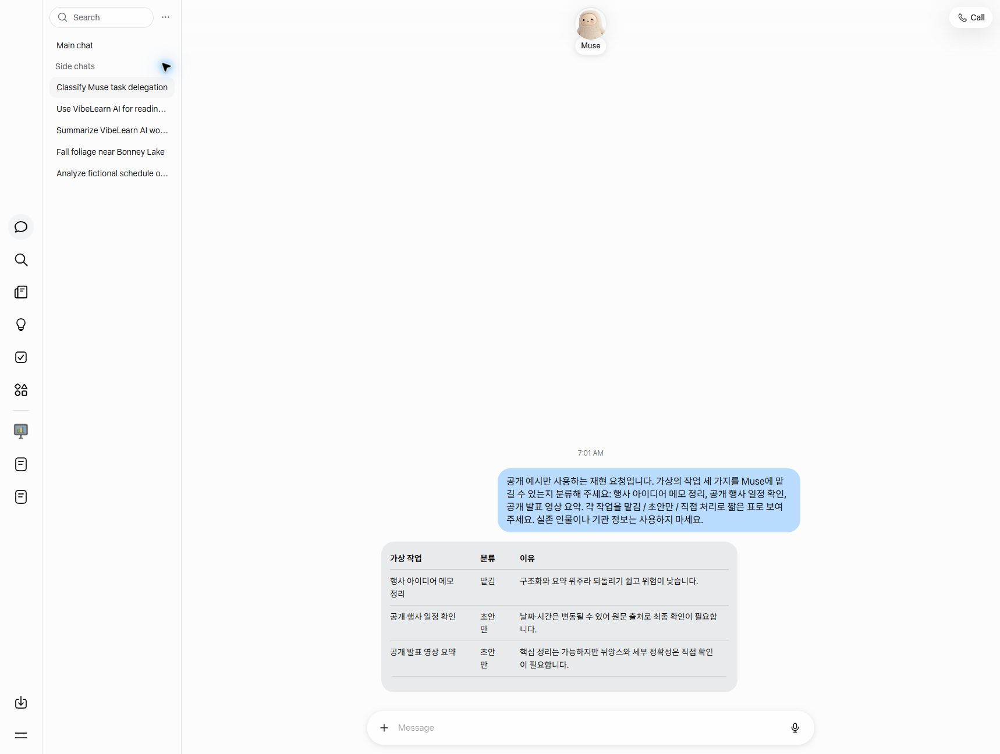

# M1 — Task List and Muse Fit Map
[한국어](README.md)

**Status**: ✅ Complete (2026-10-18, Live #32 broadcast part 4) · ✅ v2.0 revision complete (2026-10-25, Live #33 part 1) — feature table v2 · app connector screen checked · judgment criterion ③ · tasks v1.1 confirmed · connection and naming rules decided
**Estimated study time**: 1.5 hours + 0.75 hours for the revision

This module decides where to use Muse first. I judged 18 of my tasks as "Delegate · Draft only · Don't delegate," listed what must not be uploaded to Muse, and checked the features I need against Meta's official documentation. In the Roadmap v2.0 revision, I refined it again with facts verified hands-on, new connectors, and a changed judgment criterion.

## 📚 Study Order

1. [concepts/fit-criteria.en.md](concepts/fit-criteria.en.md) — 3 fit levels · 4 judgment criteria (③ changed in v2.0) · voice and text instructions
2. [guides/workflow-fit-map.en.md](guides/workflow-fit-map.en.md) — judgments for 18 tasks · top 6 · 5 added in v1.1 (confirmed)
3. [guides/do-not-upload.en.md](guides/do-not-upload.en.md) — what must not be uploaded · connection rule (③ mail · calendar) · naming rule (② names and relationships only)
4. [examples/muse-feature-check.en.md](examples/muse-feature-check.en.md) — v2 feature table (source type · check date) and the unverified list

## What This Module Found

- The judgment result is **Delegate 3 · Draft only 10 · Don't delegate 5** (v1). The most common is "Draft only": capture the thought while away from home, and fix the format at home.
- Top 6: ideas on the move · to-do notes · continuing a VibeLearn AI Topic · taking down dictated original wording · public event research · public post drafts · Remotion slide plans and scripts.
- Muse **creates Markdown files and saves them in the Library**, and has **download all my data** (official documentation). **Downloading files one at a time** is not in the official documentation yet — I check it hands-on in M2.

### v2.0 Revision (2026-10-25)

- **Voice input · Gmail · Google Calendar · recurring reminders were verified hands-on by using them** (2026-10-20~22, Android). What remains is whether what I say is kept as a file word for word (M2).
- More connectors appeared — the app list shows **Google Drive · GitHub · Dropbox** (verified hands-on, not connected). They are candidates for the solution that links the vault with Muse (M4). Box · Notion are unverified because I did not view the full list.
- I **downloaded all data hands-on**. One zip held a conversation txt, Markdown with the folder structure kept, uploaded files, and a manifest. It is for bringing everything over at once, not a method for daily use.
- I changed judgment criterion ③ from "Does it happen away from home?" to **"Is there a reason Muse is better?"** Using that criterion, I **added 5 more** tasks such as mail, schedule, before/after events, and background research (confirmed — Delegate 3 · Draft only 2).
- The 5 tasks that need a lot of vault context (#1 · #3 · #5 · #9 · #10) were judged on the assumption that "Muse cannot see the vault." They will be **judged again based on M4 results**.
- **Connecting is the same as having already uploaded.** So I set a connection rule (up to mail and calendar; storage is handled separately in M4) and a naming rule (names and relationships only; leave out contacts, amounts, and internal decisions).

## Navigation

- Next: [M2 — Moving Between Muse and the Vault (Both Ways)](../02-Muse-to-Vault/README.en.md)
- Retrospective: [M1 Module Retrospective](../vl_worklog/20261018_M1_Retrospective.md)

## Recreated Screen for the Video

The screen below is not a recording from the actual M1 session. It was recreated on 2026-11-05 for video production, using public and fictional examples.

