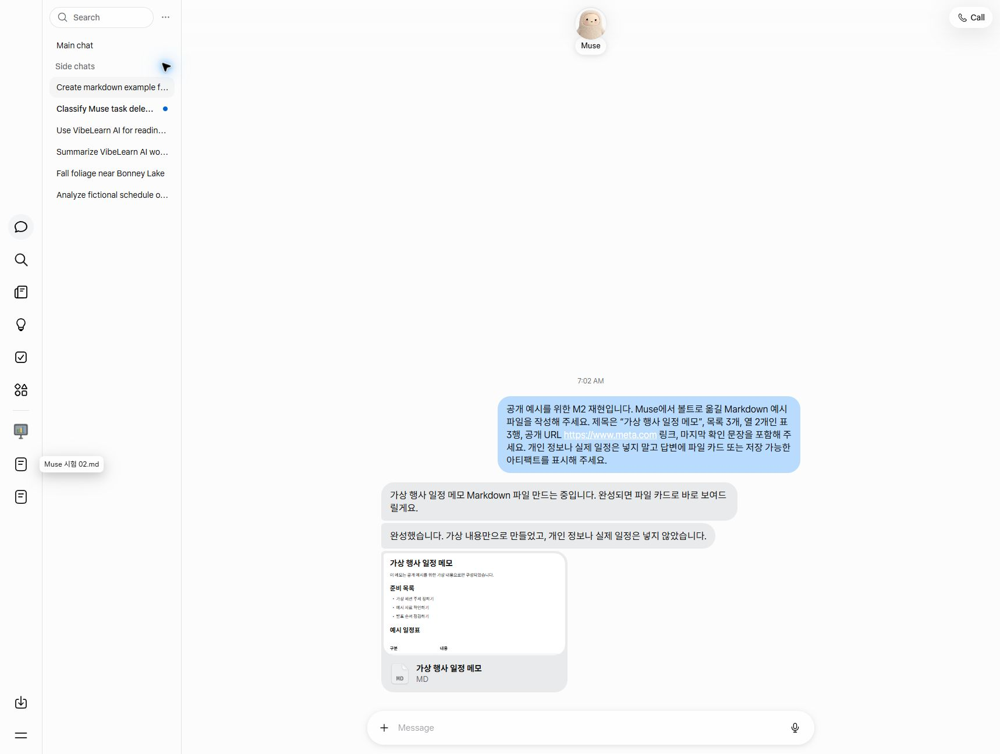

# M2 — Transfer Between Muse and the Vault (Both Ways)

[한국어](README.md)

**Status**: ✅ Done (2026-10-25, Live #33 Part 1) — finished 4 away → home methods, 2 home → away methods, voice original, phone test, inbox A, recommendation table approval, and a test of the cleanup prompt on 1 file
**Estimated study time**: 2 hours

I **tried hands-on** and compared ways to transfer results made in Muse while away into my vault at home, and to let Muse pick up work I was doing at home. None of the four methods broke the original Markdown. So the way to choose a method was not preservation. It was the number of steps, whether it works on a phone, and whether a connection is needed. I chose the vault's existing `_Inbox_/` as the inbox. I also made a 6-step cleanup for after the transfer and a prompt for it, and checked them on one test file.

## 📚 Study Order

1. [concepts/transfer-paths.en.md](concepts/transfer-paths.en.md) — both ways · preservation · keeping the original wording · inbox · handoff packet
2. [guides/transfer-comparison.en.md](guides/transfer-comparison.en.md) — test results by method · recommended default methods · inbox decision (A)
3. [guides/vault-cleanup-prompt.en.md](guides/vault-cleanup-prompt.en.md) — 6 steps to fit inbox documents to the vault rules, and a Claude Code / Codex prompt
4. [examples/sample-transfer.en.md](examples/sample-transfer.en.md) — before and after of one test file, and the check that the body was kept

## What I Found in This Module

- Downloading one file at a time was not in the official help, but **the app has it** (card → ⋯ → Download). An attachment sent to my own email was **byte-identical** to the original.
- When I uploaded a handoff packet (where I left off · what was decided · next steps + "If you don't know something, say so"), Muse picked up the work from a one-line instruction. But it did not know vault rules that were not in the packet, so it made **frontmatter with Korean keys**.
- A public repo link can be read, but **only what was pushed** is visible (what was online was the 10/18 version).
- Downloading all data gives a zip that keeps the folder structure, but it holds all your personal information at once — it is for backup.
- A memo I spoke by voice became a file **exactly as transcribed** with one line: "Save it as a Markdown file without changing a single character" (even filler words stayed). The attachment of an email sent from the phone was also byte-identical to the file downloaded on the web.
- Not verified: whether the spoken sound matches the transcribed text (only I can judge), the save format of Save to Files on the phone, and whether there is a switch to turn off training (M4).

## Navigation

- Previous: [M1 — Task List and Muse Fit Map](../01-Workflow-Fit-Map/README.en.md)
- Next: [M3 — VibeLearn AI on Muse](../03-VibeLearn-on-Muse/README.en.md)
- Retrospective: [M2 Module Retrospective](../vl_worklog/20261025_M2_Retrospective.md)

## Recreated Screen for the Video

The screen below is not a recording from the actual M2 session. It was recreated on 2026-11-05 for making a video, by generating a public, made-up example Markdown file.

