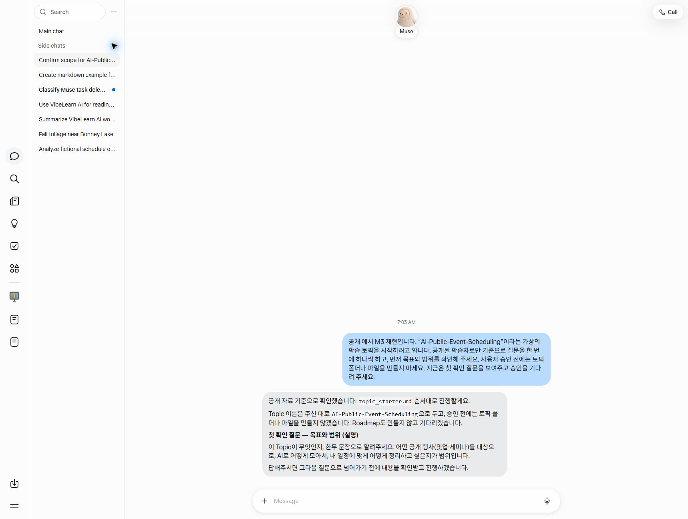

# M3 — VibeLearn AI on Muse

[한국어](README.md)

**Status**: ✅ Done (2026-11-05) — Exercise 1 (10/25 · Claude Code) · Exercises 2 · 3 (11/1 Live #34 · Claude Code) · Exercise 4 (11/5 · Codex), DoD 8/8
**Estimated study time**: 1.5 hours (actually done over three sessions)
**Verdict**: Picking up at home a VibeLearn AI Topic started away — **possible**

I tested whether Muse reads the VibeLearn AI instructions in the public repository, stops where it should, and follows the rules it remembers in the next conversation too. At the end, I downloaded the original files from the Muse Library, and Codex picked up the work in the vault at home up to the duration review step.

## Study Order

1. [What it means to read and follow instructions](concepts/vibelearn-as-instructions.en.md) — tells apart reading the original, following the procedure, and checking the output.
2. [Muse test and results](guides/muse-vibelearn-test.en.md) — check what was observed for reading the original, order, memory, and handoff.
3. [Public event Topic example](examples/muse-topic-starter-sample.en.md) — see the scope of the Topic info and prompts Muse made.
4. [How to pick up at home](guides/handoff-to-home.en.md) — download the originals and check at which step to resume.

## What I Found in This Module

- **Reading** — Muse read the instruction files in the public repo directly, and made nothing up. It even pointed out on its own where files didn't match each other.
- **Stopping** — Even though I didn't put "stop" in the instruction, it stopped three times: before creating folders, before entering Phase 2, and before creating the Roadmap. Only the "Topic description" field was not asked separately. This is why summarizing and following the instructions have to be checked separately.
- **Memory** — When I saved the rules to `MEMORY.md`, it kept them even in a new conversation where I gave no link or rules again. When asked to delete them, it first shows the scope and side effects (this time I kept them and did not delete).
- **Handoff** — When I downloaded the 3 originals from the Library, all SHA-256 hashes matched, and [Step 2] · [Step 3] of the two prompts matched the original templates. Codex picked up the work up to the duration review (2 weeks × 3 hours a week is appropriate) and stopped at the approval point.
- **Comparison case** — At first I tested by mistake in Meta AI (meta.ai). Meta AI made up a Roadmap without being able to read the original, and it did not remember either. Even in the same Meta family, it is a different product from Muse. One line — "If you can't read the original, tell me first" — prevents making things up.
- **Not verified** — Import memory in the phone app · the switch to turn off training.

Retrospective: [M3 Module Retrospective](../vl_worklog/20261105_M3_Retrospective.md)

## Navigation

- Previous · [M2 — Transfer Between Muse and the Vault](../02-Muse-to-Vault/README.en.md)
- Next · [M4 — Vault Connection Solutions](../04-Vault-Connection/README.en.md)

## Recreated Screen for the Video

The screen below is not a recording from the actual M3 session. It was recreated on 2026-11-05 for making a video, by replaying a made-up Topic start procedure based on the public repository. It is stopped at the first confirmation question, without creating folders or files before approval.

