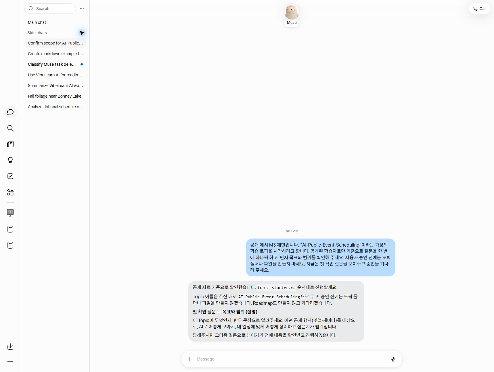

# M3 — VibeLearn AI on Muse

**상태** · 2026-11-05 실습과 문서화 완료
**로드맵 예상 시간** · 1시간 30분

Muse가 공개 저장소의 VibeLearn AI 지시를 읽고, 필요한 곳에서 멈추고, 다음 대화에서도 기억한 규칙을 따르는지 시험했다. 마지막에는 Muse Library에서 원본 파일을 내려받아 Codex가 집의 볼트에서 기간 검토 단계까지 이어받았다.

## 학습 순서

1. [지시를 읽고 따른다는 것](concepts/vibelearn-as-instructions.md) — 원문 읽기, 절차 준수, 결과물 확인을 구분한다.
2. [Muse 시험과 결과](guides/muse-vibelearn-test.md) — 원문 읽기, 순서, 기억, 이어받기의 관찰 결과를 확인한다.
3. [공개 행사 Topic 예시](examples/muse-topic-starter-sample.md) — Muse가 만든 Topic 정보와 프롬프트의 범위를 본다.
4. [집에서 이어받는 방법](guides/handoff-to-home.md) — 원본을 내려받고 어느 단계에서 재개할지 확인한다.

## 이동

- 이전 · [M2 — Muse ↔ 볼트 옮기기](../02-Muse-to-Vault/README.md)
- 다음 · [로드맵의 M4 — 볼트 연결 해법](../vl_roadmap/20261018_RoadMap_Muse-My-Workflow.md#m4---볼트-연결-해법--집과-밖을-끊김-없이)

## 영상용 재현 화면

아래 화면은 실제 M3 진행 당시의 녹화가 아니라, 2026-11-05 영상 제작을 위해 공개 저장소 기반의 가상 Topic 시작 절차를 재현한 화면이다. 승인 전 폴더나 파일을 만들지 않고 첫 확인 질문에서 멈춘 상태다.

