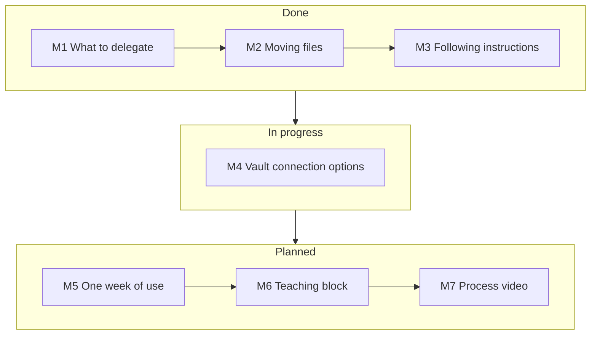

## Fitting Meta Muse into My Workflow

[한국어](README.md)

This Topic looks for a way to work on my phone with Meta Muse when my laptop is not with me, and then add the results seamlessly to the Obsidian vault (2nd Brain) at home. I find the way **by trying it myself**. I decided which work to give to Muse, moved files between Muse and the vault, and tested whether Muse follows VibeLearn AI instructions. Right now I am comparing options for connecting the whole vault to Muse (M4). At the end, I will make a guide from one week of real use, a teaching block for teaching other people, and a video of the process (Korean · English).

> When my laptop is not with me, I can use Muse, and later, when I get home, move the work to my computer. That way I can keep my work in my 2nd Brain on my local machine
>
> — Changsoo Park, 2026-10-14 (the starting point of the Topic)

> If I sync my vault with Muse's computer, automatically or manually, I think I could work without interruption at home and away.
>
> — Changsoo Park, 2026-10-25 (the reason the roadmap was widened to v2.0)

This Topic is run by **Claude Code and Codex in turns**. So every module and WorkLog leaves "what to read when you start" and "what to pass to the next session." That way, whichever agent takes over can start by reading only the [roadmap](vl_roadmap/20261018_RoadMap_Muse-My-Workflow.md) and the [WorkLog](vl_worklog/).

## What I Have Found So Far

| Question | Answer (results from trying it myself) | Module |
|---|---|---|
| What should I give to Muse? | I judged 18 tasks: **Delegate 3 · Draft only 10 · Don't delegate 5**. "Draft only" is the largest group: catch the thought while away, fix the format at home. I changed the test to "Is there a reason Muse does it better?" and added 5 more, such as email and calendar | [M1](01-Workflow-Fit-Map/README.en.md) |
| Can I move what I made away to home? | With all four methods, **the Markdown source did not break**. Downloading one file at a time is not in the official help, but **it was in the app**. An attachment sent by email was identical to the original, down to the byte | [M2](02-Muse-to-Vault/README.en.md) |
| Can Muse take over work from home? | If I upload a "handoff packet" (how far I got · what was decided · what to do next), it takes over with a one-line instruction. But it does not know vault rules that were not in the packet | [M2](02-Muse-to-Vault/README.en.md) |
| Can I keep exactly what I said? | With one line, "Save this as a Markdown file without changing a single character," the dictated text became a file as is | [M2](02-Muse-to-Vault/README.en.md) |
| Does Muse follow VibeLearn AI instructions? | It read the instructions in the public repo directly and stopped at the three places that need approval. When I put the rules in its memory (`MEMORY.md`), it kept those rules **even in a new chat** | [M3](03-VibeLearn-on-Muse/README.en.md) |
| Can I continue at home a Topic I started away? | I downloaded 3 original files from the Muse Library and moved them to the vault. **The SHA-256 values all matched**, and Codex took over from the period review step | [M3](03-VibeLearn-on-Muse/README.en.md) |
| How should I connect the vault to Muse? | I checked 8 candidates with official documentation and screens. I built a preview that picks only the Markdown marked `visibility: public` in the vault, and ran it: **3 candidates to include · 55,975 excluded · 0 copied** — all internal material was left out. I have not made a real connection yet | [M4](04-Vault-Connection/README.en.md) |

## Learning Order and Status by Module

| Module | Guide | Status |
|---|---|---|
| M1 | [Task list and Muse fit map](01-Workflow-Fit-Map/README.en.md) | ✅ Done (10/18 · expanded 10/25) |
| M2 | [Moving between Muse ↔ vault (both ways)](02-Muse-to-Vault/README.en.md) | ✅ Done (10/25) |
| M3 | [VibeLearn AI on Muse](03-VibeLearn-on-Muse/README.en.md) | ✅ Done (10/25 – 11/5) |
| M4 | [Vault connection options — home and away, seamless](04-Vault-Connection/README.en.md) | 🔄 In progress 3/8 — waiting for preview report review · choice of candidates to test |
| M5 | One week of real use and a usage guide | ⏳ Planned (use 11/8 – 11/14) |
| M6 | A teaching block for other people | ⏳ Planned (around 11/15) |
| M7 | Capstone — process video (Korean · English) | ⏳ Planned (11/22 – 11/29) |

The M5 – M7 folders do not exist yet. The plans are in the detailed module plans and the progress table of the [roadmap](vl_roadmap/20261018_RoadMap_Muse-My-Workflow.md).

## Vault Connection Candidates (M4)

| Candidate | What I have checked so far |
|---|---|
| A · Dropbox mirror copy | In the Muse connector list. Whether the scope can be narrowed to a folder needs testing |
| B · GitHub private mirror copy | In the Muse connector list. Whether the scope can be limited to one repository is unverified |
| C · Google Drive · Box | Drive shows permission settings per action. Folder scope cannot be judged from the screen alone |
| D · Manual transfer | Actually done in M3 — original preserved, but it takes manual work |
| E · Claude Code Remote Control | Proven in an earlier Topic. The home PC must be on |
| F · Claude Code web · mobile | A separate test repo is needed first |
| G · Muse desktop | macOS app confirmed. Could not confirm a Windows release |
| H · Custom connector | Document review only |

Before choosing a candidate, look at the [two connection models](04-Vault-Connection/concepts/connection-models.en.md) (cloud-agent model · remote-console model; connection, not sync) first. Then the table is easy to read. The proposed test order is D → E → C (Drive) → A, and it is waiting for Changsoo Park's choice. The detailed reasons are in the [options map](04-Vault-Connection/guides/solution-map.en.md) and the [scenario comparison table](04-Vault-Connection/guides/seamless-scenarios.en.md). I first set a [mirror policy draft](04-Vault-Connection/guides/mirror-policy.en.md): the vault mirror copy **holds only what is marked public, and before the first upload or any widening of scope, the list is shown and approved**.

## Judgments I Got Wrong and What I Still Don't Know

This method also keeps failures and unverified items as results.

- **"There is no way to download one file at a time"** — I looked only at the official help and thought it did not exist, but it was in the app (M2). The official documentation and the actual screen must be checked separately.
- **Testing in the wrong app** — I first ran M3 labs 2 · 3 not in Muse but in Meta AI (meta.ai). I tested again in Muse and kept the Meta AI results only as comparison material. In the same test, Meta AI made up a roadmap and could not remember it either.
- **A gap in the handoff packet** — Muse took over well, but it did not know the vault rules, so it made the frontmatter keys in Korean. The packet must include the rules too.
- **A public repo shows only what has been pushed** — What Muse read was an old version that had been uploaded.
- **The training off switch** — I could not find a switch to turn off model training in Data controls on the Muse web.
- **What I could not check** — whether the spoken sound itself matches the dictated text (only I can judge that), the save format of Save to Files on the phone, and whether a connector can be limited to a specific folder.

## What This Topic Keeps To

- Internal material (`visibility: internal` · 🔒) · client information · personal information · accounts and keys go **neither into Muse nor into the vault mirror copy**.
- I ask first before newly connecting email · calendar · storage to Muse, or before installing or paying. I work within the free tier.
- Public documents do not include other people's real names, account-specific settings screens, or the folder list of the real mirror copy. Screens for the video were remade with public · synthetic examples.
- Features are described only from official documentation or from results of trying it myself. If there is no evidence, I write "unverified."

## Records

| Record | Location |
|---|---|
| Learning roadmap (v2.0, 6 weeks) | [vl_roadmap/20261018_RoadMap_Muse-My-Workflow.md](vl_roadmap/20261018_RoadMap_Muse-My-Workflow.md) |
| WorkLog | [vl_worklog/](vl_worklog/) — M1 · M1 expansion · M2 · M3 (10/25 · 11/1 · 11/5) · M4 (11/5) |
| Module retrospectives | [M1](vl_worklog/20261018_M1_Retrospective.md) · [M2](vl_worklog/20261025_M2_Retrospective.md) · [M3](vl_worklog/20261105_M3_Retrospective.md) — the M2 · M3 retrospectives were written late, during the 2026-11-07 Topic review |
| Prompts | [vl_prompts/roadmap_prompt.md](vl_prompts/roadmap_prompt.md) · [vl_prompts/daily_learning_prompt.md](vl_prompts/daily_learning_prompt.md) |
| First research material | [vl_materials/vault-connection-first-research.md](vl_materials/vault-connection-first-research.md) |
| Agent handoff (11/7 review) | [Codex handoff — review results and how to proceed](vl_materials/20261107_Codex-Handoff.md) |
| Topic starting information | [topic_starter.md](topic_starter.md) |

This Topic keeps work records and reusable outputs in the [VibeLearn AI](https://github.com/solkit70/CatchUpAI_VL) way. When M7 is finished, I will rewrite this README as the final results and retrospective.
