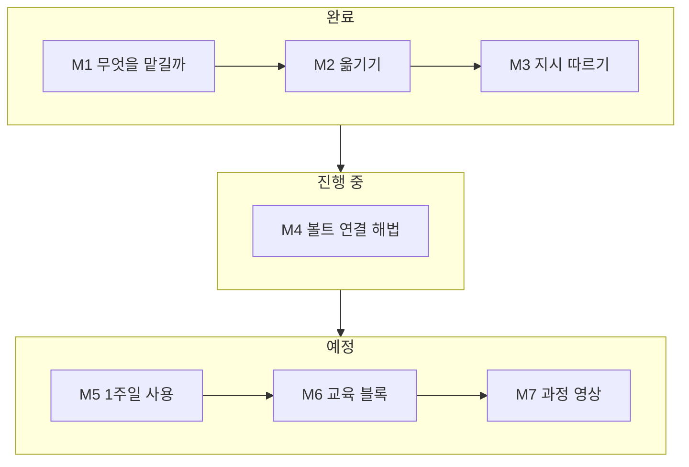

## Meta Muse 를 내 작업 흐름에 맞추기

[English](README.en.md)

노트북이 옆에 없을 때 휴대폰의 Meta Muse 로 일하고, 그 결과를 집의 Obsidian 볼트(2nd Brain)에 끊김 없이 이어 붙이는 방법을 **직접 해 보며** 찾는 Topic 이다. 어떤 일을 Muse 에 맡길지 정하고, Muse 와 볼트 사이로 파일을 옮기고, Muse 가 VibeLearn AI 지시를 따르는지 시험했다. 지금은 볼트 전체를 Muse 와 잇는 해법(M4)을 비교하는 중이다. 마지막에는 1주일 실제 사용 가이드, 다른 사람을 가르칠 교육 블록, 과정 영상(한 · 영)을 만든다.

> 노트북이 옆에 없을 때는 Muse 를 사용하고 나중에 집에 와서 작업한 내용을 컴퓨터로 옮기는 방법으로 내 로컬에 있는 나의 2nd Brain 에 작업 내용을 보관할 수 있다
>
> — 박창수, 2026-10-14 (Topic 의 출발점)

> 제 vault 를 Muse 의 컴퓨터와 자동적으로 혹은 매뉴얼로 동기화 시키면 집과 밖에서 중단없이 작업을 할 수 있을 것 같습니다.
>
> — 박창수, 2026-10-25 (로드맵 v2.0 으로 넓힌 계기)

이 Topic 은 **Claude Code 와 Codex 가 번갈아** 진행한다. 그래서 모든 모듈과 WorkLog 에 「시작할 때 읽을 것」과 「다음 세션에 넘길 것」을 남겨, 어느 에이전트가 이어받아도 [로드맵](vl_roadmap/20261018_RoadMap_Muse-My-Workflow.md)과 [WorkLog](vl_worklog/)만 읽고 시작할 수 있게 했다.

## 지금까지 알아낸 것

| 질문 | 답 (직접 해 본 결과) | 모듈 |
|---|---|---|
| 무엇을 Muse 에 맡길까 | 작업 18개를 판정하니 **맡김 3 · 초안만 10 · 맡기지 않음 5**. 밖에서는 생각을 붙잡고 형식은 집에서 맞추는 「초안만」이 가장 많다. 기준을 「Muse 가 더 나은 이유가 있는가」로 바꿔 메일 · 일정 등 5개를 더했다 | [M1](01-Workflow-Fit-Map/README.md) |
| 밖에서 만든 것을 집으로 옮길 수 있나 | 네 방법 모두 **Markdown 원문이 안 깨졌다**. 파일 하나씩 내려받기는 공식 도움말엔 없지만 **앱에는 있었고**, 메일로 보낸 첨부는 원본과 바이트까지 같았다 | [M2](02-Muse-to-Vault/README.md) |
| 집의 일을 Muse 가 이어받을 수 있나 | 「넘김 꾸러미」(어디까지 · 정한 것 · 다음 할 일)를 올리면 한 줄 지시로 이어받는다. 다만 꾸러미에 없던 볼트 규칙은 모른다 | [M2](02-Muse-to-Vault/README.md) |
| 말한 그대로 남길 수 있나 | 「한 글자도 바꾸지 말고 마크다운 파일로 저장해줘」 한 줄로 받아 적은 글이 그대로 파일이 됐다 | [M2](02-Muse-to-Vault/README.md) |
| Muse 가 VibeLearn AI 지시를 따르나 | 공개 레포의 지시를 직접 읽고, 승인이 필요한 곳 세 번에서 멈췄다. 규칙을 기억(`MEMORY.md`)에 넣자 **새 대화에서도** 그 규칙을 지켰다 | [M3](03-VibeLearn-on-Muse/README.md) |
| 밖에서 시작한 Topic 을 집에서 이어갈 수 있나 | Muse Library 에서 원본 3개를 내려받아 볼트에 옮기니 **SHA-256 이 모두 같았고**, Codex 가 기간 검토 단계부터 이어받았다 | [M3](03-VibeLearn-on-Muse/README.md) |
| 볼트를 Muse 와 어떻게 이을까 | 후보 8개를 공식 자료와 화면으로 확인했다. 볼트에서 `visibility: public` 으로 표시한 Markdown 만 골라 보는 미리 보기를 만들어 돌려 보니 **포함 후보 3 · 제외 55,975 · 복사 0** — 내부 자료는 모두 빠졌다. 실제 연결은 아직 안 했다 | [M4](04-Vault-Connection/README.md) |

## 모듈별 학습 순서와 상태

| 모듈 | 안내 | 상태 |
|---|---|---|
| M1 | [작업 목록과 Muse 적합도 지도](01-Workflow-Fit-Map/README.md) | ✅ 완료 (10/18 · 보강 10/25) |
| M2 | [Muse ↔ 볼트 옮기기 (양방향)](02-Muse-to-Vault/README.md) | ✅ 완료 (10/25) |
| M3 | [VibeLearn AI on Muse](03-VibeLearn-on-Muse/README.md) | ✅ 완료 (10/25 ~ 11/5) |
| M4 | [볼트 연결 해법 — 집과 밖을 끊김 없이](04-Vault-Connection/README.md) | 🔄 진행 중 3/8 — 미리 보기 보고서 검토 · 시험 후보 선택 대기 |
| M5 | 1주일 실제 사용과 사용 가이드 | ⏳ 예정 (11/8 ~ 11/14 사용) |
| M6 | 다른 사람을 위한 교육 블록 | ⏳ 예정 (11/15 전후) |
| M7 | Capstone — 과정 영상 (한 · 영) | ⏳ 예정 (11/22 ~ 11/29) |

M5 ~ M7 폴더는 아직 없다. 계획은 [로드맵](vl_roadmap/20261018_RoadMap_Muse-My-Workflow.md)의 모듈별 상세 계획과 진행 상황 표에 있다.

## 볼트 연결 후보 (M4)

| 후보 | 지금까지 확인한 것 |
|---|---|
| A · Dropbox 사본 | Muse 커넥터 목록에 있음. 폴더 단위로 범위를 좁힐 수 있는지는 시험 필요 |
| B · GitHub private 사본 | Muse 커넥터 목록에 있음. 저장소 하나로 범위를 제한할 수 있는지 미확인 |
| C · Google Drive · Box | Drive 는 동작별 권한 설정이 보임. 폴더 범위는 화면만으로 판정 못 함 |
| D · 수동 전달 | M3 에서 실제로 해 봄 — 원본 보존 확인, 대신 손이 간다 |
| E · Claude Code Remote Control | 이전 Topic 에서 실증. 집 PC 가 켜져 있어야 함 |
| F · Claude Code 웹 · 모바일 | 별도 시험 레포가 먼저 필요 |
| G · Muse 데스크톱 | macOS 앱 확인. Windows 는 배포 확인 못 함 |
| H · 사용자 정의 커넥터 | 문서 검토 범위 |

후보를 고르기 전에 [두 가지 연결 모델](04-Vault-Connection/concepts/connection-models.md)(클라우드 대리형 · 원격 콘솔형, 동기화가 아니라 연결)을 먼저 보면 표가 쉽게 읽힌다. 시험 순서 제안은 D → E → C(Drive) → A 이고, 박창수의 선택을 기다린다. 자세한 근거는 [해법 지도](04-Vault-Connection/guides/solution-map.md)와 [시나리오 비교표](04-Vault-Connection/guides/seamless-scenarios.md)에 있다. 볼트 사본은 **공개로 표시한 것만 넣고, 처음 올리거나 범위를 넓히기 전에 목록을 보여 주고 승인받는다**는 [사본 정책 초안](04-Vault-Connection/guides/mirror-policy.md)을 먼저 정했다.

## 틀렸던 판단과 아직 모르는 것

이 방법론은 실패와 미확인도 결과로 남긴다.

- **「파일 하나씩 내려받기는 없다」** — 공식 도움말만 보고 없는 줄 알았는데, 앱에는 있었다(M2). 공식 문서와 실제 화면을 따로 확인해야 한다.
- **엉뚱한 앱에서 시험** — M3 실습 2 · 3 을 처음에 Muse 가 아니라 Meta AI(meta.ai)에서 진행했다. 다시 Muse 에서 시험했고, Meta AI 결과는 비교 자료로만 남겼다. 같은 시험에서 Meta AI 는 로드맵을 지어내고 기억도 못 했다.
- **넘김 꾸러미의 빈틈** — Muse 가 이어받기는 잘했지만 볼트 규칙을 몰라 머리말 키를 한글로 만들었다. 꾸러미에 규칙도 넣어야 한다.
- **공개 레포는 push 한 것만 보인다** — Muse 가 읽은 것은 올라가 있던 옛 버전이었다.
- **학습 끄기 스위치** — Muse 웹의 Data controls 에서 모델 학습을 끄는 스위치를 찾지 못했다.
- **확인 못 한 것** — 말소리 자체와 받아 적은 글의 일치(본인만 판단 가능), 휴대폰 Save to Files 의 저장 형식, 커넥터가 특정 폴더로만 접근하게 할 수 있는지.

## 이 Topic 에서 지키는 것

- 내부 자료(`visibility: internal` · 🔒) · 의뢰인 정보 · 개인 정보 · 계정과 키는 **Muse 에도, 볼트 사본에도** 넣지 않는다.
- 메일 · 캘린더 · 저장소를 Muse 에 새로 연결하거나 설치 · 결제하기 전에는 먼저 묻는다. 무료 범위에서 진행한다.
- 공개 문서에는 다른 사람의 실명, 계정별 설정 화면, 실제 사본의 폴더 목록을 쓰지 않는다. 영상용 화면은 공개 · 가상 예시로 다시 만든 것이다.
- 기능 설명은 공식 자료나 직접 해 본 결과로만 쓰고, 근거가 없으면 「미확인」으로 적는다.

## 기록

| 기록 | 위치 |
|---|---|
| 학습 로드맵 (v2.0, 6주) | [vl_roadmap/20261018_RoadMap_Muse-My-Workflow.md](vl_roadmap/20261018_RoadMap_Muse-My-Workflow.md) |
| WorkLog | [vl_worklog/](vl_worklog/) — M1 · M1 보강 · M2 · M3(10/25 · 11/1 · 11/5) · M4(11/5) |
| 모듈 회고 | [M1](vl_worklog/20261018_M1_Retrospective.md) · [M2](vl_worklog/20261025_M2_Retrospective.md) · [M3](vl_worklog/20261105_M3_Retrospective.md) — M2 · M3 회고는 2026-11-07 Topic 점검에서 뒤늦게 작성 |
| 프롬프트 | [vl_prompts/roadmap_prompt.md](vl_prompts/roadmap_prompt.md) · [vl_prompts/daily_learning_prompt.md](vl_prompts/daily_learning_prompt.md) |
| 첫 조사 자료 | [vl_materials/vault-connection-first-research.md](vl_materials/vault-connection-first-research.md) |
| 에이전트 인계 (11/7 점검) | [Codex 인계 — 점검 결과와 앞으로의 진행 방법](vl_materials/20261107_Codex-Handoff.md) |
| Topic 시작 정보 | [topic_starter.md](topic_starter.md) |

이 Topic 은 [VibeLearn AI](https://github.com/solkit70/CatchUpAI_VL) 방식으로 작업 기록과 재사용 가능한 산출물을 남긴다. M7 을 마치면 이 README 를 최종 결과와 회고로 다시 정리한다.
