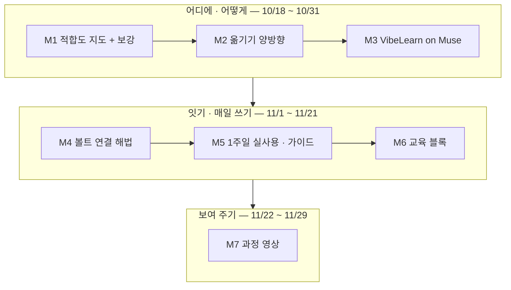

# Muse-My-Workflow 학습 로드맵

**생성일**: 2026-10-18
**방법론**: VibeLearn AI
**버전**: 2.0 — **사용자 승인 2026-10-25** (볼트 연결 해법 · 교육 블록 · 과정 영상 추가, 2주 → 6주)

---

## 📚 학습 개요

### Topic 소개
Meta Muse 를 박창수의 작업 전체에 맞춰 쓰는 방법을 찾는다. 출발점은 2026-10-14 박창수의 구술이다 — 「노트북이 옆에 없을 때는 Muse 를 사용하고 나중에 집에 와서 작업한 내용을 컴퓨터로 옮기는 방법으로 내 로컬에 있는 나의 2nd Brain 에 작업 내용을 보관할 수 있다」. 2026-10-25 에는 질문이 한 걸음 더 나아갔다 — 「제 vault 를 Muse 의 컴퓨터와 자동적으로 혹은 매뉴얼로 동기화 시키면 집과 밖에서 중단없이 작업을 할 수 있을 것 같습니다. 아니면 GitHub 에 Vault 전체를 Private 으로 올려서 Muse 도 같이 볼 수 있도록 할 수 있구요.」 이 Topic 은 그 바람이 가능한 최대한 이뤄지는 해법을 실험으로 찾고, 매일 쓰는 사용법 · 규칙으로 굳힌 뒤, 과정을 영상(한 · 영)과 다른 사람을 위한 AI 교육 블록으로 만든다.

### v2.0 변경 — 볼트와 Muse 를 잇는 해법 · 영상 · 교육 (2026-10-25 사용자 승인)

| 항목 | v1.0 (2026-10-18) | v2.0 (2026-10-25) |
|---|---|---|
| 범위 | 노트북이 없을 때 Muse 로 일하고 집에서 볼트로 옮기기 | 내 일 전체에 Muse + 볼트와 Muse 를 잇는 해법 (집 ↔ 밖을 끊김 없이) |
| 기간 | 2주 (11/1 마무리) | 6주 (11/29 마무리) |
| 모듈 | 5개 | 7개 — M4 볼트 연결 해법 · M6 교육 블록 · M7 과정 영상을 새로 두고, 옛 M4(실제 일 2~3개)는 M5 에 합침 |
| M1 | 완료 | 완료 + 보강 — 직접 확인한 사실 · 새 커넥터 · 판정 기준 ③ · 연결 규칙 |
| M2 | Muse → 볼트 한 방향 | 양방향 (밖 → 집, 집 → 밖) + 음성 원문 보존 시험 |
| M3 | 지시 파일 전체를 따르는지 | 밖에서 할 수 있는 조각 + 기억에 규칙 넣기 |
| Capstone | 1주일 실제 사용 | 과정 영상 (한 · 영) |
| 기록 | WorkLog | WorkLog + 🎬 영상 재료 · 🎓 가르칠 때 칸 |

**왜 바꾸나**: 1주차에 M1 만 끝났다. 그 사이 직접 써 보며 음성 입력 · Gmail · Google Calendar · 반복 알림이 되는 것을 확인했고(2026-10-20~22, 안드로이드), Meta 는 Dropbox · GitHub · Box 같은 커넥터를 늘렸다(2026-09). 그리고 박창수가 볼트 전체를 Muse 와 잇는 방법, 과정 영상, 다른 사람 교육에 쓸 노하우를 요청했다(볼트 Journal 2026-10-25 원문). 첫 조사 결과는 [vl_materials/vault-connection-first-research.md](../vl_materials/vault-connection-first-research.md) 에 있다.

### 학습 목표
- [x] 박창수의 작업 목록을 만들고, 작업마다 Muse 적합도(맡김 / 초안만 / 맡기지 않음)를 근거와 함께 판정한다 (M1, 2026-10-18)
- [ ] 직접 써서 확인한 사실(음성 입력 · 메일 · 캘린더 · 알림)과 늘어난 커넥터로 적합도 지도와 연결 규칙을 보강한다
- [ ] Muse ↔ 볼트 옮기기(밖 → 집, 집 → 밖)와 VibeLearn AI 지시 따르기를 직접 시험해, 되는 것 · 안 되는 것을 이유와 함께 기록한다
- [ ] 볼트 연결 해법(클라우드 저장소 사본 · private GitHub · 원격 콘솔 · 데스크톱 앱 등)을 「끊김 없는 시나리오」로 비교하고, 내부 자료를 지키는 범위에서 가장 끊김 없는 조합을 골라 실제로 가동한다
- [ ] 1주일 실제 사용 기록을 남기고, 매일 쓰는 「집 ↔ 밖」 사용 가이드 · 프롬프트 모음 · 규칙을 만든다
- [ ] 배운 것을 다른 사람을 가르칠 때 쓰는 교육 블록(레벨별 수업 카드 · 실습 · 안전 규칙 · 막힐 때 FAQ)으로 정리한다
- [ ] 이 과정을 한 · 영 영상으로 만든다

### 예상 학습 기간
**6주 (2026-10-18 ~ 11/29)** — 2026-10-25 사용자 승인(「그대로 진행」). 처음 2주(10/18 확정)에서 범위 확대로 다시 잡았다. 남은 학습은 약 15시간이고, 11월 중순 행사 준비 기간을 고려해 주당 약 3시간으로 나눴다. 1주일 실제 사용과 영상 리뷰 · 렌더링 대기는 학습 시간에 넣지 않았다.

| 주차 | 기간 | 모듈 | 라이브 방송 |
|---|---|---|---|
| 1 | 10/18 ~ 10/24 | M1 ✅ | Live #32 (10/18) |
| 2 | 10/25 ~ 10/31 | M1 보강 · M2 · M3 — 방송에서 못 끝낸 것은 주중. 10/26 부터 가벼운 사용 기록 시작 | Live #33 (10/25) |
| 3 | 11/1 ~ 11/7 | M4 볼트 연결 해법 — 해법 결정 · 가동 | Live #34 (11/1) |
| 4 | 11/8 ~ 11/14 | M5 1주일 실제 사용 | Live #35 (11/8) 중간 점검 |
| 5 | 11/15 ~ 11/21 | M5 가이드 · M6 교육 블록 | Live #36 (11/15) |
| 6 | 11/22 ~ 11/29 | M7 과정 영상 · Topic README · Final Retrospective | Live #37 (11/22) |

### 학습 환경
- OS: Windows 11 (집 PC — i7-1355U · 16GB RAM · GPU 없음) + 휴대폰 (밖에서 Muse 사용)
- Muse: 무료 — 웹 · 휴대폰 앱. Windows 데스크톱 앱은 2026-10-07 발표 · 출시 전
- 도구: Obsidian 볼트 · VS Code + Claude Code / Codex · GitHub(CatchUpAI_VL) · Remotion · gobi-cli
- 볼트 연결 시험용 (설치 · 생성 · 연결 전에 박창수 확인): Dropbox 무료 · GitHub private 레포 · Claude Code 웹 / 휴대폰 앱 · Python
- 사전 지식: Muse 설치와 기본 사용(Live #31) · 볼트 구조와 작업 흐름 · VibeLearn AI 방법론 · 내부 자료 규칙 · [Claude-Code-Mobile-Remote-Execution](../../Claude-Code-Mobile-Remote-Execution/README.md) 의 원격 콘솔 방식

### 진행 에이전트
- **Roadmap**: Claude Code (v1.0 2026-10-18 · v2.0 2026-10-25)
- **일일 학습**: Claude Code 와 Codex 를 함께 쓴다. 그래서 모듈마다 **「시작할 때 읽을 것」**과 **「다음 세션에 넘길 것」**을 적는다. 어느 에이전트가 이어받아도 WorkLog 와 이 Roadmap 만 읽고 시작할 수 있어야 한다.

### 이 Topic 전체에서 지킬 것
- 내부 자료(`visibility: internal` · 🔒 표시 문서 — 단체 회사 IR · 정산 등) · 의뢰인 정보 · 개인 정보 · 비밀(계정 · 키)은 **Muse 에도, 볼트 사본에도** 넣지 않는다. 이 구분이 적합도 판정과 사본 규칙의 기준이다.
- 볼트 사본을 밖(클라우드 저장소 · GitHub · Muse)에 **처음 올리거나 범위를 넓히기 전에는** 포함 · 제외 목록을 보여 주고 박창수 승인을 받는다.
- 메일 · 캘린더 · 저장소를 Muse 에 새로 연결하거나 결제 · 설치를 하기 전에는 반드시 박창수에게 묻는다. 회사 계정은 기본적으로 연결하지 않고, 필요해지면 그때 계정 · 범위를 보여 주고 박창수 승인을 받는다(2026-10-25 변경). 이 Topic 은 무료 범위에서 하고, 유료가 필요하면 먼저 묻는다.
- 이 Topic 은 공개 레포에 올라간다. 공개 문서에 **다른 사람의 실명** · 의뢰인 정보 · 계정 정보 · Muse 화면의 계정별 설정 상태 · 실제 사본 설정(폴더 목록)을 쓰지 않는다. 캡처는 가린 뒤 쓴다. 교육 재료는 개인 정보 없이 일반화한다.
- Muse 는 사용자와 사용자가 언급한 사람에 대한 기록을 계속 갱신한다는 보도가 있다(TIME, 2026-10-06). 다른 사람 이름이 들어가는 일은 M1 보강에서 정한 **이름 규칙**을 따른다.
- 기능 설명은 **공식 자료**나 **직접 해 본 결과**로만 쓴다. 2차 보도는 「2차」로 표시하고, 아무 근거도 없으면 「미확인」이다.
- 시험해 보고 안 되는 것도 결과다. 실패한 방법은 이유와 함께 남긴다.
- 영상과 교육에 쓸 재료를 진행하면서 함께 남긴다 — WorkLog 의 🎬 · 🎓 칸.

---

## 🗺️ 전체 로드맵 구조

| 모듈 | 모듈명 | 난이도 | 예상 시간 | 산출물 폴더 |
|------|--------|--------|----------|------------|
| M1 | 작업 목록과 Muse 적합도 지도 (✅ + v2.0 보강) | ⭐ | 1.5h + 0.75h | `01-Workflow-Fit-Map/` |
| M2 | Muse ↔ 볼트 옮기기 (양방향) | ⭐⭐ | 2h | `02-Muse-to-Vault/` |
| M3 | VibeLearn AI on Muse | ⭐⭐ | 1.5h | `03-VibeLearn-on-Muse/` |
| M4 | 볼트 연결 해법 — 집과 밖을 끊김 없이 | ⭐⭐⭐ | 3h | `04-Vault-Connection/` |
| M5 | 1주일 실제 사용과 사용 가이드 | ⭐⭐⭐ | 2.5h (+ 1주일 일상 사용) | `05-Daily-Use-Guide/` |
| M6 | 다른 사람을 위한 교육 블록 | ⭐⭐ | 2h | `06-Teaching-Kit/` |
| M7 | Capstone — 과정 영상 (한 · 영) | ⭐⭐⭐ | 3h (+ 리뷰 · 렌더링 대기) | `07-Capstone-Video/` |

**총 예상 시간**: 약 16시간 (완료한 M1 1.5h 포함, 남은 약 15시간 · 각 모듈 버퍼 20% 포함). 1주일 실제 사용과 영상 대기 시간은 넣지 않았다.



---

## 📖 모듈별 상세 계획

### M1 - 작업 목록과 Muse 적합도 지도

**난이도**: ⭐
**예상 시간**: 1.5h
**산출물 폴더**: `01-Workflow-Fit-Map/`
**시작할 때 읽을 것**: 이 Roadmap · `topic_starter.md` · `AI-Agent-Apps-Compare/03-Hands-On/guides/setup-muse.md` · 볼트의 작업 기록(`orchestrator.yaml` · `_Settings_/Prompts/` · `AI/Tasks/items/` · 최근 Weekly Progress)
**다음 세션에 넘길 것**: 적합도 「맡김」 · 「초안만」 작업 목록 → M2 옮기기 시험 재료 · M5 실제 일 후보 (v2.0 번호)

#### 학습 목표
- [ ] 박창수의 작업을 15개 이상 목록으로 만들 수 있다 (볼트 기록 근거)
- [ ] 작업마다 Muse 적합도(맡김 / 초안만 / 맡기지 않음)를 판정 기준 4가지로 근거와 함께 매길 수 있다
- [ ] 「Muse 에 올리면 안 되는 것」의 기준을 한 장으로 정리할 수 있다
- [ ] Muse 의 기능 중 이 Topic 에 필요한 것을 공식 자료로 확인해 출처와 날짜를 적을 수 있다

#### 주요 개념
1. **적합도 3단계**: 맡김(Muse 가 끝까지 해도 됨) · 초안만(Muse 가 만들고 집에서 사람이 검토 · 마무리) · 맡기지 않음(올리면 안 되거나 볼트 · 로컬 도구가 꼭 필요함).
2. **판정 기준 4가지**: ① 데이터 등급(공개 / 개인 / 내부) ② 볼트 맥락이 필요한 정도(볼트 문서를 많이 읽어야 하는 일은 밖에서 어렵다) ③ 밖에서 생기는 일인가(이동 중 떠오른 생각 · 대기 시간) ④ 결과를 옮기는 비용. — v2.0 보강에서 ③을 「Muse 가 더 나은 이유가 있는가」로 바꾼다.
3. **데이터 등급**: 공개(방송 · 공개 레포 · 공개 행사), 개인(내 일정 · 생각), 내부(`visibility: internal` · 🔒). 내부는 적합도와 상관없이 「맡기지 않음」이다.
4. **옮기기 비용**: Muse 결과를 볼트에 넣을 때 드는 손. 복사해 붙이고 형식을 고치는 데 10분이 걸리면, 집에서 처음부터 하는 것과 비교해야 한다.
- ⚠️ 오해하기 쉬운 점: 「Muse 가 할 수 있다」와 「Muse 에 맡기는 게 낫다」는 다르다. 볼트 안에서 Claude Code 로 더 잘 되는 일은 밖에서 할 이유가 적다.

#### 실습 과제

**실습 1: 작업 목록 만들기** ⭐
- **목적**: 어디에 쓸지부터 정한다
- **단계**:
  1. 볼트 기록(워크플로 설정 · 프롬프트 폴더 · 할 일 · 최근 Weekly Progress)에서 반복하는 작업을 뽑는다
  2. 박창수에게 「밖에 있을 때 자주 하고 싶은 일」을 묻는다 (예: 방송 아이디어 메모, 글 초안, 행사 전 리서치)
  3. 작업마다 한 줄 설명 · 얼마나 자주 하는지 · 지금 쓰는 도구를 적는다
- **예상 시간**: 25분
- **검증**: 15개 이상, 각 작업에 볼트 근거나 박창수 답이 있다

**실습 2: 적합도 판정** ⭐⭐
- **목적**: 작업마다 맡길지 말지 근거를 남긴다
- **단계**:
  1. 판정 기준 4가지로 작업마다 표를 채운다
  2. 내부 자료가 섞이는 작업은 「맡기지 않음」으로 두고, 공개 부분만 떼어 맡길 수 있는지 따로 적는다
  3. 「맡김」 · 「초안만」 상위 5개를 고른다 — M2 시험 재료와 M5 실제 일 후보 (v2.0 번호)
  4. 박창수 확인
- **예상 시간**: 25분
- **검증**: 모든 작업에 등급과 근거가 있고, 상위 5개를 박창수가 확인했다

**실습 3: Muse 기능 확인 (공식 자료)** ⭐
- **목적**: 이 Topic 에 필요한 기능이 있는지 공식 자료로 먼저 본다
- **단계**:
  1. Meta 발표문 · 도움말에서 내보내기 · 공유 · 파일 · 기억 · 백그라운드 작업 · 웹 접근 · 커넥터 관련 내용을 찾는다
  2. 기능마다 「공식 자료로 확인 / 미확인」과 출처 · 확인 날짜를 적는다
  3. 미확인인 것은 M2 · M3 에서 직접 해 볼 목록으로 넘긴다
- **예상 시간**: 15분
- **검증**: 기능 표의 모든 행에 출처 또는 「미확인」이 있다

#### 산출물
```
01-Workflow-Fit-Map/
├── README.md              ← 학습 순서 안내 + 전체 문서 링크 (필수)
├── concepts/
│   └── fit-criteria.md    ← 적합도 3단계 · 판정 기준 4가지 · 데이터 등급
├── guides/
│   ├── workflow-fit-map.md     ← 작업 목록과 적합도 표 (공개 가능한 수준으로)
│   └── do-not-upload.md        ← Muse 에 올리면 안 되는 것 한 장 정리
└── examples/
    └── muse-feature-check.md   ← 공식 자료로 확인한 기능 표 (출처 · 날짜)
```

#### Definition of Done
- [ ] 작업 15개 이상 목록 · 적합도 판정 완료
- [ ] 「맡김」 · 「초안만」 상위 5개를 박창수가 확인
- [ ] 「올리면 안 되는 것」 한 장 정리
- [ ] Muse 기능 표 — 모든 행에 출처 또는 「미확인」
- [ ] 공개 문서에 실명 · 의뢰인 · 내부 자료 내용 없음
- [ ] 산출물 폴더 README 작성
- [ ] 🔴 **README 링크가 실제 파일을 가리키는지 확인** (`python Ingest/CatchUpAI_VL/scripts/check_links.py Ingest/CatchUpAI_VL/Topics/Muse-My-Workflow`)
- [ ] WorkLog · Daily Retrospective 작성

#### Self-Assessment
**개념 이해**:
- [ ] 「맡김」과 「초안만」의 차이를 내 작업 예로 설명할 수 있다
- [ ] 내부 자료가 섞인 작업을 어떻게 나눠야 하는지 말할 수 있다

**실무 활용**:
- [ ] AI 에게 「이 작업이 Muse 에 맞는지 판정 기준 4가지로 봐 줘」라고 지시할 수 있다
- [ ] AI 가 매긴 적합도가 맞는지 근거를 보고 판단할 수 있다

#### 예상 시간 배분
- 개념 학습: 15분
- 실습 1: 25분
- 실습 2: 25분
- 실습 3: 15분
- 문서화: 10분
- **합계**: 1.5h (버퍼 20% 포함)

#### 참조 자료
- [Meta — Introducing Muse](https://about.fb.com/news/2026/09/introducing-muse-personal-ai-agent/): Secure VM · Sentinel · 백그라운드 작업 · 기억 기반 제안 · 개인정보 제어 (공식 발표)
- [Meta Help Center — About Muse subscriptions](https://www.meta.com/help/subscriptions/1021145227643680/): 무료 사용량 제한과 구독 (공식 도움말)
- `Ingest/CatchUpAI_VL/Topics/AI-Agent-Apps-Compare/03-Hands-On/guides/setup-muse.md`: Muse 웹 첫 사용 · Settings(Data controls · Permissions) 위치 (Live #31 기록)

#### 🔁 v2.0 보강 (2026-10-25 · Live #33 1부 ①)

**예상 시간**: 0.75h
**시작할 때 읽을 것**: 이 절 · [vl_materials/vault-connection-first-research.md](../vl_materials/vault-connection-first-research.md) · `examples/muse-feature-check.md`
**다음 세션에 넘길 것**: 갱신된 기능 표 · 늘어난 작업 판정 · 연결 규칙 · 이름 규칙 → M2 · M4

**보강 목표**
- [ ] 직접 써서 확인한 기능(음성 입력 · Gmail · Google Calendar · 반복 알림)과 새 커넥터(Dropbox · GitHub · Box 등)를 기능 표에 반영하고, 앱의 Settings → Connectors 에서 실제 목록을 확인할 수 있다
- [ ] 판정 기준 ③을 「Muse 가 더 나은 이유가 있는가 (밖 · 음성 · 커넥터 · 백그라운드)」로 바꾸고, Muse 고유 강점 작업 4~6개를 더해 판정할 수 있다
- [ ] 연결 규칙(무엇을 어떤 권한으로 연결할지)과 이름 규칙(다른 사람 이름을 어디까지 넣을지)을 박창수 결정으로 기록할 수 있다

**보강 실습**
- **실습 4: 기능 표 갱신** (20분) — 공식 자료 다시 확인(확인 날짜) · 직접 사용 결과(2026-10-20~22) · 앱 커넥터 목록 화면(계정 정보 가림)을 모은다. 행마다 출처 종류를 「공식 / 2차 / 직접 / 미확인」으로 나눈다.
- **실습 5: 지도 넓히기** (15분) — 후보: 메일 확인 · 정리 / 일정 확인 · 추가 · 반복 알림 / 행사 직후 기억 정리(음성) / 행사 전 공개 정보 확인 / 긴 공개 리서치를 백그라운드로. 기준 ③이 바뀌면서 판정이 달라지는 기존 작업도 표시한다.
- **실습 6: 연결 · 이름 규칙 결정** (10분) — 선택지 표를 보고 박창수가 고른다. 연결: 안 함 / 캘린더만 / 메일 · 캘린더 / 저장소까지. 권한: 「쓰기 전에 묻기」 유지 여부. 학습 사용 끄기 확인. 이름 규칙: 빼기 / 이름 · 관계만 / 그대로.

**보강 산출물** (기존 파일 갱신)
- `examples/muse-feature-check.md` — v2 기능 표 (2026-10-25)
- `concepts/fit-criteria.md` — 기준 ③ 변경
- `guides/workflow-fit-map.md` — 「v1.1 추가」 절 (작업 추가 · 판정 변경)
- `guides/do-not-upload.md` — 「연결 규칙」 · 「이름 규칙」 절
- `README.md` — 보강 요약

**보강 DoD**
- [ ] 기능 표 모든 행에 출처 종류(공식 / 2차 / 직접 / 미확인)와 날짜
- [ ] 작업 4개 이상 추가 · 판정, 판정이 바뀐 기존 작업 표시
- [ ] 연결 규칙 · 이름 규칙 박창수 결정 기록
- [ ] 공개 문서에 계정 설정 상태 · 어디서 써 봤는지 같은 개인 맥락 없음
- [ ] `check_links.py` 통과 · WorkLog 작성 (🎬 · 🎓 칸 포함)

**보강 Self-Assessment**
- [ ] 판정 기준 ③을 왜 바꿨는지 내 작업 예로 설명할 수 있다
- [ ] 새 커넥터를 연결하기 전에 확인할 것(권한 · 범위 · 학습 사용)을 말할 수 있다

---

### M2 - Muse ↔ 볼트 옮기기 (양방향)

**난이도**: ⭐⭐
**예상 시간**: 2h
**산출물 폴더**: `02-Muse-to-Vault/`
**시작할 때 읽을 것**: M1 보강 결과(연결 규칙) · `01-Workflow-Fit-Map/examples/muse-feature-check.md` 의 미확인 목록 · [vl_materials/vault-connection-first-research.md](../vl_materials/vault-connection-first-research.md)
**다음 세션에 넘길 것**: 수동 방법 비교표 · 기본 방법 1~2개 · 받는 곳(Inbox) 위치 → M3 · M4 의 기준선. 가벼운 사용 기록을 이때부터 시작한다

#### 학습 목표
- [ ] 밖 → 집 방향(Muse 결과를 볼트로) 방법 4가지 이상을 직접 해 보고 결과(성공 / 실패 / 미확인)를 기록할 수 있다
- [ ] 집 → 밖 방향(진행 중인 일을 Muse 에 넘겨 이어 하기) 방법 2가지 이상을 시험할 수 있다
- [ ] 음성으로 말한 메모가 한 글자도 바뀌지 않고 파일로 남는지 확인할 수 있다
- [ ] 받는 곳(Inbox)과 볼트 정리 절차를 정하고 Claude Code / Codex 프롬프트로 만들 수 있다

#### 주요 개념
1. **양방향**: 밖 → 집(Muse 결과를 볼트로)과 집 → 밖(진행 중인 일을 Muse 에 넘겨 이어 하기). 「중단 없이」는 두 방향이 다 돼야 한다.
2. **보존도**: 옮긴 뒤 제목 · 목록 · 표 · 링크 · 출처가 얼마나 남는가. 볼트에서 다시 손보는 양을 정한다.
3. **원문 보존**: 볼트 규칙은 구술 원문을 한 글자도 바꾸지 않는다. Muse 가 받아 적은 말을 「대답」이나 요약으로 바꾸지 않고 그대로 파일로 남기는지가 관건이다.
4. **받는 곳(Inbox)과 출처 표시**: 밖에서 온 결과는 한곳에 모았다가 집에서 정리한다. 「Muse 에서 만든 것 · 날짜 · 검토 여부」를 남겨야 나중에 검증할 수 있다. 위치는 박창수가 정한다.
5. **넘김 꾸러미(handoff)**: 집 → 밖으로 넘길 때 쓰는 짧은 묶음 — 「어디까지 했는지 · 정한 것 · 다음 할 일」 3줄과 필요한 공개 문서.
- ⚠️ 오해하기 쉬운 점: 공유 링크는 「옮긴 것」이 아니다. Muse 의 System Files 에 올린 것도 지우거나 계정이 바뀌면 사라진다. 원본은 늘 볼트다.

#### 실습 과제

**실습 1: 밖 → 집 방법 시험** ⭐⭐
- **목적**: 되는 방법과 안 되는 방법을 실제로 가린다
- **단계**:
  1. 공개 가능한 짧은 결과(예: 공개 행사 요약)를 Muse 에서 **Markdown 파일**로 만들게 한다
  2. 방법마다 볼트로 옮긴다 — ① Library · System Files 에서 하나씩 내려받기(웹 · 휴대폰) ② 내 메일로 보내기(M1 보강의 연결 규칙이 허용할 때만) ③ 복사 · 붙여넣기 ④ 전체 데이터 내려받기 형식 확인(오래 걸릴 수 있으니 세션 시작 때 요청만 해 둔다) ⑤ (선택) 집에서 Claude Code / Codex 가 Muse 웹 화면에서 가져오기 — Live #31 에서 Codex 가 브라우저로 Muse 를 다룬 경험이 있다
  3. 방법마다 걸린 단계 수 · 보존도 · 막힌 곳 · 휴대폰에서 되는가를 기록한다
- **예상 시간**: 50분
- **검증**: 4가지 이상에 결과 기록, 실패한 방법도 이유가 있다

**실습 2: 음성 원문 보존 시험** ⭐⭐
- **목적**: 차 안 음성 메모가 Journal 원문으로 쓸 수 있는 상태로 남는지 본다
- **단계**:
  1. 휴대폰 Muse 에 음성으로 3~4문장 메모를 남기고 「한 글자도 바꾸지 말고 Markdown 파일로 저장해」라고 지시한다
  2. 파일을 내려받아 실제로 말한 내용과 대조한다 — 그대로 / 일부 고침 / 요약해 버림
  3. 원문이 바뀌면 지시문을 바꿔 한 번 더 시험하고, 원문을 지키는 지시문을 남긴다
- **예상 시간**: 15분
- **검증**: 대조표와 (되면) 원문을 지키는 지시문

**실습 3: 집 → 밖 넘기기** ⭐⭐
- **목적**: 집에서 하던 일을 밖에서 이어 갈 수 있는지 본다
- **단계**:
  1. 진행 중인 공개 작업 하나로 넘김 꾸러미를 만든다
  2. 세 방법으로 넘긴다 — ① Muse 에 파일로 올리기(System Files) ② 내 메일로 보내 Muse 가 읽게 하기(연결 규칙이 허용할 때) ③ 공개 레포 링크 주기
  3. 휴대폰 Muse 가 그 내용을 읽고 다음 할 일을 이어 가는지 본다
- **예상 시간**: 20분
- **검증**: 방법별 결과 표 (되는 것 · 안 되는 것 · 이유)

**실습 4: 비교표 · 받는 곳 · 정리 프롬프트** ⭐
- **목적**: 지금 바로 매일 쓸 기본 방법을 정한다
- **단계**:
  1. 방향 · 방법 · 결과 · 단계 수 · 보존도 · 휴대폰 · 주의점 · 근거로 비교표를 만든다
  2. 기본 방법 1~2개와 받는 곳 후보를 제시하고 박창수가 고른다
  3. 받는 곳에 온 문서를 볼트 규칙(frontmatter · 출처 표시 · 링크)에 맞추는 Claude Code / Codex 프롬프트를 만들고 1건 시험한다
- **예상 시간**: 15분
- **검증**: 박창수가 기본 방법과 받는 곳을 확인했고, 시험한 문서가 볼트 규칙을 지킨다

#### 산출물
```
02-Muse-to-Vault/
├── README.md
├── concepts/
│   └── transfer-paths.md       ← 양방향 경로 · 보존도 · 원문 보존 · 받는 곳 · 넘김 꾸러미
├── guides/
│   ├── transfer-comparison.md  ← 방법별 비교표와 기본 방법 (실패한 방법 포함)
│   └── vault-cleanup-prompt.md ← 받는 곳 문서를 볼트 규칙에 맞추는 단계와 프롬프트
└── examples/
    └── sample-transfer.md      ← 공개 가능한 시험 결과 한 건 (전 · 후) + 음성 원문 대조
```

#### Definition of Done
- [ ] 밖 → 집 4가지 이상, 집 → 밖 2가지 이상 시험 · 결과 기록
- [ ] 음성 원문 보존 대조 결과
- [ ] 비교표 · 기본 방법 · 받는 곳, 박창수 확인
- [ ] 볼트 정리 프롬프트 1건 시험
- [ ] 캡처 · 예시에 계정 정보 · 개인 맥락 없음
- [ ] 산출물 폴더 README 작성
- [ ] 🔴 **README 링크가 실제 파일을 가리키는지 확인** (`check_links.py`)
- [ ] WorkLog (🎬 · 🎓 칸 포함) · Daily Retrospective 작성

#### Self-Assessment
**개념 이해**:
- [ ] 공유 링크와 실제로 옮긴 것의 차이를 설명할 수 있다
- [ ] 「중단 없이」에 두 방향이 다 필요한 이유를 말할 수 있다

**실무 활용**:
- [ ] 밖에서 만든 결과를 집에서 5분 안에 볼트에 넣을 수 있다
- [ ] 집에서 하던 일을 넘김 꾸러미로 밖에서 이어 갈 수 있다

#### 예상 시간 배분
- 개념 학습: 10분
- 실습 1: 50분
- 실습 2: 15분
- 실습 3: 20분
- 실습 4: 15분
- 문서화: 10분
- **합계**: 2h (버퍼 20% 포함)

#### 참조 자료
- [Meta Help — How to manage your Muse data](https://www.meta.com/help/superintelligence/2225571704857152/): System Files · 파일 지우기 · Download your Muse data (공식 도움말)
- [Meta Help — How to get started with Muse](https://www.meta.com/help/superintelligence/1331373868832401/): 파일 올리기 · Library (공식 도움말)
- [Meta Help — How Muse works with Connectors](https://www.meta.com/help/artificial-intelligence/1687253048996149/): 메일 커넥터가 가져오는 범위 (공식 도움말)
- `_Settings_/Skills/obsidian-yaml-frontmatter/SKILL.md` · `_Settings_/Skills/obsidian-links/SKILL.md`: 볼트 frontmatter · 위키 링크 규칙
- [AI-Agent-Apps-Compare Final Retrospective](../../AI-Agent-Apps-Compare/vl_worklog/20261019_AI-Agent-Apps-Compare_Final_Retrospective.md): Codex 가 브라우저로 Muse 를 다룬 경험

---

### M3 - VibeLearn AI on Muse

**난이도**: ⭐⭐
**예상 시간**: 1.5h
**산출물 폴더**: `03-VibeLearn-on-Muse/`
**시작할 때 읽을 것**: M2 비교표 · 넘김 꾸러미 결과 · `Ingest/CatchUpAI_VL/AGENTS.md` · `templates/workflow_guide.md`
**다음 세션에 넘길 것**: 판정(가능 / 일부 가능 / 불가) · 밖에서 할 수 있는 VibeLearn 조각 목록 → M4(볼트 사본이 생기면 무엇이 더 되는가) · M5

#### 학습 목표
- [ ] Muse 가 공개 레포(CatchUpAI_VL)의 지시 파일을 읽고 사실대로 요약하는지 대조할 수 있다
- [ ] Muse 가 VibeLearn AI 순서(topic_starter → 기간 확인에서 멈춤)를 지키는지 확인할 수 있다
- [ ] VibeLearn 규칙 요약을 Muse 기억에 넣고, 다음 대화에서도 지키는지 시험할 수 있다
- [ ] 「밖에서 할 수 있는 조각」과 「집에서만 되는 일」을 나눠 적을 수 있다

#### 주요 개념
1. **「설치」의 뜻**: VibeLearn AI 는 프로그램이 아니라 지시 파일(AGENTS.md · CLAUDE.md · templates/)이다. Muse 에 「설치」한다는 것은 지시를 읽게 하고(레포 링크 · 파일 올리기) 기억시키는 것이다.
2. **지시 따르기 검사**: 템플릿 순서 · 승인 대기 지점(기간 확인)에서 멈추는지 · 템플릿 없이 문서를 지어내지 않는지를 본다.
3. **조각으로 나누기**: 밖에서 되는 단계(topic_starter 초안 · 다음 실습 계획 검토 · 학습 메모)와 집에서만 되는 단계(폴더 구조 · 링크 검사 · git)를 나눈다.
4. **이어받기(handoff)**: 밖에서 Muse 가 만든 조각을 집에서 Claude Code / Codex 가 Roadmap · 일일 학습으로 이어 가는 것.
- ⚠️ 오해하기 쉬운 점: Muse 가 레포 내용을 「요약」했다고 지시를 「따른」 것은 아니다. 멈춰야 할 곳에서 멈추는지를 봐야 한다.

#### 실습 과제

**실습 1: 레포 읽기 시험** ⭐
- **목적**: Muse 가 지시 파일에 닿을 수 있는지 본다
- **단계**:
  1. Muse 에 공개 레포 주소를 주고 AGENTS.md 와 workflow_guide 의 순서를 요약하게 한다
  2. 실제 파일 내용과 비교한다 (지어낸 부분이 있는지)
  3. 웹 접근이 막히면 파일을 올리는 방법(System Files)으로 대신 시험한다
- **예상 시간**: 15분
- **검증**: 요약이 실제 파일과 맞는지 항목별로 대조한 표

**실습 2: 순서 지키기 시험** ⭐⭐
- **목적**: VibeLearn AI 방식으로 일하는지 본다
- **단계**:
  1. 공개해도 되는 작은 주제로 「VibeLearn AI 로 새 Topic 을 시작하자」고 지시한다
  2. topic_starter 를 템플릿 형식으로 채우는지, 기간 확인에서 멈추는지, 승인 전에 Roadmap 을 만들지 않는지 본다
  3. 지키지 않으면 지시를 바꿔 한 번 더 시험하고, 결과를 모두 기록한다
- **예상 시간**: 25분
- **검증**: 검사 항목 표(지킴 / 안 지킴 / 미확인)와 Muse 답 일부 인용

**실습 3: 기억에 규칙 넣기** ⭐⭐
- **목적**: 매번 레포를 주지 않아도 규칙을 지키게 할 수 있는지 본다
- **단계**:
  1. VibeLearn 규칙 요약(공개 내용만)을 Muse 에 기억시킨다
  2. 새 대화에서 작은 학습 요청을 하고 규칙을 지키는지 본다
  3. 기억을 지우는 방법(forget)도 확인해 적는다
- **예상 시간**: 15분
- **검증**: 기억 전 · 후 비교와 지우는 방법

**실습 4: 집에서 이어받기** ⭐⭐
- **목적**: 밖에서 시작한 학습이 집에서 이어지는지 본다
- **단계**:
  1. 실습 2 결과를 M2 기본 방법으로 볼트에 가져온다
  2. Claude Code 나 Codex 가 그 결과로 roadmap_prompt 단계를 이어 갈 수 있는지 본다
  3. 판정(가능 / 일부 가능 / 불가)과 이유, 「밖에서 할 수 있는 조각」 목록을 적는다
- **예상 시간**: 15분
- **검증**: 판정과 막힌 지점 · 다음에 해 볼 것이 적힌 결과 문서

#### 산출물
```
03-VibeLearn-on-Muse/
├── README.md
├── concepts/
│   └── vibelearn-as-instructions.md  ← 「설치」의 뜻 · 지시 따르기 검사 · 조각으로 나누기
├── guides/
│   ├── muse-vibelearn-test.md        ← 시험 절차 · 검사 표 · 판정
│   └── handoff-to-home.md            ← 밖에서 할 수 있는 조각과 집에서 이어받는 절차
└── examples/
    └── muse-topic-starter-sample.md  ← 공개 주제로 Muse 가 만든 결과 (발췌)
```

#### Definition of Done
- [ ] 레포 읽기 시험 · 대조 표
- [ ] 순서 지키기 시험 · 검사 표
- [ ] 기억 시험 결과 · 지우는 방법
- [ ] 집에서 이어받기 시험 · 판정(가능 / 일부 가능 / 불가)과 이유 · 막힌 지점
- [ ] 밖에서 할 수 있는 조각 / 집에서만 되는 일 목록
- [ ] 공개 주제만 사용, 계정 정보 없음 · 산출물 폴더 README 작성
- [ ] 🔴 **README 링크가 실제 파일을 가리키는지 확인** (`check_links.py`)
- [ ] WorkLog (🎬 · 🎓 칸 포함) · Daily Retrospective 작성

#### Self-Assessment
**개념 이해**:
- [ ] VibeLearn AI 를 「설치」한다는 것이 무엇인지 설명할 수 있다
- [ ] 「요약」과 「지시를 따름」의 차이를 예로 들 수 있다

**실무 활용**:
- [ ] 밖에서 Muse 로 학습을 시작할지, 집에서 시작할지 판단할 수 있다
- [ ] Muse 가 순서를 어기면 어떻게 다시 지시할지 말할 수 있다

#### 예상 시간 배분
- 개념 학습: 10분
- 실습 1: 15분
- 실습 2: 25분
- 실습 3: 15분
- 실습 4: 15분
- 문서화: 10분
- **합계**: 1.5h (버퍼 20% 포함)

#### 참조 자료
- [CatchUpAI_VL (GitHub)](https://github.com/solkit70/CatchUpAI_VL): VibeLearn AI 지시 파일 · 템플릿 (시험 대상)
- [Meta — Introducing Muse](https://about.fb.com/news/2026/09/introducing-muse-personal-ai-agent/): Secure VM · 웹 작업 · 기억 (공식 발표)
- [Meta Help — How to manage your Muse data](https://www.meta.com/help/superintelligence/2225571704857152/): 기억 지우기(forget) (공식 도움말)
- `Ingest/CatchUpAI_VL/templates/workflow_guide.md`: 지켜야 할 순서 (검사 기준)

---

### M4 - 볼트 연결 해법 — 집과 밖을 끊김 없이

**난이도**: ⭐⭐⭐
**예상 시간**: 3h
**산출물 폴더**: `04-Vault-Connection/`
**시작할 때 읽을 것**: [vl_materials/vault-connection-first-research.md](../vl_materials/vault-connection-first-research.md) · M2 비교표(기준선) · M3 판정 · M1 연결 · 이름 규칙 · [Claude-Code-Mobile-Remote-Execution README](../../Claude-Code-Mobile-Remote-Execution/README.md)
**다음 세션에 넘길 것**: 가동 중인 조합 · 사본 규칙 · 스크립트 사용법 · 작업 종류별 경로표 → M5 1주일 실제 사용

#### 학습 목표
- [ ] 해법 후보 8가지를 공식 자료와 직접 시험으로 확인해, 「끊김 없는 시나리오」 5개에 대한 결과표를 만들 수 있다
- [ ] 볼트 사본 규칙(넣을 것 · 뺄 것)을 데이터 등급으로 정하고 박창수 승인을 받을 수 있다
- [ ] 사본을 만드는 스크립트를 만들어 포함 · 제외 보고서를 낼 수 있다
- [ ] 고른 저장소에 사본을 올리고, Muse 가 읽기 → 받는 곳에 쓰기 → 집으로 회수까지 되는지 확인할 수 있다
- [ ] 작업 종류별 최적 경로(조합)를 정해 실제로 가동할 수 있다

#### 주요 개념
1. **두 가지 모델**: 「클라우드 대리형」은 Muse 의 컴퓨터에서 실행한다 — 집 PC 가 꺼져 있어도 되고 휴대폰 · 음성이 자연스럽지만, 자료가 사본 · 커넥터로 볼트 밖에 나간다. 「원격 콘솔형」은 집 PC 에서 실행하고 휴대폰은 조작만 한다 — 볼트와 규칙을 그대로 쓰지만 PC 가 켜져 있어야 한다. 이전 Topic 의 결론은 「모바일은 조작 콘솔, 실행은 로컬」이었다.
2. **동기화가 아니라 연결**: Muse 의 컴퓨터와 폴더를 맞추는 기능은 공식 자료에 없다. 파일은 올리기(System Files)나 커넥터로 들어가고, 커넥터는 일할 때 필요한 만큼만 가져온다(공식 도움말). 그래서 「Muse 안의 동기화된 사본」이 아니라 「내 저장소를 Muse 가 그때그때 들여다보는」 구조다.
3. **골라 담은 사본(mirror)과 받는 곳**: 원본은 볼트다. 스크립트가 공개 · 개인 등급 md 만 사본 폴더로 한 방향 복사한다. Muse 는 사본을 읽고 결과는 받는 곳에만 쓴다 — 사본은 다음 복사 때 덮어써지기 때문이다. 쓰는 곳을 나누면 충돌이 생기지 않는다.
4. **사본 규칙과 크기**: 내부 · 비밀 · 의뢰인 · 연락처 · 개인 문서는 무조건 뺀다. 다른 사람 이름이 많은 문서는 M1 보강의 이름 규칙을 따른다. 볼트 md 는 약 95MB 라 사본이 가능하지만, 볼트 전체(약 54GB, 대부분 영상 · 오디오)는 대상이 아니다.
5. **끊김 없는 시나리오** (평가 기준):
   - S1. 차 안에서 음성으로 남긴 생각이 저녁에 볼트 Journal 에 원문 그대로 들어간다
   - S2. 행사장에서 진행 중인 Topic 을 보고 남긴 메모를 집에서 Claude Code 가 이어받는다
   - S3. 밖에서 볼트의 지난 자료(공개 · 개인 등급)를 찾아본다
   - S4. 집에서 하던 일을 밖에서 이어 한다
   - S5. 노트북 없이 하루를 보내도, 밖에서 만든 결과가 집 PC 에 저절로 와 있다
   - 기록할 값: 손 단계 수 · 걸린 시간 · 최신성(몇 분 전 자료까지 보이나) · 원문 보존 · 충돌 · 데이터 등급 위험 · 비용 · 다른 사람에게 가르치기 쉬운가
6. **한 도구로 다 하지 않는다**: 결과물은 정답 하나가 아니라 「작업 종류별 경로표」다.
- ⚠️ 오해하기 쉬운 점: private 레포와 클라우드 저장소도 볼트 밖이다. 볼트 전체를 올리면 내부 자료 규칙을 어기고, Muse 는 언급된 사람들에 대한 기록을 쌓는다(TIME 보도). 「전부」가 아니라 「필요한 만큼」이다.

**해법 후보 8가지** (2026-10-25 첫 조사 기준 — M4 실습 1 에서 다시 확인)

| # | 해법 | 상태 | 시험 방법 |
|---|---|---|---|
| A | Dropbox 사본 + Dropbox 커넥터 + 받는 곳 자동 회수 | 공식 커넥터 — 미국 · 캐나다, 무료 플랜 포함 | 시험 폴더 → 승인 뒤 사본 |
| B | GitHub private 사본 + GitHub 커넥터 | 커넥터 발표(2026-09-23), 권한 범위는 공개 자료 없음 | 공개 레포로 먼저 → private 시험 레포 |
| C | Google Drive · Box | Box 공식(2026-09-23), Google Drive 는 2차 보도만 | 앱 커넥터 목록 확인 뒤 |
| D | 수동 — 올리기 · 메일 · 내려받기 | M2 결과 | 기준선 |
| E | 원격 콘솔 — 집 PC 의 Claude Code Remote Control | 이전 Topic 에서 검증, PC 가 켜져 있어야 함 | S2 · S4 로 비교 |
| F | Claude Code 웹 · 휴대폰 앱 + private 사본 레포 | 사용 가능 | B 의 레포로 S2 · S3 · S4 |
| G | Muse 데스크톱 앱이 PC 에 직접 | Mac 만(2026-09-23), Windows 앱은 2026-10-07 발표 · 출시 전 | 나오면 시험, 아니면 「대기」로 기록 |
| H | 사용자 정의 커넥터로 집 PC 에 직접 | 가능하지만 집 PC 를 인터넷에 여는 위험 | 문서 검토만 — 시험하지 않는다 |

#### 실습 과제

**실습 1: 해법 지도 확인** ⭐⭐
- **목적**: 후보를 사실로 다시 확인하고 시험할 것을 고른다
- **단계**:
  1. 후보마다 공식 자료를 다시 확인하고(확인 날짜), 앱의 커넥터 화면에서 실제로 있는지 본다 (계정 정보 가림)
  2. 비용 · 한계 · 필요한 설치를 적는다
  3. 시험할 후보 3~4개를 고르고 박창수 확인을 받는다
- **예상 시간**: 30분
- **검증**: 8개 후보 모두에 출처 종류 · 날짜, 시험 후보를 박창수가 확인

**실습 2: 사본 규칙과 스크립트** ⭐⭐⭐
- **목적**: 무엇을 밖에 내보낼지 기계적으로 지키게 한다
- **단계**:
  1. 데이터 등급별 포함 · 제외 규칙 초안을 쓴다 (폴더 · frontmatter 표시 · 🔒 · 파일 종류 · 크기)
  2. 스크립트를 만든다 — 볼트 → 사본 폴더 한 방향 복사, 제외 규칙 적용, 포함 · 제외 보고서 출력, 실제로 복사하지 않는 「미리 보기」 모드
  3. 미리 보기 보고서를 박창수가 검토하고 규칙을 확정한다
  4. 공개 레포에는 일반화한 스크립트와 예시 설정만 두고, 실제 설정은 볼트 안에 둔다
- **예상 시간**: 45분
- **검증**: 미리 보기 보고서에 내부 표시 문서 0개, 박창수 승인

**실습 3: 저장소 시험** ⭐⭐⭐
- **목적**: 시나리오 5개를 실제로 돌려 본다
- **단계**:
  1. 공개 문서 3~4개만 든 **시험 폴더**로 먼저 한다 (A · B · C 중 고른 것 — 설치 · 연결 전에 박창수 확인)
  2. Muse 가 읽기 · 찾기 → 받는 곳에 Markdown 쓰기 → 집 PC 로 내려오는지 본다
  3. 연결 권한 화면을 기록한다 — 읽기만 되는가, 폴더 · 레포 하나로 좁힐 수 있는가. 못 좁히면 사본 전용 계정을 검토한다
  4. 박창수 승인 뒤 실제 사본으로 넓힌다
  5. E · F 를 S2 · S4 에서 같은 조건으로 비교한다
- **예상 시간**: 50분
- **검증**: 시나리오 5개 × 시험한 해법 결과표 (실패 포함)

**실습 4: 조합 결정과 가동** ⭐⭐
- **목적**: 매일 쓸 조합을 정하고 켠다
- **단계**:
  1. 작업 종류별 경로표를 만든다 (예: 음성 메모 · 메일 · 일정 → Muse / 볼트 자료 보기 → 사본 / 볼트 규칙이 필요한 일 → Claude Code)
  2. 사본 자동 실행(작업 스케줄러 등)과 받는 곳 정리 프롬프트를 연결한다
  3. 박창수 결정 뒤 가동하고, 되돌리는 법(연결 끊기 · 사본 지우기 · 기억 지우기)도 적는다
- **예상 시간**: 30분
- **검증**: 가동 확인과 되돌리기 절차

#### 산출물
```
04-Vault-Connection/
├── README.md
├── concepts/
│   └── connection-models.md        ← 클라우드 대리형 · 원격 콘솔형 · 동기화가 아니라 연결 · 사본과 받는 곳
├── guides/
│   ├── solution-map.md             ← 해법 8가지 확인표 (출처 종류 · 날짜 · 비용 · 한계)
│   ├── seamless-scenarios.md       ← 시나리오 5개 × 해법 결과표
│   ├── mirror-policy.md            ← 사본 규칙 (일반화한 기준 — 실제 폴더 목록은 볼트 안에)
│   └── task-route-table.md         ← 작업 종류별 경로표 (가동 중인 조합) + 되돌리는 법
├── scripts/
│   ├── build_mirror.py             ← 볼트 → 사본 한 방향 복사 · 제외 규칙 · 보고서 · 미리 보기
│   └── mirror_config.example.yaml  ← 예시 설정 (실제 설정은 공개하지 않는다)
└── examples/
    └── mirror-report-sample.md     ← 포함 · 제외 보고서 예시 (숫자만, 파일명 가림)
```

#### Definition of Done
- [ ] 해법 8가지 확인표 — 모든 행에 출처 종류 · 날짜
- [ ] 시나리오 5개 × 시험한 해법 결과표 (실패 포함)
- [ ] 사본 규칙 박창수 승인 · 미리 보기 보고서에 내부 표시 문서 0개
- [ ] 첫 업로드는 박창수 승인 뒤 실행, 받는 곳 회수 확인
- [ ] 작업 종류별 경로표 · 되돌리는 법
- [ ] 공개 문서에 실제 사본 설정 · 계정 정보 없음 · 산출물 폴더 README 작성
- [ ] 🔴 **README 링크가 실제 파일을 가리키는지 확인** (`check_links.py`)
- [ ] WorkLog (🎬 · 🎓 칸 포함) · Module Retrospective 작성

#### Self-Assessment
**개념 이해**:
- [ ] 클라우드 대리형과 원격 콘솔형의 차이를 내 시나리오로 설명할 수 있다
- [ ] 이 해법이 「동기화」가 아니라 「연결」인 이유를 말할 수 있다

**실무 활용**:
- [ ] AI 에게 사본 규칙을 주고 만든 보고서를 검토할 수 있다
- [ ] 새 저장소를 연결하기 전에 확인할 것(권한 · 범위 · 학습 사용)을 점검할 수 있다

**문제 해결**:
- [ ] 커넥터가 계정 전체 권한을 요구하면 어떻게 할지 말할 수 있다
- [ ] Muse 가 사본을 직접 고쳤을 때 어떻게 되돌릴지 말할 수 있다

#### 예상 시간 배분
- 개념 학습: 15분
- 실습 1: 30분
- 실습 2: 45분
- 실습 3: 50분
- 실습 4: 30분
- 문서화: 10분
- **합계**: 3h (버퍼 20% 포함)

#### 참조 자료
- [vl_materials/vault-connection-first-research.md](../vl_materials/vault-connection-first-research.md): 첫 조사 — 공식 자료 · 보도 · 직접 사용 · 볼트 쪽 사실 (2026-10-25)
- [Meta Help — How Muse works with Connectors](https://www.meta.com/help/artificial-intelligence/1687253048996149/) · [How Muse works with your guidance and approval](https://www.meta.com/help/artificial-intelligence/1385290430137537/): 커넥터 범위 · 권한 · 사용자 정의 커넥터 (공식 도움말)
- [Meta — Everything We Announced at Meta Connect 2026](https://www.meta.com/blog/meta-connect-2026-everything-we-announced/): Mac 컴퓨터 사용 · GitHub · Box 등 새 커넥터 (공식)
- [Dropbox Help — Connect Dropbox to Meta Muse](https://help.dropbox.com/integrations/connect-to-meta-muse): Dropbox 커넥터 기능 · 지역 · 학습 사용 문구 (공식)
- [Windows Experience Blog (2026-10-07)](https://blogs.windows.com/windowsexperience/2026/10/07/building-windows-for-hybrid-intelligence/): Muse for Windows 예정 · MXC (Microsoft 공식)
- [Claude-Code-Mobile-Remote-Execution](../../Claude-Code-Mobile-Remote-Execution/README.md): 원격 콘솔 세 가지 비교 — 해법 E 의 기준

---

### M5 - 1주일 실제 사용과 사용 가이드

**난이도**: ⭐⭐⭐
**예상 시간**: 2.5h (+ 11/8 ~ 11/14 일상 사용)
**산출물 폴더**: `05-Daily-Use-Guide/`
**시작할 때 읽을 것**: M4 `guides/task-route-table.md` · M2 `guides/vault-cleanup-prompt.md` · M1 v1.1 적합도 지도 · 10/26 부터 남긴 가벼운 사용 기록
**다음 세션에 넘길 것**: 사용 가이드 · 프롬프트 모음 · 규칙 · 막힌 곳 목록 → M6 교육 블록 · M7 영상

#### 학습 목표
- [ ] 실제 일 2~3개를 처음부터 끝까지(밖에서 시작 → 볼트에서 마무리) 해 보고 시간 · 고친 양을 기록할 수 있다
- [ ] 7일 동안 사용 기록(사용일 · 상황 · 입력 방식 · 작업 · 경로 · 고친 양, 안 쓴 날은 이유)을 남길 수 있다
- [ ] 기록을 근거로 매일 쓰는 「집 ↔ 밖」 사용 가이드 · 프롬프트 모음 · 규칙을 쓸 수 있다
- [ ] 적합도 판정과 경로표가 틀렸던 곳을 고칠 수 있다

#### 주요 개념
1. **처음부터 끝까지(end-to-end)**: 밖에서 시작 → Muse 결과 → 볼트로 옮김 → 집에서 마무리까지 한 번에 이어져야 「실제로 쓴 것」이다.
2. **고친 양**: Muse 결과에서 집에서 고친 정도(거의 그대로 / 일부 / 다시 씀). 적합도 판정이 맞았는지 보여 준다.
3. **사용 기록(usage log)**: 날마다 무엇을 Muse 로 했고 어떤 경로로 옮겼는지의 짧은 기록. 가이드의 근거다.
4. **규칙이 편리함보다 먼저**: 올리면 안 되는 것 · 연결 규칙 · 사본 규칙 · 검토 없이 쓰지 않을 것.
- ⚠️ 오해하기 쉬운 점: 한 번 잘 됐다고 매일 잘 되는 것은 아니다. 안 쓴 날도 기록한다 — 왜 안 썼는지가 가이드를 고치는 단서다.

#### 실습 과제

**실습 1: 실제 일 2~3개** ⭐⭐⭐
- **목적**: 가장 적합도가 높은 일을 실제로 끝까지 해 본다
- **단계**:
  1. M1 상위 작업과 v1.1 추가 작업 중 박창수가 고른다 (예: 행사 직후 기억 정리, 공개 행사 리서치, 글 초안)
  2. M4 경로표대로 밖에서 시작해 볼트에서 마무리한다
  3. 시간 · 고친 양 · 막힌 곳 · 집에서 했을 때와의 차이를 기록하고, 작업별 프롬프트를 다듬는다
- **예상 시간**: 40분
- **검증**: 마무리된 결과가 볼트의 실제 위치에 있고 기록이 남았다

**실습 2: 1주일 실제 사용과 기록** ⭐⭐
- **목적**: 매일 쓰는 방법인지 확인한다
- **단계**:
  1. 11/8 ~ 11/14 동안 경로표와 프롬프트로 일한다
  2. 사용 기록에 하루 한 줄씩 적는다 (안 쓴 날은 이유)
  3. 막히거나 바꾼 점을 바로 적는다
- **예상 시간**: 일상 사용 + 기록 하루 5분 (학습 시간 30분으로 계산)
- **검증**: 7일 기록 (사용한 날 · 안 쓴 날 모두)

**실습 3: 사용 가이드 · 프롬프트 모음 · 규칙** ⭐⭐⭐
- **목적**: 기록을 매일 쓰는 가이드로 굳힌다
- **단계**:
  1. 기록에서 반복된 작업 · 경로만 골라 가이드를 쓴다 (3~5단계 흐름 + 작업별 예)
  2. 프롬프트 모음을 정리한다 (지킬 것 문장 포함)
  3. 규칙 한 장을 다듬는다 — M1 「올리면 안 되는 것」 · 연결 규칙 · 이름 규칙 · M4 사본 규칙을 하나로
- **예상 시간**: 50분
- **검증**: 박창수가 가이드만 보고 다음 날 그대로 쓸 수 있다고 확인

**실습 4: 판정 고치기와 정리** ⭐
- **목적**: 틀렸던 판단을 문서에 되돌려 놓는다
- **단계**:
  1. M1 적합도 지도와 M4 경로표에서 틀렸던 곳을 고친다
  2. 막힌 곳 목록을 M6 「막힐 때 FAQ」 재료로 넘긴다
- **예상 시간**: 20분
- **검증**: 고친 곳 기록, 막힌 곳 목록

#### 산출물
```
05-Daily-Use-Guide/
├── README.md
├── guides/
│   ├── daily-use-guide.md   ← 집 ↔ 밖 사용 가이드 (매일 쓰는 것만)
│   ├── prompt-pack.md       ← 작업별 프롬프트 모음 (지킬 것 문장 포함)
│   └── rules.md             ← 올리면 안 되는 것 · 연결 규칙 · 이름 규칙 · 사본 규칙 · 검토 규칙 한 장
└── examples/
    ├── real-work-trials.md  ← 실제 일 2~3개 결과 (공개 가능한 요약)
    └── one-week-log.md      ← 1주일 사용 기록 (공개 가능한 수준으로 요약)
```

#### Definition of Done
- [ ] 실제 일 2개 이상 처음부터 끝까지, 결과가 볼트의 실제 위치에 있음
- [ ] 7일 사용 기록 (안 쓴 날 이유 포함)
- [ ] 사용 가이드 · 프롬프트 모음 · 규칙, 박창수 확인
- [ ] M1 · M4 갱신 여부 기록
- [ ] 공개 문서에 실제 결과물 원문 · 다른 사람 정보 없음 · 산출물 폴더 README 작성
- [ ] 🔴 **README 링크가 실제 파일을 가리키는지 확인** (`check_links.py`)
- [ ] WorkLog (🎬 · 🎓 칸 포함) · Module Retrospective 작성

#### Self-Assessment
**개념 이해**:
- [ ] 한 번 해 본 것과 매일 쓰는 것의 차이를 내 기록으로 설명할 수 있다

**실무 활용**:
- [ ] 노트북 없이 하루를 보내도 일을 Muse 로 이어 가고 저녁에 볼트로 정리할 수 있다
- [ ] 다른 사람에게 이 흐름을 10분 안에 설명할 수 있다

**문제 해결**:
- [ ] 옮기기가 막히거나 Muse 무료 한도에 걸리면 대안을 AI 에게 지시할 수 있다

#### 예상 시간 배분
- 개념 학습: 10분
- 실습 1: 40분
- 실습 2: 30분 (기록 정리 기준)
- 실습 3: 50분
- 실습 4: 20분
- **합계**: 2.5h (버퍼 20% 포함)

#### 참조 자료
- M1 ~ M4 산출물 (이 Topic)
- [Meta Help Center — About Muse subscriptions](https://www.meta.com/help/subscriptions/1021145227643680/): 무료 사용량 한도 — 1주일 사용에서 한도에 걸리는지 기록
- `Topics/Datacenter-Workforce-Programs/README.md` · `Topics/WA-Caregiver-Pathways/README.md`: 최상위 README 참고 예 (M7 마무리용)

---

### M6 - 다른 사람을 위한 교육 블록

**난이도**: ⭐⭐
**예상 시간**: 2h
**산출물 폴더**: `06-Teaching-Kit/`
**시작할 때 읽을 것**: M5 가이드 · 규칙 · 막힌 곳 목록 · 모든 WorkLog 의 🎓 칸 · [Senior-AI-Enablement/06-Curriculum-v1](../../Senior-AI-Enablement/06-Curriculum-v1/README.md) (형식 참고)
**다음 세션에 넘길 것**: 교육 블록 목록 · 레벨 지도 → M7 영상의 「따라 하기」 장면 · 앞으로 만드는 교육 과정

#### 학습 목표
- [ ] 이 Topic 의 노하우를 수업 단위 「교육 블록」 4~6개로 나눌 수 있다
- [ ] 블록마다 레벨과 목표 · 시간 · 준비물 · 단계 · 실습 · 확인 질문 · 흔한 실수 · 안전 규칙을 쓸 수 있다
- [ ] 내가 막혔던 곳을 「막힐 때 FAQ」로 바꿀 수 있다
- [ ] 다른 교육 과정에 끼워 넣을 수 있게 형식을 맞출 수 있다

#### 주요 개념
1. **교육 블록**: 한 번 수업(30~60분)에 끝나는 단위. 커리큘럼은 블록을 배우는 사람의 레벨에 맞게 골라 엮은 것이다.
2. **레벨 3단계**: L1 처음 쓰는 사람(휴대폰 · 음성 · 메일 · 일정) · L2 일에 쓰는 사람(맡길 일 고르기 · 옮기기 · 안전) · L3 자기 자료(2nd Brain)가 있는 사람(볼트 연결 · 사본 규칙).
3. **안전 먼저**: 올리면 안 되는 것 · 연결 규칙 · 학습 사용 끄기 · 다른 사람 정보는 모든 레벨의 첫 블록에 넣는다.
4. **내 경험을 일반화**: 실명과 내 일 대신 누구나 가진 상황(행사 · 메일 · 메모 · 일정)으로 바꾼다.
- ⚠️ 오해하기 쉬운 점: 내가 할 수 있다고 남이 할 수 있는 것은 아니다. 처음 쓰는 사람에게는 단계를 더 잘게 쪼갠다.

**블록 후보** (M5 결과로 확정): ① Muse 시작과 안전 설정 ② 말로 일 맡기기(음성 · 메일 · 일정 · 알림) ③ 맡길 일 고르기(적합도 3단계) ④ 결과를 내 컴퓨터로(옮기기 · 받는 곳) ⑤ 내 자료와 이어 붙이기(사본 · 커넥터 · 규칙) ⑥ 한 주 써 보고 내 방식 만들기

#### 실습 과제

**실습 1: 블록 나누기** ⭐⭐
- **목적**: 가르칠 단위를 정한다
- **단계**:
  1. M5 가이드와 WorkLog 🎓 칸에서 가르칠 내용을 뽑는다
  2. 블록 4~6개로 나누고 레벨 지도(어느 레벨이 어떤 블록을 듣나)를 만든다
- **예상 시간**: 30분
- **검증**: 블록 목록과 레벨 지도

**실습 2: 수업 카드 쓰기** ⭐⭐⭐
- **목적**: 다른 사람이 그대로 가르칠 수 있게 쓴다
- **단계**:
  1. 블록마다 카드 8칸(목표 · 시간 · 준비물 · 단계 · 실습 · 확인 질문 · 흔한 실수 · 안전 규칙)을 채운다
  2. 처음 쓰는 사람 기준으로 단계를 다시 읽고 쪼갠다
- **예상 시간**: 50분
- **검증**: 모든 카드의 8칸이 채워짐

**실습 3: 막힐 때 FAQ 와 형식 맞추기** ⭐⭐
- **목적**: 실제로 막혔던 곳을 남이 덜 막히게 한다
- **단계**:
  1. M5 막힌 곳 목록으로 FAQ 10개 이상을 쓴다
  2. 이 레포의 다른 교육 과정 형식과 대조해 끼워 넣을 수 있게 맞추고, 레벨별 예시 과정을 하나씩 만든다
- **예상 시간**: 25분
- **검증**: FAQ 10개 이상, 레벨별 예시 과정

#### 산출물
```
06-Teaching-Kit/
├── README.md                  ← 블록 목록 · 레벨 지도 · 쓰는 법
├── concepts/
│   └── teaching-blocks.md     ← 교육 블록 · 레벨 3단계 · 안전 먼저 · 일반화
├── guides/
│   ├── lesson-cards.md        ← 블록별 수업 카드
│   └── troubleshooting-faq.md ← 막힐 때 FAQ
└── examples/
    └── sample-course-plan.md  ← 블록을 골라 만든 레벨별 예시 과정
```

#### Definition of Done
- [ ] 블록 4개 이상 · 레벨 지도
- [ ] 블록마다 수업 카드 8칸 채움
- [ ] FAQ 10개 이상 (실제로 막혔던 곳 근거)
- [ ] 레벨별 예시 과정
- [ ] 개인 정보 · 특정 학습자 정보 없음 (일반화) · 산출물 폴더 README 작성
- [ ] 🔴 **README 링크가 실제 파일을 가리키는지 확인** (`check_links.py`)
- [ ] WorkLog · Module Retrospective 작성

#### Self-Assessment
**개념 이해**:
- [ ] 교육 블록과 커리큘럼의 차이를 설명할 수 있다
- [ ] 모든 레벨의 첫 블록이 안전인 이유를 말할 수 있다

**실무 활용**:
- [ ] 새로 배우려는 사람의 레벨에 맞는 블록 3개를 고를 수 있다
- [ ] AI 에게 수업 카드 초안을 시키고 처음 쓰는 사람 기준으로 검토할 수 있다

#### 예상 시간 배분
- 개념 학습: 10분
- 실습 1: 30분
- 실습 2: 50분
- 실습 3: 25분
- 문서화: 5분
- **합계**: 2h (버퍼 20% 포함)

#### 참조 자료
- [Senior-AI-Enablement/06-Curriculum-v1](../../Senior-AI-Enablement/06-Curriculum-v1/README.md): 레벨별 코스 · 수업 카드 형식 (이 레포의 교육 과정 Topic)
- M5 `guides/daily-use-guide.md` · `guides/rules.md` · M1 `guides/do-not-upload.md` (이 Topic)

---

### M7 - Capstone — 과정 영상 (한 · 영)

**난이도**: ⭐⭐⭐
**예상 시간**: 3h (+ 리뷰 · 렌더링 대기)
**산출물 폴더**: `07-Capstone-Video/`
**시작할 때 읽을 것**: 모든 WorkLog 의 🎬 칸 · M4 경로표 · M5 1주일 기록 · M6 블록 목록 · remotion-video 스킬 (Skill tool 로 호출) · 라이브 방송 녹화(Live #33 ~ #36)
**다음 세션에 넘길 것**: (Topic 마무리) 최상위 README · Final Retrospective

#### 학습 목표
- [ ] 과정의 이야기 줄기(문제 → 실험 → 해법 → 1주일 → 가르치기)를 장면 목록으로 만들 수 있다
- [ ] remotion-video 스킬의 3단계 승인(슬라이드 플랜 → 오디오 → 렌더링)으로 한 · 영 영상을 만들 수 있다
- [ ] 영상에서 말할 것과 레포 문서로 보낼 것을 나누고 GitHub QR 을 2번 넣을 수 있다
- [ ] Topic 최상위 README 와 Final Retrospective 로 마무리할 수 있다

#### 주요 개념
1. **이야기 줄기**: 「노트북이 없을 때」 → 「클라우드 컴퓨터 한 대」 → 「동기화가 아니라 연결」 → 「작업 종류별 조합」 → 「다른 사람도 따라 하기」.
2. **영상과 문서 나누기**: 정보가 많으면 영상은 핵심 장면만 말하고, 숫자 · 표는 레포 문서로 보낸다. 그 경계에 QR 을 둔다.
3. **공개 영상 규칙**: 진행자 이름 대신 Catch Up AI / Builders Lounge, 음악은 코드로 직접 합성, 목소리 복제는 작업마다 확인, 화면의 계정 · 개인 정보 가림, 밝기 대역 규칙.
- ⚠️ 오해하기 쉬운 점: 계획표에 「QR 2회」라고 적는 것과 실제 슬라이드에 있는 것은 다르다. 렌더링 전에 슬라이드에서 확인한다.

#### 실습 과제

**실습 1: 재료 모으기와 장면 목록** ⭐⭐
- **목적**: 영상이 될 순간을 고른다
- **단계**:
  1. WorkLog 🎬 칸과 방송 녹화에서 장면 · 화면 · 수치를 고른다
  2. 이야기 줄기에 맞춰 장면 목록을 만들고 장면마다 출처를 적는다
  3. 공개해도 되는지(개인 정보 · 계정 화면) 확인한다
- **예상 시간**: 40분
- **검증**: 장면 목록과 출처, 공개 확인

**실습 2: 슬라이드 플랜** ⭐⭐⭐
- **목적**: 한 · 영 영상의 설계도를 승인받는다
- **단계**:
  1. remotion-video 스킬을 호출해 그 절차대로 video-slide-plan(한국어 · 영어)을 쓴다
  2. QR 2회(수치가 가장 많은 장면 끝 · 아웃트로) 위치를 플랜에 넣는다
  3. 박창수 승인
- **예상 시간**: 50분
- **검증**: 승인된 슬라이드 플랜 (한 · 영)

**실습 3: 오디오 · 렌더링** ⭐⭐⭐
- **목적**: 승인 단계를 지켜 영상을 만든다
- **단계**:
  1. 스킬 절차대로 오디오 초벌 → 승인 → 렌더링
  2. 렌더링 결과를 검수한다 — QR 2회 · 자막 · 개인 정보 가림
- **예상 시간**: 60분 (+ 대기)
- **검증**: 렌더링된 한 · 영 영상, 검수 기록

**실습 4: Topic 마무리** ⭐
- **목적**: 공개 레포 방문자가 한눈에 보게 한다
- **단계**:
  1. Topic 최상위 README 를 쓴다 — 무엇을 알아냈는지 · 모듈 순서 링크 · 영상 링크 · 틀렸던 판단과 확인 못 한 것
  2. Final Retrospective 를 쓴다
  3. `check_links.py` 로 깨진 링크 · 빈 폴더 0 확인
- **예상 시간**: 30분
- **검증**: 링크 검사 통과, 최상위 README 존재

#### 산출물
```
07-Capstone-Video/
├── README.md                ← 영상 링크 (한 · 영) · 제작 기록
├── video-slide-plan.md      ← 한국어 플랜 (승인본)
├── video-slide-plan.en.md   ← 영어 플랜
└── scene-sources.md         ← 장면별 출처 (WorkLog · 방송 · 문서)
```
Topic 최상위: `README.md` · `vl_worklog/YYYYMMDD_Muse-My-Workflow_Final_Retrospective.md` (Remotion 프로젝트 파일은 `AI/RemotionStudio/` 에 두고 이 레포에 넣지 않는다)

#### Definition of Done
- [ ] 장면 목록 · 출처
- [ ] 슬라이드 플랜 박창수 승인 (한 · 영)
- [ ] 오디오 · 렌더링 승인, GitHub QR 2회가 실제 슬라이드에 있음
- [ ] 공개 영상 규칙(이름 · 음악 · 개인 정보) 확인
- [ ] 학습 목표 7개 달성 여부를 Final Retrospective 에 기록
- [ ] Topic 최상위 README 작성
- [ ] 🔴 **`check_links.py` 통과** — 깨진 링크 0 · 빈 폴더 0
- [ ] WorkLog · Module Retrospective · Topic Final Retrospective 작성

#### Self-Assessment
**개념 이해**:
- [ ] 영상에서 말할 것과 문서로 보낼 것을 어떻게 나눴는지 설명할 수 있다

**실무 활용**:
- [ ] 다음 Topic 에서 영상 재료를 처음부터 모으는 방법을 말할 수 있다
- [ ] 다른 사람에게 이 Topic 의 흐름을 10분 안에 설명할 수 있다

#### 예상 시간 배분
- 실습 1: 40분 (개념 포함)
- 실습 2: 50분
- 실습 3: 60분 (+ 대기)
- 실습 4: 30분
- **합계**: 3h (버퍼 20% 포함)

#### 참조 자료
- `_Settings_/Skills/remotion-video/SKILL.md` (Skill tool 로 호출): 3단계 승인 · GitHub QR · 밝기 대역 규칙
- [AI-Agent-Apps-Compare/06-Capstone-Video](../../AI-Agent-Apps-Compare/06-Capstone-Video/README.md): 이전 Muse 영상의 플랜 · 기록
- [Claude-Code-Mobile-Remote-Execution](../../Claude-Code-Mobile-Remote-Execution/README.md): 영상과 문서를 짝으로 낸 예

---

## 📝 WorkLog 작성 가이드

각 학습 세션마다 WorkLog를 작성하여 진행 상황을 추적합니다.

**파일명 규칙**: `vl_worklog/YYYYMMDD_MX_Muse-My-Workflow.md`
- 예: `vl_worklog/20261025_M2_Muse-My-Workflow.md`
- 같은 날 두 번째 세션이면 `_Day2` 를 붙인다
- M1 보강은 `vl_worklog/YYYYMMDD_M1-v2_Muse-My-Workflow.md`

**WorkLog 필수 섹션**:
1. 오늘의 학습 목표 (체크리스트)
2. 진행 내용 (실습별 상세 기록) — **진행 에이전트(Claude Code / Codex)를 적는다**
3. 문제 해결 로그
4. DoD 체크리스트 (모듈 완료 기준)
5. Daily Retrospective
6. 참조 및 산출물
7. **🎬 영상 재료** — 장면이 될 순간 · 화면(가린 뒤) · 전 / 후 · 수치 · 방송이면 시각
8. **🎓 가르칠 때** — 막힌 곳 · 쉽게 설명한 말 · 처음 쓰는 사람이 헷갈릴 점

**에이전트를 바꿔 이어 갈 때**: WorkLog 마지막에 「다음 세션에 넘길 것」을 3줄 안으로 적는다 — 어디까지 했는지 · 박창수가 결정한 것 · 바로 할 일.

---

## 🔍 Retrospective 가이드

### Daily Retrospective (매일, 5-10분)
WorkLog 내에 작성:
- What went well?
- What could be improved?
- Insights
- Tomorrow's focus

### Module Retrospective (모듈 완료 시, 15-20분)
`vl_worklog/YYYYMMDD_MX_Retrospective.md`:
- 계획 대비 실제 비교
- 핵심 학습 내용
- 발생한 문제와 해결
- Roadmap 정확도 평가
- 영상 · 교육 재료가 충분히 모였는지
- 다음 모듈 준비사항

### Topic Retrospective (전체 완료 시, 30-60분)
`vl_worklog/YYYYMMDD_Muse-My-Workflow_Final_Retrospective.md`:
- 전체 학습 여정 통계
- VibeLearn AI 방법론 효과성 평가 (Claude Code · Codex 를 함께 쓴 경험, 방송 세션 포함)
- 산출물 품질 평가
- 끊김 없는 시나리오 5개의 최종 결과 — 해결된 것 · 안 된 것과 이유
- 향후 학습 개선 사항

---

## 📂 전체 폴더 구조

```
Muse-My-Workflow/
├── README.md                  # 🔴 필수 — Topic 최상위 안내 (M7 마무리 때 작성)
├── topic_starter.md           # Topic 정보 (v2 — 2026-10-25)
├── vl_prompts/
│   ├── roadmap_prompt.md
│   └── daily_learning_prompt.md
├── vl_roadmap/
│   └── 20261018_RoadMap_Muse-My-Workflow.md   # v2.0
├── vl_worklog/
│   ├── YYYYMMDD_MX_Muse-My-Workflow.md
│   └── ...
├── vl_materials/
│   └── vault-connection-first-research.md      # 2026-10-25 첫 조사
├── 01-Workflow-Fit-Map/
├── 02-Muse-to-Vault/
├── 03-VibeLearn-on-Muse/
├── 04-Vault-Connection/
├── 05-Daily-Use-Guide/
├── 06-Teaching-Kit/
└── 07-Capstone-Video/
```

---

## 📊 학습 진행 상황 추적

| 모듈 | 시작일 | 종료일 | 상태 | DoD 달성률 | 비고 |
|------|--------|--------|------|-----------|------|
| M1 | 2026-10-18 | 2026-10-18 | ✅ | 100% | Live #32 4부 · Claude Code · 상위 작업 6개. v2.0 보강 ✅ 5/5 (10/25 Live #33 1부 — 앱 커넥터 확인 · 연결 규칙 ③ · 이름 규칙 ② · 새 작업 5개 확정). 학습 끄기 스위치는 앱 Data controls 에 없음 → M4 에서 다른 메뉴 확인 |
| M2 | 2026-10-25 | 2026-10-25 | ✅ | 100% (8/8) | Live #33 1부 · Claude Code · 밖 → 집 4가지 · 집 → 밖 2가지 · 음성 원문 · 휴대폰 시험 · 받는 곳 A(`_Inbox_/`) · 추천표 승인 |
| M3 | 2026-10-25 | | 🔄 | 1/8 | Live #33 1부 · 실습 1(지시 파일 읽기) 완료 — 지어낸 것 없음. 실습 2 부터 주중 |
| M4 | | | ⏳ | 0% | 11/1 Live #34 — 해법 결정 · 가동 |
| M5 | | | ⏳ | 0% | 실제 사용 11/8 ~ 11/14 |
| M6 | | | ⏳ | 0% | 11/15 전후 |
| M7 | | | ⏳ | 0% | 11/22 ~ 11/29 |

**범례**:
- ⏳ 대기
- 🔄 진행 중
- ✅ 완료

---

## 🎯 성공 기준

전체 Topic 완료 기준:
- [ ] 모든 모듈 완료 (DoD 100%, M1 보강 포함)
- [ ] 7개 산출물 폴더 생성
- [ ] 끊김 없는 시나리오 5개 모두에 결과가 있고, 가동 중인 조합으로 되는 것과 안 되는 것(이유 · 대안)이 구분됨
- [ ] Topic Retrospective 작성
- [ ] Self-Assessment 평균 ⭐⭐⭐⭐ 이상
- [ ] Capstone 영상(한 · 영) 완성 — 레포 QR 2회 포함
- [ ] 교육 블록이 다른 교육 과정에 끼워 넣을 수 있는 형식으로 정리됨

---

**생성자**: Claude with VibeLearn AI
**Roadmap 버전**: 2.0 (2026-10-25 사용자 승인)
**방법론 버전**: VibeLearn AI 2.0
