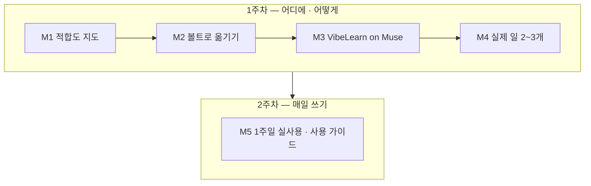

# Muse-My-Workflow 학습 로드맵

**생성일**: 2026-10-18
**방법론**: VibeLearn AI
**버전**: 1.0

---

## 📚 학습 개요

### Topic 소개
Meta Muse 를 박창수가 매일 하는 작업에 맞춰, 노트북이 없을 때도 밖에서 일을 이어 가고 그 결과를 집 컴퓨터의 2nd Brain(Obsidian 볼트)으로 옮겨 쓰는 실제 사용 방법을 만든다. 기능 시험으로 끝내지 않고, 매일 쓰는 사용법과 규칙으로 굳히는 데까지 간다. 출발점은 2026-10-14 박창수의 구술이다 — 「노트북이 옆에 없을 때는 Muse 를 사용하고 나중에 집에 와서 작업한 내용을 컴퓨터로 옮기는 방법으로 내 로컬에 있는 나의 2nd Brain 에 작업 내용을 보관할 수 있다」.

### 학습 목표
- [ ] 박창수의 작업 목록을 만들고, 작업마다 Muse 적합도(맡김 / 초안만 / 맡기지 않음)를 근거와 함께 판정한다
- [ ] Muse 결과를 볼트로 옮기는 방법(다운로드 · 내보내기 · 공유 링크 · 복사 · GitHub · 메일 · 드라이브 등)을 직접 해 보고 비교표와 추천 방법 1~2개를 정한다
- [ ] Muse 가 공개 레포(CatchUpAI_VL)의 VibeLearn AI 지시를 따를 수 있는지 시험하고, 가능 / 일부 가능 / 불가와 그 이유를 기록한다
- [ ] 적합도가 높은 작업 2~3개를 실제 박창수의 일로 Muse 에서 해 보고, 볼트로 가져와 마무리하는 데까지 성공한다
- [ ] 매일 쓸 「밖에서 Muse → 집에서 볼트」 사용 가이드와 프롬프트 모음을 만들고, 1주일 실제 사용 기록을 남긴다

### 예상 학습 기간
**2주 (주당 4~5시간, 총 약 9시간)** — 2026-10-18 사용자 확정(「그대로 진행」). 첫 세션은 2026-10-18 Live #32 방송 4부.

**주차별 계획**: 1주차(10/18~10/24) M1 · M2 · M3 · M4 / 2주차(10/25~10/31) M5 실제 사용 1주일 → 11/1 전후 마무리. **M1~M4 를 첫 주에 끝내야** 둘째 주를 실제 사용에 통째로 쓸 수 있다 — 기간 확인 때 짚은 조건이다.

### 학습 환경
- OS: Windows 11 (집 PC — i7-1355U · 16GB RAM · GPU 없음) + 휴대폰 (밖에서 Muse 사용)
- 도구: Meta Muse(무료 · 웹 / 휴대폰) · Obsidian 볼트 · VS Code + Claude Code / Codex · GitHub(CatchUpAI_VL) · gobi-cli
- 사전 지식: Muse 설치와 기본 사용(Live #31, 가상 과제 2개) · 볼트 구조와 작업 흐름 · VibeLearn AI 방법론 · 내부 자료 규칙

### 진행 에이전트
- **Roadmap**: Claude Code (2026-10-18)
- **일일 학습**: Claude Code 와 Codex 를 함께 쓴다. 그래서 모듈마다 **「시작할 때 읽을 것」**과 **「다음 세션에 넘길 것」**을 적는다. 어느 에이전트가 이어받아도 WorkLog 와 이 Roadmap 만 읽고 시작할 수 있어야 한다.

### 이 Topic 전체에서 지킬 것
- 내부 자료(`visibility: internal` · 🔒 표시 문서 — 단체 회사 IR · 정산 등)와 의뢰인 · 개인 정보는 Muse 에 올리지 않는다. 이 구분이 M1 적합도 판정의 기준 중 하나다.
- 개인 메일 · 캘린더 · 드라이브를 Muse 에 새로 연결하거나 결제 · 설치를 하기 전에는 반드시 박창수에게 묻는다.
- 이 Topic 은 공개 레포에 올라간다. 공개 문서에 실명 · 의뢰인 정보 · 계정 정보 · Muse 화면의 계정별 설정 상태를 쓰지 않는다. 캡처는 가린 뒤 쓴다.
- 기능 설명은 **공식 자료**나 **직접 해 본 결과**로만 쓴다. 둘 다 아니면 「미확인」이다.
- 시험해 보고 안 되는 것도 결과다. 실패한 방법은 이유와 함께 남긴다.

---

## 🗺️ 전체 로드맵 구조

| 모듈 | 모듈명 | 난이도 | 예상 시간 | 산출물 폴더 |
|------|--------|--------|----------|------------|
| M1 | 작업 목록과 Muse 적합도 지도 | ⭐ | 1.5h | `01-Workflow-Fit-Map/` |
| M2 | Muse 결과를 볼트로 옮기기 | ⭐⭐ | 2h | `02-Muse-to-Vault/` |
| M3 | VibeLearn AI on Muse | ⭐⭐ | 1.5h | `03-VibeLearn-on-Muse/` |
| M4 | 실제 내 일로 해 보기 (2~3개) | ⭐⭐⭐ | 2h | `04-Real-Work-Trials/` |
| M5 | Capstone — 1주일 실제 사용과 사용 가이드 | ⭐⭐⭐ | 2h (+ 1주일 일상 사용) | `05-Daily-Use-Guide/` |

**총 예상 시간**: 9시간 (각 모듈 버퍼 20% 포함). M5 의 1주일 실제 사용은 일상 속에서 쓰는 시간이라 학습 시간에 넣지 않았다.



---

## 📖 모듈별 상세 계획

### M1 - 작업 목록과 Muse 적합도 지도

**난이도**: ⭐
**예상 시간**: 1.5h
**산출물 폴더**: `01-Workflow-Fit-Map/`
**시작할 때 읽을 것**: 이 Roadmap · `topic_starter.md` · `AI-Agent-Apps-Compare/03-Hands-On/guides/setup-muse.md` · 볼트의 작업 기록(`orchestrator.yaml` · `_Settings_/Prompts/` · `AI/Tasks/items/` · 최근 Weekly Progress)
**다음 세션에 넘길 것**: 적합도 「맡김」 · 「초안만」 작업 목록 → M2 옮기기 시험 재료 · M4 후보

#### 학습 목표
- [ ] 박창수의 작업을 15개 이상 목록으로 만들 수 있다 (볼트 기록 근거)
- [ ] 작업마다 Muse 적합도(맡김 / 초안만 / 맡기지 않음)를 판정 기준 4가지로 근거와 함께 매길 수 있다
- [ ] 「Muse 에 올리면 안 되는 것」의 기준을 한 장으로 정리할 수 있다
- [ ] Muse 의 기능 중 이 Topic 에 필요한 것을 공식 자료로 확인해 출처와 날짜를 적을 수 있다

#### 주요 개념
1. **적합도 3단계**: 맡김(Muse 가 끝까지 해도 됨) · 초안만(Muse 가 만들고 집에서 사람이 검토 · 마무리) · 맡기지 않음(올리면 안 되거나 볼트 · 로컬 도구가 꼭 필요함).
2. **판정 기준 4가지**: ① 데이터 등급(공개 / 개인 / 내부) ② 볼트 맥락이 필요한 정도(볼트 문서를 많이 읽어야 하는 일은 밖에서 어렵다) ③ 밖에서 생기는 일인가(이동 중 떠오른 생각 · 대기 시간) ④ 결과를 옮기는 비용.
3. **데이터 등급**: 공개(방송 · 공개 레포 · 공개 행사), 개인(내 일정 · 생각), 내부(`visibility: internal` · 🔒). 내부는 적합도와 상관없이 「맡기지 않음」이다.
4. **옮기기 비용**: Muse 결과를 볼트에 넣을 때 드는 손. 복사해 붙이고 형식을 고치는 데 10분이 걸리면, 집에서 처음부터 하는 것과 비교해야 한다.
- ⚠️ 오해하기 쉬운 점: 「Muse 가 할 수 있다」와 「Muse 에 맡기는 게 낫다」는 다르다. 볼트 안에서 Claude Code 로 더 잘 되는 일은 밖에서 할 이유가 적다.

#### 실습 과제

**실습 1: 작업 목록 만들기** ⭐
- **목적**: 어디에 쓸지부터 정한다
- **단계**:
  1. 볼트 기록(워크플로 설정 · 프롬프트 폴더 · 할 일 · 최근 Weekly Progress)에서 반복하는 작업을 뽑는다
  2. 박창수에게 「밖에 있을 때 자주 하고 싶은 일」을 묻는다 (예: 방송 아이디어 메모, 글 초안, 행사 전 리서치)
  3. 작업마다 한 줄 설명 · 얼마나 자주 하는지 · 지금 쓰는 도구를 적는다
- **예상 시간**: 25분
- **검증**: 15개 이상, 각 작업에 볼트 근거나 박창수 답이 있다

**실습 2: 적합도 판정** ⭐⭐
- **목적**: 작업마다 맡길지 말지 근거를 남긴다
- **단계**:
  1. 판정 기준 4가지로 작업마다 표를 채운다
  2. 내부 자료가 섞이는 작업은 「맡기지 않음」으로 두고, 공개 부분만 떼어 맡길 수 있는지 따로 적는다
  3. 「맡김」 · 「초안만」 상위 5개를 고른다 — M2 시험 재료와 M4 후보
  4. 박창수 확인
- **예상 시간**: 25분
- **검증**: 모든 작업에 등급과 근거가 있고, 상위 5개를 박창수가 확인했다

**실습 3: Muse 기능 확인 (공식 자료)** ⭐
- **목적**: 이 Topic 에 필요한 기능이 있는지 공식 자료로 먼저 본다
- **단계**:
  1. Meta 발표문 · 도움말에서 내보내기 · 공유 · 파일 · 기억 · 백그라운드 작업 · 웹 접근 · 커넥터 관련 내용을 찾는다
  2. 기능마다 「공식 자료로 확인 / 미확인」과 출처 · 확인 날짜를 적는다
  3. 미확인인 것은 M2 · M3 에서 직접 해 볼 목록으로 넘긴다
- **예상 시간**: 15분
- **검증**: 기능 표의 모든 행에 출처 또는 「미확인」이 있다

#### 산출물
```
01-Workflow-Fit-Map/
├── README.md              ← 학습 순서 안내 + 전체 문서 링크 (필수)
├── concepts/
│   └── fit-criteria.md    ← 적합도 3단계 · 판정 기준 4가지 · 데이터 등급
├── guides/
│   ├── workflow-fit-map.md     ← 작업 목록과 적합도 표 (공개 가능한 수준으로)
│   └── do-not-upload.md        ← Muse 에 올리면 안 되는 것 한 장 정리
└── examples/
    └── muse-feature-check.md   ← 공식 자료로 확인한 기능 표 (출처 · 날짜)
```

#### Definition of Done
- [ ] 작업 15개 이상 목록 · 적합도 판정 완료
- [ ] 「맡김」 · 「초안만」 상위 5개를 박창수가 확인
- [ ] 「올리면 안 되는 것」 한 장 정리
- [ ] Muse 기능 표 — 모든 행에 출처 또는 「미확인」
- [ ] 공개 문서에 실명 · 의뢰인 · 내부 자료 내용 없음
- [ ] 산출물 폴더 README 작성
- [ ] 🔴 **README 링크가 실제 파일을 가리키는지 확인** (`python Ingest/CatchUpAI_VL/scripts/check_links.py Ingest/CatchUpAI_VL/Topics/Muse-My-Workflow`)
- [ ] WorkLog · Daily Retrospective 작성

#### Self-Assessment
**개념 이해**:
- [ ] 「맡김」과 「초안만」의 차이를 내 작업 예로 설명할 수 있다
- [ ] 내부 자료가 섞인 작업을 어떻게 나눠야 하는지 말할 수 있다

**실무 활용**:
- [ ] AI 에게 「이 작업이 Muse 에 맞는지 판정 기준 4가지로 봐 줘」라고 지시할 수 있다
- [ ] AI 가 매긴 적합도가 맞는지 근거를 보고 판단할 수 있다

#### 예상 시간 배분
- 개념 학습: 15분
- 실습 1: 25분
- 실습 2: 25분
- 실습 3: 15분
- 문서화: 10분
- **합계**: 1.5h (버퍼 20% 포함)

#### 참조 자료
- [Meta — Introducing Muse](https://about.fb.com/news/2026/09/introducing-muse-personal-ai-agent/): Secure VM · Sentinel · 백그라운드 작업 · 기억 기반 제안 · 개인정보 제어 (공식 발표)
- [Meta Help Center — About Muse subscriptions](https://www.meta.com/help/subscriptions/1021145227643680/): 무료 사용량 제한과 구독 (공식 도움말)
- `Ingest/CatchUpAI_VL/Topics/AI-Agent-Apps-Compare/03-Hands-On/guides/setup-muse.md`: Muse 웹 첫 사용 · Settings(Data controls · Permissions) 위치 (Live #31 기록)

---

### M2 - Muse 결과를 볼트로 옮기기

**난이도**: ⭐⭐
**예상 시간**: 2h
**산출물 폴더**: `02-Muse-to-Vault/`
**시작할 때 읽을 것**: M1 `guides/workflow-fit-map.md` 상위 5개 · `examples/muse-feature-check.md` 의 미확인 목록
**다음 세션에 넘길 것**: 추천 옮기기 방법 1~2개와 볼트 착지 위치 → M3 · M4 에서 그대로 쓴다

#### 학습 목표
- [ ] Muse 결과를 볼트로 옮기는 방법을 4가지 이상 직접 해 보고 결과(성공 / 실패 / 미확인)를 기록할 수 있다
- [ ] 방법마다 마크다운 서식 · 표 · 링크 · 출처가 얼마나 보존되는지 비교할 수 있다
- [ ] 추천 방법 1~2개와 볼트의 「착지 위치」를 정할 수 있다
- [ ] 옮겨 온 결과를 볼트 규칙(frontmatter · 출처 표시)에 맞게 정리하는 단계를 적을 수 있다

#### 주요 개념
1. **옮기기 경로**: Muse 안의 기능(다운로드 · 내보내기 · 공유 링크)과 Muse 밖의 길(복사 · 메일로 보내기 · 클라우드 드라이브 · GitHub)이 있다. 어떤 것이 실제로 되는지는 직접 해 봐야 안다.
2. **보존도**: 옮긴 뒤 제목 · 목록 · 표 · 링크 · 출처가 얼마나 남는가. 볼트에서 다시 손보는 양을 정한다.
3. **착지 위치(Inbox)**: 밖에서 온 결과가 처음 놓이는 볼트 폴더. 바로 정리 위치에 넣지 않고 한곳에 모았다가 집에서 정리하면 섞이지 않는다. 위치는 박창수가 정한다.
4. **출처 표시**: 볼트로 온 문서에 「Muse 에서 만든 것 · 날짜 · 검토 여부」를 남겨야 나중에 검증할 수 있다.
- ⚠️ 오해하기 쉬운 점: 공유 링크는 「옮긴 것」이 아니다. Muse 계정이 바뀌거나 링크가 만료되면 볼트에는 아무것도 남지 않는다.

#### 실습 과제

**실습 1: 옮기기 방법 직접 해 보기** ⭐⭐
- **목적**: 되는 방법과 안 되는 방법을 실제로 가린다
- **단계**:
  1. M1 상위 작업 하나로 공개 가능한 짧은 결과를 Muse 에서 만든다 (예: 공개 행사 요약)
  2. 그 결과를 방법마다 볼트로 옮겨 본다 — Muse 기능에 있는 것부터, 없으면 복사 · 메일 · 드라이브 · GitHub 순서
  3. 방법마다 걸린 단계 수 · 보존도 · 막힌 곳을 기록한다
  4. 개인 메일 · 드라이브를 새로 연결해야 하는 방법은 **하기 전에 박창수에게 묻는다**
- **예상 시간**: 50분
- **검증**: 4가지 이상에 결과 기록, 실패한 방법도 이유가 있다

**실습 2: 비교표와 추천** ⭐⭐
- **목적**: 매일 쓸 방법을 정한다
- **단계**:
  1. 방법 · 결과 · 단계 수 · 보존도 · 휴대폰에서 되는가 · 주의점 · 근거로 비교표를 만든다
  2. 추천 1~2개와 그 이유를 적는다
  3. 볼트 착지 위치 후보를 제시하고 박창수가 고른다
- **예상 시간**: 25분
- **검증**: 박창수가 추천 방법과 착지 위치를 확인했다

**실습 3: 볼트 정리 단계** ⭐
- **목적**: 옮겨 온 뒤 할 일을 짧은 절차로 만든다
- **단계**:
  1. 착지 위치에 온 문서를 볼트 규칙(frontmatter · 출처 표시 · 링크)에 맞추는 단계를 적는다
  2. 이 단계를 Claude Code / Codex 에게 맡길 프롬프트로 만든다
  3. 실습 1 결과 하나로 시험한다
- **예상 시간**: 15분
- **검증**: 시험한 문서가 볼트 규칙을 지키고 출처 표시가 있다

#### 산출물
```
02-Muse-to-Vault/
├── README.md
├── concepts/
│   └── transfer-paths.md       ← 옮기기 경로 · 보존도 · 착지 위치 · 출처 표시
├── guides/
│   ├── transfer-comparison.md  ← 방법별 비교표와 추천 (실패한 방법 포함)
│   └── vault-cleanup-prompt.md ← 옮겨 온 문서를 볼트 규칙에 맞추는 단계와 프롬프트
└── examples/
    └── sample-transfer.md      ← 공개 가능한 시험 결과 한 건 (전 · 후)
```

#### Definition of Done
- [ ] 옮기기 방법 4가지 이상 시험 · 결과 기록
- [ ] 비교표와 추천 1~2개, 박창수 확인
- [ ] 볼트 착지 위치 결정
- [ ] 볼트 정리 단계와 프롬프트, 1건 시험
- [ ] 캡처 · 예시에 계정 정보 없음
- [ ] 산출물 폴더 README 작성
- [ ] 🔴 **README 링크가 실제 파일을 가리키는지 확인** (`check_links.py`)
- [ ] WorkLog · Daily Retrospective 작성

#### Self-Assessment
**개념 이해**:
- [ ] 공유 링크와 실제로 옮긴 것의 차이를 설명할 수 있다
- [ ] 착지 위치를 따로 두는 이유를 말할 수 있다

**실무 활용**:
- [ ] 밖에서 만든 결과를 집에서 5분 안에 볼트에 넣을 수 있다
- [ ] AI 에게 옮겨 온 문서 정리를 지시하고 결과를 검토할 수 있다

#### 예상 시간 배분
- 개념 학습: 15분
- 실습 1: 50분
- 실습 2: 25분
- 실습 3: 15분
- 문서화: 15분
- **합계**: 2h (버퍼 20% 포함)

#### 참조 자료
- [Meta — Introducing Muse](https://about.fb.com/news/2026/09/introducing-muse-personal-ai-agent/): 공식 기능 설명 — 내보내기 관련 내용은 M1 실습 3 에서 확인한 범위만 쓴다
- `_Settings_/Skills/obsidian-yaml-frontmatter/SKILL.md`: 볼트 frontmatter 규칙
- `_Settings_/Skills/obsidian-links/SKILL.md`: 위키 링크 규칙

---

### M3 - VibeLearn AI on Muse

**난이도**: ⭐⭐
**예상 시간**: 1.5h
**산출물 폴더**: `03-VibeLearn-on-Muse/`
**시작할 때 읽을 것**: M2 `guides/transfer-comparison.md` 의 추천 방법 · `Ingest/CatchUpAI_VL/AGENTS.md` · `templates/workflow_guide.md`
**다음 세션에 넘길 것**: 가능 / 일부 가능 / 불가 판정과, 밖에서 VibeLearn AI 를 쓸 수 있는 범위 → M4 · M5

#### 학습 목표
- [ ] Muse 가 공개 레포(CatchUpAI_VL)의 지시 파일을 읽을 수 있는지 시험할 수 있다
- [ ] Muse 가 VibeLearn AI 순서(topic_starter → roadmap_prompt → 기간 확인 → Roadmap)를 지키는지 확인할 수 있다
- [ ] Muse 에서 시작한 학습 결과를 M2 방법으로 볼트에 가져와 Claude Code / Codex 가 이어받을 수 있는지 확인할 수 있다
- [ ] 가능 / 일부 가능 / 불가와 그 이유 · 막힌 지점을 기록할 수 있다

#### 주요 개념
1. **「설치」의 뜻**: VibeLearn AI 는 프로그램이 아니라 지시 파일(AGENTS.md · CLAUDE.md · templates/)이다. Muse 에 「설치」한다는 것은 Muse 가 이 파일을 읽고 그 순서를 지키게 하는 것이다.
2. **지시 따르기 검사**: 템플릿 순서 · 승인 대기 지점(기간 확인)에서 멈추는지 · 템플릿 없이 문서를 지어내지 않는지를 본다.
3. **이어받기(handoff)**: 밖에서 Muse 가 만든 topic_starter 나 메모를 집에서 Claude Code / Codex 가 이어서 Roadmap · 일일 학습으로 가져가는 것.
4. **Secure VM 과 웹 접근**: Muse 는 Meta 가 운영하는 보안 가상 환경에서 일한다(공식 발표). 레포를 읽을 수 있는지는 웹 접근 설정과 실제 시험으로 확인한다.
- ⚠️ 오해하기 쉬운 점: Muse 가 레포 내용을 「요약」했다고 지시를 「따른」 것은 아니다. 멈춰야 할 곳에서 멈추는지를 봐야 한다.

#### 실습 과제

**실습 1: 레포 읽기 시험** ⭐
- **목적**: Muse 가 지시 파일에 닿을 수 있는지 본다
- **단계**:
  1. Muse 에 공개 레포 주소를 주고 AGENTS.md 와 workflow_guide 의 순서를 요약하게 한다
  2. 실제 파일 내용과 비교한다 (지어낸 부분이 있는지)
  3. 웹 접근이 막히면 설정 화면을 박창수와 확인하고, 그래도 안 되면 파일 내용을 붙여 넣는 대안을 시험한다
- **예상 시간**: 20분
- **검증**: 요약이 실제 파일과 맞는지 항목별로 대조한 표

**실습 2: 순서 지키기 시험** ⭐⭐
- **목적**: VibeLearn AI 방식으로 일하는지 본다
- **단계**:
  1. 공개해도 되는 작은 주제로 「VibeLearn AI 로 새 Topic 을 시작하자」고 지시한다
  2. topic_starter 를 템플릿 형식으로 채우는지, 기간 확인에서 멈추는지, 승인 전에 Roadmap 을 만들지 않는지 본다
  3. 지키지 않으면 지시를 바꿔 한 번 더 시험하고, 결과를 모두 기록한다
- **예상 시간**: 30분
- **검증**: 검사 항목 표(지킴 / 안 지킴 / 미확인)와 Muse 답 일부 인용

**실습 3: 집에서 이어받기** ⭐⭐
- **목적**: 밖에서 시작한 학습이 집에서 이어지는지 본다
- **단계**:
  1. 실습 2 결과를 M2 추천 방법으로 볼트에 가져온다
  2. Claude Code 나 Codex 가 그 결과로 roadmap_prompt 단계를 이어 갈 수 있는지 본다
  3. 판정(가능 / 일부 가능 / 불가)과 이유를 적는다
- **예상 시간**: 15분
- **검증**: 판정과 막힌 지점 · 다음에 해 볼 것이 적힌 결과 문서

#### 산출물
```
03-VibeLearn-on-Muse/
├── README.md
├── concepts/
│   └── vibelearn-as-instructions.md  ← 「설치」의 뜻 · 지시 따르기 검사 · 이어받기
├── guides/
│   ├── muse-vibelearn-test.md        ← 시험 절차 · 검사 표 · 판정
│   └── handoff-to-home.md            ← 밖에서 시작 → 집에서 이어받는 절차 (되는 범위만)
└── examples/
    └── muse-topic-starter-sample.md  ← 공개 주제로 Muse 가 만든 결과 (발췌)
```

#### Definition of Done
- [ ] 레포 읽기 시험 · 대조 표
- [ ] 순서 지키기 시험 · 검사 표
- [ ] 집에서 이어받기 시험
- [ ] 판정(가능 / 일부 가능 / 불가)과 이유 · 막힌 지점 기록
- [ ] 공개 주제만 사용, 계정 정보 없음
- [ ] 산출물 폴더 README 작성
- [ ] 🔴 **README 링크가 실제 파일을 가리키는지 확인** (`check_links.py`)
- [ ] WorkLog · Daily Retrospective 작성

#### Self-Assessment
**개념 이해**:
- [ ] VibeLearn AI 를 「설치」한다는 것이 무엇인지 설명할 수 있다
- [ ] 「요약」과 「지시를 따름」의 차이를 예로 들 수 있다

**실무 활용**:
- [ ] 밖에서 Muse 로 학습을 시작할지, 집에서 시작할지 판단할 수 있다
- [ ] Muse 가 순서를 어기면 어떻게 다시 지시할지 말할 수 있다

#### 예상 시간 배분
- 개념 학습: 10분
- 실습 1: 20분
- 실습 2: 30분
- 실습 3: 15분
- 문서화: 15분
- **합계**: 1.5h (버퍼 20% 포함)

#### 참조 자료
- [CatchUpAI_VL (GitHub)](https://github.com/solkit70/CatchUpAI_VL): VibeLearn AI 지시 파일 · 템플릿 (시험 대상)
- [Meta — Introducing Muse](https://about.fb.com/news/2026/09/introducing-muse-personal-ai-agent/): Secure VM · 웹 작업 관련 공식 설명
- `Ingest/CatchUpAI_VL/templates/workflow_guide.md`: 지켜야 할 순서 (검사 기준)

---

### M4 - 실제 내 일로 해 보기 (2~3개)

**난이도**: ⭐⭐⭐
**예상 시간**: 2h
**산출물 폴더**: `04-Real-Work-Trials/`
**시작할 때 읽을 것**: M1 상위 5개 · M2 추천 방법과 착지 위치 · M3 판정
**다음 세션에 넘길 것**: 실제로 쓸 만한 작업 목록과 작업별 프롬프트 → M5 1주일 사용의 기본 세트

#### 학습 목표
- [ ] M1 상위 작업 중 2~3개를 박창수의 실제 일로 Muse 에서 처음부터 끝까지 해 볼 수 있다
- [ ] 결과를 볼트로 옮겨 마무리(검토 · 고침 · 저장)하는 데까지 성공할 수 있다
- [ ] 작업마다 걸린 시간 · 고친 양 · 집에서 했을 때와의 차이를 기록할 수 있다
- [ ] 작업마다 다시 쓸 수 있는 프롬프트를 만들 수 있다

#### 주요 개념
1. **처음부터 끝까지(end-to-end)**: 밖에서 시작 → Muse 결과 → 볼트로 옮김 → 집에서 마무리까지 한 번에 이어져야 「실제로 쓴 것」이다.
2. **고친 양**: Muse 결과에서 집에서 고친 정도(거의 그대로 / 일부 / 다시 씀). 적합도 판정이 맞았는지 보여 준다.
3. **작업별 프롬프트**: 같은 일을 다음에도 같은 품질로 시키기 위한 지시문. 내부 자료를 넣지 말라는 문장도 포함한다.
- ⚠️ 오해하기 쉬운 점: 한 번 잘 됐다고 매일 잘 되는 것은 아니다. 그래서 M5 에서 1주일을 써 본다.

#### 실습 과제

**실습 1: 실제 작업 ① (초안 · 정리형)** ⭐⭐
- **목적**: 가장 적합도가 높은 일을 실제로 해 본다
- **단계**:
  1. M1 상위 작업 중 하나를 고른다 (예: 방송 아이디어 메모 정리, 공개 행사 전 리서치, SNS 글 초안 — 박창수가 고른다)
  2. 밖에 있다고 생각하고 Muse(가능하면 휴대폰)로 한다
  3. M2 방법으로 볼트에 옮기고 마무리한다
  4. 시간 · 고친 양 · 막힌 곳을 기록한다
- **예상 시간**: 35분
- **검증**: 마무리된 결과가 볼트의 실제 위치에 있고 기록이 남았다

**실습 2: 실제 작업 ② (다른 유형)** ⭐⭐⭐
- **목적**: 다른 유형의 일에서도 되는지 본다
- **단계**:
  1. 실습 1 과 유형이 다른 작업을 고른다 (예: 리서치형이었으면 이번엔 글쓰기형)
  2. 실습 1 과 같은 절차로 한다
  3. (선택) 시간이 되면 세 번째 작업을 한다
- **예상 시간**: 35분
- **검증**: 실습 1 과 같은 기준

**실습 3: 작업별 프롬프트와 결과 정리** ⭐⭐
- **목적**: M5 에서 바로 쓸 세트를 만든다
- **단계**:
  1. 작업마다 프롬프트를 다듬는다 (지킬 것 문장 포함)
  2. 「집에서 했을 때와 비교」 표를 만든다
  3. 적합도 판정이 틀렸던 작업은 M1 표를 고친다
- **예상 시간**: 20분
- **검증**: 작업별 프롬프트와 비교표, M1 표 갱신 여부 기록

#### 산출물
```
04-Real-Work-Trials/
├── README.md
├── guides/
│   ├── trial-results.md     ← 작업별 결과 · 시간 · 고친 양 · 집에서와 비교
│   └── task-prompts.md      ← 작업별로 다시 쓸 프롬프트 (지킬 것 포함)
└── examples/
    └── trial-1-summary.md   ← 공개 가능한 작업 한 건의 전 · 후 (실제 내용은 공개 가능한 것만)
```

#### Definition of Done
- [ ] 실제 작업 2개 이상 처음부터 끝까지 완료
- [ ] 결과가 볼트의 실제 위치에 저장됨
- [ ] 작업별 시간 · 고친 양 기록
- [ ] 작업별 프롬프트 작성
- [ ] 공개 산출물에는 공개 가능한 내용만 (실제 결과물 원문은 볼트 안에만)
- [ ] 산출물 폴더 README 작성
- [ ] 🔴 **README 링크가 실제 파일을 가리키는지 확인** (`check_links.py`)
- [ ] WorkLog · Daily Retrospective 작성

#### Self-Assessment
**개념 이해**:
- [ ] 「처음부터 끝까지 쓴 것」이 왜 기능 시험과 다른지 설명할 수 있다

**실무 활용**:
- [ ] 밖에서 작업 하나를 Muse 로 시작해 집에서 15분 안에 마무리할 수 있다
- [ ] 적합도 판정이 틀렸을 때 표를 어떻게 고칠지 말할 수 있다
- [ ] 작업별 프롬프트를 AI 에게 주고 같은 품질을 다시 얻을 수 있다

#### 예상 시간 배분
- 개념 학습: 10분
- 실습 1: 35분
- 실습 2: 35분
- 실습 3: 20분
- 문서화: 20분
- **합계**: 2h (버퍼 20% 포함)

#### 참조 자료
- M1 `guides/workflow-fit-map.md` · M2 `guides/transfer-comparison.md` · M3 판정 (이 Topic 산출물)
- [Meta Help Center — About Muse subscriptions](https://www.meta.com/help/subscriptions/1021145227643680/): 무료 사용량 제한 — 실제 일에 쓸 때 한도에 걸리는지 확인

---

### M5 - Capstone — 1주일 실제 사용과 사용 가이드

**난이도**: ⭐⭐⭐
**예상 시간**: 2h (+ 10/25~10/31 일상 사용)
**산출물 폴더**: `05-Daily-Use-Guide/`
**시작할 때 읽을 것**: M1~M4 산출물 전체 · M4 `guides/task-prompts.md`
**다음 세션에 넘길 것**: (Topic 마무리) 최상위 README · Final Retrospective

#### 학습 목표
- [ ] 1주일 동안 밖에서 Muse 로 한 일을 볼트로 가져온 기록을 남길 수 있다 (사용일 · 작업 · 옮긴 방법 · 고친 양)
- [ ] 기록을 근거로 「밖에서 Muse → 집에서 볼트」 사용 가이드를 다듬을 수 있다
- [ ] 매일 쓸 프롬프트 모음과 규칙(올리면 안 되는 것 포함)을 한 곳에 정리할 수 있다
- [ ] 다른 사람(방송 시청자 · 시니어 학습자)이 따라 할 수 있는 수준으로 쓸 수 있다

#### 주요 개념
1. **사용 기록(usage log)**: 날마다 무엇을 Muse 로 했고 어떻게 옮겼는지의 짧은 기록. 가이드의 근거다.
2. **사용 가이드**: 기록에서 실제로 반복된 것만 남긴 절차. 한 번 해 본 것과 매일 쓰는 것을 구분한다.
3. **규칙**: 올리면 안 되는 것 · 연결하지 않을 것 · 검토 없이 쓰지 않을 것. 편리함보다 먼저다.
- ⚠️ 오해하기 쉬운 점: 1주일 중 안 쓴 날도 기록한다. 왜 안 썼는지가 가이드를 고치는 단서다.

#### 실습 과제

**실습 1: 1주일 실제 사용과 기록** ⭐⭐
- **목적**: 매일 쓰는 방법인지 확인한다
- **단계**:
  1. 10/25~10/31 동안 밖에 있을 때 M4 프롬프트로 Muse 를 쓴다
  2. 집에 오면 M2 방법으로 볼트에 옮기고, 사용 기록에 한 줄씩 적는다 (안 쓴 날은 이유)
  3. 막히거나 바꾼 점을 바로 적는다
- **예상 시간**: 일상 사용 + 기록 하루 5분 (학습 시간 30분으로 계산)
- **검증**: 7일 기록 (사용한 날 · 안 쓴 날 모두)

**실습 2: 사용 가이드와 프롬프트 모음** ⭐⭐⭐
- **목적**: 기록을 매일 쓰는 가이드로 굳힌다
- **단계**:
  1. 기록에서 반복된 작업 · 방법만 골라 가이드를 쓴다 (3~5단계 흐름 + 작업별 예)
  2. 프롬프트 모음을 정리한다
  3. 규칙 한 장을 다듬는다 (M1 「올리면 안 되는 것」 갱신)
- **예상 시간**: 50분
- **검증**: 박창수가 가이드만 보고 다음 날 그대로 쓸 수 있다고 확인

**실습 3: Topic 마무리** ⭐
- **목적**: 공개 레포 방문자가 한눈에 보게 한다
- **단계**:
  1. Topic 최상위 README 를 쓴다 — 무엇을 알아냈는지 · 모듈 순서 링크 · 틀렸던 판단과 확인 못 한 것
  2. Final Retrospective 를 쓴다
  3. `check_links.py` 로 깨진 링크 · 빈 폴더 0 확인
- **예상 시간**: 25분
- **검증**: 링크 검사 통과, 최상위 README 존재

#### 산출물
```
05-Daily-Use-Guide/
├── README.md
├── guides/
│   ├── daily-use-guide.md   ← 밖에서 Muse → 집에서 볼트 사용 가이드 (매일 쓰는 것만)
│   ├── prompt-pack.md       ← 작업별 프롬프트 모음
│   └── rules.md             ← 올리면 안 되는 것 · 연결하지 않을 것 · 검토 규칙
└── examples/
    └── one-week-log.md      ← 1주일 사용 기록 (공개 가능한 수준으로 요약)
```
Topic 최상위: `README.md` (마무리 때 작성)

#### Definition of Done
- [ ] 7일 사용 기록 (안 쓴 날 이유 포함)
- [ ] 사용 가이드 · 프롬프트 모음 · 규칙 작성, 박창수 확인
- [ ] 학습 목표 5개 달성 여부를 Final Retrospective 에 기록
- [ ] Topic 최상위 README 작성
- [ ] 공개 문서에 실명 · 의뢰인 · 계정 · 내부 자료 없음
- [ ] 🔴 **`check_links.py` 통과** — 깨진 링크 0 · 빈 폴더 0
- [ ] WorkLog · Module Retrospective · Topic Final Retrospective 작성

#### Self-Assessment
**개념 이해**:
- [ ] 한 번 해 본 것과 매일 쓰는 것의 차이를 내 기록으로 설명할 수 있다

**실무 활용**:
- [ ] 노트북 없이 하루를 보내도 일을 Muse 로 이어 가고 저녁에 볼트로 정리할 수 있다
- [ ] 다른 사람에게 이 흐름을 10분 안에 설명하고 시작하게 도울 수 있다

**문제 해결**:
- [ ] 옮기기가 막히거나 Muse 한도에 걸리면 대안을 AI 에게 지시할 수 있다

#### 예상 시간 배분
- 개념 학습: 10분
- 실습 1: 30분 (기록 정리 기준)
- 실습 2: 50분
- 실습 3: 25분
- 문서화: 5분
- **합계**: 2h (버퍼 20% 포함)

#### 참조 자료
- M1~M4 산출물 (이 Topic)
- `Topics/WA-Caregiver-Pathways/README.md` · `Topics/Datacenter-Workforce-Programs/README.md`: 최상위 README 참고 예
- [Meta — Introducing Muse](https://about.fb.com/news/2026/09/introducing-muse-personal-ai-agent/): 가이드에 쓰는 기능 설명의 공식 근거

---

## 📝 WorkLog 작성 가이드

각 학습 세션마다 WorkLog를 작성하여 진행 상황을 추적합니다.

**파일명 규칙**: `vl_worklog/YYYYMMDD_MX_Muse-My-Workflow.md`
- 예: `vl_worklog/20261018_M1_Muse-My-Workflow.md`
- 같은 날 두 번째 세션이면 `_Day2` 를 붙인다

**WorkLog 필수 섹션**:
1. 오늘의 학습 목표 (체크리스트)
2. 진행 내용 (실습별 상세 기록) — **진행 에이전트(Claude Code / Codex)를 적는다**
3. 문제 해결 로그
4. DoD 체크리스트 (모듈 완료 기준)
5. Daily Retrospective
6. 참조 및 산출물

**에이전트를 바꿔 이어 갈 때**: WorkLog 마지막에 「다음 세션에 넘길 것」을 3줄 안으로 적는다 — 어디까지 했는지 · 박창수가 결정한 것 · 바로 할 일.

---

## 🔍 Retrospective 가이드

### Daily Retrospective (매일, 5-10분)
WorkLog 내에 작성:
- What went well?
- What could be improved?
- Insights
- Tomorrow's focus

### Module Retrospective (모듈 완료 시, 15-20분)
`vl_worklog/YYYYMMDD_MX_Retrospective.md`:
- 계획 대비 실제 비교
- 핵심 학습 내용
- 발생한 문제와 해결
- Roadmap 정확도 평가
- 다음 모듈 준비사항

### Topic Retrospective (전체 완료 시, 30-60분)
`vl_worklog/YYYYMMDD_Muse-My-Workflow_Final_Retrospective.md`:
- 전체 학습 여정 통계
- VibeLearn AI 방법론 효과성 평가 (Claude Code · Codex 를 함께 쓴 경험 포함)
- 산출물 품질 평가
- 향후 학습 개선 사항

---

## 📂 전체 폴더 구조

```
Muse-My-Workflow/
├── README.md                  # 🔴 필수 — Topic 최상위 안내 (M5 마무리 때 작성)
├── topic_starter.md           # Topic 정보
├── vl_prompts/
│   ├── roadmap_prompt.md
│   └── daily_learning_prompt.md
├── vl_roadmap/
│   └── 20261018_RoadMap_Muse-My-Workflow.md
├── vl_worklog/
│   ├── YYYYMMDD_M1_Muse-My-Workflow.md
│   └── ...
├── vl_materials/              # 쓸 자료가 생길 때 만든다 (빈 폴더 금지)
├── 01-Workflow-Fit-Map/
├── 02-Muse-to-Vault/
├── 03-VibeLearn-on-Muse/
├── 04-Real-Work-Trials/
└── 05-Daily-Use-Guide/
```

---

## 📊 학습 진행 상황 추적

| 모듈 | 시작일 | 종료일 | 상태 | DoD 달성률 | 비고 |
|------|--------|--------|------|-----------|------|
| M1 | 2026-10-18 | 2026-10-18 | ✅ | 100% | Live #32 4부 · Claude Code · 상위 작업 6개 |
| M2 | | | ⏳ | 0% | |
| M3 | | | ⏳ | 0% | |
| M4 | | | ⏳ | 0% | 10/24 까지 끝내야 M5 일정이 맞는다 |
| M5 | | | ⏳ | 0% | 실제 사용 10/25~10/31 |

**범례**:
- ⏳ 대기
- 🔄 진행 중
- ✅ 완료

---

## 🎯 성공 기준

전체 Topic 완료 기준:
- [ ] 모든 모듈 완료 (DoD 100%)
- [ ] 최소 5개 산출물 폴더 생성
- [ ] Topic Retrospective 작성
- [ ] Self-Assessment 평균 ⭐⭐⭐⭐ 이상
- [ ] Capstone 프로젝트 완성 — 1주일 사용 기록과 매일 쓰는 사용 가이드

---

**생성자**: Claude with VibeLearn AI
**Roadmap 버전**: 1.0
**방법론 버전**: VibeLearn AI 2.0
