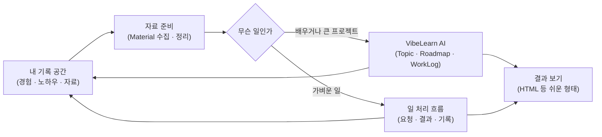

## 이 문서의 용도

사용자의 구상 원문(비공개 `Materials_For_Topics/Senior-AI-Enablement/`)을 Topic 시작용으로 구조화하고, 사용자가 요청한 「추가로 생각해야 할 것들」을 덧붙인 문서다. **사용자 말씀은 3·4·5장에, AI 가 덧붙인 제안은 「제안」 표시와 함께 7장에** 분리해 두었다. 제안은 사용자가 확인하기 전에는 결정이 아니다. 이 폴더는 공개 레포이므로 참가자·고객의 이름과 상담 내용은 적지 않았다.

## 1. 출발점

사용자는 AI 를 보통 사람이 쉽고 유용하게 쓰는 방법을 찾기 위해 자신부터 여러 실험을 하고, 그 과정을 YouTube 로 올린다. 그 실험에서 나온 시스템이 VibeLearn AI 이고, 일반인을 위한 안내 문서가 참가자용 가이드북이다. 그런데 시니어에게 가이드북을 보여 드렸더니 「머리가 지끈지끈 아프다」는 반응이 나왔다. 시니어는 도메인 지식이 깊고 제2의 일을 찾거나 한 분야의 노하우가 많은 분이 많아서 AI 가 가장 큰 도움이 될 수 있는 집단인데, 입구가 너무 높다는 것이 이 Topic 의 출발 문제다.

## 2. 지금까지의 시도 (익명)

| 시도 | 알려진 것 |
|---|---|
| 유타주의 한 선생님과 몇 달간 주간 진행 | 단 며칠 만에 자기 이야기를 녹음해 글·책으로 만드는 앱을 만든 사례가 가이드북에 실려 있다 |
| Shoreline 에서 식당을 운영하시는 선생님과 몇 차례 진행 | 구체적 기록은 이 Topic 에서 정리 필요 (제안: 허락받은 범위의 익명 요약) |
| 상담 고객 한 분 | 고객 자료는 🔒 내부 자료. 이 Topic 에는 「AI Agent 앱을 곧바로 만들어 상담에 쓴 경험이 있다」는 사실만 쓴다 |
| 동네 시니어 커뮤니티 모임에 참가 (10/10) | 대상층을 직접 만난 접점. 대화 내용은 기록된 바 없음 |

## 3. 시니어가 어려워할 것 — 사용자 정리

1. 가이드대로 하려면 코딩이 무엇인지, 바이브 코딩이 무엇인지부터 이해해야 한다.
2. VS Code · Claude Code 를 설치하고 이해하고 쓰는 것 자체가 어렵다.
3. VibeLearn AI 는 쓰기 편하게 만들었지만 여전히 어려운 점이 있다.
4. 문서가 md 형식이라 보려면 Obsidian 같은 도구를 깔거나 웹에서 보는 법을 알아야 한다. 그래서 HTML 로 만들어 드리는 방법을 생각 중이다.
5. 지금은 VS Code · Claude Code · VibeLearn AI 3개를 로컬에 세팅하는 방식인데 부족했다. **자기 기록을 담는 장소와 프로세스가 없다.**
6. VibeLearn AI 는 사전 자료(Material)가 있으면 훨씬 좋은데, 그 자료를 준비하는 프로세스와 저장 공간이 없다.
7. VibeLearn AI 를 쓸 필요가 없는 일(가벼운 일)을 처리하는 프로세스·흐름·구조가 없다.
8. 시니어마다 관심과 하고 싶은 일이 다르므로 다양한 일을 다 도울 수 있어야 한다.
9. 시스템을 쉽게 만들어도 기본 개념과 조작법은 배워야 하므로, 그것을 배워 가며 시스템을 쓰게 하는 교육 과정이 함께 필요하다.
10. 새 애플리케이션을 만드는 것이 아니라 기존 도구를 프로세스와 스킬로 쉽게 쓰게 하는 시스템이다. VibeLearn AI 도 시니어용으로 많은 프로세스가 업그레이드되어야 한다.

## 4. 대상 — 사용자 구술(10/9) 기반

모든 시니어가 대상은 아니다. 기록할 만한 경험과 지식이 있고, 그것으로 무언가를 하고 싶은 열정이 있는 분이 중심이다. 웹 서비스에 만족하는 분은 이 방식이 필요 없을 수 있다. 같은 시니어라도 출발선이 다르다.

| 유형 | 상태 |
|---|---|
| A | 컴퓨터 사용 자체가 익숙하지 않다 |
| B | 컴퓨터는 익숙하고 웹의 AI 기본 기능만 써 봤다 |
| C | NotebookLM 같은 응용 서비스를 써 봤다 |
| D | CLI·바이브 코딩 환경에서 로컬 작업을 해 봤다 |

하나의 교육 과정이 네 유형을 다 덮을 수는 없다. **일반(공통) 과정을 먼저 만들고, 대상이 정해지면 그 대상에 맞춰 변형한다.** 상담 중인 한 분이 주변 시니어를 모아 보겠다고 해서, 그분들이 첫 대상이 될 가능성이 있고 구체 과정은 상담 뒤에 정한다.

## 5. 시스템 구상 — 사용자 방향 위에 그린 초안

사용자의 방향은 「내 컴퓨터에 내 기록을 쌓고, AI 가 그것을 읽으며 점점 나를 잘 아는 도움을 주는 것」이다. 아래 흐름은 3장의 빈칸(기록 공간·자료 준비·가벼운 일 처리·보기)을 채우는 **초안**이며, 이름과 단계는 로드맵 단계에서 사용자와 정한다.

핵심은 두 가지다. 일이 끝나면 결과가 다시 **기록 공간으로 돌아와 쌓여야** 한다. 그리고 기술을 모르는 분이 보는 화면은 **md 가 아니라 쉬운 형태**여야 한다.

## 6. 재사용할 기존 자산

| 자산 | 어떻게 쓰나 |
|---|---|
| VibeCoding-Starter-Guide (가이드북 7장) | 시니어용으로 줄이고 쉽게 바꿀 원본. 「진입로가 좁다」는 진단이 이미 있다 |
| VibeCoding-Onboarding-Program · 온보딩 확정안 | 무료 온보딩 → 유료 추가 가이드의 운영 틀. 신청서 존재 |
| AI 활용 가이드 프로그램 개요 (레벨 1~3) | 레벨 구성 아이디어. 대상 유형(3장 A~D)과 맞춰 볼 수 있다 |
| Vibe-Guiding-VSCode (Guiding 엔진 POC) | 사용자가 막힌 순간에 맥락에 맞춰 안내하는 기능. 「처음에 어떻게 다가갈까」에 직접 연결될 후보 |
| AI-Agent-Apps-Compare (진행 중) | Muse(무료 단계, 웹·모바일)·Dots·Grok Bot·Instinct 의 접근 조건과 승인·개인정보 경계. 시니어 입구 후보(클라우드 개인 에이전트) 검토의 근거 |
| FDE-Forward-Deployed-Engineer | 현장에 들어가 그 사람의 일에 맞춰 붙이는 접근. 시니어별 맞춤에 참고 |
| VibeLearn-AI-Chromebook | 크롬북에서는 현재 방식이 안 되는 이유와 대안 검토가 있다 |

## 7. AI 가 덧붙이는 고려사항 (제안 — 사용자 확인 필요)

아래는 사용자 말씀에 없던 항목이다. 기존 기록에서 근거를 찾을 수 있는 것은 근거를 적었고, 근거가 없는 것은 「일반적으로 점검할 만한 것」으로 구분했다.

1. **첫 30분의 작은 성공** (근거: 가이드북의 「첫 성공까지 30분」). 설치보다 먼저 「내 이야기 한 토막이 정리된 결과」를 보게 하는 순서가 가능한지 검토한다. 설치를 시니어가 직접 하지 않고 먼저 세팅해 드리는 방식도 선택지다.
2. **설치 장벽을 낮추는 대안 비교** (근거: 10/3 Always-On 구상, Chrome Remote Desktop Topic; 10/11 사용자 리뷰로 **클라우드 개인 에이전트(Muse 등 무료)도 후보에 포함**). 제작자가 원격으로 세팅하거나, 설치가 필요 없는 형태로 시작하는 방법을 비교한다. 어떤 도구가 로컬 기록 방식을 유지하면서 설치가 쉬운지는 **조사가 필요**하다. 추측으로 결정하지 않는다.
3. **기록의 보관과 백업** (일반 점검). 기록이 로컬에만 있으면 컴퓨터 고장 시 모두 잃는다. 시니어가 감당할 백업 방법(자동 복사·클라우드 폴더 등)이 필요한지 정한다.
4. **개인정보와 안전** (일반 점검). 가족·건강·금융 정보를 AI 에 넣는 문제, 시니어를 노리는 사기와 가짜 AI 서비스에 대한 주의 교육을 과정에 넣을지 정한다.
5. **AI 답을 믿는 기준** (근거: 요양보호사 조사 사례에서 공식 출처 미검증을 명시한 방식). 「틀릴 수 있다. 중요한 건 이렇게 확인한다」를 한 장짜리 습관으로 만든다.
6. **접근성** (일반 점검). 글자 크기, 대비, 마우스 조작, 시력·청력, 음성 입력으로 말해서 시키는 방식. 말로 시키는 방식은 시니어에게 입구를 크게 낮출 수 있어 보이지만 **실제로 시험해 봐야 안다.**
7. **계속하게 하는 장치** (근거: 「오래 일할 수 있게 지속 가능한 범위」 원칙, WorkLog 로 쉬었다 돌아온 사례). 주 1회 리듬, 짝·소모임, 막혔을 때 부르는 방법.
8. **성공을 재는 기준** (일반 점검). 「설치했다」가 아니라 「자기 일에 한 가지를 실제로 써 봤다」「2주 뒤에도 쓰고 있다」처럼 정의한다.
9. **사례 수집의 동의** (근거: 온보딩 확정안의 녹화 동의 논의). 시범 운영 기록을 Topic·영상으로 쓰려면 참가자 동의와 익명화 규칙이 필요하다. 별도 동의서는 아직 없다.
10. **운영과 사업의 경계** (근거: 온보딩 확정안, Catch Up AI). 무료 온보딩 범위와 유료 가이드의 경계, 시니어 대상 과정이 사업 모델과 어떻게 이어지는지는 이 Topic 에서 결정하지 않고 확정안을 따른다.
11. **제2의 일 연결** (근거: 은퇴자 일자리 자료, 소득 연구 흐름). 시니어의 노하우가 수입이나 활동으로 이어지는 경로를 과정의 출구로 둘지 정한다.
12. **지원 체계** (일반 점검). 제작자 혼자 모든 질문을 받기 어렵다. 질문 접수, 자주 막히는 지점 문서(트러블슈팅), 동료 학습자가 서로 돕는 구조를 검토한다.

## 8. 열린 질문과 사용자 답변 (2026-10-11)

원문은 Journal/2026-10-11 의 「시니어 AI 활용 Topic — 기간 확정과 열린 질문 답변」에 있다.

| 질문 | 답 |
|---|---|
| 기간 | **8주 확정** (2026-10-11 ~ 12월 초) |
| 1. 첫 대상 | **A 유형이 유력.** 페더럴웨이의 한 분이 주변 시니어를 모집해 주기로 했다. 오랫동안 자기 사업을 운영해 온 분들이라 쓰던 컴퓨터 기능 외에는 익숙하지 않다. 인원은 5명 이내 예상 |
| 2. 「새 앱이 아니다」 경계 | **열려 있다.** 사용자가 이 질문을 되물었으므로 풀어 쓴다: 처음 시안은 「새 앱은 만들지 않고 기존 도구 + 프로세스 + 스킬로」였다. 사용자 답은 「스킬이든 앱이든 처음 진입 장벽이 가장 낮은 방법을 고른다. 진행하며 결정」이다. 따라서 **앱 개발도 선택지**이고 판단 기준은 「진입 장벽」 하나다 |
| 3. 결과물 중심 | **「시니어에게 AI 를 가이드하는 일을 쉽게 만드는 것」이 기준.** 형태(스킬·앱·문서)는 상관없다. 교육 과정도 중요하며, 더 많은 분께 알리기 위해 **가이드 문서와 영상**도 만든다 |
| 4. VibeLearn AI 개선 위치 | 이 Topic 안에서 설계·시험을 마치고, 완료되면 **별도 GitHub Repository 로 만들어 배포**하는 것이 희망이다 |
| 5. 시범 운영 | 약 10일 뒤(10/21 전후) 페더럴웨이 시니어를 대상으로 **의견 접수**를 시작한다. 그때 교육 과정의 개략 설명을 한다. 대화 뒤 정확한 레벨을 정하고 첫 운영을 한다 (5명 이내) |

이 답에 따라 3·5의 판단 기준과 지킬 것이 바뀌었다. `topic_starter.md` 의 「지킬 것」도 함께 고쳤다.

## 9. 클라우드에서 작성하고 나중에 로컬로 가져오기 — 분석 후보

> 이 기능을 사용하면 Muse 에게 문서를 만들도록 하고 그 만들어진 문서를 나중에 컴퓨터를 켜서 로컬로 저장시키는 방법이 있을 수 있겠네요.

출처: [[Journal/2026-10-11#Muse 문서 작성 후 로컬 기록 회수 — 시니어 활용 제안 (구술 원문)|사용자 구술 원문]]. 사용자는 클라우드에서 작성한 결과를 나중에 로컬 기록 공간으로 가져오는 방법도 이 Topic의 분석에 포함하도록 요청했다. 따라서 「클라우드에 기록됨」은 로컬 보관의 불가능을 뜻하지 않으며, 가져오는 절차와 이후 재사용이 얼마나 쉬운지를 따로 평가한다.

### 이미 관찰한 것과 아직 시험할 것

[Codex→Muse 브라우저 위임 사례](../../AI-Agent-Apps-Compare/vl_materials/20261011_codex-muse-browser-delegation.md#관찰한-흐름)에서는 Codex가 Muse의 한국어 답변을 읽고 별도의 로컬 문서로 정리·저장했다. 이 관찰은 **답변을 로컬 기록으로 가져오는 경로**의 근거다. Muse가 다운로드 가능한 문서 파일을 만들고, 컴퓨터를 끈 동안 작업을 마친 뒤, 나중에 켠 컴퓨터에서 그 파일을 회수하는 전체 절차는 아직 시험하지 않았다.

| 경로 | 현재 근거 | M4·M5에서 확인할 것 |
|---|---|---|
| Muse 답변을 읽어 로컬 문서로 정리 | 단풍 추천 답변을 Codex가 로컬 Markdown으로 저장한 사례 있음 | 시니어가 한 번의 쉬운 요청으로 저장 위치와 결과를 확인할 수 있는가 |
| Muse가 만든 파일을 직접 다운로드 | 이번 사례에서는 미실행 | 지원 파일 형식, 다운로드 절차, 열기·저장 실패 시 복구 |
| 나중에 PC를 켜고 Codex가 브라우저에서 회수 | 사용자 제안; 지연 회수 미시험 | 로그인 유지, 원본 찾기, 작업 완료 확인, 누락·중복·버전 구분 |
| 로컬 기록을 다음 작업에 재사용 | 이 사례의 재사용 성공은 아직 미시험 | 출처·날짜·맥락 보존, 원하는 파일 찾기, 이후 AI가 기록을 읽는 과정 |

### 분석할 절차

1. Muse에 필요한 결과와 문서 구조를 지정해 작성을 요청한다. 실제 개인 자료 대신 공개 또는 가상 자료로 먼저 경로를 확인한다.
2. 나중에 컴퓨터를 켜서 원래 대화를 찾고 결과가 완성됐는지 확인한다. 파일이 있으면 다운로드 경로를, 답변만 있으면 복사 또는 Codex의 읽기·정리 경로를 검토한다.
3. 사용자가 정한 로컬 폴더에 저장하고 파일명·날짜·원본 출처·미확인 항목을 남긴다. 원문 그대로 가져온 것과 AI가 다시 정리한 문서를 구분한다.
4. 저장된 파일을 사람이 읽고 누락을 확인한 뒤 다음 작업에서 재사용한다. 수정된 클라우드 결과를 다시 가져올 때 덮어쓰기·중복을 어떻게 처리할지도 평가한다.

### 기존 평가를 수정할 지점

「Muse만 쓰면 기록이 서비스에 남는다」는 평가에 **로컬 회수 단계를 붙일 수 있다**는 후보를 추가한다. 이 경로가 성립하면 시니어는 익숙한 웹·모바일 요청으로 시작하고 로컬 기록은 별도 단계에서 쌓는 운영을 검토할 수 있다. 다만 저장 위치 선택, 다운로드, 재로그인, 파일 열기까지 실제로 쉽게 수행하는지는 참가자 관점에서 확인해야 한다.

로컬 사본을 만들더라도 질문·결과가 클라우드에서 처리·보관된 사실은 별도로 설명한다. 로컬 저장이 클라우드 삭제나 로컬 전용 처리를 뜻하지 않으며, 두 저장 위치의 개인정보 범위를 따로 판단한다. 설치 부담·조작 수·막혔을 때 복구·기록 누락·재사용·비용을 다른 입구 후보와 같은 기준으로 비교하고, 현재는 채택 확정이 아닌 분석 후보로 둔다.
