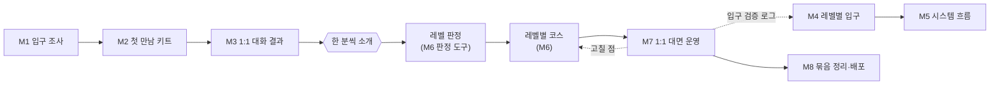

# Senior-AI-Enablement 학습 로드맵

**생성일**: 2026-10-11
**방법론**: VibeLearn AI
**버전**: 1.3 — **사용자 승인 2026-10-21** (결과물을 「레벨 판정 + 레벨별 코스 묶음」으로, 운영은 1:1 · 대면)
- v1.1 (2026-10-11): 클라우드 개인 에이전트 검토 추가
- v1.2 (2026-10-21): 실제 첫 대상(A0)과 입구(Muse) 반영
- v1.3 (2026-10-21): 결과물 구조 변경, M4·M6·M7·M8 범위 조정 (아래 「v1.3 변경」)

## 📚 학습 개요

### Topic 소개
컴퓨터가 낯설거나 AI 를 막 시작한 시니어가, 자기 경험과 노하우를 「내 컴퓨터의 내 기록」으로 쌓으면서 AI 와 함께 하고 싶은 일을 해 나갈 수 있도록 돕는 시스템과 교육 과정을 설계하고 시범 운영한다. 기본 도구는 VS Code · Claude Code · VibeLearn AI 이지만 스킬·앱·문서 중 무엇을 쓸지는 진행하며 정한다. 판단 기준은 하나다: **시니어가 처음에 진입 장벽을 덜 느끼는가.**

### 학습 기간 확정 (STEP 1 통과)
- 8주, 주당 6~8시간, 약 50시간 (2026-10-11 사용자 확인). 복잡도는 「복잡」.
- 일정 제약 둘: ① **10/21 전후 페더럴웨이 시니어 의견 접수 모임**에서 쓸 개략 설명이 가장 가까운 마감이다. ② 첫 운영은 그 모임에서 레벨을 정한 뒤 시작하며, 인원은 5명 이내다.

### 사용자 확정 사항 (Journal/2026-10-11 구술 원문 기준)
- 첫 대상: A 유형 가능성이 크다. 오래 자기 사업을 운영해 쓰던 컴퓨터 기능만 쓰시는 분들.
- 결과물 형태(스킬·앱·문서)는 열려 있고, 진입 장벽이 가장 낮은 것을 고른다.
- 교육 과정과 함께 가이드 문서·영상도 만든다.
- 이 Topic 안에서 설계·시험을 마치면 별도 GitHub Repository 로 배포하는 것이 희망이다.

### 입구 후보의 범위 (2026-10-11 사용자 리뷰 반영)
- 사용자의 방식은 **로컬에서 AI Agent 를 쓰고 기록하고 활용**하는 것이다. 그러나 **처음 진입 문턱을 낮추는 데 필요하다면 다른 곳에서 작동하는 AI Agent 도 검토할 가치가 있다.**
- 연계 Topic: `AI-Agent-Apps-Compare` (진행 중). 그 조사(2026-10-04~11)에 따르면 Meta 의 **Muse** 는 무료 단계가 있고(사용량 한도, 미국 성인) 웹·모바일에서 시작해 PC 설치가 필요 없다. 반면 Dots(ChatGPT Pro 이상)·Grok Bot(유료 구독)은 유료이고 Instinct 는 초대 대기라, 지금은 **무료로 시험할 수 있는 Muse 가 가장 현실적인 후보**다. 이 사실들은 해당 Topic 의 공식·보조 출처 구분을 따르며, 서비스 정책은 바뀔 수 있어 사용 직전에 다시 확인한다.
- 이 Topic 의 긴장 지점: 클라우드 에이전트는 시작이 쉽지만 **기록이 서비스 쪽에 남는다.** 사용자의 접근은 기록이 내 컴퓨터에 쌓이는 것이므로, 클라우드를 쓴다면 「맛보기 → 로컬 기록으로 이행」의 **단계적 진입**을 설계해야 한다 (M4·M5).

### v1.2 — 실제 첫 대상과 입구가 정해짐 (2026-10-21 사용자 확인)
- 10/20 만남에서 **A 보다 한 단계 앞의 레벨(A0: 계정은 있지만 거의 쓰지 않음)** 인 분과 5주 과정을 하기로 했다. 첫 운영은 2026-10-22.
- 입구는 **Muse(무료 범위)** 로 정해졌다. M4 의 비교·시험 절차를 거친 결정이 아니라 사용자 판단이므로, M4 는 「이 결정을 시험 기록으로 검증하는 모듈」로 남긴다.
- **M6 은 특정인용 수업안이 아니라 A0 레벨 공통 5주 입문 코스**로 만든다(사용자 지시). 공개 문서에 특정인을 유추할 수 있는 정보는 넣지 않는다.
- M6(코스)과 M7(시범 운영)이 M3~M5 보다 먼저 시작된다. M3 의 레벨 확정은 M6 의 레벨 정의 문서로 일부 대신한다.
- 10/20 은 모임이 아니라 **연결자 한 분과의 1:1 대화**였다. 결론: **1:1 · 대면 기본 · 레벨별 코스**, 참가자는 연결자가 한 분씩 소개한다. 연결자 본인(P2)도 과외를 받기로 해 **P2 레벨용 코스를 나중에 만든다.** M2 자료는 참고만 했다 (상세: `03-Listening-Results/`).

### v1.3 변경 — 결과물은 「레벨 판정 + 레벨별 코스 묶음」 (2026-10-21 사용자 확인)
- 같은 지역 시니어라도 레벨과 하고 싶은 일이 다 달라 **「한 과정」이 아니라 레벨을 먼저 판정하고 그 레벨의 코스를 붙이는 구조**로 간다.
- 운영 단위는 **1:1 · 대면 기본**. 참가자는 연결자가 한 분씩 소개한다. 「5명 이내 한 반」 가정은 폐기.
- 모듈 조정:
  - **M4** — 입구를 하나로 고르지 않고 **레벨별 입구**를 정한다 (A0 = Muse, 운영 로그로 검증 / A 이상 = 로컬 후보 비교)
  - **M6** — 「공통 과정 + A 유형 변형」 → **레벨 판정 도구 + 레벨별 코스 묶음 v1** (A0 코스 먼저, P2 레벨 코스는 판정 뒤)
  - **M7** — 반 운영 → **1:1 대면 시범 운영** (P1 5주 10/22~11/19, P2 는 시작 시점 미정)
  - **M8** — 배포 단위를 「레벨 판정 + 코스 묶음」으로
- **(10/22 P1 1회 뒤)** P1 은 Facebook 을 쓰지 않고 목적이 **글쓰기**로 정해져, A0 코스를 **1회 공통 + 목적별 트랙**으로 바꿨다. 첫 트랙은 글쓰기, Facebook 은 선택 모듈. 2회 뒤 약 2주 공백이 있어 「혼자 쓰는 기간」 카드를 넣었다. P1 의 3~5회가 11월 중순 이후로 밀려 **M8(12/5)과 성공 기준 확인(코스 종료 2주 뒤)이 겹치거나 넘칠 수 있다.**
- 이 문서의 M1·M2 본문은 당시 계획 그대로 둔다. M3~M8 본문 중 v1.3 과 다른 부분은 아래 각 모듈의 「v1.3 범위」가 우선한다.

### 학습 환경
- OS: Windows 11 (제작자) / 대상자: Windows · macOS 혼재, 크롬북·태블릿은 현재 방식 불가
- 도구: VS Code, Claude Code, VibeLearn AI, 마크다운↔HTML 변환, Skills, 필요 시 원격 접속, **클라우드 개인 에이전트(Muse 등, 무료 범위만)**
- 사전 지식: VibeLearn AI 흐름, 기존 가이드북

## 🗺️ 전체 로드맵 구조

| 모듈 | 모듈명 | 난이도 | 예상 시간 | 주차 | 산출물 폴더 |
|------|--------|--------|----------|------|------------|
| M1 | 시니어 입구 조사 | ⭐ | 5h | W1 (10/11~) | 01-Senior-Difficulty-Map/ |
| M2 | 첫 만남 자료 키트 | ⭐⭐ | 5h | W2 (**10/20 전 완료**) | 02-First-Meeting-Kit/ |
| M3 | 의견 접수 결과와 레벨 확정 | ⭐ | 4h | W2 (10/21) | 03-Listening-Results/ |
| M4 | 레벨별 입구 결정 (로컬·클라우드 후보 비교) | ⭐⭐⭐ | 8h | W3~W5 (운영과 병행) | 04-Easy-Entrance/ |
| M5 | 시스템 흐름 설계 | ⭐⭐⭐ | 8h | W5~W6 | 05-System-Flow/ |
| M6 | 레벨 판정 도구 + 레벨별 코스 묶음 v1 | ⭐⭐⭐ | 10h | W2~W6 (코스마다) | 06-Curriculum-v1/ |
| M7 | 1:1 대면 시범 운영과 개선 | ⭐⭐⭐ | 10h | W2~W7 (매주) | 07-Pilot-Run/ |
| M8 | 정리·배포 준비 (Capstone) | ⭐⭐ | 6h | W8 (~12/5) | 08-Release-Capstone/ |

**총 예상 시간**: 56시간 (각 모듈에 버퍼 20% 포함, v1.3 에서 M6·M7 각 +2h)



v1.3 부터는 직선이 아니라 **순환**이다. 한 분이 소개될 때마다 「판정 → 코스 → 운영 → 고칠 점」을 돈다. A0 코스는 이미 돌기 시작했고(P1, 10/22), P2 레벨은 판정부터 시작한다. 11/26 은 추수감사절이라 W7 에는 여유를 두었다.

## 📖 모듈별 상세 계획

### M1 - 시니어 입구 조사

**난이도**: ⭐
**예상 시간**: 5h
**산출물 폴더**: `01-Senior-Difficulty-Map/`

#### 학습 목표
- [ ] 시니어가 처음 AI 를 쓰려 할 때 막히는 지점을 단계별(설치 → 첫 사용 → 기록 → 계속)로 정리한 「어려움 지도」를 만들 수 있다
- [ ] A 유형 대상자의 프로필(가정)을 한 쪽으로 쓰고 확인할 질문을 뽑을 수 있다
- [ ] 기존 자산(가이드북·온보딩·Guiding 엔진)을 「시니어 입구」 기준으로 평가해 재사용/폐기 목록을 만들 수 있다
- [ ] 입구의 두 갈래(로컬 에이전트 / 클라우드 개인 에이전트)와 `AI-Agent-Apps-Compare` 의 현재 조사 결과를 요약할 수 있다
- [ ] 유타주·Shoreline 사례에서 효과가 있었던 점과 부족했던 점을 익명 요약할 수 있다

#### 주요 개념
1. **어려움 지도**: 사용자 정리 10가지(vl_materials 3장)를 시간순 단계에 놓은 표. 같은 어려움이 여러 단계에 나올 수 있다
2. **진입 장벽**: 시니어가 첫 30분 안에 포기하게 만드는 요인. 이 Topic 의 단일 판단 기준
3. **대상 유형 A~D**: 컴퓨터 숙련도 4단계. 이번 첫 대상은 A (쓰던 기능만 쓰는 사업 운영 경력자)
4. **익명 사례화**: 공개 레포에 쓰기 위해 이름·상담 내용을 제거하는 규칙
5. **입구의 두 갈래**: 로컬 에이전트(VS Code + Claude Code, 기록이 내 컴퓨터에 쌓임)와 클라우드 개인 에이전트(Muse 등, 시작이 쉽고 기록은 서비스에 남음). 어느 쪽이 맞는지는 M4 에서 정한다
6. **오해하기 쉬운 점**: 「시니어는 쉬운 것만 원한다」가 아니라 「자기 일에 닿는 것은 열심히 배운다」일 수 있다 — 확인이 필요한 가설로 취급한다

#### 실습 과제

**실습 1: 어려움 지도 작성** ⭐
- **목적**: 막히는 지점을 한눈에 보게 한다
- **단계**: 1) vl_materials 3장 10가지를 단계별 표로 옮긴다 2) 각 항목에 근거(사용자 말씀·기존 기록)를 붙인다 3) 빠진 단계는 「가설」로 표시한다
- **예상 시간**: 90분
- **검증**: 모든 항목에 근거 또는 「가설」 표시가 있다

**실습 2: 기존 자산 감사** ⭐⭐
- **목적**: 처음부터 다시 만들지 않고 재사용할 것을 고른다
- **단계**: 1) 가이드북·온보딩 신청서·Guiding 엔진·AI 활용 가이드 프로그램 개요, 그리고 `AI-Agent-Apps-Compare` 의 서비스 카드·비교표·M3 WorkLog 를 읽는다 2) 「시니어 입구」 기준(쉬운 말, 설치 부담, 첫 성공까지 시간)으로 평점을 매긴다 3) 재사용·수정·폐기 표를 만든다
- **예상 시간**: 120분
- **검증**: 자산마다 판정과 한 줄 이유가 있다

**실습 3: A 유형 프로필과 익명 사례 요약** ⭐⭐
- **목적**: 10/21 전에 확인할 가설을 정리한다
- **단계**: 1) 사용자가 준 정보(사업 운영 경력, 쓰던 기능만 사용)로 프로필 초안 2) 유타주·Shoreline 사례를 사용자에게 물어 익명 요약(사용자 허락 범위만) 3) 모임에서 물을 질문 후보 10개 추출
- **예상 시간**: 90분
- **검증**: 프로필에 「확인 필요」 표시가 있고 사례 요약에 이름이 없다

#### 산출물
```
01-Senior-Difficulty-Map/
├── README.md
├── concepts/
│   └── barrier-and-types.md
├── guides/
│   ├── difficulty-map.md
│   └── asset-audit.md
└── examples/
    └── a-type-profile-and-cases.md
```

> **README.md 작성 기준**: 처음 여는 사람이 README 만 보고 문서 순서를 알 수 있어야 한다. 모듈 헤더(번호·제목·상태·시간), 학습 순서대로 번호 매긴 문서 목록과 상대 경로 링크·한 줄 설명, 이전/다음 모듈 링크를 둔다.

#### Definition of Done
- [ ] 모든 학습 목표 달성
- [ ] 어려움 지도·자산 감사·프로필 3개 문서 작성
- [ ] 모든 주장에 근거 또는 「가설」 표시
- [ ] 공개 문서에 실제 이름·상담 내용 없음
- [ ] 산출물 폴더 README 작성
- [ ] 🔴 README 링크가 실제 파일을 가리키는지 확인 (`python scripts/check_links.py`)
- [ ] WorkLog 작성 완료
- [ ] Daily Retrospective 작성

#### Self-Assessment
**개념 이해**:
- [ ] 이 Topic 의 단일 판단 기준을 한 문장으로 말할 수 있다
- [ ] 대상 유형 A 가 어떤 분인지 설명할 수 있다

**실무 활용**:
- [ ] AI 에게 「이 문서가 시니어 입구 기준에 맞는지 평가해 줘」라고 구체적 기준과 함께 지시할 수 있다
- [ ] AI 가 만든 사례 요약에 실명이 섞였는지 점검할 수 있다

#### 예상 시간 배분
- 개념 학습: 60분
- 실습 1: 90분
- 실습 2: 120분
- 실습 3: 90분
- 문서화·점검: 40분
- **합계**: 약 5h (버퍼 20% 포함)

#### 참조 자료
- 구상 정리와 AI 제안: vl_materials/00-구상-정리와-추가-고려사항.md — 어려움 10가지와 열린 질문 답
- 참가자용 가이드북: Topics/VibeCoding-Starter-Guide/07-Guidebook/01-participant-guidebook.md — 시니어에게 어려웠던 원본
- Topics/VibeCoding-Onboarding-Program/ — 신청서
- Topics/Vibe-Guiding-VSCode/ — 막힌 순간 안내 엔진 POC
- Topics/AI-Agent-Apps-Compare/ — Muse·Dots·Grok Bot·Instinct 비교, 승인·개인정보 경계 (진행 중)

### M2 - 첫 만남 자료 키트

**난이도**: ⭐⭐
**예상 시간**: 5h
**산출물 폴더**: `02-First-Meeting-Kit/`

#### 학습 목표
- [ ] 10/21 전후 모임에서 말할 「교육 과정 개략 설명」을 시니어가 이해할 수 있는 말로 쓸 수 있다
- [ ] 시니어에게서 의견을 받을 질문지(10문항 이내)를 만들 수 있다
- [ ] 모임에서 AI 가 무엇을 해 주는지 5분 안에 보여 줄 짧은 시연 시나리오를 준비할 수 있다
- [ ] 참가 의사·동의(녹화·사례 사용)를 묻는 방법을 정할 수 있다

#### 주요 개념
1. **의견 접수**: 가르치는 모임이 아니라 듣는 모임. 설명은 짧게, 질문은 많이
2. **쉬운 말 원칙**: 전문 용어는 처음 나올 때 일상 말로 풀어 쓴다 (예: 터미널 = 컴퓨터에게 글자로 시키는 창)
3. **한 장 소개**: 종이 한 장으로 과정이 무엇이고 무엇이 아닌지 보여 주는 문서
4. **시연 시나리오**: 설치 없이 보여 주는 「내 일에 AI 가 하는 일」 한 장면
5. **오해하기 쉬운 점**: 모임에서 설치를 시키면 첫인상이 어려워진다 — 보여 주기만 한다

#### 실습 과제

**실습 1: 한 장 소개와 설명 스크립트** ⭐⭐
- **목적**: 과정의 개략을 전달한다
- **단계**: 1) 무엇을 배우나/무엇이 쉬운가/무엇이 필요한가를 한 장에 2) 3분 설명 스크립트 3) 쉬운 말 점검(AI 에게 「70대 사업가가 이해할 수준인지」 평가 요청)
- **예상 시간**: 100분
- **검증**: 사용자가 소리 내어 읽어 보고 막히는 문장이 없다

**실습 2: 질문지와 시연 시나리오** ⭐⭐
- **목적**: 모임에서 듣고 보여 준다
- **단계**: 1) 질문지: 지금 쓰는 컴퓨터·기능, 하고 싶은 일, 두려운 것, 가능한 시간·요일 2) 5분 시연: 한 사업 관련 장면(예: 거래처 안내문 정리). 시연 도구는 `AI-Agent-Apps-Compare` M3·M4 결과를 보고 고른다. Muse 처럼 설치 없이 웹에서 보여 줄 수 있는 무료 도구가 후보이며, **시연 중에는 개인 계정(메일·일정)을 연결하지 않는다** 3) 모임 진행 순서 1장
- **예상 시간**: 100분
- **검증**: 질문지가 10문항 이내이고 시연이 설치 없이 재현 가능하다

**실습 3: 동의와 개인정보 한 장** ⭐
- **목적**: 사례 사용·녹화에 대한 합의를 구한다
- **단계**: 1) 온보딩 확정안의 녹화 논의를 확인 2) 짧은 동의 문구 초안(사용자 확인) 3) 정보 취급 약속 3줄
- **예상 시간**: 40분
- **검증**: 사용자가 승인한 문구가 있다 (동의서 확정은 사용자 결정)

#### 산출물
```
02-First-Meeting-Kit/
├── README.md
├── guides/
│   ├── one-page-intro.md
│   ├── explanation-script.md
│   ├── meeting-flow.md
│   └── consent-and-privacy.md
└── examples/
    ├── question-sheet.md
    └── five-minute-demo.md
```

#### Definition of Done
- [ ] 모든 학습 목표 달성
- [ ] 한 장 소개·스크립트·질문지·시연·동의 문구 5종 작성
- [ ] 사용자가 읽어 보고 모임에서 쓸 수 있다고 승인
- [ ] 10/20 전 완료
- [ ] 산출물 폴더 README 작성
- [ ] 🔴 README 링크가 실제 파일을 가리키는지 확인 (`python scripts/check_links.py`)
- [ ] WorkLog 작성 완료
- [ ] Daily Retrospective 작성

#### Self-Assessment
**개념 이해**:
- [ ] 의견 접수 모임의 목적을 한 문장으로 말할 수 있다
- [ ] 한 장 소개에 넣을 것/뺄 것을 구분할 수 있다

**실무 활용**:
- [ ] AI 에게 대상 연령·상황을 명시해 쉬운 말 점검을 시킬 수 있다
- [ ] 시연 시나리오가 실패했을 때의 대안을 준비했다

#### 예상 시간 배분
- 개념 학습: 60분
- 실습 1: 100분
- 실습 2: 100분
- 실습 3: 40분
- 문서화·리허설: 40분
- **합계**: 약 5h (버퍼 20% 포함)

#### 참조 자료
- M1 산출물 — 프로필과 질문 후보
- Materials_For_Topics/VibeCoding-Onboarding-Business/ — 온보딩 확정안·녹화 논의
- 가이드북 2장 — 쉬운 말 설명 예시

### M3 - 의견 접수 결과와 레벨 확정

**난이도**: ⭐
**예상 시간**: 4h
**산출물 폴더**: `03-Listening-Results/`

#### 학습 목표
- [ ] 모임에서 받은 의견을 익명으로 정리하고 어려움 지도에 반영할 수 있다
- [ ] 참가자별 상태를 A~D 로 판정하고 첫 운영 레벨과 인원을 정할 수 있다
- [ ] 성공 기준(2주 뒤에도 쓰는가 등)을 정할 수 있다
- [ ] 첫 운영의 일정·방식(대면/원격)을 정할 수 있다

#### 주요 개념
1. **레벨 확정**: 모임 대화로 실제 숙련도·목표를 판단해 첫 운영 반을 정한다
2. **성공 기준**: 「설치했다」가 아니라 「자기 일에 한 가지를 써 봤다」
3. **익명 코드**: 참가자를 P1·P2 처럼 부른다
4. **오해하기 쉬운 점**: 모임에서 말한 희망과 실제 가능한 시간은 다를 수 있다 — 두 번 확인한다

#### 실습 과제

**실습 1: 의견 정리** ⭐
- **목적**: 들은 것을 잃지 않는다
- **단계**: 1) 사용자 구술/메모를 원문 그대로 Journal 에 저장 2) 익명 요약 3) 어려움 지도 갱신
- **예상 시간**: 90분
- **검증**: 원문과 요약이 분리되어 있고 요약에 실명이 없다

**실습 2: 레벨·성공 기준·운영 계획 확정** ⭐⭐
- **목적**: 첫 운영의 틀을 정한다
- **단계**: 1) 참가자 A~D 판정표 2) 성공 기준 3개 3) 일정·방식·시간 길이 4) 사용자 승인
- **예상 시간**: 90분
- **검증**: 승인된 한 장 요약이 있다

#### 산출물
```
03-Listening-Results/
├── README.md
├── guides/
│   └── first-run-plan.md
└── examples/
    └── listening-summary-anonymized.md
```

#### Definition of Done
- [ ] 학습 목표 달성
- [ ] 의견 원문이 Journal 에 보존됨
- [ ] 익명 요약과 레벨 판정표 작성
- [ ] 성공 기준 3개 이상 사용자 승인
- [ ] 산출물 폴더 README 작성
- [ ] 🔴 README 링크가 실제 파일을 가리키는지 확인 (`python scripts/check_links.py`)
- [ ] WorkLog 작성 완료
- [ ] Daily Retrospective 작성

#### Self-Assessment
**개념 이해**:
- [ ] 성공 기준이 설치 여부가 아닌 이유를 설명할 수 있다

**실무 활용**:
- [ ] 메모를 AI 에 맡길 때 원문 보존과 요약을 분리해 지시할 수 있다
- [ ] AI 가 만든 판정이 근거 없이 단정하지 않았는지 확인할 수 있다

#### 예상 시간 배분
- 개념 학습: 40분
- 실습 1: 90분
- 실습 2: 90분
- 문서화: 20분
- **합계**: 약 4h (버퍼 20% 포함)

#### 참조 자료
- M1 어려움 지도, M2 질문지
- vl_materials/00-구상-정리와-추가-고려사항.md 7장 — 성공 기준·동의·지원 체계

### M4 - 레벨별 입구 결정 (로컬·클라우드 후보 비교)

> **v1.3 범위** — 입구를 하나로 고르지 않고 **레벨마다** 정한다. A0 는 Muse 로 이미 시작했으므로, M7 의 P1 운영 로그(가입·로그인·첫 성공까지 걸린 시간, 막힌 곳)를 **시험 로그**로 삼아 사후 검증한다. A 이상은 아래 원래 계획대로 로컬 후보와 비교한다. 산출물 `guides/entrance-decision.md` 는 「레벨 → 입구」 표로 쓴다.

2026-10-11 사용자 제안 반영: [클라우드 작성·로컬 회수 분석 후보](../vl_materials/00-구상-정리와-추가-고려사항.md#9-클라우드에서-작성하고-나중에-로컬로-가져오기--분석-후보)를 비교 대상으로 추가한다. 답변의 로컬 정리 사례는 있으나 Muse의 파일 생성·지연 회수 전체 경로는 미시험이다.

**난이도**: ⭐⭐⭐
**예상 시간**: 8h
**산출물 폴더**: `04-Easy-Entrance/`

#### 학습 목표
- [ ] 「첫 30분에 작은 성공」을 만들 수 있는 입구 후보를 3개 이상 낼 수 있다
- [ ] 후보를 같은 기준(설치 부담·조작 수·실패 시 복구·기록이 쌓이는가·비용·개인정보와 승인 경계·접근 조건)으로 비교해 하나를 고를 수 있다
- [ ] 클라우드 에이전트를 쓸 경우 「맛보기 → 로컬 기록 이행」 경로와 이행 시점을 설계할 수 있다
- [ ] Muse에서 작성한 결과를 나중에 PC에서 로컬로 가져오는 후보를 분석하고, 답변 정리·파일 다운로드·지연 회수의 검증 상태를 구분할 수 있다
- [ ] 선택한 입구를 실제로 한 번 돌려 보고 막히는 지점을 기록할 수 있다
- [ ] 입구의 형태(스킬·앱·문서·원격 세팅)를 정하고 이유를 남길 수 있다

#### 주요 개념
1. **입구**: 설치부터 첫 결과물까지의 구간. 시니어가 포기하는 곳
2. **후보 비교표**: 같은 기준으로 점수 매기기. 추측이 아니라 시험으로 채운다
3. **기록이 쌓이는 입구**: 로컬 기록 방식을 유지하면서도 쉬워야 한다 (이 Topic 의 긴장 지점). 클라우드 에이전트는 시작이 쉬운 대신 기록이 서비스에 남으므로 내보내기·이행이 가능한지 본다
4. **단계적 진입**: 1단계 맛보기(무료 클라우드 에이전트 등) → 2단계 내 컴퓨터에 기록 쌓기. 도구를 전환하는 방법과 클라우드 작성·로컬 회수를 병행하는 방법을 비교하며, 가져오는 시점과 절차도 설계 대상
5. **위임 위험**: 에이전트는 메일 전송·결제·삭제처럼 되돌리기 어려운 행동을 한다. 시니어 기본 규칙은 「처음엔 읽기·초안까지만」으로 두고 `AI-Agent-Apps-Compare` 의 승인 경계 정리를 따른다
6. **형태 결정**: 스킬/앱/문서 중 하나로 단정하지 않고 진입 장벽 기준으로 선택
7. **오해하기 쉬운 점**: 설치를 대신 해 주는 것이 항상 정답은 아니다 — 이후 혼자 못 하면 단절된다

#### 실습 과제

**실습 1: 입구 후보 3개 이상 설계와 조사** ⭐⭐
- **목적**: 선택지를 넓힌다
- **단계**: 1) 후보 예: 제작자 원격 세팅 + 로컬 Claude Code / 말로 시키는 방식 / 설치 안내 스킬 / **클라우드 개인 에이전트(Muse 등 무료 범위)** / 설치가 가벼운 도구 2) 필요한 사실은 조사해서 확인(추측 금지) 3) 후보별 장단점 표
- **예상 시간**: 150분
- **검증**: 조사한 사실마다 출처 또는 「미확인」 표시

**실습 2: 후보 시험** ⭐⭐⭐
- **목적**: 표가 아니라 실제로 비교한다
- **단계**: 1) 로컬 후보 1개와 클라우드 후보 1개(Muse)를 시험한다. Muse 는 `AI-Agent-Apps-Compare` M3·M4 의 기록을 재사용하되 시니어 입장(첫 화면 이해, 가입, 연결 거부; 한국어 사용은 사용자가 가능하다고 확인함 2026-10-11)으로 다시 본다 2) 시간·막힌 곳 기록 3) 비교표 갱신. **새 유료 결제는 하지 않고, 공개 기록에 개인 계정 정보를 남기지 않는다**
- **예상 시간**: 150분
- **검증**: 시험 로그가 있고 비교표 점수가 로그에 근거한다

**실습 3: 입구 결정 기록** ⭐⭐
- **목적**: 왜 골랐는지를 남긴다
- **단계**: 1) 결정 문서(선택·탈락 이유·재검토 조건) 2) 사용자 승인
- **예상 시간**: 60분
- **검증**: 사용자 승인 기록

#### 산출물
```
04-Easy-Entrance/
├── README.md
├── concepts/
│   └── entrance-criteria.md
├── guides/
│   ├── candidate-comparison.md
│   └── entrance-decision.md
└── examples/
    └── trial-logs.md
```

#### Definition of Done
- [ ] 학습 목표 달성
- [ ] 후보 3개 이상 비교표 + 시험 로그 2개 이상
- [ ] 결정 문서 사용자 승인
- [ ] 조사 사실에 출처 또는 「미확인」 표시
- [ ] 산출물 폴더 README 작성
- [ ] 🔴 README 링크가 실제 파일을 가리키는지 확인 (`python scripts/check_links.py`)
- [ ] WorkLog 작성 완료
- [ ] Daily Retrospective 작성

#### Self-Assessment
**개념 이해**:
- [ ] 후보 비교 기준 4가지를 말하고 왜 필요한지 설명할 수 있다

**실무 활용**:
- [ ] AI 에게 조사 결과를 요약시킬 때 출처와 미확인을 구분하도록 지시할 수 있다
- [ ] 시험 로그만 보고 입구의 약점을 판단할 수 있다

**문제 해결**:
- [ ] 설치가 막혔을 때 AI 에게 로그를 주고 원인을 물을 수 있다

#### 예상 시간 배분
- 개념 학습: 90분
- 실습 1: 160분
- 실습 2: 150분
- 실습 3: 80분
- **합계**: 약 8h (버퍼 20% 포함)

#### 참조 자료
- Topics/Chrome-Remote-Desktop/ — 원격 세팅 가능성 기록
- Topics/Vibe-Guiding-VSCode/ — 막힌 순간 안내 엔진 (입구 후보의 구성요소)
- Topics/VibeLearn-AI-Chromebook/ — 크롬북 한계
- Topics/AI-Agent-Apps-Compare/ (서비스 카드·비교표·승인과 개인정보·M3 WorkLog) — 클라우드 후보 근거
- 공식 설치 문서 — 이 모듈에서 확인 (미확인 상태로 시작)

### M5 - 시스템 흐름 설계

**난이도**: ⭐⭐⭐
**예상 시간**: 8h
**산출물 폴더**: `05-System-Flow/`

#### 학습 목표
- [ ] 「기록 공간 → 자료 준비 → VibeLearn AI/가벼운 일 처리 → 결과 보기 → 기록으로 환류」 흐름을 구체 폴더 구조와 절차로 만들 수 있다
- [ ] 사전 자료(Material) 준비 프로세스를 시니어가 따라 할 수 있는 단계로 쓸 수 있다
- [ ] 「VibeLearn AI 가 필요한 일」과 「가벼운 일」을 구분하는 기준과 가벼운 일 처리 흐름을 정의할 수 있다
- [ ] 결과를 HTML 등 쉬운 형태로 보는 방법을 정하고 시험할 수 있다
- [ ] VibeLearn AI 를 시니어용으로 바꿀 항목을 목록으로 낼 수 있다
- [ ] M4 에서 클라우드 입구를 골랐다면 그 서비스의 결과를 내 기록 공간으로 가져오는 절차(내보내기·복사)를 정의할 수 있다
- [ ] 클라우드 작성·로컬 회수 경로에서 저장 위치·출처·원문/정리본·누락·중복·재사용 확인 절차를 정의할 수 있다

#### 주요 개념
1. **기록 공간**: 시니어의 경험·노하우·자료가 쌓이는 폴더 구조
2. **자료 준비(Material)**: 학습·프로젝트 전에 모으는 개인 자료와 외부 자료
3. **가벼운 일 처리 흐름**: 로드맵이 필요 없는 일(편지 정리, 안내문, 질문)의 요청→결과→기록 순서
4. **결과 보기**: md 를 열 도구를 설치하지 않고 보는 방법 (HTML 변환 등)
5. **오해하기 쉬운 점**: 흐름이 복잡할수록 좋은 시스템이 아니다 — 시니어가 외울 규칙은 3개 이하로

#### 실습 과제

**실습 1: 기록 공간 구조와 자료 준비 절차** ⭐⭐⭐
- **목적**: 가장 비어 있던 부분을 채운다
- **단계**: 1) 폴더 구조 안(이름은 쉬운 말) 2) 자료 넣는 방법·이름 규칙 3) 샘플 기록으로 시험(익명 가상 사례)
- **예상 시간**: 150분
- **검증**: 가상 사례로 처음부터 끝까지 따라 해 막힘이 없다

**실습 2: 가벼운 일 처리 흐름** ⭐⭐
- **목적**: VibeLearn AI 를 안 써도 되는 일의 길을 만든다
- **단계**: 1) 구분 기준 2) 요청→결과→기록 절차 3) 3개 사례로 시험
- **예상 시간**: 120분
- **검증**: 사례 3개가 기록 공간에 쌓였다

**실습 3: 결과 보기와 VibeLearn AI 개선 목록** ⭐⭐
- **목적**: 보기 쉬움과 방법론 개선점을 정리한다
- **단계**: 1) HTML 변환 방법 시험 2) VibeLearn AI 에서 시니어에게 어려운 단계 목록 3) 개선안 분류(바로 적용/별도 Repo)
- **예상 시간**: 120분
- **검증**: 변환 결과를 브라우저에서 열어 확인하고 목록에 근거가 있다

#### 산출물
```
05-System-Flow/
├── README.md
├── concepts/
│   └── flow-and-rules.md
├── guides/
│   ├── record-space-and-materials.md
│   ├── light-task-flow.md
│   └── viewing-results.md
└── examples/
    ├── sample-record-space.md
    └── vibelearn-senior-changes.md
```

#### Definition of Done
- [ ] 학습 목표 달성
- [ ] 흐름도·기록 공간 구조·가벼운 일 처리 흐름 문서화
- [ ] 가상 사례 시험 로그 3개 이상
- [ ] VibeLearn AI 개선 목록 작성
- [ ] 시니어가 외울 규칙 3개 이하
- [ ] 산출물 폴더 README 작성
- [ ] 🔴 README 링크가 실제 파일을 가리키는지 확인 (`python scripts/check_links.py`)
- [ ] WorkLog 작성 완료
- [ ] Daily Retrospective 작성

#### Self-Assessment
**개념 이해**:
- [ ] 결과가 기록 공간으로 돌아와야 하는 이유를 설명할 수 있다
- [ ] VibeLearn AI 가 필요한 일과 가벼운 일의 기준을 말할 수 있다

**실무 활용**:
- [ ] AI 에게 기록을 읽고 이어서 작업하도록 지시할 수 있다
- [ ] 시스템이 복잡해졌는지 판단하는 기준을 갖고 있다

#### 예상 시간 배분
- 개념 학습: 90분
- 실습 1: 150분
- 실습 2: 120분
- 실습 3: 120분
- **합계**: 약 8h (버퍼 20% 포함)

#### 참조 자료
- vl_materials/00-구상-정리와-추가-고려사항.md 5장 흐름 초안
- M4 입구 결정 문서
- Topics/Personal-Ops-Board/ — 기록이 AI 와 함께 쌓이는 구조 사례
- VibeLearn-AI 레포 (로컬 C:\AI_study\2026\VibeLearn-AI)

### M6 - 레벨 판정 도구 + 레벨별 코스 묶음 v1

> **v1.3 범위** — 아래 원래 계획(공통 과정 + A 유형 변형) 대신 다음을 만든다. 예상 시간 10h.
>
> **학습 목표**
> - [ ] 처음 만난 분의 레벨(A0·A~D)을 15분 대화로 판정하는 **레벨 판정 도구**를 만들 수 있다
> - [x] A0 레벨 코스(Muse 5주 입문)를 설계할 수 있다 (2026-10-21)
> - [ ] A0 코스의 주차별 수강생 카드 5장을 운영 전 주마다 만들 수 있다 (1주차 완료)
> - [ ] P2 의 레벨을 판정하고 그 레벨의 코스를 설계할 수 있다
> - [ ] 코스 묶음의 공통 틀(운영 원칙·약속 3가지·60분 순서·숙제 검사)과 레벨별로 바뀌는 부분을 구분할 수 있다
>
> **산출물**
> ```
> 06-Curriculum-v1/
> ├── README.md                     # 코스 묶음 목차 (레벨 → 코스)
> ├── concepts/
> │   └── target-level.md           # A0 레벨 정의 (작성)
> ├── guides/
> │   ├── level-assessment.md       # 레벨 판정 도구
> │   ├── muse-5week-intro-course.md# A0 코스 (작성)
> │   ├── week1-card.md ~ week5-card.md
> │   └── {레벨}-course.md          # P2 레벨 판정 뒤
> └── examples/
>     └── intro-video-outline.md    # 소개 영상 개요 (원래 계획 유지)
> ```
>
> **Definition of Done**
> - [ ] 레벨 판정 도구 작성, 실제 판정 1회 이상(P2) 사용
> - [ ] 코스 2개 이상 (A0 + P2 레벨)
> - [ ] A0 카드 5장
> - [ ] 공개 문서에 특정인을 유추할 정보 없음
> - [ ] 산출물 README 작성 · `check_links.py` 통과
> - [ ] WorkLog · Daily Retrospective

**난이도**: ⭐⭐⭐
**예상 시간**: 8h
**산출물 폴더**: `06-Curriculum-v1/`

#### 학습 목표
- [ ] 공통 기본 과정(개념 + 조작법)을 회차별 목표와 실습으로 설계할 수 있다
- [ ] A 유형용 변형(속도·용어·자료)을 정리할 수 있다
- [ ] 시니어가 혼자 볼 수 있는 가이드 문서(큰 글씨·적은 단계)를 쓸 수 있다
- [ ] 많은 분께 알릴 소개 영상의 개요를 잡을 수 있다

#### 주요 개념
1. **공통 기본 + 대상별 변형**: 하나의 틀에서 속도와 예시만 바꾼다
2. **회차 설계**: 회차마다 「오늘 끝나면 손에 남는 것」 한 가지
3. **쉬운 가이드**: 한 화면에 한 동작, 실패했을 때 되돌리는 방법 포함
4. **교육 과정과 시스템의 연결**: 배우는 순서가 M5 의 3개 규칙과 일치해야 한다
5. **오해하기 쉬운 점**: 개념 설명을 길게 하면 이탈한다 — 이론 20~30% 이하

#### 실습 과제

**실습 1: 공통 과정 설계** ⭐⭐⭐
- **목적**: 과정의 뼈대를 만든다
- **단계**: 1) 회차 수·시간 정하기(사용자 확인) 2) 회차별 목표·실습·산출물 3) 개념 최소 목록
- **예상 시간**: 150분
- **검증**: 모든 회차에 「손에 남는 것」이 있다

**실습 2: A 유형 변형과 가이드 문서** ⭐⭐⭐
- **목적**: 첫 대상에 맞춘다
- **단계**: 1) 변형표 2) 첫 회차 가이드 문서(큰 글씨 규칙) 3) 쉬운 말 점검
- **예상 시간**: 150분
- **검증**: 사용자가 첫 회차 문서를 따라 해 막히는 곳이 없다

**실습 3: 소개 영상 개요** ⭐⭐
- **목적**: 확산 경로를 준비한다
- **단계**: 1) 영상 메시지 한 문장 2) 구성 3) 필요한 장면(익명·동의 범위)
- **예상 시간**: 60분
- **검증**: 개요 한 장 승인

#### 산출물
```
06-Curriculum-v1/
├── README.md
├── concepts/
│   └── course-design-principles.md
├── guides/
│   ├── common-course.md
│   ├── a-type-variant.md
│   └── session1-handout.md
└── examples/
    └── intro-video-outline.md
```

#### Definition of Done
- [ ] 학습 목표 달성
- [ ] 공통 과정·A 유형 변형·첫 회차 가이드 작성
- [ ] 첫 회차 문서를 사용자가 따라 하여 통과
- [ ] 영상 개요 승인
- [ ] 산출물 폴더 README 작성
- [ ] 🔴 README 링크가 실제 파일을 가리키는지 확인 (`python scripts/check_links.py`)
- [ ] WorkLog 작성 완료
- [ ] Daily Retrospective 작성

#### Self-Assessment
**개념 이해**:
- [ ] 공통 기본과 변형의 경계를 설명할 수 있다

**실무 활용**:
- [ ] AI 에게 대상·시간·목표를 주고 회차 설계를 시킨 뒤 이론 비율을 점검할 수 있다
- [ ] 가이드 문서의 쉬움을 판단하는 체크리스트를 쓸 수 있다

#### 예상 시간 배분
- 개념 학습: 90분
- 실습 1: 150분
- 실습 2: 150분
- 실습 3: 60분
- **합계**: 약 8h (버퍼 20% 포함)

#### 참조 자료
- M3 확정 레벨·성공 기준, M5 흐름
- Topics/VibeCoding-Starter-Guide/ — 재사용할 설명
- 자료 개요 Materials_For_Topics/AI-Guidance-Program/ — 레벨 구성 아이디어

### M7 - 1:1 대면 시범 운영과 개선

> **v1.3 범위** — 「5명 이내 반」이 아니라 **1:1 대면**. 예상 시간 10h(매주 수업 후 기록 포함).
> - P1(A0): 5주, 2026-10-22 ~ 11/19 예정. 매주 수업 후 원문은 Journal, 익명 관찰 기록은 `examples/session-observations-anonymized.md`
> - P2: 레벨 판정 뒤 시작 시점 결정
> - 매주 측정: 숙제 횟수(7칸 중 몇), 막힌 곳, 이상했던 Muse 답
> - 성공 기준: 코스 종료 2주 뒤 주 3회 이상 사용 (M3 제안, 승인 대기) — P1 은 12/3 전후 확인
> - DoD 의 「최소 2회차」는 「P1 5주 완주 + 관찰 기록 5회」로 바꾼다

**난이도**: ⭐⭐⭐
**예상 시간**: 8h
**산출물 폴더**: `07-Pilot-Run/`

#### 학습 목표
- [ ] 5명 이내 시범 운영을 계획대로 진행하고 회차별 관찰을 기록할 수 있다
- [ ] 성공 기준에 대한 달성도를 익명으로 측정할 수 있다
- [ ] 막힌 지점을 분류(입구·시스템·과정·문서)해 해당 모듈 산출물을 고칠 수 있다
- [ ] 시범 운영 결과를 동의 범위 안에서 사례로 정리할 수 있다

#### 주요 개념
1. **관찰 기록**: 시간·막힌 곳·한 말을 그 자리에서 적는다
2. **개선 환류**: 막힌 지점을 M4·M5·M6 으로 돌려보낸다
3. **동의 범위**: 녹화·사례 사용은 참가자별로 확인한 범위만
4. **오해하기 쉬운 점**: 시범은 시험이지 완성 수업이 아니다 — 실패 기록이 가장 값지다

#### 실습 과제

**실습 1: 운영 준비와 1~2회차 진행** ⭐⭐⭐
- **목적**: 실제 사람과 돌려 본다
- **단계**: 1) 일정·장소/원격·연락 방법 2) 준비물·점검표 3) 1~2회차 진행 4) 관찰 기록
- **예상 시간**: 240분 (실제 세션 시간 포함)
- **검증**: 회차마다 관찰 기록이 있다

**실습 2: 성공 기준 측정과 개선** ⭐⭐⭐
- **목적**: 결과로 고친다
- **단계**: 1) 기준별 달성/미달 2) 막힌 지점 분류 3) 산출물 수정 4) 재시험
- **예상 시간**: 180분
- **검증**: 수정 전후가 기록으로 남아 있다

**실습 3: 익명 사례 정리** ⭐⭐
- **목적**: 확산과 배포용 재료를 만든다
- **단계**: 동의 범위 확인 → 익명 사례 → 사용자 검토
- **예상 시간**: 60분
- **검증**: 실명·연락처 없음, 동의 범위 안

#### 산출물
```
07-Pilot-Run/
├── README.md
├── guides/
│   ├── run-checklist.md
│   └── improvement-log.md
└── examples/
    ├── session-observations-anonymized.md
    └── pilot-case-anonymized.md
```

#### Definition of Done
- [ ] 학습 목표 달성
- [ ] 최소 2회차 운영과 관찰 기록
- [ ] 성공 기준 달성도 표
- [ ] 개선 로그(수정 전후)
- [ ] 공개 문서에 실명·연락처 없음, 동의 범위 확인
- [ ] 산출물 폴더 README 작성
- [ ] 🔴 README 링크가 실제 파일을 가리키는지 확인 (`python scripts/check_links.py`)
- [ ] WorkLog 작성 완료
- [ ] Daily Retrospective 작성

#### Self-Assessment
**개념 이해**:
- [ ] 시범 운영과 정식 수업의 차이를 설명할 수 있다

**실무 활용**:
- [ ] AI 에게 관찰 기록을 분류시키되 원문은 보존하도록 지시할 수 있다
- [ ] 참가자의 어려움을 탓하지 않고 시스템의 문제로 바꿔 기록할 수 있다

#### 예상 시간 배분
- 개념 학습: 40분
- 실습 1: 240분
- 실습 2: 180분
- 실습 3: 60분
- **합계**: 약 8h (버퍼 20% 포함)

#### 참조 자료
- M3 운영 계획, M6 과정과 가이드
- M2 동의·개인정보 문서

### M8 - 정리·배포 준비 (Capstone)

> **v1.3 범위** — 배포 단위를 **「레벨 판정 도구 + 레벨별 코스 묶음」** 으로 잡는다. 다른 강사가 받아서 「처음 만난 분 판정 → 맞는 코스 선택 → 카드 인쇄 → 운영」을 할 수 있으면 성공이다. 코스가 아직 없는 레벨은 「없음」으로 정직하게 표시한다.

**난이도**: ⭐⭐
**예상 시간**: 6h
**산출물 폴더**: `08-Release-Capstone/`

#### 학습 목표
- [ ] 이 Topic 의 결과를 별도 GitHub Repository 로 배포하기 위한 구조·범위를 설계할 수 있다
- [ ] 공개 가능한 것과 비공개로 둘 것을 가려 배포 목록을 만들 수 있다
- [ ] VibeLearn AI 시니어 개선을 별도 버전으로 낼지 판단 기준을 정리할 수 있다
- [ ] 다음 단계(2차 운영·영상 제작·대상 확장) 계획을 세울 수 있다

#### 주요 개념
1. **배포 단위**: 교육 과정, 가이드 문서, 스킬/앱, 사례 중 무엇을 어떻게 묶는가
2. **공개/비공개 경계**: 참가자 자료·고객 자료는 올리지 않는다
3. **재사용성**: 다른 사람이 읽고 바로 시작할 수 있는가
4. **오해하기 쉬운 점**: 배포 직전에 문서 링크가 깨지는 일이 잦다

#### 실습 과제

**실습 1: 배포 구조와 공개 목록** ⭐⭐
- **목적**: 무엇을 올릴지 정한다
- **단계**: 구조 안 → 공개/비공개 분류 → 사용자 승인
- **예상 시간**: 120분
- **검증**: 분류표와 승인 기록

**실습 2: Topic README 와 회고** ⭐⭐
- **목적**: GitHub 방문자를 위한 첫 화면을 만든다
- **단계**: 1) 최상위 README(알아낸 것·틀렸던 판단·확인 못한 것 포함) 2) check_links 통과 3) Topic Retrospective
- **예상 시간**: 150분
- **검증**: 링크 오류 0, 빈 폴더 0

**실습 3: 다음 단계 계획** ⭐
- **목적**: 이어지는 일을 남긴다
- **단계**: 2차 운영, 영상, VibeLearn AI 새 버전 판단, 대상 확장 정리
- **예상 시간**: 60분
- **검증**: 사용자 승인

#### 산출물
```
08-Release-Capstone/
├── README.md
├── guides/
│   ├── release-structure.md
│   └── next-steps.md
└── examples/
    └── public-private-list.md
```

#### Definition of Done
- [ ] 학습 목표 달성
- [ ] 배포 구조·공개/비공개 목록 사용자 승인
- [ ] 🔴 Topic 최상위 README.md 작성
- [ ] 🔴 `check_links.py` 통과 (깨진 링크 0 · 빈 폴더 0)
- [ ] Topic Retrospective 작성
- [ ] 다음 단계 계획 작성
- [ ] WorkLog 작성 완료

#### Self-Assessment
**개념 이해**:
- [ ] 이 Topic 에서 알아낸 것과 확인 못한 것을 구분해 말할 수 있다

**실무 활용**:
- [ ] AI 에게 공개 레포용 문서 점검(실명·내부 자료)을 지시할 수 있다
- [ ] 별도 Repo 배포 시 필요한 것을 점검표로 확인할 수 있다

#### 예상 시간 배분
- 개념 학습: 40분
- 실습 1: 120분
- 실습 2: 150분
- 실습 3: 60분
- **합계**: 약 6h (버퍼 20% 포함)

#### 참조 자료
- 각 모듈 README 와 WorkLog
- Topics/YouTube-Channel-Revival-With-AI/README.md — 최상위 README 예시
- scripts/check_links.py

## 📝 WorkLog 작성 가이드

각 학습 세션마다 WorkLog 를 작성한다.

**파일명 규칙**: `vl_worklog/YYYYMMDD_MX_Senior-AI-Enablement.md` (예: `vl_worklog/20261011_M1_Senior-AI-Enablement.md`)

**WorkLog 필수 섹션**:
1. 오늘의 학습 목표 (체크리스트)
2. 진행 내용 (실습별 상세 기록)
3. 문제 해결 로그
4. DoD 체크리스트 (모듈 완료 기준)
5. Daily Retrospective
6. 참조 및 산출물

이 Topic 의 추가 규칙: 사용자 구술은 Journal 에 원문 보존 후 인용하고, 시니어 참가자 관련 기록은 P1·P2 처럼 익명으로 쓴다.

## 🔍 Retrospective 가이드

### Daily Retrospective (매일, 5~10분)
WorkLog 안에 작성: What went well / What could be improved / Insights / Tomorrow's focus

### Module Retrospective (모듈 완료 시, 15~20분)
`vl_worklog/YYYYMMDD_MX_Retrospective.md`: 계획 대비 실제, 핵심 학습, 문제와 해결, Roadmap 정확도, 다음 모듈 준비

### Topic Retrospective (전체 완료 시, 30~60분)
`vl_worklog/YYYYMMDD_Senior-AI-Enablement_Final_Retrospective.md`: 전체 여정 통계, 방법론 효과성, 산출물 품질, 향후 개선

## 📂 전체 폴더 구조

```
Senior-AI-Enablement/
├── README.md                  # 🔴 마지막 모듈 후 작성
├── topic_starter.md
├── vl_prompts/
│   ├── roadmap_prompt.md
│   └── daily_learning_prompt.md
├── vl_roadmap/
│   └── 20261011_RoadMap_Senior-AI-Enablement.md
├── vl_worklog/
├── vl_materials/
│   └── 00-구상-정리와-추가-고려사항.md
├── 01-Senior-Difficulty-Map/
├── 02-First-Meeting-Kit/
├── 03-Listening-Results/
├── 04-Easy-Entrance/
├── 05-System-Flow/
├── 06-Curriculum-v1/
├── 07-Pilot-Run/
└── 08-Release-Capstone/
```

## 📊 학습 진행 상황 추적

| 모듈 | 시작일 | 종료일 | 상태 | DoD 달성률 | 비고 |
|------|--------|--------|------|-----------|------|
| M1 | 2026-10-11 | 2026-10-11 | ✅ | 100% | 로드맵 승인 완료 |
| M2 | 2026-10-11 | 2026-10-21 | ✅ | 닫음 | 1:1 대화로 바뀌어 참고만 함 |
| M3 | 2026-10-21 | 2026-10-21 | ✅ | 100% | 성공 기준 승인 · P2 판정은 M6 으로 |
| M4 | | | ⏳ | 0% | |
| M5 | | | ⏳ | 0% | |
| M6 | 2026-10-21 | | 🔄 | 30% | A0 코스를 **1회 공통 + 글쓰기 트랙**으로 개정(10/22) · 판정 도구 · P2 코스 남음 |
| M7 | 2026-10-22 | | 🔄 | 20% | P1 1회 완료(10/22) · 2회 10/28(수) · 약 2주 공백 뒤 3~5회 · P2 미정 |
| M8 | | | ⏳ | 0% | ~12/5 |

**범례**: ⏳ 대기 / 🔄 진행 중 / ✅ 완료

## 🎯 성공 기준

전체 Topic 완료 기준:
- [ ] 모든 모듈 완료 (DoD 100%)
- [ ] 8개 산출물 폴더 생성
- [ ] 시니어 1명 이상과 시범 운영을 하고 개선 로그가 남음 (v1.3: P1 5주 완주)
- [ ] 레벨 판정 도구 + 레벨별 코스 2개 이상 (v1.3)
- [ ] Topic Retrospective 작성
- [ ] Self-Assessment 평균 ⭐⭐⭐⭐ 이상
- [ ] 별도 Repo 배포 구조 승인

## ⚠️ 가정과 위험 (사용자 확인 필요)

- (v1.3) 1:1 운영은 사람 수만큼 시간이 늘어난다. 소개가 빠르게 늘면 8주 안에 다 못 받는다 — 그 경우 M7 은 P1·P2 까지로 하고 나머지는 Topic 이후 운영으로 넘긴다
- (v1.3) P1 의 성공 기준 확인(코스 종료 2주 뒤)은 12/3 전후라 M8 마감(12/5)과 가깝다
- ~~의견 접수 모임 날짜가 밀리면 M3 이후가 밀린다~~ — 모임 대신 1:1 대화로 진행됨 (10/20)
- 시범 운영 인원·시간이 확정되지 않았으므로 M7 의 회차 수는 M3 에서 확정한다
- 앱 개발을 선택하면 M4~M5 가 길어져 일정이 초과될 수 있다. 그 경우 범위를 줄이거나 기간을 조정한다
- `AI-Agent-Apps-Compare` 가 진행 중이라 서비스 정보(무료 한도·지역·약관)가 바뀔 수 있다. M4 시작 시 그 Topic 의 최신 기록을 다시 읽고, Muse 무료 한도 숫자는 아직 확인되지 않았음을 전제로 한다(한국어 사용 가능은 사용자 확인). 이 Topic 의 M3·M4 가 계속 진행 중이며 사용자가 업데이트가 생기면 알려 준다
- 클라우드 에이전트는 미국 성인 전제(Muse)이고 계정 연결·학습 사용 기본값이 켜져 있을 수 있어, 시니어 대상 안내 전에 설정을 하나씩 확인해야 한다
- 영상 제작(Remotion)은 이 Topic 의 8주 안에는 「개요」까지만 포함한다. 실제 제작은 별도 작업이다

---

**생성자**: Claude with VibeLearn AI
**Roadmap 버전**: 1.3 (2026-10-21)
**방법론 버전**: VibeLearn AI 2.0
